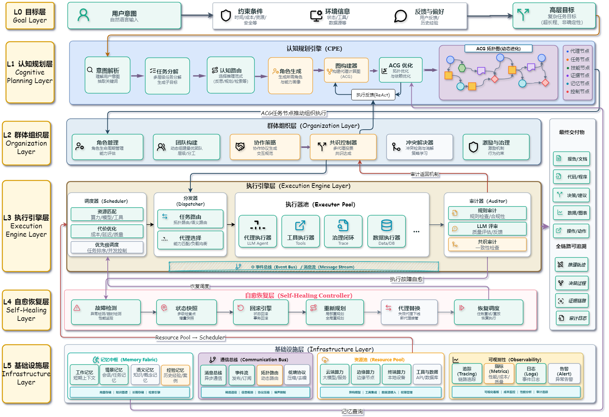
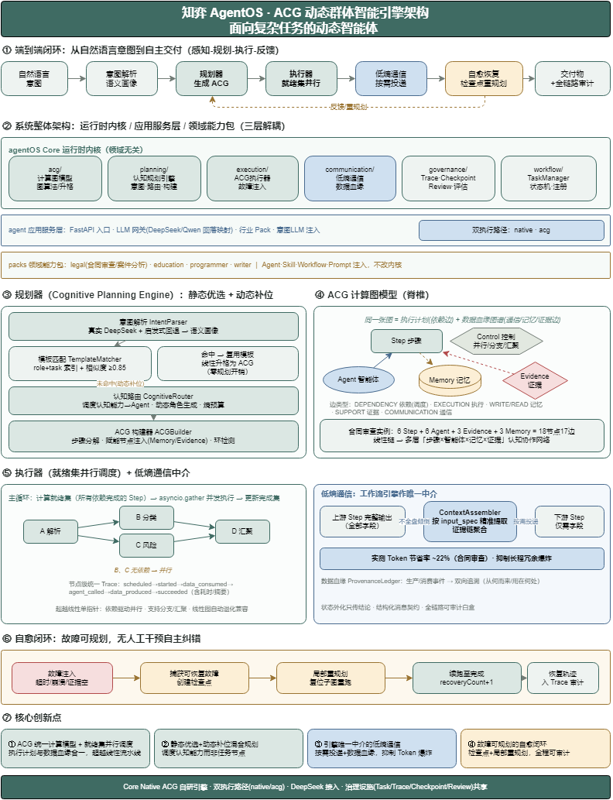

<p align="center">
  <picture>
    <source media="(prefers-color-scheme: dark)" srcset="docs/assets/brand/wreath-dark.svg">
    
  </picture>
</p>

<p align="center">
  
</p>

<p align="center">
  <strong>面向下一代 AI Agent 基础设施</strong><br>
  <sub>让多 Agent 在同一个可规划、可通信、可恢复、可审计的执行真源中完成复杂工作</sub>
</p>

<p align="center">
  <a href="#快速开始"></a>
  <a href="#核心特性"></a>
  
  
</p>

<p align="center">
  
  
  
  
  
</p>

---

## 简介

知弈 AgentOS 是一套**群体智能运行时操作系统**——当 AI 从单轮问答走向自主执行，复杂任务需要的不再是更长的上下文窗口，而是一个能描述、调度、通信、记忆和自我修复的工程运行时。

我们将问题定义为：

<p align="center">
  <em>给定自然语言任务目标、约束、风险与资源预算，如何即时构造一个可执行、可观察、可恢复、可审计的多智能体计算图？</em>
</p>

系统的核心答案是 **Agentic Computation Graph (ACG)**——一种将 Step、Agent、Skill、Memory、Evidence 和 Control 建模为有类型节点，将执行依赖、通信、控制、读写与支撑关系建模为不同类型边的统一中间表示。

当前版本由唯一的 `ExecutionRuntime` 承担执行真源：Planner 产出 Blueprint，Compiler 冻结 Package、合同与 Binding，ExecutionGraph 推进就绪集与并行超步，NodeRunner 装配最小 ContextPack 并提交引用；Checkpoint、Provenance、Decision 与 Identity V2 分别负责恢复、追溯、审计与查询投影。

---

## 为什么选择知弈？

现有技术范式面临三重结构性瓶颈：

| 瓶颈                           | 表现                                     | 知弈的解法                                                   |
| :----------------------------- | :--------------------------------------- | :----------------------------------------------------------- |
| **注意力稀释与记忆坍缩** | 单体智能体在超长上下文膨胀中遗忘关键信息 | 六类独立 Store + Checkpoint CAS + 引用式输出                 |
| **Token 冗余爆炸**       | 全连接广播式通信导致决策噪声级联放大     | Communication Broker：字段白名单 + 熵预算 + 最小 ContextPack |
| **缺乏动态路由与容错**   | 静态流水线面对异常只能从头重跑           | ACG 动态拓扑 + GraphPatch + 局部恢复与恢复配方               |

<p align="center">
  <strong>知弈的定位不是 LLM、RAG、多 Agent 等技术的简单叠加，而是通过统一运行时内核对各类能力进行封装、规划和调度。</strong>
</p>

---

## 核心架构

<p align="center">
  
</p>

<p align="center">
  <sub>六层能力视图：目标层 → 认知规划 → 群体组织 → 执行引擎 → 自愈恢复 → 基础设施；右侧为交付物与全链路可追溯能力</sub>
</p>

## 核心特性

<table>
  <tr>
    <td width="50%" align="center">
      <h4>Agentic Computation Graph</h4>
      <p>将复杂任务编译为有类型计算图。6 种节点类型（Step、Agent、Skill、Memory、Evidence、Control）和 6 种边类型（DEPENDENCY、COMMUNICATION、CONTROL_FLOW、READ/WRITE、SUPPORT、EXECUTION），让调度、通信、记忆和治理各司其职。</p>
    </td>
    <td width="50%" align="center">
      <h4>规划提交与图修订 (S01–S03)</h4>
      <p>规划不再直接改图：Planner 产出候选，PlanningCommit 负责持久化接受，GraphRevision 负责版本化修订，ActivationAuthority 负责唯一激活，CheckpointIdentity 负责恢复时的身份交接。</p>
    </td>
  </tr>
  <tr>
    <td align="center">
      <h4>字段级低熵通信</h4>
      <p>告别全连接广播。下游节点只声明自己需要的字段，Communication Broker 按字段白名单与熵预算投递最小 <code>ContextPack</code>，并同步记录生产者、消费者、字段、校验和与证据引用。</p>
    </td>
    <td align="center">
      <h4>引用式状态与六类 Store</h4>
      <p>Workflow、Checkpoint、Execution Value、Memory、Provenance、Decision 分库存储。Run DTO 只返回摘要与引用，正文通过 <code>outputRef</code> 解引用，长程状态不会被模型原文撑爆。</p>
    </td>
  </tr>
  <tr>
    <td align="center">
      <h4>自愈与断点恢复</h4>
      <p>故障或需求变化 → guarded runtime 分类与审计 → Checkpoint CAS → 恢复配方 / 契约修复 / 备用绑定 → 必要时 GraphPatch，保持同一 <code>run_id</code> 与引用归属继续执行。</p>
    </td>
    <td align="center">
      <h4>模型运行时治理</h4>
      <p>模型调用在冻结的 execution binding 下执行：能力与版本约束、异步健康刷新、主备 failover、key rotation、统一超时重试；<code>commitId</code> 在重试中保持不变并作为外部幂等键。</p>
    </td>
  </tr>
  <tr>
    <td align="center">
      <h4>端-边-云资源调度</h4>
      <p>ResourceProfile 分层画像、远程资源注册、资源级 HMAC 签名观测、观测序号校验、约束过滤、租约与快照版本确认、远程执行 Adapter，以及边缘失败后的云端重绑定。</p>
    </td>
    <td align="center">
      <h4>可视化与可审计</h4>
      <p>Milan 工作台提供 Run history、Graph、Trace、Provenance、Checkpoint、Review 与 Output 视图；高风险节点可进入 <code>WAITING_REVIEW</code>，审核后从原运行恢复，而不是回到任意历史检查点。</p>
    </td>
  </tr>
</table>

<p align="center">
  
</p>

<p align="center">
  <sub>ACG 引擎全景：端到端闭环、三层解耦、规划与编译、计算图模型、就绪集并行执行、低熵通信与自愈闭环</sub>
</p>

---

## 比赛背景

本项目参加**"挑战杯"全国大学生课外学术科技作品竞赛"揭榜挂帅"擂台赛**（题目编号：**XH-202631**），由荣耀终端股份有限公司发榜。

题目要求构建一种"具备全局动态任务编排以及自适应网络拓扑流转机制的智能体生态网络"，重点攻克超长周期下的上下文连续性保持、神经符号协同推理与低熵通信难题。

### 赛题交付物矩阵

| 赛题要求                     | 对应机制                                                                   | 状态 |
| :--------------------------- | :------------------------------------------------------------------------- | :--: |
| 超长程上下文连续性与记忆保持 | 六类 Store + Checkpoint CAS + Evidence Memory + 引用式输出                 |  ✅  |
| 动态异构拓扑与低熵通信       | ACG + conditional routing + 并行超步 + Communication Broker + Provenance   |  ✅  |
| 端-边-云异构资源自适应调度   | ResourceProfile + 资源注册 + 签名观测 + 租约 + 远程 Adapter + 云端重绑定   |  🚧  |
| 典型产业场景可运行系统验证   | Legal 合同审查黄金纵切；Programmer / Education / Writer / Industrial Packs |  🚧  |
| 异常/节点失效无人工干预恢复  | Checkpoint + 恢复配方 + 契约修复 + GraphPatch + review barrier             |  ✅  |
| 中间决策过程与推理轨迹展示   | Trace + Provenance + Checkpoint + Review + Output                          |  ✅  |

> 端-边-云目前完成的是**位置选择**基础链路；神经网络层级切分尚未实现，真实多设备部署与故障演示仍待验收。Legal 链路已完整，第二个高完成度跨领域长任务仍在推进。
>
> 完整方案文档：[比赛方案](docs/赛题与项目概述/比赛方案.pdf)

---

## 快速开始

### 前置条件

- **Windows 11** + Docker Desktop (Linux containers)
- 或 **Linux / macOS** + Docker
- Python 3.14（本地回归） · JDK 17（后端构建） · Node.js 18+（前端开发）
- Git

### Windows 一键部署

```powershell
# 1. 配置环境
Copy-Item .config/env/windows.example .env.windows
py -3 -m ops.scripts.infra.init_secrets .secrets/kinlin-win-dev-001

# 2. 配置模型 API Key（至少配置一个）
# 将 DeepSeek API Key 写入 .secrets/kinlin-win-dev-001/deepseek_api_key
# 或将 DashScope API Key 写入 .secrets/kinlin-win-dev-001/dashscope_api_key

# 3. 启动全栈服务
.\ops\scripts\infra\windows\up.ps1 -Build
```

打开 **http://127.0.0.1:8080**，首次使用自行注册账号。

常用运维命令：

```powershell
.\ops\scripts\infra\windows\status.ps1            # 服务健康状态
.\ops\scripts\infra\windows\logs.ps1              # 聚合日志
.\ops\scripts\infra\windows\preflight.ps1 -Full   # 发布前全量预检
.\ops\scripts\infra\windows\down.ps1              # 停止（保留数据卷）
```

### 前端热更新开发

```powershell
.\ops\scripts\infra\windows\up.ps1 -DebugPorts
Set-Location apps/frontend
npm ci
$env:DEV_BACKEND_PROXY_TARGET = "http://127.0.0.1:18080"
npm run dev
```

前端开发服务位于 **http://localhost:3000**，通过代理调用容器中的完整后端能力。

### Linux / macOS

```bash
cp .env.example .env
python3 -m ops.scripts.infra.init_secrets .secrets/kinlin-dev-local
export KINLIN_DEPLOYMENT_ID=kinlin-dev-local
export KINLIN_SECRETS_DIR="$PWD/.secrets/kinlin-dev-local"
./ops/scripts/dev.sh up
```

---

## 测试

```powershell
Set-Location apps/agentOS
py -3.14 -m pytest tests -q

Set-Location ../agent
py -3.14 -m pytest tests -q

Set-Location ../backend
mvn -B -ntp test

Set-Location ../frontend
npm ci
npm run test
```

### 当前套件规模

| 测试集                      |                         规模 | 覆盖范围                                                              |
| :-------------------------- | ---------------------------: | :-------------------------------------------------------------------- |
| AgentOS Kernel              |         **1730 cases** | ACG 节点/边模型、图执行、通信、记忆、恢复、规划提交、图修订、资源调度 |
| Agent Runtime / API / Packs |      见 `apps/agent/tests` | 规划器、通信器、执行器、领域 Packs、SSE 流式事件                      |
| Spring Gateway              | 见 `apps/backend/src/test` | 鉴权、安全契约、可观测性契约、架构守卫                                |
| Milan Frontend              |     见 `apps/frontend/src` | 视图、组件、状态与交互回归                                            |

### 最近一次完整收束基线（2026-08-19）

| 测试集                                      |                                                            结果 |
| :------------------------------------------ | --------------------------------------------------------------: |
| AgentOS Kernel                              |                                            **187 passed** |
| Python Application / Packs / AgentOS v2 API |                                 **102 passed**, 1 skipped |
| Spring Gateway                              |                                            **132 passed** |
| Milan Frontend                              |                            **24 files, 115 tests passed** |
| 五服务健康检查                              | frontend / backend / ai-service / postgres / redis 全部 healthy |

> 内核套件已从 187 项增长到 1730 项。代码变更后必须重新执行，历史数字不代表当前结果。

---

## 项目结构

```text
知弈 AgentOS
├── apps/
│   ├── agentOS/                # WKN 内核 — 唯一执行真源
│   │   └── src/
│   │       ├── runtime/        #   ExecutionRuntime / 身份生命周期
│   │       ├── components/     #   Planner / Executor / Communicator / Recovery
│   │       ├── storage/        #   六类 Store 与查询投影
│   │       └── support/        #   Packs / Skills / ACG 支撑结构
│   ├── agent/                  # FastAPI 运行时
│   │   ├── app/                #   Composition Root · API · 适配器
│   │   └── packs/              #   领域 Agent Pack (法律/教育/编程/写作/工业)
│   ├── backend/                # Spring Boot 业务与安全网关
│   ├── frontend/               # Vue 3 · Milan 工作台 + ACG 可视化
│   └── desktop/                # Tauri 2 桌面壳
├── contracts/                  # AgentOS v2 接口契约
├── benchmark/                  # 基准与冒烟脚本
├── tools/                      # 端-边-云演示 / 终端调试界面
├── ops/                        # Docker · 离线部署 · 预检与发布脚本
├── .config/                    # Compose 覆盖与环境模板
├── compose.yaml                # 唯一根目录 Compose 基线
└── docs/                       # 架构、开发记录与交付材料
```

---

## 文档

| 文档                                                                                                    | 说明                               |
| :------------------------------------------------------------------------------------------------------ | :--------------------------------- |
| [文档总索引](docs/README.md)                                                                             | 所有文档的导航入口                 |
| [当前架构图](docs/架构设计/kinlin-agentos-current-architecture.md)                                       | 请求链、执行内核、持久化与查询投影 |
| [核心代码层次](docs/架构设计/02-知弈AgentOS-Core代码层次架构图.md)                                       | 代码架构与模块边界                 |
| [ACG 引擎技术设计](docs/架构设计/05-ACG动态群体智能引擎技术设计.md)                                      | ACG 引擎深度设计                   |
| [律师 AgentOS 设计](docs/架构设计/06-知弈律师AgentOS技术设计文档.md)                                     | 合同审查验证场景                   |
| [Docker 基础设施 RFC](docs/架构设计/07-Docker基础设施重构RFC-v1.1.md)                                    | 单机部署底座的冻结设计基线         |
| [Prompt Runtime 改造记录](<docs/开发记录/Prompt%20Runtime%20提示词权威与审计改造实施记录-2026-09-18.md>) | 提示词权威、信任封装与审计身份     |
| [WKN-C4-Milan 稳定集成报告](apps/agentOS/docs/系统迁移档案/阶段迁移报告/WKN-C4-Milan稳定集成总结报告.md) | 三线收束证据                       |
| [部署说明](ops/deploy/DEPLOYMENT.md)                                                                     | 离线安装、升级、回滚与恢复         |
| [Secret 初始化](ops/deploy/secrets/README.md)                                                            | 外置 Secret 格式与轮换边界         |

---

## 路线图

|        状态        | 能力域                                                                                                                                                                                                                                                             |
| :-----------------: | :----------------------------------------------------------------------------------------------------------------------------------------------------------------------------------------------------------------------------------------------------------------- |
| ✅ **已实现** | 单一 `ExecutionRuntime` 与执行真源、ACG 动态拓扑与并行超步、低熵通信与 Provenance、六类 Store 与 `outputRef` 引用式状态、Checkpoint/恢复/契约修复/GraphPatch、S01–S03 规划提交与图修订协议、Milan 可视化工作台、Legal 黄金纵切、Windows Docker 开发与部署收口 |
| 🚧 **进行中** | 第二个高完成度跨领域长任务、数千步长程稳定性与 Token/耗时基准、浏览器级 `WAITING_REVIEW → approve → resume` 与真实模型/工具验收                                                                                                                                |
| 📋 **规划中** | 真实端-边-云多设备调度演示、模型层切分、生产级密钥轮换与资源凭据生命周期、核心算法伪代码与对照实验归档、演示视频与提交包校验                                                                                                                                       |

---

## 重要声明

- 知弈 AgentOS 当前是**比赛稳定候选与工程原型**，不等同于生产级商业系统。合同审查输出是辅助材料，不构成正式法律意见。
- 六类运行 Store 当前使用独立 SQLite 文件，这是单实例部署选择，不代表已完成生产级横向扩展。
- 端-边-云目前完成的是**位置选择**基础链路：画像、注册、签名观测、约束调度、租约、远程 Adapter 与云端重绑定。真实多设备、生产级密钥轮换与故障演示仍需在隔离环境验收。
- **没有实现神经网络层级切分**：一次模型调用仍由一个完整执行节点在单个资源上完成。
- 远程资源观测必须同时通过服务级内部 Token 与资源级签名；生产环境缺少主密钥时拒绝启动。
- 测试数字中，1730 为当前内核套件规模，187 / 102 / 132 / 115 为 2026-08-19 历史基线，代码变化后必须重新执行。

---

## License

MIT © 知弈 Team

---

<p align="center">
  <sub><em>天地之功不可仓卒，艰难之业当累日也。</em><br>
  下一阶段需要在更多场景、更大规模的测试中，诚实地验证这些设计假设哪些能站住，哪些需要重来。我们期待这个过程。</sub>
</p>

<p align="center">
  <sub>Made by 知弈 Team · 2026</sub>
</p>
