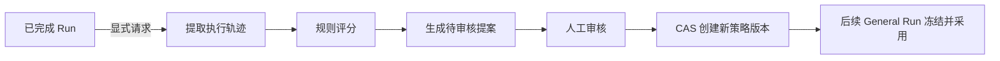

> 前半部分保留 2026-11-15 的现状分析，含迁移前文件路径；最新实现和能力边界见文末“2026-11-18 实施结果”。当前进化器和 SAFE 都位于 `src/components/`，核心测试位于仓库根 `TEST/tests/`。

目前实现的是**基于历史轨迹的受控策略演化**；自动调整图节点、边和拓扑的能力仍是 TODO。

**当前逻辑**



具体过程：

1. 从已完成的 Run 提取步骤、调度、记忆、输出、溯源和 checkpoint 引用，形成 `Trajectory`。
2. 规则评分：成功分根据完成状态判断；效率分根据错误步骤比例计算；新颖度固定为 **0**。
3. 当前真实运行路径固定提出：**将记忆 token 预算设为 768**，尚未根据评分自动寻找优化方案。服务默认要求 3 条轨迹，应用装配实际配置为 1 条。
4. 审核时校验基础版本、评分摘要及持久化提案一致性，再创建新版本。新 General Run 采用策略快照；回滚通过创建新版本恢复旧策略。

主要部件如下：

| 部件 | 当前职责与状态 |
|---|---|
| [contracts/evolution.py](/E:/Project/Kinlin_AI/apps/agentOS/src/contracts/evolution.py) | 定义轨迹、评分、策略变更、提案和版本合同 |
| [EvolutionService](/E:/Project/Kinlin_AI/apps/agentOS/src/components/evolution/service.py) | 已实现轨迹投影、评分、提案、审核和回滚 |
| [EvolutionStore](/E:/Project/Kinlin_AI/apps/agentOS/src/components/evolution/store.py) | 内存／SQLite 存储，保存证据、提案及策略版本，支持 CAS |
| [WorkflowRuntime](/E:/Project/Kinlin_AI/apps/agentOS/src/runtime/workflow_runtime.py:2346) | 提供运行入口；新任务读取策略，实际消费记忆预算配置 |
| [演化 API](/E:/Project/Kinlin_AI/apps/agent/app/api/agentos_v2.py:3686) | 查询版本、创建提案、审核及回滚 |
| [GraphEvolutionService](/E:/Project/Kinlin_AI/apps/agentOS/src/components/evolution/graph_service.py) | 图变更提案、校验、应用三个方法均未实现 |
| [SkillEvolutionService](/E:/Project/Kinlin_AI/apps/agentOS/src/components/evolution/skill_service.py) | 技能抽象、生命周期治理及选择均未实现 |

合同虽然列出了预算、技能偏好、能力路由、插入注册验证器四种变更，**目前明确接入运行时并产生效果的是记忆预算调整**。

**按照 SAFE 的逻辑梳理**

这里参照 [SAFE 的分层与依赖规则](/E:/Project/Kinlin_AI/apps/agentOS/src/safe/README.md:203)，建议将演化模块整理为以下职责；这是目标结构：

| 层 | 演化模块应承担的职责 |
|---|---|
| `contracts` | 统一轨迹、评估、策略提案、图提案、版本、审核回执及错误合同 |
| `domain` | 纯规则：评分、证据门槛、变更白名单、拓扑约束、提案状态机 |
| `ports` | 定义轨迹仓库、版本仓库、候选生成器、离线评测器和图版本发布接口 |
| `application` | 编排“收集证据 → 评估 → 提案 → 验证 → 审核 → 发布／回滚” |
| `infrastructure` | 实现 SQLite、模型调用、聚类、离线回放及审计存储 |
| `integration` | 将 AgentOS Run 转成轨迹，把批准结果交给正式策略／图版本入口 |
| `interfaces`／`bootstrap` | API 薄封装；显式装配存储、算法与权限依赖 |
| 公开门面 | 提供稳定的评估、提案、审核、发布入口 |

目前最需要收敛的三点：

- **拆开依赖**：`EvolutionService` 同时处理 Run 投影、领域规则和流程编排，还直接引用具体内存存储。按 SAFE，应分别放入 integration、domain、application，由 bootstrap 注入实现。
- **补齐发布事务**：策略版本创建与提案标记为已批准，目前是两次提交，应合并为原子事务，并提供可重放的发布回执。
- **逐步开放图演化**：先实现离线候选生成与基线对照评测，再校验拓扑、能力和预算，最后经审核发布新图版本。运行时图修订继续走现有正式修订入口。

实施顺序可以沿用 SAFE 的方式：**先冻结合同和边界 → 整理现有策略闭环 → 补离线评测 → 接图版本发布 → 验证后开放更多变更类型**。

## 2026-11-18 实施结果

共享合同仍唯一归属于 [contracts/evolution.py](../../contracts/evolution.py)；内部按 SAFE 的依赖方向拆分，保留旧入口。

```text
evolution/
├── policy.py                  轻量公开策略服务，必须注入存储
├── graph_service.py           轻量公开离线图服务，必须注入所需能力
├── service.py / store.py      历史构造器、Run 方法及存储导入兼容
├── application/
│   ├── policy.py              轨迹评估、策略提案、审核和回滚
│   └── graph.py               图候选、校验、离线评测和发布端口编排
├── domain/
│   ├── policy.py              评分、证据去重、变更、状态迁移和发布一致性
│   └── graph.py               图/证据绑定、受限变更、质量和成本门槛
├── ports/
│   ├── store.py               存储与原子审核事务协议
│   └── graph.py               候选生成、图校验、真实评测、正式发布协议
├── infrastructure/
│   ├── memory.py / sqlite.py  两种存储与发布回执
│   └── graph_candidates.py    重复失败证据驱动的验证器插入建议
├── integration/
│   ├── trajectory.py          Run → 轨迹，只投影引用和审核元数据
│   └── runs.py                兼容的 768 预算示例用例
└── bootstrap/policy.py        显式内存装配
```

`application → contracts/domain/ports`；`domain` 无 IO，`ports` 无具体实现。
`infrastructure` 实现端口；`integration` 适配 Run；`bootstrap` 创建实例。
包和 `policy.py` 导入不加载 SQLite 或 runtime。只有历史 `service.py` 兼容构造器允许组合默认存储和适配 Run，新应用装配已改用注入式 `policy.EvolutionService`。

### 策略发布

审核在同一内存锁或 SQLite `BEGIN IMMEDIATE` 中完成：重验提案/评估 → 保存新版本 → 切换活动指针 → 标记提案已批准 → 保存不可改写的发布回执。
任一步失败全部回滚。不同提案竞争同一基础版本只有一个成功；同内容、同审核人的重试复用已发布版本，不重复生效。换审核人或修改内容会冲突。

`EvolutionPublicationReceipt` 保存提案完整内容摘要、版本号、审核人和发布时间；`GET /agentos/v2/evolution/proposals/{proposal_id}/receipt` 返回该回执，未发布返回 404。
回执在 SQLite 重启后保留，后续回滚也不修改它。重试 `approve` 仍返回原版本号；若原版本已被替代，其 `status` 为 `superseded`，回执本身始终不变。
旧数据库保留原表和所有记录，增建回执表；不会为历史版本伪造回执。无回执的历史批准提案继续只读，不能自动重新批准。

重复轨迹不能凑足门槛，冲突证据拒绝覆盖；等价 JSON 对象的字段顺序不影响重放。空审核人、布尔值和非有限预算被拒绝。
现有 General Run 冻结策略快照和 768 token 示例兼容；768 仍是演示规则，评分的新颖度仍为 0，不代表已经实现自动策略搜索。

### 离线图演化

`RegisteredValidatorCandidateGenerator` 接收显式的 capability → 已注册验证器标识映射。
同一图版本至少达到证据门槛（默认 3 条不同来源轨迹），同一步骤在至少 2 个不同 Run 失败时，按失败数量和步骤标识确定性选出一个插入验证器建议；成功证据不会凭空产生候选。
真实 Run 投影以 `task.runId` 区分来源，同一 Run 的多个轨迹快照不能增加证据数。旧离线 DTO 缺少 runId 时以 trajectoryId 作为来源。

`GraphEvolutionService` 只接受 `registered_validator_insertion` 的非空受限变更；校验图身份、版本、目标步骤、证据与评分绑定后，委派注入的专业图校验器。
离线报告必须绑定提案完整指纹、评测器版本和配对样本；样本不能重用来源轨迹 ID 或 Run ID。
质量不得低于基线，成本不得超过基线乘显式上限（默认 1.0）。发布时重新调用可信评测器；若传入先前报告，要求与此次报告一致。
发布器负责主体授权、最新图版本 CAS、幂等回执，以及经过 TaskPlan/编译/正式版本入口发布；回执返回后还检查提案、图、版本和审核人绑定。

**实际能力边界：** 已实现候选生成算法和上述用例/门槛；生产图快照校验器、真实任务回放评测器和正式图版本发布适配器尚未接入，也未新增产品图发布 API。
端口测试使用显式测试替身，仅证明流程约束和委派，不证明生产拓扑优化效果。
缺少任何所需依赖时抛出 `NotImplementedError`，不会返回假评测、假发布或直接修改运行中执行图。
Skills 抽象与生命周期服务仍为显式未实现；现有运行时 GraphRevision/GraphPatch 权威继续独立存在。

新代码用法：

```python
from components.evolution.policy import EvolutionService
from components.evolution.infrastructure.sqlite import SQLiteEvolutionStore

store = SQLiteEvolutionStore("data/evolution.sqlite3")
try:
    service = EvolutionService(store=store, proposal_threshold=3)
    # service.propose(trajectories, mutation) → 待审提案
    # service.approve(proposal, approved_by=trusted_reviewer) → 策略版本
    # store.get_receipt(proposal.proposal_id) → 不变的发布回执
finally:
    store.close()
```

测试与故障注入记录见 [实施报告](../../../../../docs/superpowers/reports/2026-11-18-evolution-safe-layers.md)。
