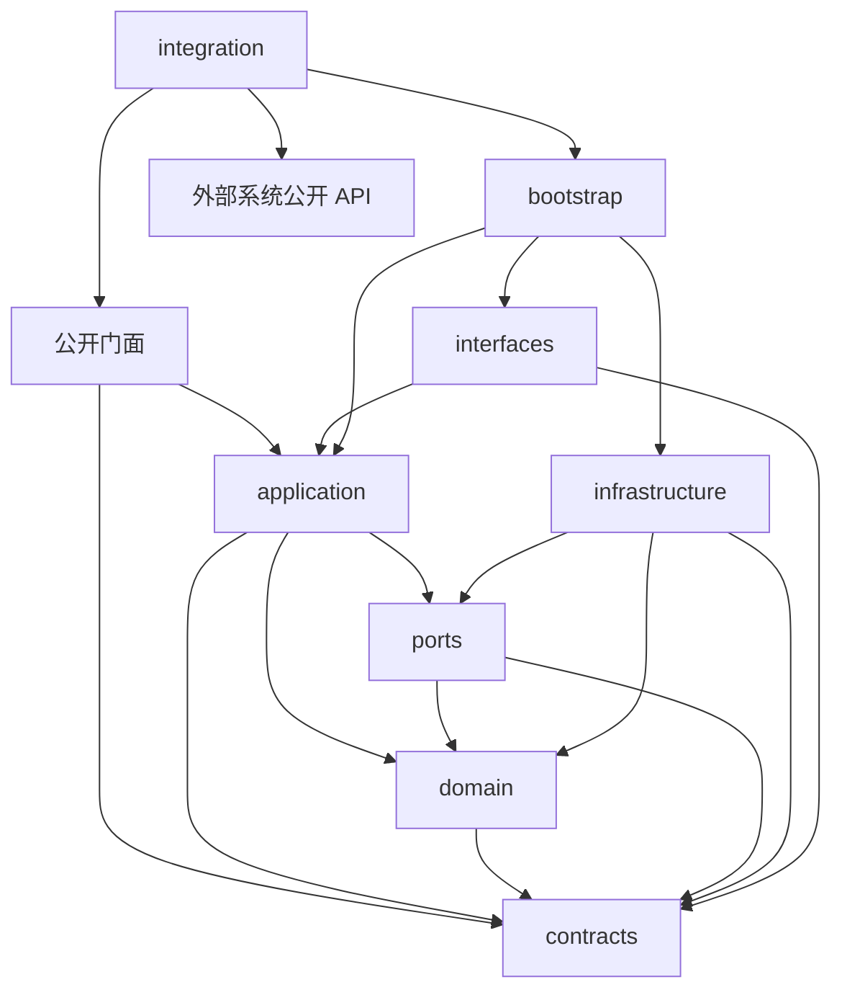

# Safe 模块

`apps/agentOS/src/safe` 是端侧/云侧模型协作模块。它承载拆分推理的合同、模型前后段执行、激活值传输、隐私策略和会话生命周期。AgentOS 和应用层通过公开入口接入，不直接访问模型、数据库和网络实现。

本 README 是模块目录与依赖边界的设计基线，更新于 2026-11-15。目标是让后续工作在既定分层中扩展；新模型、编码格式和存储实现通过新增适配器接入。文件位置和公开 API 应保持稳定，模型算法、协议版本及隐私参数仍须依据实验修订，不能把目录稳定等同于技术方案永不变化。

2026-11-14阶段更新：已完成 `ManifestService` 的canonical身份核验、`ActivationService` 的受信会话/manifest/phase/位置/shape校验，以及 P3 单进程会话事务基线。`ActivationContext` 必须来自受信会话，摘要来自批准配置；`SessionService` + `MemorySessionStore` 已覆盖 owner 隔离、严格 step、60秒空闲 TTL、300秒绝对 TTL、请求幂等、终态和 runner 异常失败。会话存储可注入 `ModelRunner`，分配不透明 KV 句柄并在关闭/失败/过期时释放；释放失败会保持终态并允许清理重试。此时尚未接通真实 KV 前向；后续进展见下文，仍不能直接发布为云端服务。后续按完整功能分阶段提交，保留各次验收证据。

同日真实模型进展：已实现离线Qwen2角色导出、独立CPU FP32/eager prefix/suffix prefill，并完成20×16步无KV基线和KV缓存对照；KV评估20条中英文合成输入×16步共320个logits，greedy `320/320` 一致，最大绝对误差为0。基线和KV验证记录分别见[真实模型报告](../../../../docs/superpowers/reports/safe/2026-11-14-qwen-prefill.md)和[KV续算报告](../../../../docs/superpowers/reports/safe/2026-11-14-qwen-kv.md)。KV runner 与完整模型的 `DynamicCache` oracle 使用 `atol=1e-5, rtol=1e-4`，并单独记录与无KV全序列重算的数值差异。网络、认证和DP仍未接通，`SplitInferenceService` 和隐私发布服务仍明确不可用。下方“骨架当前状态”表保留创建日记录，新增能力以本节带日期报告为准。

## 当前状态

2026-11-15验证与加固：新增回执提交失败、同步取消、执行超出绝对TTL、清理失败隔离和执行中重入保护。Qwen两角色在层前向、有限值检查或返回值转换失败时使对应KV句柄失效，避免复用部分推进的状态。联合回归78项、数据流脚本18项通过；真实模型20×32缓存oracle对照640次logits误差为0、greedy全部一致。最新命令、结果与能力边界见[本轮报告](../../../../docs/superpowers/reports/safe/2026-11-15-session-failure.md)。下表含早期骨架状态，具体已实现能力以带日期的验证记录为准。

2026-11-15后段用例：`ContinuationService` 已连接可信会话位置/KV、激活校验、suffix prefill/decode、greedy/EOS和幂等token回执。每会话最多32次输出、最多160位置，EOS或输出上限关闭会话并释放后段KV；错误后的部分推进状态不允许重用。联合回归112项和数据转换18项通过；真实权重验证结果、复现命令和装配示例见[后段闭环报告](../../../../docs/superpowers/reports/safe/2026-11-15-continuation.md)。

2026-11-15本机用例：已实现注入式 `SplitInferenceService`、批准制品离线 `HuggingFaceTokenizer` 和显式研究装配 `InProcessTransport`。本机负责固定模板/128 token限额、前段KV、输出32 token上限与整段文本解码；超时只查询已提交回执，不盲目重发。默认无配置仍拒绝执行，单实例只允许一个活动生成；同步调用间支持协作取消。完整EOS集合读取自已校验的generation配置，不启用其中的随机采样配置。联合回归139项通过，详见[本机用例报告](../../../../docs/superpowers/reports/safe/2026-11-15-local-generation.md)。

目前已有进程内及认证 HTTPS 本机/后段生成用例；产品接口、DP发布与持久预算仍待实现。下表按当前代码状态维护，历史阶段报告单独保留。

同日本机对照实验：Qwen2.5-0.5B、K=2/24、CPU FP32，20条合成输入×3轮，60组生成共1,146个token与完整模型全部一致。本机拆分路径的配对首token/TPOT耗时比中位数为1.24×/1.40×；当前参考实现尚无加速。已输出3组中文300 DPI PNG和矢量PDF，包含延迟分布、组件耗时和激活上传量；配置、原始CSV、统计口径和能力边界见[实验报告与图像](../../../../docs/superpowers/reports/safe/experiments/2026-11-15-local-generation/README.md)。

网络扩展分析复用同一组实测计算路径，在 1000 Mbps/0.2 ms 到 5 Mbps/80 ms 的六个情景下叠加请求—回执通信，输出360条记录和带宽×RTT热力图；两端情景的端到端中位数分别约1.14秒和2.88秒。该结果使用256 B回执假设，属于通信敏感性模型，不是公网测量；公式、校验规则、图像与复现命令见[网络敏感性报告](../../../../docs/superpowers/reports/safe/experiments/2026-11-15-network-sensitivity/README.md)。

同日认证传输更新：`HmacAuthenticator`、`HttpRemoteTransport`、`create_cloud_app`、`create_http_cloud_app` 已接通专用 HTTPS 端口。请求签名绑定最终正文、方法、路径、凭据、UTC时间和一次性 nonce；owner 从凭据源读取。服务具备有界正文/并发/会话记录、严格 JSON、后台 TTL 清理及停机请求排空；客户端校验证书与主机名，不跟随重定向、不使用环境代理、不自动重发 step。独立后段进程的真实 TLS 回环实验与图像入口见 `evals/safe/exam/verify_https_transport.py`、`gen_fig_https_transport.py`；范围仍为 CPU/FP32 单进程后段研究服务。

已完成20条输入×3轮真实HTTPS配对：60/60组、792/792 token一致，62个后段KV全部回收；独立规格/质量审查通过，362项回归与18项数据转换通过。输出两组中文300 DPI PNG与矢量PDF，数据、统计口径及复现命令见[HTTPS回环实验](../../../../docs/superpowers/reports/safe/experiments/2026-11-15-https-loopback/README.md)。回环仍比完整本地模型慢，不作公网或DP结论。

2026-11-16持久防重放更新：新增SQLite nonce适配器。它以独立版本化文件保存消费记录和UTC高水位，支持同机多进程争用及重启保留；认证存储和模型同步在线程池执行。84项适配器、9项独立进程/双HTTP实例集成、59项认证IO/HTTP/生命周期测试及Safe全回归457项通过。数据库删除、损坏、回滚、锁超时和跨主机使用均固定拒绝，不能把此能力扩展为跨主机一致性或DP保证。

| 内容 | 当前状态 | 说明 |
| --- | --- | --- |
| 旧 `encryptionservice.py` | 已删除 | 新拆分推理路径不依赖旧参数扰动或同态加密占位。 |
| `../contracts/model_partition.py` | 已有合同 | 校验层区间连续、层放置和相邻张量边界；当前仍在核心 `contracts` 路径。 |
| `../components/model_partition/service.py` | 仅有验证/拒绝 | `execute()` 当前明确抛出 `MODEL_PARTITION_UNAVAILABLE`，没有真实模型执行。 |
| 七个公开门面、`contracts/`、`ports/` | 已创建轻量入口、初版严格合同和部分 Protocol | 合同只定义一次；执行/事务接口及 wire schema 仍待 P1/P2 实验冻结。 |
| FP32 codec、形状边界、会话迁移/step/幂等规则、全局 L2 裁剪 | 已实现并有基础测试 | 仅独立基础能力；裁剪不构成 DP，摘要不构成认证。 |
| `ContinuationService`、`GreedySampler` | 已接通进程内后段用例 | 仅收激活，返回单token；无状态greedy支持可信EOS集合、有限logits和词表校验，并列取最小索引。 |
| `SplitInferenceService` | 显式注入后可用，无配置拒绝 | 本机非流式生成、回执身份校验、未知结果拒绝重发、取消与双端清理；产品网关入口待接入。 |
| `HuggingFaceTokenizer`、`InProcessTransport` | 已有离线适配器与进程内JSON装配 | 完整EOS集合、固定模板；后段装配始终使用同一个suffix实例；循环传输不等于跨网络认证。 |
| 隐私发布服务 | 仍明确拒绝执行 | 抛出 `PRIVACY_UNAVAILABLE`，裁剪与哈希不能替代激活DP。 |
| P3 `SessionService` + `MemorySessionStore` | 已连接真实suffix及认证HTTP，有并发/TTL/幂等/KV生命周期测试 | 位置在会话锁内从存储构造，回执提交后才推进；短时状态不持久化，不保存原始prompt。 |
| Qwen2 prefix/suffix KV decode与角色制品 | 已实现离线导出、校验、双角色DynamicCache和数值对照 | KV不跨激活边界传输；CPU FP32/eager；公网、GPU与吞吐仍待验收。 |
| 认证、HTTP客户端/API、云端工厂 | 已接通显式装配与独立进程 TLS 回环 | HMAC防重放、凭据撤销、HTTPS、有界会话、TTL、停机排空；不等于生产部署。 |
| 预算存储、产品接入 | 中文职责/TODO/验收骨架 | DP发布/账本和产品网关尚未实现。 |

现有联邦学习和差分隐私代码属于旧的参数聚合域。它们没有接入拆分推理的激活传输链路，不能复用为安全证明、隐私预算记账或 DP-SGD 实现。

## 认证传输的装配与边界

HTTP依赖单独安装，不改变默认Agent安装包：

```powershell
apps/agentOS/.venv-safe/Scripts/python.exe -m pip install --require-hashes -r apps/agentOS/requirements.safe.http.lock
```

调用 `safe.bootstrap.cloud.create_http_cloud_app` 时显式注入批准的 suffix runner、FP32 codec、greedy sampler、manifest、批准摘要和 `CredentialSource`。返回 ASGI 应用，须使用 lifespan 启停，并在服务器上配置 TLS；工厂不监听端口，也不关闭调用者的模型。客户端使用 `safe.infrastructure.transport.http_client.HttpRemoteTransport`，注入批准的 HTTPS origin、凭据及可选的受信 CA 上下文。临时证书仅由实验脚本生成。

| 方法与路径 | 内容 |
| --- | --- |
| `GET /safe/v1/capabilities` | 经过认证的服务能力 |
| `POST /safe/v1/sessions` | 仅提交 `manifest_digest`，不允许自报 owner |
| `POST /safe/v1/sessions/{sid}/steps` | 既有 `StepRequest`，上传激活并返回单 token 回执 |
| `GET /safe/v1/sessions/{sid}/requests/{rid}` | 查询已提交回执；尚无回执为 `null` |
| `DELETE /safe/v1/sessions/{sid}` | 关闭会话，终态重复关闭返回原视图 |

所有请求均签名。签名域为 `SAFE-HMAC-SHA256-V1`，覆盖凭据 ID、规范方法与路径、UTC秒、nonce和正文SHA256；密钥至少32字节。请求 ID、会话 ID 在 HTTP 路径中仅允许字母、数字、`_`、`-`，长度1–128。正文仅UTF-8 JSON；重复键、未知字段、非有限数、重复头、CL/TE冲突和编码歧义均拒绝。默认正文最多12 MiB，step元数据最多16 KiB；客户端响应默认最多64 KiB。

云端工厂默认最多128条会话记录、每owner一个活跃会话、8个在途请求。终态回执保留到会话绝对TTL（默认300秒）再回收，空闲TTL默认60秒；容量不足直接拒绝。维护失败撤销就绪；停机先关闭准入、等待已准入请求及同步计算交还执行权，最后释放KV。同步runner永久阻塞时，应用不能保证有界停机；部署侧需隔离进程，不能直接释放在用KV。

nonce存储默认仅在当前进程内，认证时窗为±60秒；时钟回拨期间拒绝认证直到恢复。需要重启保留或同机多worker共享防重放时，使用 `safe.infrastructure.storage.sqlite_nonces.SqliteNonceStore`：先用 `SqliteNonceStore.create(path)` 初始化一次，再由每个实例以同一容量配置打开已有文件。它只接受专用版本化结构，文件丢失、损坏、锁超时、回滚或配置不一致均固定拒绝，不自动重建；高水位和消费在SQLite事务中持久化。该适配器只保证可信单机文件，不保证跨主机/网络文件系统一致性，数据库替换或回滚后必须轮换凭据。凭据由调用者安全保存并注入，每次请求读取撤销状态；浏览器不持有长期密钥。直接TLS运行时禁用反向代理scheme伪装；若未来部署代理，须另立可信边界配置与验收。

HMAC依据 [RFC 2104](https://www.rfc-editor.org/rfc/rfc2104)，HTTP消息长度约束参考 [RFC 9112 §6.3](https://www.rfc-editor.org/rfc/rfc9112#section-6.3)；具体协议由本模块实现，不从论文复制未审查的服务代码。TLS保护链路，激活仍可能被受信后段分析；DP、反演评估和持久隐私账本均未因此实现。

## 模块边界

第一阶段只做“本地前导网络 + 云端后续网络”的拆分推理：

```text
用户原始输入
  └─ 本机 tokenizer / embedding / 前 K 层
       └─ 受限、认证的中间激活边界
            └─ 云端其余层 / norm / lm head
                 └─ token 回执
```

`safe` 负责合同、执行与安全边界；以下职责属于外部调用方或明确未开放的能力：

- AgentOS 的 Mission、Run、Planner 或执行授权；
- 普通聊天 API 的 prompt 组装和供应商路由；
- 任意模型下载、任意 Python 模型代码执行或动态切点；
- 把中间激活直接当作“匿名数据”；
- 将无噪声激活传输标记为已经满足差分隐私。

## 完整目标目录

以下树中的源文件已经创建。尚未实现的文件包含中文职责、依赖、实施顺序和验收条件，使用空导出列表明确不提供运行能力；没有以空类、假回执或随机结果冒充实现。每个 Python 子包均有显式 `__init__.py`，树中省略重复展示。逐文件状态见[骨架交付报告](../../../../docs/superpowers/reports/safe/2026-11-13-scaffold.md)。

根目录保留用户确定的七个名称作为公开门面。合同定义只存在于 `contracts/`；门面负责导出稳定 API，不复制模型定义，也不在导入时创建模型、网络客户端、数据库或全局服务。

```text
safe/
├── README.md
├── __init__.py                  # 最小包入口；不自动装配，不通配导入
├── inference.py                 # 主入口：合同导出、推理服务公开类型
├── activation.py                # 激活编码/校验公开入口
├── manifest.py                  # 制品校验与兼容性公开入口
├── privacy.py                   # 隐私策略与出站发布公开入口
├── privacy_ledger.py            # 预算预留/消费/查询公开入口
├── session.py                   # 会话生命周期与步骤回执公开入口
├── transport.py                 # 远端能力发现、传输和查询公开入口
│
├── contracts/                   # 纯数据与协议，无 IO 和重依赖
│   ├── base.py                  # 严格不可变合同基类、摘要与标识约束
│   ├── inference.py             # 推理请求、生成选项、结果与能力声明
│   ├── activation.py            # 激活信封、dtype/shape、编解码元数据
│   ├── manifest.py              # 模型身份、层切分、制品与兼容描述
│   ├── privacy.py               # 邻接定义、profile、release、隐私回执
│   ├── session.py               # 会话视图、phase、step 和结果回执
│   ├── identity.py              # 经认证主体、作用域、授权凭据引用
│   ├── events.py                # 进度/结束/失败事件及无内容审计事件
│   ├── errors.py                # 稳定错误码与安全错误结构
│   └── model_update.py          # 方向 B 预留：适配器/参数更新制品合同
│
├── domain/                      # 可独立测试的纯规则，不访问外部状态
│   ├── compatibility.py         # 模型版本、切口、前后段与格式兼容判定
│   ├── activation_policy.py     # 张量形状、元素数、字节数和有限值规则
│   ├── session_state.py         # 状态迁移、步骤顺序和终态规则
│   ├── idempotency.py           # owner/session/request 与载荷身份匹配
│   ├── privacy_policy.py        # profile 与发布范围、邻接/裁剪规则
│   └── budget.py                # 预算预留/消费规则与组合结果校验
│
├── ports/                       # 注入的外部能力接口；不导入具体实现
│   ├── model_runner.py         # prefix/suffix、采样、KV handle 生命周期
│   ├── activation_codec.py     # 受限张量编码/解码接口
│   ├── artifact_store.py       # 批准制品的读取、校验与显式离线导出接口
│   ├── session_store.py        # 会话互斥、原子步骤及回执存取
│   ├── budget_store.py         # 原子预算预留、发布去重与恢复
│   ├── privacy_mechanism.py    # 校准噪声、裁剪和组合会计的接口
│   ├── remote_transport.py     # capabilities、session、step 与结果查询
│   ├── credentials.py          # 主体验证、凭据读取/撤销与 nonce 消费
│   ├── audit.py                # 仅允许结构化白名单元数据的审计接口
│   └── clock.py                # 单调时钟/过期时钟，便于故障与 TTL 测试
│
├── application/                 # 用例编排，依赖 ports，不依赖框架
│   ├── inference.py            # 本机 tokenize/prefill/decode、输出事件
│   ├── continuation.py         # 云端 suffix 执行与 token 回执
│   ├── activation.py           # 编解码调用、载荷检查与出站信封
│   ├── manifest.py             # 制品身份/兼容核验与显式导出用例
│   ├── privacy.py              # 发布前预留预算、扰动、固定载荷与回执
│   ├── privacy_ledger.py       # 多会话预算用例与崩溃恢复
│   ├── session.py              # 创建/逐步执行/查回执/取消/过期清理
│   └── model_update.py         # 方向 B 预留：个人适配器上传/撤回用例
│
├── infrastructure/              # 外部依赖与真实 IO 实现
│   ├── models/
│   │   ├── torch_runner.py     # Torch 执行上下文、设备与 dtype 生命周期
│   │   ├── qwen.py             # 首个受控架构：embedding、层、RoPE、KV
│   │   ├── tokenizer.py        # 固定 tokenizer、模板、增量文本解码
│   │   └── sampling.py         # greedy / 会话独立 RNG / EOS 规则
│   ├── artifacts/
│   │   ├── local_store.py      # 受限本机制品目录与哈希核验
│   │   ├── export.py           # 显式离线分片导出、tied weights 与制品清单
│   │   └── safetensors.py      # 角色权重读取；不执行远程模型代码
│   ├── codecs/
│   │   └── fp32.py             # 有界 little-endian FP32/base64 实现
│   ├── storage/
│   │   ├── memory_sessions.py  # 临时会话、步骤锁和幂等回执
│   │   ├── sqlite_budget.py    # 持久预算、原子预留、release 去重
│   │   └── schema.py           # 模块自有 schema 版本与显式升级
│   ├── privacy/
│   │   ├── clipping.py         # 整个激活向量的全局范数裁剪
│   │   ├── gaussian.py         # 已校准机制、数值边界、安全随机源
│   │   └── accountant.py       # 固定版本的多轮/自适应发布组合会计
│   ├── transport/
│   │   └── http_client.py      # 固定端点、TLS、连接池、超时与重试
│   ├── security/
│   │   ├── authentication.py   # 云端主体绑定、凭据/nonce 校验
│   │   ├── signing.py          # 协议 canonical request、签名与验签
│   │   └── encryption.py       # 标准库/审核依赖的密码学实现
│   ├── audit/
│   │   └── structured.py       # 白名单审计、去敏与输出 sink 适配
│   └── legacy/
│       └── encryption.py       # 隔离旧算法和 fallback，仅供旧调用方
│
├── interfaces/                  # 入站适配；框架类型止于这一层
│   ├── local_api.py            # 本机推理/状态/取消接口与事件流
│   ├── cloud_api.py            # 专用激活协议路由、限流和 body 上限
│   ├── http_errors.py          # 稳定错误码到 HTTP 状态的唯一映射
│   └── cli.py                  # 显式制品导出、验证、benchmark 入口
│
├── integration/                 # 外部系统到 safe 的适配边界
│   ├── agentos.py              # 分区计划、资源能力与 safe DTO 的转换
│   └── agent_app.py            # 本机可信身份/配置、生命周期和事件转换
│
└── bootstrap/                   # 唯一装配入口，不承载业务规则
    ├── settings.py             # 配置、限额、路径与 feature flag 校验
    ├── local.py                # 创建本机 runner、预算账本、远端客户端
    ├── cloud.py                # 创建云端 suffix、认证与短时会话服务
    ├── cli.py                  # 装配导出/验证用例后调用无副作用 CLI
    └── lifecycle.py            # 连接、任务、KV、模型的关闭和失败清理
```

方向 B 的两个 `model_update.py` 已创建中文 TODO 预留文件，未定义或开放上传能力。未来的制品校验/传输实现分别扩展 `artifacts/`、`transport/`，训练、聚合和投毒防护必须另写设计，不预先塞进推理状态机。

### 七个公开入口的职责

| 入口 | 对外内容 | 内部唯一归属 |
| --- | --- | --- |
| `safe.inference` | `InferenceRequest`、`GenerationOptions`、`InferenceResult`、`SplitInferenceService`、错误类型；可重导出常用 DTO | DTO 在 `contracts`，推理用例在 `application.inference` |
| `safe.activation` | `ActivationEnvelope`、激活校验/编解码服务 | 规则在 `domain`，流程在 `application.activation`，字节格式在 `infrastructure.codecs` |
| `safe.manifest` | `SplitModelManifest`、制品核验服务 | 数据在 `contracts.manifest`，兼容规则在 `domain.compatibility` |
| `safe.privacy` | `PrivacyProfile`、`PrivacyReceipt`、出站发布服务 | 规则在 `domain.privacy_policy`，发布用例在 `application.privacy` |
| `safe.privacy_ledger` | 预算预留、已发布消费、余额查询服务 | 规则在 `domain.budget`，用例在 `application.privacy_ledger`，持久化在 `sqlite_budget` |
| `safe.session` | 会话视图、状态、步骤回执与 `SessionService` | 状态机在 `domain.session_state`，存储/锁经 port 注入 |
| `safe.transport` | 远端 transport 协议、能力/回执 DTO 和稳定错误 | HTTP 实现在 `infrastructure.transport.http_client`；门面不创建客户端 |

表中的服务名称是后续 API 基线；当前门面只导出已经定义的合同、部分端口及明确拒绝的推理/发布服务，不提前导出其余未实现服务。端口目前也只冻结已列出的方法，不代表事务或模型执行签名已完整。`manifest` 的定义只有一份：`inference.py` 从 `contracts.manifest` 重导出，相同类型不能在两个门面分别定义。

### 中文 TODO 的阅读顺序

TODO 编号与配套方案一致：P0 可行性与版本冻结 → P1 合同/协议/认证 → P2 前后段 prefill → P3 逐 token 会话 → P4 隐私/账本/反演评估 → P5 产品接入 → P6 性能/交付。`B1` 表示方向 B 的独立后续设计。文件内编号是该阶段的本文件子任务，不是新的全局阶段。

每个运行骨架写明职责、步骤、失败处理和验收条件；尚未实现的模块使用空导出列表明确拒绝运行。P3 已通过 `ContinuationService` 连接后段事务，并由注入式 `SplitInferenceService` 编排本机生成；认证云端接口仍未接通，进程内闭环不代表网络或隐私能力完成。

当前基础用法（在 `apps/agentOS` 目录、`src` 位于 `PYTHONPATH` 时）：

```python
from safe.activation import ActivationEnvelope  # 与 contracts 中为同一类型
from safe.infrastructure.codecs.fp32 import FP32Codec  # 实现由装配层选择

codec = FP32Codec()
envelope = codec.encode([1.0, -2.0], (1, 1, 2))
assert codec.decode(envelope) == (1.0, -2.0)
```

该示例只验证字节往返。`FP32Codec` 不核验 owner、manifest、phase、位置、认证或隐私回执，不能直接充当安全传输接口。`InferenceRequest` 包含本机原文，禁止用于云端请求；`StepRequest` 才是云端合同的初版位置。现有字段尚缺完整位置/profile/回执绑定，**尚不可冻结为对外 wire protocol**。

### 依赖方向与导入规则



箭头从调用方指向允许导入的被依赖层；下表是依赖检查的精确定义。

| 层 | 允许的模块内依赖 | 不允许的依赖 |
| --- | --- | --- |
| `contracts` | 其他合同、stdlib、Pydantic | IO、Torch、HTTP/DB 框架、AgentOS 核心 |
| `domain` | `contracts`、其他纯规则 | `ports`、`application`、任何基础设施 |
| `ports` | `contracts`、必要的领域值类型、typing | 实现类、框架类型、数据库连接和模型对象 |
| `application` | `contracts`、`domain`、`ports` | `infrastructure`、`interfaces`、`bootstrap`、AgentOS 核心 |
| `infrastructure` | `contracts`、`domain`、`ports`、相应第三方库 | 用例编排、AgentOS Runtime/Store；通过 duck typing/Protocol 实现 port |
| `interfaces` | `application`、`contracts`、HTTP 框架 | 直接加载模型、直接开数据库、直接调用 AgentOS |
| 公开门面 | `contracts`、`application`、`ports` | `bootstrap`、重依赖实现、跨门面循环导入 |
| `bootstrap` | 内部所有装配所需层 | Mission/Run 等业务规则、模块外数据库表 |
| `integration` | 公开门面、`bootstrap`、外部系统的公开 API | 让外部对象反向进入领域层、越过外部授权入口 |

工程导入名统一为 `safe.*`，通过现有 `apps/agentOS/src` 搜索路径使用。后续打包应分配独立 distribution 名以避免第三方同名包冲突，不同时使用 `safe.*` 与 `apps.agentOS.src.safe.*` 加载同一文件。当前遗留调用仍使用后者，应在兼容迁移阶段统一，避免产生两份全局实例。

`safe/__init__.py` 和七个门面导入成功时，不得要求安装 Torch、Transformers、FastAPI、httpx 或数据库驱动，不得创建密钥、网络连接、线程和目录。`bootstrap.local` / `bootstrap.cloud` 在显式调用工厂时再装配角色所需实现；`settings` 不在 import 阶段读取并缓存全局配置。

### 两端部署与资源归属

| 对象 | 负责方 | 保存位置与释放时机 |
| --- | --- | --- |
| 原始输入、分词结果与用户历史 | 本机 `application.inference` | 本机请求范围，不进云端请求或审计 |
| prefix 权重、前 K 层 KV | 本机 runner | 权重随角色进程；KV 随会话终态/过期释放 |
| suffix 权重、其余层 KV | 云端 runner | 不加载 prefix；KV 同样仅短时保存 |
| 传输 DTO、已扰动激活字节 | 发布用例和 transport | 限额内短时保留；同一次重试复用字节，终态释放 |
| step、锁与结果回执 | `application.session` + `memory_sessions` | 会话有效期内保存，重启后旧会话失效 |
| 隐私预算与 release 记录 | 本机 `privacy_ledger` + SQLite | 跨会话/跨重启保留，关闭会话不退款；不存原文/KV |
| 云端主体、凭据与 nonce | 云端认证实现，来源经配置注入 | 凭据外置；nonce 独立消费，与 step 幂等分开 |
| 模型制品、manifest 与哈希 | `artifact_store` | 安装/导出时准备，运行只从批准目录读取 |

本地装配不创建 suffix，云端装配不创建 prefix、用户 tokenizer 流程或本机预算数据库。两端共同使用相同版本的纯合同。runner port 用 opaque KV handle 表达状态，不能把 Torch tensor、CUDA stream、HTTP Request 或 SQLite connection 放进 Pydantic DTO。

每个请求有端到端 deadline；网络断连不等于 GPU 工作已停止。`lifecycle` 与 runner 必须等待或隔离仍在执行的工作后释放会话，状态不确定时进入 FAILED，不重用可疑 KV。

### 路径、依赖和版本管理

- 配置、manifest、wire protocol、privacy profile 和预算 schema 分别有版本，不能用单一“模块版本”代替兼容检查。
- 数据目录由 `bootstrap.settings` 注入，默认位于应用数据根的 `safe/`：`artifacts/`、`privacy/budget.sqlite3`；临时会话只在内存。代码目录不存权重、数据库、激活或真实密钥。
- 新模型新增 `infrastructure/models/<architecture>.py`，新编码新增 `infrastructure/codecs/<format>.py`，新存储新增 `infrastructure/storage/<backend>.py`；由 manifest/capability 白名单明确启用，不按请求动态 import。
- DP库仍为待选的可选依赖；Torch/Transformers是模型角色的可选依赖。`apps/agentOS/requirements.safe.in` 已固定CPU参考依赖，`requirements.safe.lock` 已从实际wheel生成SHA256平台锁并在全新环境验证。仅支持本轮验收的Windows x64/Python3.10；新平台/后端须单独锁定。轻量门面导入仍不要求模型依赖，文件放在应用根而非 `src/safe` 内。
- CLI 由 `bootstrap.cli` 显式注入制品/推理用例；`interfaces.cli` 只解析参数、调用注入用例和输出报告，不绕过 application 直接操作模型或数据库。配置拒绝任意网络下载地址与可执行模型代码。
- 批处理、动态切分、跨设备调度、联合训练和权重聚合需要独立能力协议；不能通过任意 `metadata` 或额外 JSON 字段绕开协议演进。

### 测试、工具和资料目录

```text
apps/agentOS/tests/safe/
├── contracts/                  # DTO、版本和恶意输入
├── domain/                     # 状态、预算、兼容性、幂等纯规则
├── application/                # fake ports 的用例与错误分支
├── infrastructure/             # codec、DB 原子性、HTTP、认证、审计
├── architecture/               # 禁止依赖、轻量导入与公开类型一致性
├── integration/                # 两进程续算、双端 KV、故障、跨 owner
└── models/                     # 显式启用的真实模型 logits/token 对照

apps/agent/tests/test_safe_local_api.py  # P5 接入时创建，当前无实际路由可测
ops/scripts/safe/                       # export_model.py / verify_split.py / benchmark.py
docs/superpowers/plans/2026-11-12-split-inference-todo.md
docs/superpowers/reports/safe/           # 阶段报告、测试环境和无用户内容证据
```

测试不放进 `src/safe`，协议测试与真实模型测试分离；网络测试用假凭据、合成载荷和独立临时数据目录。反演攻击评估作为显式研究工具放在 `ops/scripts/safe/evaluation/`，不能随服务启动。

### 从当前仓库迁移的固定规则

1. 已先创建全部职责骨架，并建立初版合同/端口/边界测试及 codec 基础行为；后续仍按 codec → 模型 runner → 会话 → 预算/API 的顺序补充可验证实现，不能因为文件存在就将阶段标记完成。
2. 已有 `contracts/model_partition.py` 与 `components/model_partition/service.py` 暂不移动，也不在两个目录复制相同类。`integration/agentos.py` 将其计划转换为 `safe.contracts.manifest` 的分区描述；跨层身份/协议校验由 safe 完成，外部资源放置仍由资源器授权。
3. 主用例实现统一放进 `safe.application`，模型、HTTP、DP 与存储实现放进 `safe.infrastructure`。原方案中的 `apps/agent/app/split_inference/` 不再作为第二套实现目录。
4. `apps/agent/app/api/split_inference.py` 只薄封装 `safe.interfaces.local_api`，应用启动点注入本机身份和服务；独立云端由 `safe.bootstrap.cloud` 装配 `safe.interfaces.cloud_api`，不导入整个 Agent 应用。
5. 旧 `encryptionservice.py` 已删除；保留历史报告中的迁移背景，新推理路径禁止依赖旧fallback。未来任何DP能力都需独立机制、预算和攻击评估验收。
6. 旧文档中的 `split_inference.py`、扁平实现清单和 `apps/agent/app/split_inference/` 路径以本 README 为准；配套 TODO 方案同步引用本结构，后续不维护两份目录事实。

### 架构验收条件

- [ ] 对纯合同和公开门面进行独立子进程导入，在允许 Pydantic、关闭字节码落盘的环境中，不装重依赖也能成功，且无网络/文件写入和线程启动。
- [ ] 依赖测试拒绝 `contracts/domain/ports/application` 导入 Torch、HTTP/DB 框架或 AgentOS 业务实现；内层相互依赖遵循上表。
- [ ] 只有 `integration` 可以导入模块外业务对象；公开门面的 DTO 与 `contracts` 中的定义是同一个类型对象。
- [ ] 本机与云端独立装配/关闭，各自仅持有对应角色权重与状态；构造失败也关闭已创建资源。
- [ ] 预算 schema、wire protocol 与模型/profile 版本不匹配时明确拒绝；升级预算数据库需显式操作，服务启动不静默重建账本。
- [ ] 新模型/格式/存储实现通过 port 和批准注册表接入，已有调用方无需引用新实现路径。

这里固定的是职责归属、依赖方向和扩展位置；确需改变公开协议或安全假设时，通过版本化变更和对应回归测试处理，不能用“不改目录”掩盖必要的设计修正。

## 设计原则

1. **原文只在本机进入模型。** Web 或桌面入口没有可信本机 runner 时直接显示不可用，不能静默退回普通远程聊天 API。
2. **激活值不是天然隐私。** 云端可能通过激活反演输入；TLS 只保护链路，不消除云端分析风险。
3. **制品必须绑定身份。** 模型 ID、不可变 revision、tokenizer/config/template 哈希、切分点、dtype、shape 和前后段权重哈希共同生成 `manifestDigest`。
4. **不信任请求体自报信息。** owner、租户和权限来自认证上下文；请求体只提供通过白名单校验的协议字段。
5. **先无扰动证明正确性，再做隐私变换。** FP32、greedy、固定 tokenizer 下的前后段结果必须先与完整模型对齐；量化、压缩、裁剪和噪声都会重新引入误差。
6. **错误时拒绝，不伪造结果。** 模型不匹配、激活过大、NaN/Inf、step 乱序、预算不足或云端不可用都应终止当前会话，不能改发原始文本。
7. **重试不得重复推进状态。** `(owner, sessionId, requestId)` 与激活摘要绑定；回执不确定时先查询，不能在可能已更新的旧 KV 上重算。
8. **隐私承诺必须可审计。** `baseline`、`experimental DP` 和正式可用 DP 是不同状态；现有遗留参数扰动代码不能替代敏感度、机制校准和跨轮预算会计。

## 推荐的第一阶段边界

- 模型：小型开源 decoder-only 文本模型；方案默认候选为 `Qwen/Qwen2.5-0.5B-Instruct`，需要先核验许可证和不可变 revision。
- 切口：固定第 K 个 decoder block 输出之后；首个实验只支持 batch=1、prefill 和逐 token decode。
- 编码：首期使用有界 little-endian FP32 连续张量，拒绝 pickle、任意对象和客户端代码；量化/压缩等优化另行验证。
- 会话：云端只保存短时 KV，严格单调 step、单会话互斥、空闲 TTL 和最长 TTL；本地或云端进程重启都使旧会话失效。
- 隐私：第一版默认 `split-baseline-v1`，明确“无 DP 保证”；完成威胁模型、敏感度、噪声校准、预算账本和多轮发布分析后，才考虑 `split-dp-experimental-v1`。

详细阶段、验收条件和故障矩阵见 [拆分推理 TODO 方案](../../../../docs/superpowers/plans/2026-11-12-split-inference-todo.md)。

## 仓库内已有参考

| 文件 | 可借鉴内容 | 不能直接推断的能力 |
| --- | --- | --- |
| [`contracts/model_partition.py`](../contracts/model_partition.py) | 层区间、连续性、相邻张量边界和 Pydantic 严格字段 | 没有激活编解码、认证、KV、真实执行或隐私保证。 |
| [`components/model_partition/service.py`](../components/model_partition/service.py) | “未配置执行器就明确拒绝”的失败语义 | 不是拆分推理执行器。 |
| [`adapters/resource_model_execution.py`](../adapters/resource_model_execution.py) | 已登记 Runtime 的 endpoint 归一化、签名请求和无敏感观测 | 它面向 OpenAI-compatible 文本接口，不能接收 hidden states。 |
| [`contracts/resource/resource_signing.py`](../contracts/resource/resource_signing.py) | HMAC canonical request 原语 | 仍需为公网会话增加 TLS、时间窗、nonce、撤销和 owner 绑定。 |
| 旧 `safe/encryptionservice.py`（已删除） | 历史加密/参数扰动入口 | 仅作历史背景；未经记账的噪声不能作为激活DP方案。 |
| [`docs/superpowers/specs/2026-09-04-edge-cloud-resource-runtime-design.md`](../../../../docs/superpowers/specs/2026-09-04-edge-cloud-resource-runtime-design.md) | 资源和模型分区的历史边界 | 文档确认当前分区执行仍未实现。 |

## 外部论文与文献

以下链接在 2026-11-13 检索。论文用于设计和风险建模，不能替代本项目的实测验收。

### 拆分学习和拆分推理基础

1. [Vepakomma et al., *Split learning for health: Distributed deep learning without sharing raw patient data*, arXiv:1812.00564](https://arxiv.org/abs/1812.00564)。SplitNN 的基础工作，讨论客户端前段、服务器后段和训练时的激活/梯度往返；本项目借鉴“原始数据不出端”的边界，但第一阶段是冻结权重的推理，不是 SplitNN 训练。
2. [Thapa et al., *SplitFed: When Federated Learning Meets Split Learning*, arXiv:2004.12088](https://arxiv.org/abs/2004.12088)。把联邦聚合和拆分训练结合，并讨论 DP/PixelDP；适合方向 B 的训练与聚合研究，不能直接作为本项目方向 A 的逐 token 推理实现。
3. [Itahara et al., *Packet-Loss-Tolerant Split Inference for Delay-Sensitive Deep Learning in Lossy Wireless Networks*, arXiv:2104.13629](https://arxiv.org/abs/2104.13629)。关注激活传输丢包和延迟，适合参考网络故障、重传和通信量测试。
4. [Malekzadeh & Kawsar, *Salted Inference: Enhancing Privacy while Maintaining Efficiency of Split Inference in Mobile Computing*, arXiv:2310.13384](https://arxiv.org/abs/2310.13384)。指出 split inference 的输出/语义隐私问题，提出 Salted DNN；适合研究“激活能算但不应让云端轻易解释”的结构性防护。
5. [Samragh et al., *Unsupervised Information Obfuscation for Split Inference of Neural Networks*, arXiv:2104.11413](https://arxiv.org/abs/2104.11413)。研究在切口处移除与任务无关的信息并控制通信量，适合作为激活变换和质量权衡的参考。

### 激活/梯度泄露与隐私防护

1. [Vepakomma et al., *NoPeek: Information leakage reduction to share activations in distributed deep learning*, arXiv:2008.09161](https://arxiv.org/abs/2008.09161)。用距离相关性约束中间表示，直接对应激活泄露评估；应参考其攻击指标，而不是把“没有原文上传”当作隐私证明。
2. [Zhu et al., *Deep Leakage from Gradients*, arXiv:1906.08935](https://arxiv.org/abs/1906.08935)。虽然主要研究梯度，但证明共享训练信号可能恢复输入；方向 B 上传梯度/权重增量时必须纳入威胁模型。
3. [Fan et al., *What Does the Server See? Understanding Privacy Leakage from Large Language Models in Split Inference*, arXiv:2605.23158](https://arxiv.org/abs/2605.23158)。面向 LLM split inference 的较新激活反演研究，提出 ActInv/PAF/PriPert；截至本 README 日期属于新近论文，需先复现其设置再决定是否采用其指标。

## 可参考的代码和框架

| 项目 | 适合参考的部分 | 与本模块的关系 |
| --- | --- | --- |
| [PyTorch `torch.distributed.pipelining`](https://docs.pytorch.org/docs/stable/distributed.pipelining.html) | 层切分、stage、microbatch 和流水线调度 | 官方执行基础；它解决的是分布式计算，不提供本项目的激活隐私、用户会话或公网认证。 |
| [Hugging Face Accelerate Big Model Inference](https://huggingface.co/docs/accelerate/en/usage_guides/big_modeling) | `device_map`、低峰值加载和权重分配 | 可用于本地/云端制品加载原型；`device_map` 不等于跨网络的安全 split inference。 |
| [Hugging Face Transformers](https://github.com/huggingface/transformers) | `hidden_states`、past key/value、模型配置和 tokenizer | 用于 Qwen 等 decoder 模型的 prefix/suffix 适配；必须固定 revision、配置和权重来源。 |
| [Petals](https://github.com/bigscience-workshop/petals) / [Petals 文档](https://petals.dev/) | 多节点分布式 LLM block 执行、远程 block 服务和协作推理 | 最接近“大模型跨节点继续计算”的工程参考；Petals 的公开网络/信任模型不能直接满足本项目的用户隐私和安全边界。仓库许可证为 MIT。 |
| [Opacus](https://github.com/pytorch/opacus) | DP-SGD、裁剪和预算会计实现思路 | 主要面向训练梯度，不能直接拿来给激活加噪并宣称相同保证。 |
| [IBM diffprivlib](https://github.com/IBM/differential-privacy-library) | 标准 DP 机制和参数校验 | 可用于机制原型；需要先确认所选机制适用于激活发布、敏感度和多轮 transcript。 |
| [OpenDP](https://github.com/opendp/opendp) | 可组合的隐私测量和预算建模 | 适合后续正式预算账本研究；不是拆分推理网络执行器。 |
| [OpenMined PySyft](https://github.com/OpenMined/PySyft) | 数据协作、权限和隐私计算边界 | 可参考安全协作接口；不要将其 API 当作本项目的 hidden-state wire protocol。 |

### 复用前的检查

- 固定上游 commit/tag、许可证、模型许可证和依赖版本；不得直接复制未审计的网络服务或模型加载代码。
- 逐项比较它们的信任模型：公开志愿节点、单一云服务器、受信边缘节点和本项目的用户配对云端不是同一安全假设。
- 逐项比较数据对象：原文、激活、梯度、权重和 KV 的攻击面不同；论文的训练结论不能直接转成推理结论。
- 保留本项目的 `manifestDigest`、会话 owner、nonce、step、TTL、payload digest 和错误拒绝语义。

## 已获取的可复用资料与验证

本轮获取并保存了 Transformers `v4.46.3` 的 Qwen2 前向/LM head 短摘录、diffprivlib `0.6.6` 的高斯校准/采样短摘录，以及各自的 Apache-2.0 / MIT 许可证。源码 tag、URL、完整源文件 SHA256、摘录行号和中文复用说明见[资料索引](../../../../docs/superpowers/reports/safe/references/README.md)。研究资料不随包导入，也不是已经接通的模型/DP 实现。

FP32 codec、纯规则和裁剪是本项目独立实现；Qwen runner已实现并有数值对照，高斯发布器仍为TODO。不能把“参考过论文”写成“已经复现”，不能把依赖库的保证扩展为本模块完整协议的保证。

运行本轮验证：

```powershell
cd E:\Project\Kinlin_AI\apps\agentOS
python -B -m pytest tests/safe tests/components/test_model_partition.py -q -p no:cacheprovider
```

验证覆盖严格合同、FP32字节/完整性、有限值与形状限额、裁剪、会话/后段/采样事务、终态/step/幂等、未实现能力的明确拒绝、分层依赖及独立进程轻量导入。模型测试用小型合成权重；真实预训练权重的显式评估另见 `evals/safe/exam/`。跨网认证会话、持久账本和隐私质量评估仍待实施。

完整实施顺序和验收命令见 [2026-11-12 拆分推理 TODO 方案](../../../../docs/superpowers/plans/2026-11-12-split-inference-todo.md)。

