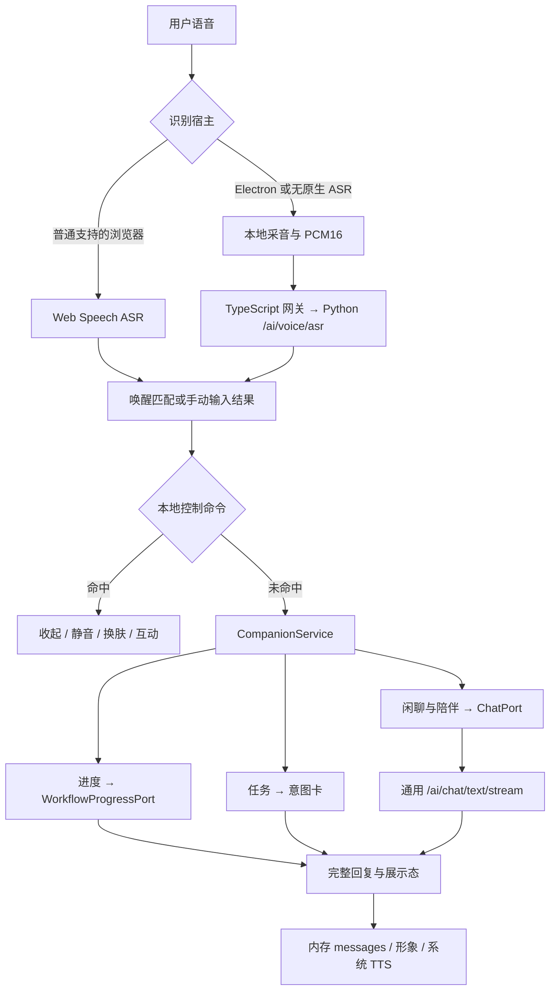

# 当前虚拟人物设计与组件梳理

分析日期：2026-11-15。范围：当前工作树中的落地页角色、Companion 前端能力域、Electron 桥接、聊天与本地 ASR 接口。

本报告基于源码与本轮自动化测试；未进行浏览器视觉验收、真实麦克风录音或完整 Electron 端到端验证。本轮不修改功能代码。

## 1. 当前定位

当前虚拟人物采用程序化 SVG 路线，产品形态是「可交互的抽象角色 + 常驻语音伙伴」。当前相关实现没有接入 Live2D、VRM 或三维数字人渲染。

实际上有两套入口：

| 维度 | 落地页角色 | 工作台 Companion |
| --- | --- | --- |
| 入口 | `LandingView.vue` → `GlassConstellation.vue` | `App.vue` → 异步加载 `CompanionHost.vue` |
| 名称 | Justin / 贾斯汀 | 默认知宝，可 DIY 改名 |
| 目的 | 展示形态、状态、动作、配色及语音交互 | 常驻陪伴、养成、语音控制、进度问询、任务意图记录 |
| 角色渲染 | 直接操作 `GrokCharacter` | 通过 `SkinManifest` 和 `AvatarRenderer` 适配 |
| 语音 | 组件内独立实现浏览器识别与唤醒 | `VoiceEngine` + `WakeWordListener` + 本地 ASR 适配 |
| 对话 | 共用 `useChatStore()`，调用 `sendMessageStream` | `CompanionService` + 独立 `ChatPort` |
| 保存 | 本组件不复用 Companion 的 DIY 配置 | 外观、养成、位置与开关写 localStorage |
| 挂载条件 | 落地页对应展示分支；真正对话要求登录 | 非公开路由且 `appSettings.companionEnabled` 开启 |

两者共享底层动效引擎，但没有统一角色身份、语音控制器和会话管理。落地页展示的丰富形态也不会自动成为工作台可选皮肤。

## 2. 当前组件树

```text
App.vue
├─ 公开路由 → PublicRouteLayout → LandingView
│                              └─ GlassConstellation
└─ 工作台 → AppShell
           └─ CompanionHost（Teleport 到 body）
              ├─ 面板
              │  ├─ header：名字、语义状态、收起
              │  ├─ 日常模式
              │  │  ├─ CompanionPetBar
              │  │  └─ CompanionDialogue
              │  │     ├─ 任务意图卡
              │  │     └─ CompanionVoiceBar
              │  ├─ 设置模式 → CompanionSettings
              │  └─ 编辑模式 → CompanionCustomizer
              ├─ CompanionBubble
              └─ avatar stage → AvatarRenderer
```

设置、日常交互、形象工坊是互斥内容。头像使用右下角 fixed 定位，默认 64px，展开后 76px；面板向上生长，包含拖拽、越界夹取及窗口缩放后的避让。

| 组件 | 当前职责 | 边界与观察 |
| --- | --- | --- |
| `CompanionHost.vue` | 组合所有状态、语音、对话、养成、拖拽、皮肤、托盘与生命周期 | 1187 行，当前复杂度主要集中于此 |
| `CompanionPetBar.vue` | 等级、称号、心情、连续天数、好感/精力、三种互动、成就 | 展示和事件组件，边界清楚 |
| `CompanionDialogue.vue` | 任务卡及语音条 | 仍接收 `messages`、`pending`，模板已不展示它们；保留了消息区旧 CSS |
| `CompanionVoiceBar.vue` | 麦克风、波形、临时识别字幕、静音 | 波形为装饰动效；强度来自字幕长度，并非真实音量 |
| `CompanionSettings.vue` | 皮肤选择、DIY 入口、唤醒开关与说明 | 不包含完整的人设或会话配置 |
| `CompanionCustomizer.vue` | 外观与声音编辑、实时预览、试听、导入导出 | 组件内有 draft，父级收到 preview 后直接覆盖运行配置 |
| `CompanionBubble.vue` | 临时气泡及反馈 | 普通对话回复没有统一接入气泡 |

## 3. 逻辑模块划分

| 模块 | 实际职责 |
| --- | --- |
| `types.ts` | 8 个语义状态、皮肤与渲染协议、消息、进度快照、任务卡及端口 |
| `companionService.ts` | 意图分流；进度走只读端口；任务生成卡片；其余走 ChatPort |
| `intent.ts` / `speechCommands.ts` | 规则意图分类 / 更优先的本地语音控制命令 |
| `dialogue.ts` | 本地话术、进度格式化、任务卡生成 |
| `companionState.ts` | 事件映射、状态优先级、回落计时器、主动通知去重 |
| `pet.ts` / `idleBehavior.ts` | 好感、精力、12 级称号、8 个成就、互动冷却、闲时搭话与打盹 |
| `customization.ts` | DIY 默认值、5 套预设、净化、持久化、JSON 导入导出 |
| `skins.ts` / `renderers.ts` | 皮肤注册、状态映射、三种 SVG 渲染实现 |
| `switchGuard.ts` | 异步换肤只接受最新结果，销毁过期渲染器 |
| `position.ts` / `enabled.ts` | 位置边界与持久化 / 全局显隐开关 |
| `voice.ts` / `wakeWord.ts` | 语音状态机、ASR/TTS 宿主、声线、唤醒词与自动重启 |
| `adapters/chatStream.ts` | 通用聊天 SSE → 一次完整回复，维护服务端 contextId |
| `adapters/serverAsr.ts` | 麦克风采集、16k 重采样、PCM16、静音断句、分段上传 |
| `adapters/progress.ts` | 从 URL 或本地锚点取 runId，通过既有 API 读取进度投影 |
| `adapters/desktop.ts` | 可选托盘/通知桥；Web 环境 no-op |

整体分层基础合理：界面组件、纯逻辑与外部适配分开，角色展示不直接引用 ACG 执行内核。当前主要问题是宿主组件承担了过多编排，以及部分模块间的接线未完成。

## 4. 形象与动效设计

| 皮肤 | 实现 | 当前能力 |
| --- | --- | --- |
| 轻量 SVG | `InlineSvgRenderer` | 主题令牌配色、圆形身体、8 态表情、眨眼、4 帧口型、收音环 |
| 动效 SVG | `GrokRenderer` | 动态加载底层引擎；固定 blob / blue / light；8 态映射及指针跟随 |
| DIY SVG | `DiySvgRenderer` | 5 种轮廓、三色、位图裁剪、腮红/高光、共用表情与口型 |

业务态为 `idle / listening / thinking / working / happy / alert / sleeping / error`，由皮肤映射到底层表情。这个抽象值得保留，可避免业务依赖具体美术资源。

DIY 支持名字、外观、图片、闲聊台词、声线、语速/音调/音量和动效开关。图片压至 256×256，只接受指定类型的位图 dataURL；颜色、数值和文本均有净化。

需要明确的现状：

- 上传图片是「SVG 身体里的裁剪贴图」，并非可绑定骨骼或表情的完整角色资源。
- Grok 皮肤的 `setSpeaking/setListening` 只写 data 属性，未接入共用 `createFace()`，也未驱动引擎口型；不能等同于另外两种皮肤的说话表现。
- DIY 的 motion 控制 DIY 表情计时器及互动粒子，但宿主 CSS 浮动仍存在，动效关闭没有覆盖所有层。
- `SkinRegistry.validate()` 只检查 stateMap 键数为 8，没有核对每个合法键；`fallbackSkinId` 已声明，但失败流程实际统一回落静态皮肤。
- 底层 `grok-character` 是依赖导入顺序的 IIFE，通过 `window.GROK_*` 共享数据；后续扩展应继续限制在渲染适配层内。

## 5. 实际数据流

### 5.1 语音与对话



补充事实：

- 模型回复默认启用；本地话术主要覆盖动态适配器加载前或加载失败的阶段。
- 模型请求使用 `thinking_mode: disabled`、`workspace_mode: chat`、`tool_mode: auto`；不指定角色 ID，也不传入 DIY 名字/台词。
- SSE 增量在适配器内累计，完整读完后才交给宿主并启动 TTS，界面不逐字展示回复。
- 会话 ID 使用服务端真实创建的 Conversation，并保存到 `companion.chat_context_id.v1`；旧的 `companion:*` ID 会被清理。
- Electron 及缺原生识别的浏览器已接本地 ASR；Python 已注册 `/ai/voice/asr`，使用 sherpa-onnx / Paraformer。是否实际可用仍依赖模型与运行环境。
- 唤醒默认开启，但需要用户手势布防；当前通过点击头像或切换唤醒开关触发。朗读、手动收音、免打扰期间暂停唤醒。

### 5.2 运行状态与任务

进度查询实际是 `workflowApi → agentosApi.getWorkflowProgress → getWorkflowRun → projectProgress`，读取既有运行信息后做摘要，不从人物情绪推断任务真相。

实时跟进目前不完整：全量搜索 `apps` 的非测试代码，`companion:run-event` 只找到宿主的监听与移除，未找到派发方；`companion.active_run_id.v1` 也只找到声明和读取，未找到写入方。显式 URL runId 或语句中的 runId 仍可用于查询。

任务卡只有描述与「知道了」关闭按钮，没有提交、确认启动或跳转到既有启动入口的动作。应标记为「意图记录已实现，任务交接待实现」。

### 5.3 存储与桌面

本地保存养成、DIY、位置、展开/免打扰/唤醒开关、皮肤与会话引用；前端 `messages` 本身仅在内存中。模型对话会进入通用服务端 Conversation，因此不能将整个 Companion 描述为「全部离线或全部只存本地」。

桌面复用单窗口，通过 `companionState / companionNotify / companionTrayAction` 三个通道发布状态、触发原生通知和接收托盘动作。麦克风权限只对白名单页面来源的音频开放。

## 6. 已确认的问题与优先级

| 优先级 | 问题与证据 | 用户影响 / 建议 |
| --- | --- | --- |
| P0 | `serverAsr.ts:273,283,294`：finish 立即置 ended，而排队上传成功/失败处理遇到 ended 就返回 | 自动断句/手动停止后丢失 final 或错误；区分 finishing 与 ended，等待已提交识别结束后再 onend，abort 单独取消 |
| P0 | `CompanionDialogue.vue` 不渲染 messages/pending；`CompanionHost.vue:863` 的 send 只写消息及朗读，不为普通回复 showBubble | 静音、TTS 不可用时普通回复没有可见出口；保留语音优先，同时显示最终字幕/回复及 pending |
| P1 | `companion:run-event` 无生产派发方，active run 本地锚点无写入方 | 角色无法按设计自动跟进当前运行；在已有事件订阅/运行选择处接线并按 runId 过滤 |
| P1 | 模型通道只在 import 失败时回落本地；HTTP/SSE 失败直接进入 send 的错误分支 | 「模型不可用仍能本地陪聊」尚未覆盖实际请求失败；使用组合 ChatPort，区分取消与可降级错误 |
| P1 | `StreamChatPort.reply(text, _context)` 忽略 personaName 和自定义台词 | 改名换装不等于改变模型人设；定义可信人设接入及台词的实际生效范围 |
| P1 | `onCustomizationPreview` 改写运行 customization，close 只恢复原 skinId | 工坊未保存退出后，名字、声音、台词等草稿仍在当前会话生效；拆分 saved/draft/effective，取消恢复快照 |
| P1 | `IdleFallback(5000)` 不检查 pending 或持续运行态，直接回 idle/sleeping | 慢模型回复或运行仍未结束时角色可提前显示待机；由事件来源与实际生命周期决定回落 |
| P1 | 不可用提示提到「点指令 / Win+H」，但快捷指令和文字输入均已移除 | R 仍是同一语音能力，Win+H 没有对话输入目标；应提供确实可用的非语音入口或修正提示 |
| P2 | 两个角色身份和控制逻辑独立；Grok/DIY/轻量皮肤的口型、配色与动效开关不一致 | 建立共享身份配置和明确的渲染能力清单，落地页保留展示专用控制 |
| P2 | Host 同时管理所有副作用，皮肤 fallback/状态校验的实现比协议窄 | 将控制器移到 composable/服务，补齐协议语义，避免只按文件长度机械拆分 |

本地 ASR 测试还有独立的测试夹具问题：`build()` 把数值 `ends` 拷贝到 harness，后续回调只更新闭包变量。因此部分 ends 断言失败不能直接归因于生产回调缺失。结果被提前屏蔽则同时有源码和单次识别测试支持。

`tool_mode: auto` 表示模型回复仍接通通用聊天工具运行时，不能仅凭「任务分支不启动 ACG」就认定整个对话通道只有纯陪聊。应明确产品是否需要这些工具，并据此选择 disabled 或限定范围。

## 7. 文档与当前实现的差异

原设计文件 `docs/架构设计/09-虚拟对话角色Companion-架构设计.md` 混合了方案、P0 实施记录与多轮补充，不能整体作为当前实现说明：

| 文档叙述 | 当前代码 |
| --- | --- |
| 模型回复默认关闭 | 默认异步启用 |
| 使用 `companion:*` contextId | 服务端创建真实 contextId，清理旧 ID |
| 语音主要依赖浏览器在线识别 | Electron 已有本地 ASR 端到端接线，但适配器有结果丢失缺陷 |
| 对话区显示历史消息、快捷指令 | 当前模板仅显示任务卡和语音条 |
| Java / Flyway 作为主要中间层 | 当前相关链路为 TypeScript / Fastify → Python |
| PersonaRegistry、SceneRegistry、独立 Companion API | 仍为设计；当前是规则分支与通用聊天 API |

建议把「当前基线」「历史记录」「未来设计」拆开维护，先修正当前事实，保留旧记录的历史语义。

## 8. 建议的收敛顺序

1. 先恢复可用闭环：修 ASR final/error 生命周期，提供可见回复和明确的处理状态，同步修正失效的降级提示。
2. 接好工作台运行选择与事件桥，核对当前运行隔离；实现模型请求失败的本地回落。
3. 明确角色身份、声音、台词和会话之间的关系，修正工坊取消行为；决定通用聊天工具的可用范围。
4. 再拆 Host：建议提取 `useCompanionConversation`、`useCompanionVoice`、`useCompanionAppearance`、`useCompanionPosition`、`useCompanionRuntimeBridge`，保留现有纯逻辑模块。
5. 最后扩展资源表现及任务交接：统一皮肤能力，再考虑 Lottie/序列帧/更复杂角色；任务交接继续使用现有启动入口。

## 9. 本轮验证

前端命令：

```powershell
cd apps/frontend
npm test -- src/features/companion src/components/companion src/App.spec.ts
```

- 共 23 个文件、182 项测试：169 通过，13 失败。
- Companion 范围为 174 项：162 通过，12 失败。
- Companion 失败分布：本地 ASR 8 项、Host/桌面/语音集成的消息展示断言 4 项。
- `App.spec.ts` 7 通过、1 失败，失败在工作台侧栏设置菜单断言。
- 上述为本轮实测，不沿用设计文档的历史通过数量；没有把全部失败都解释为生产缺陷。

桌面命令：

```powershell
cd apps/desktop/electron
node --experimental-strip-types --test test/companion-tray.test.ts test/companion-ipc.test.ts test/permissions.test.ts
```

16 项全部通过。当前终端 Node 为 v22.16.0，直接运行 node --test .ts 不支持该扩展名，因此显式启用类型剥离后验证。此结果覆盖托盘纯逻辑、通道同构与权限策略，不代表真实托盘/麦克风端到端验收。

未执行全仓构建、完整前端套件、Python ASR 模型推理及视觉验收。本轮仅新增本报告，不修复上述功能问题。
