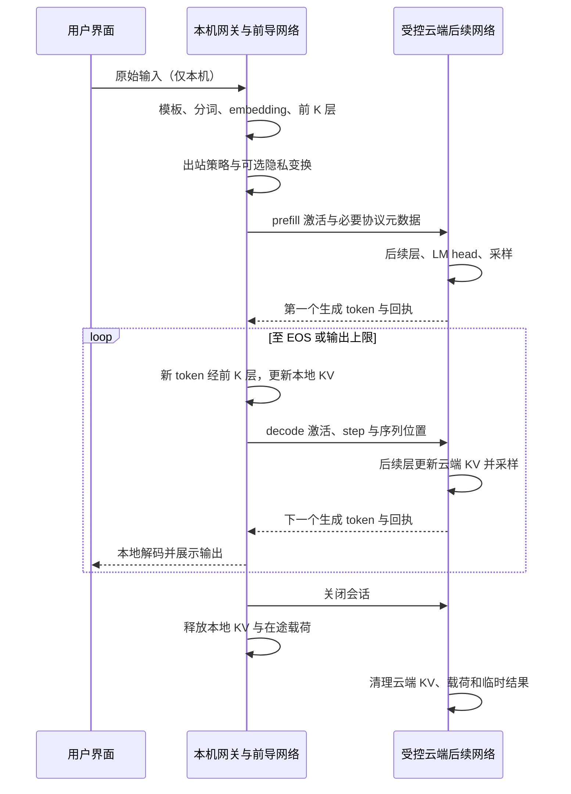

# 本地前导网络与云端续算 TODO 方案

> 日期：2026-11-12（Asia/Shanghai）。更新：2026-11-13。状态：完整模块骨架、中文 TODO、初版合同/端口及少量基础行为已创建；真实模型与端云/DP运行时仍待实现。
> 架构更新：2026-11-13。模块固定在 `apps/agentOS/src/safe/`，完整目录与依赖规则以 [safe README](../../../apps/agentOS/src/safe/README.md) 为准；本文负责阶段任务和验收，不维护另一套源文件布局。
> 执行方式：后续使用 `executing-plans` 按阶段实施，每阶段提交可核验结果；本文所有未勾选项均为待完成工作。

本轮骨架交付与逐文件状态见[交付报告](../reports/safe/2026-11-13-scaffold.md)。已实现的基础行为不代表 P0–P6 任一完整阶段验收通过；代码中的阶段号沿用本文定义，方向 B 以 `B1` 单独标识。

**Goal:** 用户原始输入先在本机经过模型前导网络，只把模型中间激活值发送到受控云端，由同一模型的后续网络继续计算并返回结果。

**Architecture:** 第一方向采用同一模型固定层切分，在 `safe` 内按 contracts/domain/ports/application/infrastructure/interfaces/bootstrap 分层，使用 integration 接入 AgentOS 与 Agent 应用。七个根级门面提供稳定公开入口，本地 prefix runner 与云端 suffix runner 独立装配。先证明无扰动数值等价，再实现会话、隐私与产品接入；第二方向“上传权重或适配器”在既定扩展位置另行实施。

**Tech Stack:** Python、PyTorch、Transformers、Safetensors、Pydantic、FastAPI、HTTPX；接入现有 TypeScript 本地网关与 Vue 前端。模型运行依赖采用独立环境及锁文件，不直接扩大现有 Agent 默认安装包。

## 1. 已确定的产品方向

用户已确定：两个方向都要实现，目前优先第一方向；没有指定模型和显卡，采用小型开源文本模型、固定切分点、单用户单会话的默认验证路线。

| 方向 | 传输对象 | 目标 | 本轮安排 |
| --- | --- | --- | --- |
| A：拆分推理 | 本次输入产生的中间激活值 | 本地做前段计算，云端继续后段计算 | 本方案完整规划 |
| B：模型能力上传 | 训练后的权重、参数增量或 LoRA 等适配器 | 云端加载个性化能力或开展训练、聚合 | 第 13 节记录后续范围 |

A 的第一版仅推理：冻结模型参数，运行 `eval()` / `inference_mode()`，不上传梯度、不做反向传播、不产生用户适配器。若未来跨端反向传播，另立拆分训练设计。

“云端计算和涌现”在本阶段具体化为继续执行模型后半段并生成输出；跨用户知识融合、持续学习和群体智能不作为拆分推理的自然结果或验收承诺。

## 2. 当前仓库证据与接入边界

以下基于编写时工作区 `master`，HEAD `75a3d00b` 的静态检查，并核对了编写期间出现的未提交加密服务目录迁移；这部分已有改动不属于本方案的实现。

| 已有文件 | 当前能力 | 本方案处理 |
| --- | --- | --- |
| `apps/agentOS/src/contracts/model_partition.py` | 层区间、资源放置、张量边界合同；检查连续性与相邻边界 | 复用基础合同，补充模型身份和执行协议；执行时额外检查覆盖完整模型且仅有一个有效跨端切口 |
| `apps/agentOS/src/components/model_partition/service.py` | 只验证，执行始终抛出 `MODEL_PARTITION_UNAVAILABLE` | 增加显式注入的执行端口；未配置执行器仍保持原有拒绝语义 |
| `apps/agentOS/tests/components/test_model_partition.py` | 切分合同与执行不可用测试 | 保留原断言，增加已配置与不兼容执行器测试 |
| `apps/agentOS/src/adapters/resource_model_execution.py` | 已登记 Runtime 上的模型 HTTP 调用与请求签名 | 借鉴凭据和审计模式；不把激活值发往现有聊天接口 |
| `apps/agentOS/src/contracts/resource/resource_signing.py` | HMAC 请求签名原语 | 可复用签名原语；云端仍需独立实现身份绑定、权限、重放检查和 TLS |
| `apps/agent/app/execution/model_runtime.py`、`apps/agentOS/src/adapters/model_runtime.py` | 消息/文本驱动的模型调用 | 后期接入专用拆分适配器，不把向量编码为提示词 |
| `apps/backend/src/gateway.ts`、`apps/backend/src/identity.ts` | 本地网关和受信任的本机身份 | 本地入口复用；本机 actorId 不能直接当作云端认证证明 |
| `apps/agent/app/security/internal_auth.py` | 本地应用服务内部认证 | 不把本地全局内部 token 分发给云端或浏览器 |
| `apps/agentOS/src/safe/encryptionservice.py`、`apps/agent/app/services/federatedlearning.py` | 遗留参数加噪与单独裁剪函数；工作区已将加密服务放入目标 `safe/` | 不直接作为激活值 DP 实现复用；后续统一 `safe.*` 导入并单独验证旧调用兼容 |
| `apps/frontend/src/components/federated/FederatedLearningPanel.vue` | 隐私开关状态为固定展示值 | 拆分能力建立真实状态接口，不继承这些“已启用”值 |

当前主依赖没有明确引入 PyTorch/Transformers，未发现可执行的 `hidden_states` 跨端续算实现。普通 OpenAI 兼容聊天接口不能据此推断支持中间激活；第一版要求受控部署开源模型后半段。

## 3. 路线选择

| 路线 | 优点 | 代价 | 决策 |
| --- | --- | --- | --- |
| 同一模型按层切分 | 不训练也能建立数值等价基线，切口清晰 | 两端必须兼容；生成过程存在往返通信 | 首期采用 |
| 本地独立编码器＋云端专用解码器 | 有机会压缩上传量、改善设备适配 | 需要配对训练或投影层训练，不能任意接到现有大模型 | 无扰动链路验证后单列研究 |
| 本地摘要/脱敏后调用云端文本 API | 易集成现有供应商 | 上传的是文本，无法验证神经网络跨层续算 | 不计入方向 A 的完成标准 |

用户本地“处理好一部分”首先指同一模型的前若干层。裁剪、加噪、量化和压缩均会改变边界分布，必须逐项验证；本地随意训练前半段后，不能假设原云端后半段仍正确匹配。

## 4. 第一版范围与默认实验配置

- 候选模型：`Qwen/Qwen2.5-0.5B-Instruct`，用于小模型工程验证，不代表最终质量或模型选型已验收。
- P0 核验许可证、下载来源、架构可切分性、受支持 Python/CUDA/依赖版本，再固定不可变模型 revision、tokenizer 文件和哈希。禁止以 `main` 作为运行身份；核验失败时停止该模型路线并记录原因。
- 本地：tokenizer、embedding、前 K 个 decoder block；云端：余下 block、最终归一化与 LM head。首个候选切口 K=2；检查 `0 < K < num_hidden_layers`。是否共享 embedding/LM head 权重及制品重复占用由导出器明确处理。
- 不在本地偷偷加载完整模型后丢弃后半段。验证模式可用完整模型作 oracle；运行制品按角色切分，只装载各自所需权重。
- 无指定硬件时，使用 CPU + FP32 + eager attention 建立正确性参考；独立测量 CUDA/FP16 后再放开加速配置，禁止自动改变精度。
- 首期 batch=1；原始 prompt 含模板后最多 128 token；最多输出 32 token；总有效上下文最多 160 token；超限明确拒绝，不静默截断。
- 初期单用户最多一个活动生成会话；完成隔离测试后再扩并发。真正远程进程与网络传输必须验证，不能只用两个函数的同进程调用宣称端云完成。
- 第一交付：研究演示，默认关闭 DP 且明确标识“未提供 DP 保证”。第二交付：完成隐私评估后决定是否可作为隐私功能开放。
- 不支持动态切点、多设备流水线、异构模型直连、批处理、模型在线训练、自动接入任意云厂商。

## 5. 数据与生成流程



### 5.1 必须补齐的模型语义

- 明确切口位于第 K 个 decoder block 输出之后、最终 norm 之前；两端遵循相同的残差、RoPE、位置与 attention mask 语义。
- 云端接收的是“已经过 K 层的 hidden states”，不能再把它们当 `inputs_embeds` 运行完整模型，否则会重复计算前 K 层。
- prefill 处理整个输入序列；decode 每步处理一个新生成 token。本地持有前 K 层 KV，云端持有其余层 KV；任何一侧丢失状态都使会话失效。
- token 采样首期由云端完成，返回的 token ID 是云端自己生成的输出，不上传原始 prompt token ID。本地负责解码、增量 UTF-8 处理与 UI 展示。
- 确定性基线使用 greedy，固定 tokenizer、模板、EOS 和停止规则。随机采样后续通过会话独立 RNG 状态实现，重试不重新采样。
- 首期一轮对话对应一个生成会话；下一轮在本地组装历史并重新 prefill，不承诺跨轮长期保留云端 KV。隐私预算不随会话重建而重置。
- 多用户激活不能直接相加、拼接或聚合来获得“融合能力”；需要另外定义训练目标或兼容的融合网络。

### 5.2 原始输入的真实本地边界

“本地”必须是用户自己的设备。输入先发到平台远程后端、再调用一个所谓本地模型，不满足本方案。

桌面端首期经已验证为本机的网关进入本地 runner；本地文本不经过普通远程 chat、会话同步、遥测、RAG 或云端错误上报路径。浏览器端未确认有配对且受认证的本机 runtime 时，显示不可用，不降级为直接上传原文。

修改 `apps/frontend/src/platform/api.ts` 增加拆分专用的本机 origin 检查，并对齐 Electron bridge 与开发代理配置；不能只因为 URL 来自通用 `apiUrl()` 就认为它指向本机。

## 6. 协议、状态与失败语义

### 6.1 制品清单与请求合同

新增 `SplitModelManifest`：包含协议版本、模型 ID 与不可变 revision、配置/tokenizer/模板哈希、前后段权重哈希、K、切口语义、hidden size、dtype、位置编码配置、上下文上限、支持的隐私 profile。所有影响激活兼容性的字段组成 `manifestDigest`。

新增 `ActivationEnvelope`：只允许 `protocolVersion`、`manifestDigest`、`sessionId`、`requestId`、`phase`、`step`、`positionOffset`、必要长度/mask、`dtype`、`shape`、`payloadDigest`、`payloadBase64`、`privacyReceipt`。额外字段一律拒绝。身份来自认证上下文，不相信请求体自报 owner。

`privacyReceipt` 固定为 profile ID/version、release ID、账本 scope ID、本次 epsilon/delta、累计预算与噪声机制版本；不含原文、真实未填充长度或未扰动激活摘要。无 DP 时仅声明 baseline profile，不伪造 epsilon。云端校验 profile 一致性，但不能仅凭客户端回执证明可信客户端执行了 DP。

- 第一版 JSON 封装 base64 编码 little-endian FP32 连续张量，不用 pickle、任意 Python 对象或客户端模型代码；量化与压缩关闭。
- 常规 prefill shape=`[1,S,H]`，`1 <= S <= 128`；decode shape=`[1,1,H]`；H 来自已注册 manifest，不能由请求自由设定。
- 原始张量默认最多 8 MiB，HTTP body 最多 12 MiB，元数据最多 16 KiB；在读取、base64 解码和分配 tensor 前分别检查上限、shape 乘积、精确字节数与摘要，拒绝 NaN/Inf。超出所选模型需要时先修改版本化限制并重测，不动态放宽。
- `payloadDigest` 只用于完整性和幂等绑定，不记录到公开日志；它本身不能代替认证。认证覆盖路径、会话、时间戳、nonce 和完整 body。
- 云端只接受批准 manifest 的激活，不能接受用户给出的下载 URL、任意路径、切点或权重文件。

### 6.2 云端专用 API（新协议）

| 方法与路径 | 作用 | 要求 |
| --- | --- | --- |
| `GET /v1/split/capabilities` | 返回允许的 manifest、资源限制和隐私 profile | 不返回凭据或制品内部路径 |
| `POST /v1/split/sessions` | 创建并绑定用户、manifest、隐私策略、过期时间的会话 | 返回 session ID；不接收 prompt |
| `POST /v1/split/sessions/{id}/steps` | prefill 或 decode 一步 | 返回 step、token ID、结束标记、用量与隐私回执；不返回内部激活 |
| `GET /v1/split/sessions/{id}/requests/{requestId}` | 查询不确定结果 | 仅相同 owner，可返回已完成回执或要求重建 |
| `DELETE /v1/split/sessions/{id}` | 取消并清理 | 重复关闭幂等；不因查不到会话泄露其他用户信息 |

公网端强制 TLS、独立云端凭据和用户绑定；本地 `actorId` 由云端配对认证映射。复用资源签名原语时，必须添加时间窗口（默认 60 秒）、nonce 去重和凭据撤销。已有本地 internal token 不出站，前端不持有云端长期凭据。

### 6.3 会话状态与重试

会话状态：`CREATED → PREFILLED → DECODING → COMPLETED`；另有 `CANCELLED / EXPIRED / FAILED` 终态。云端维护单会话互斥、严格单调 step 与 KV 进度；相同 owner 同时仅一个步骤在途。

- 幂等键为 `(owner, sessionId, requestId)`，绑定 manifest、step 和载荷摘要；相同键相同载荷只返回原回执，不能重复更新 KV 或重新采样。
- 同键不同载荷返回 `409 SPLIT_REQUEST_CONFLICT`；乱序/并行步骤返回 `409 SPLIT_STEP_OUT_OF_ORDER`。
- 云端一步执行中若 KV 已改变但回执未能提交，标记会话 FAILED，拒绝重执行，要求新会话；不能以“没找到回执”为由在旧 KV 上再算一次。
- 网络超时先查询回执；仅在可证明请求尚未执行且本地保留相同激活时重发相同请求。云端重启不恢复 KV，旧会话返回 `410 SPLIT_SESSION_LOST`，不悄悄重建。
- 默认空闲 TTL 60 秒、最长会话 300 秒；断连、终态与 TTL 到期均清理敏感内存。Python/GPU allocator 释放不等于取证级内存擦除，产品不作此保证。
- 本地关闭或崩溃后不持久化激活恢复；旧会话被废弃。云端只在会话有效期内缓存结果回执，进程重启后按失效处理。

| 情形 | 返回或处理 |
| --- | --- |
| 未开启功能/未安装 runner | `503 MODEL_PARTITION_UNAVAILABLE` |
| 模型、版本、切口不匹配 | `409 SPLIT_MANIFEST_MISMATCH` |
| 张量结构/数值无效 | `422 SPLIT_ACTIVATION_INVALID` |
| 上传过大 | `413 SPLIT_PAYLOAD_TOO_LARGE` |
| 凭据无效/会话不属于用户 | 统一拒绝，不暴露会话内容 |
| 资源忙/显存不足 | `429 SPLIT_CAPACITY_EXCEEDED`，不生成伪结果 |
| 隐私预算不足 | `409 PRIVACY_BUDGET_EXHAUSTED`，禁止出站 |
| 云端不支持或故障 | 显示失败；不退回发送原始文本的普通 API |

## 7. 隐私设计与 DP 的准确位置

中间激活不等于匿名数据。云端掌握公开权重、网络后半段和输出，可能训练反演器重建输入；TLS 只防链路窃听，不能防云端分析。

### 7.1 首期必须做的数据控制

- [ ] 原始文本、prompt token ID、文件内容、本地历史不进入云端请求、日志、trace、异常文本或上传元数据。
- [ ] 默认不记录激活、KV、生成内容和高维载荷摘要；审计仅记授权主体的受限标识、状态、字节数、耗时、manifest 与隐私 profile。
- [ ] 端点固定于已配置白名单，禁重定向到任意主机；无用户授权不切换云端；云端输出作为不可信内容显示，不自动执行工具。
- [ ] 评估长度、时序、请求数量和用户标识的泄露；“无原文上传”与“差分隐私保证”分别展示。
- [ ] 明确云端可见的是本会话的特征与生成结果，禁止默认用于跨用户训练。云端不混用不同用户的 KV/激活。

### 7.2 可选 DP profile：先验证，再承诺

定义两个 profile：`split-baseline-v1`（无 DP，仅研究与正确性验证）和 `split-dp-experimental-v1`（实验，完成以下任务前不标注已获得保证）。DP 处理在本机、激活出站之前，云端不接触未扰动激活。

- [ ] 明确本地 DP 威胁模型：云端能见到完整会话 transcript；首个研究目标为固定长度、同一授权用户下任意两个受保护 prompt 的替换邻接。用户身份、公开模型版本与已生成输出的可见性另外说明。
- [ ] 每次上传把整个激活张量视为一个向量，按公开固定 C 做全局 L2 裁剪；在上述替换邻接下，单次裁剪输出的 L2 差异上界为 `2C`。不能按块裁剪后仍声称整体上界为 C，不能用当前激活范数直接代替全局敏感度。
- [ ] 使用可审核机制按 epsilon、delta、敏感度校准噪声；验证库版本、随机源、有限精度行为及参数边界。不得复用遗留 `1/epsilon` 普通高斯兜底；机制异常时拒绝上传。
- [ ] DP prefill 在本地左侧补固定公开 padding token 至 128 个位置，使用全可见的公开 causal mask 和位置 0–127，从固定最后位置开始采样，不上传真实 prompt 长度/掩码；decode 从位置 128 开始。此实验规则会改变模型行为，重新与同一固定 padding 基线比较。仅隐藏载荷长度却上传真实 mask，不满足所选邻接的完整协议要求。
- [ ] 对 decode 的多次自适应发布、输出长度、EOS、停止时序和失败事件作完整 transcript 分析；模型生成输出的后处理不能豁免下一步重新读取私有本地 KV 造成的新发布。必要时限制为固定步数实验；完整分析未通过时保持 experimental。
- [ ] 本地持久预算账本按授权用户、受保护数据范围、策略版本记账，多会话累计。每次首次出站前原子预留并计费；不能等云端成功后再记，也不因超时、关闭会话或重启而退款/清零。
- [ ] 同一次发布重试必须复用相同已扰动字节与 release ID，不重复抽噪声；缓存丢失时终止旧发布。新抽样视为新发布并重新消耗预算。账本拒绝篡改和回滚；跨设备账本未协调前，保证范围限定为单一可信本机安装。
- [ ] C、单次预算和总预算通过合成数据上的噪声—质量曲线确定，再写入版本化 profile；未校准时不开放真实数据 DP 模式。账本缺失或损坏时拒绝该模式，不回退无噪声上传。
- [ ] 加噪后的出站与云端续算仅使用已扰动结果，不对外另外发送原始特征摘要作为“对照”；本地私有 KV 继续留在本机，其后续发布仍需裁剪、加噪与计费。允许拒绝不兼容 profile，禁止静默切换到无 DP。

定量反演攻击只是实证评估，不构成 DP 证明；数学 DP 保证也不代表输出完全不含敏感语义。若所需噪声导致任务不可用，应记录失败并研究训练瓶颈层/配对编码器，不人为调小噪声后保留原保证标签。

## 8. 拟新增与修改的文件

以下是阶段任务的文件归属摘要。完整目标树见 [safe README](../../../apps/agentOS/src/safe/README.md)，当前 `inference.py` 为空，其余目标文件按阶段实施后才创建。原扁平路径和 `apps/agent/app/split_inference/` 实现布局已由本结构替代。

| 路径 | 职责 |
| --- | --- |
| `apps/agentOS/src/safe/inference.py` 与另六个根级门面 | 稳定公开 API；无 IO、无全局装配和重依赖 |
| `apps/agentOS/src/safe/contracts/` | inference、activation、manifest、privacy、session、identity、events、errors 合同 |
| `apps/agentOS/src/safe/domain/` | 兼容性、激活限额、会话状态、幂等、隐私与预算纯规则 |
| `apps/agentOS/src/safe/ports/` | runner、codec、artifact/session/budget store、认证、transport、时钟和审计接口 |
| `apps/agentOS/src/safe/application/inference.py`、`continuation.py` | 本地前导编排与云端后续执行用例 |
| `apps/agentOS/src/safe/application/activation.py`、`manifest.py` | 载荷、编码、制品校验用例 |
| `apps/agentOS/src/safe/application/session.py` | 会话与 KV handle、step、幂等、TTL 与清理 |
| `apps/agentOS/src/safe/application/privacy.py`、`privacy_ledger.py` | 出站变换、发布回执与跨会话预算编排 |
| `apps/agentOS/src/safe/infrastructure/models/` | Torch runner、Qwen 架构、tokenizer 与采样 |
| `apps/agentOS/src/safe/infrastructure/artifacts/`、`codecs/` | 受限制品加载/导出、Safetensors 与 FP32 格式实现 |
| `apps/agentOS/src/safe/infrastructure/storage/`、`privacy/` | 短时会话、SQLite 预算及 schema、噪声和组合会计 |
| `apps/agentOS/src/safe/infrastructure/transport/`、`security/`、`audit/` | HTTP 客户端、认证/签名及白名单审计 |
| `apps/agentOS/src/safe/interfaces/local_api.py`、`cloud_api.py`、`http_errors.py` | 本机/云端路由，错误映射；框架类型不进入内层 |
| `apps/agentOS/src/safe/bootstrap/` | 角色配置、local/cloud 工厂、关闭与构造失败清理 |
| `apps/agentOS/src/safe/integration/agentos.py`、`agent_app.py` | 核心分区/资源计划、身份/生命周期与 safe 的边界转换 |
| `apps/agentOS/src/components/model_partition/service.py` | 必要时增加中立执行端口；无配置继续报不可用，不直接导入 safe 用例 |
| `apps/agent/app/api/split_inference.py` | 本机 API 的薄适配，不另写推理实现或代理原文到远端 |
| `apps/agent/app/main.py`、`apps/agent/app/config.py` | 按开关注册本机接口；默认关闭且懒加载重依赖 |
| `apps/backend/src/split-inference.ts`、`apps/backend/src/app.ts` | 本机入口路由与身份绑定，沿用受限本机网关 |
| `apps/frontend/src/services/api/splitInference.ts` | 真实状态、生成事件、取消与错误合同 |
| `apps/frontend/src/platform/api.ts`、`apps/frontend/src/platform/api.spec.ts` | 专用本机 origin 校验及桌面 bridge/开发代理回归 |
| `apps/frontend/src/components/resource-center/SplitInferencePanel.vue` | 实验入口，展示模型/本机就绪/云端就绪/隐私事实 |
| `apps/agentOS/requirements.safe.in`、`apps/agentOS/requirements.safe.lock` | 独立模型执行依赖与受控版本 |
| `ops/scripts/safe/export_model.py`、`verify_split.py`、`benchmark.py` | 调用 safe CLI 的薄脚本，制品生成、正确性与性能证据入口 |
| `docs/superpowers/reports/safe/` | 后续每阶段证据、配置与运行环境，不存用户输入 |

首期只增加实验入口；接入普通聊天或 AgentOS 的结构化生成之前，要另外验证 JSON、工具调用与取消合同，不能因为模型能输出文本就标记支持全部模型能力。

## 9. 分阶段实施待办

### P0：模型与硬件可行性冻结

依赖：无。产物：模型清单、环境锁定、切分可行性报告。

- [ ] 核验候选模型许可证、revision、tokenizer 与模板，下载仅在显式制品准备步骤执行，运行禁止远程动态代码与自动下载。
- [ ] 创建独立运行环境并锁定 PyTorch/Transformers/Safetensors；验证本机可用 Python 与 Windows/Linux 支持。现有环境不满足时使用独立解释器，不改坏默认运行链。
- [ ] 完整模型跑 20 条公开/合成中英文短输入，记录 logits、greedy token、RAM/VRAM 与耗时作为 reference。
- [ ] 核实模型能输出并接续第 K 层 hidden states、位置编码和逐层 KV；完成一次完整模型与同进程 prefix/suffix 对比。
- [ ] 导出角色制品并确认 tied weights、tokenizer 和 config 的一致性；记录启动峰值，证明两端运行不加载完整权重。
- [ ] 冻结实验上限、机器配置和切口。模型不支持时出具 no-go，不用伪造向量或普通 API 回复替代。

完成条件：同进程 FP32 非扰动 logits 满足 `atol=1e-5, rtol=1e-4`，20 条样本的前 16 个 greedy token 完全一致；如浮点路径无法满足，先分析差异并重审标准，不静默放宽。该小集合仅作正确性门槛。

### P1：协议与执行合同

依赖：P0。产物：纯合同、codec、错误矩阵和测试。

- [ ] 实现 manifest、信封与回执，验证完整层覆盖、唯一切点、兼容哈希、大小和 step 范围。
- [ ] 实现 FP32 codec；测试错误字节数、非法 base64、超大 shape、NaN/Inf、错误 dtype、额外字段与摘要不符。
- [ ] 经 `safe.integration.agentos` 转换已有模型分区计划；必要时给 `ModelPartitionService` 加可选中立执行端口，保留未配置时报不可用的行为，核心不导入 safe。拒绝未支持的模型/资源拓扑。
- [ ] 合同单元测试不导入 Torch，不下载模型；确认新功能关闭时现有模型路由不变。
- [ ] 建立 README 规定的架构边界测试：检查禁止的导入方向、`safe.*` 唯一包身份、DTO 唯一定义、轻量公开门面与两端装配隔离；失败时先修复依赖，再进入模型实现阶段。

完成条件：不可信输入在大内存分配与 GPU 调用前被拒绝；旧不可用测试与新执行端口测试通过。

### P2：本地前导网络与云端后续网络

依赖：P1。产物：两个独立 runner 与受限云端 API。

- [ ] 实现 prefix/suffix，只装载批准制品，禁止按请求路径加载权重；云端启动时校验整个 manifest。
- [ ] 实现云端凭据映射、TLS 部署样例、签名时窗/nonce 检查；测试篡改、撤销、跨 owner 和未批准 manifest。
- [ ] 经两个独立进程完成 prefill；再用第二台机器或远程测试服务验证真实网络链路与无原文出站。
- [ ] 抓取合成输入的应用层出站包，验证字段白名单；TLS 抓包与应用载荷检查分别记录，不把“抓不到明文”当作原文未上传的证明。
- [ ] 运行相同 reference 的非扰动 logits 与 greedy 对照；确认云端不会重复执行 prefix。

完成条件：远程 prefill 数值门槛与 P0 一致；两端角色制品、认证拒绝与出站边界可复核。

### P3：逐 token 生成与会话闭环

依赖：P2。产物：单会话完整生成、取消、幂等与清理。

- [ ] 实现两端 KV、位置推进、prefill/decode 分支与云端 greedy 采样，支持 EOS/32 token 上限。
- [ ] 用有 KV 和无 KV 的完整模型 oracle 对照 20 条样本，每条最多 32 个 token；测试不同 prompt 长度和 Unicode 增量解码。
- [ ] 注入“上传前超时、执行后响应丢失、回执提交失败、重复请求、乱序、进程退出、重复关闭”故障，验证不重复推进 KV。
- [ ] 覆盖 TTL、取消与资源不足；终止后无活跃会话引用；重复请求不重新采样。不同 owner 即使知道 session ID 也无法操作。
- [ ] 本地重启废弃旧会话；云端重启返回失效，不复用错误 KV。状态不确定时明确失败，不补发原文。

完成条件：无扰动 greedy 对照完全一致；重试不改变结果、不重复算步；终态按 TTL 清理且不串会话。

### P4：隐私边界、反演评估与实验 DP

依赖：P3；DP 数学假设、profile 参数和验收单独冻结。产物：隐私报告、预算账本及明确能力标签。

- [ ] 完成第 7 节各项数据与日志控制，使用合成 canary 验证云端请求/日志/遥测不存在原文与 prompt token ID 字段。
- [ ] 在公开/合成数据上评估近邻恢复、输入反演和成员推断；报告攻击知识、样本划分、基线、成功率与盲点，禁止把未攻破写成证明。
- [ ] 在实验分支实现全局裁剪、已校准噪声、固定 padding 与完整 transcript 会计；预算 profile 经复核后才允许加载。
- [ ] 用可控机制测试敏感度边界、预算组合、出站前计费、重复字节重试、崩溃重启和账本损坏；隐私失败必须阻断外发。
- [ ] 对每个 profile 报告任务质量、噪声尺度、累计预算与反演评估；不能以非扰动等价门槛要求 DP 输出逐 token 一致。
- [ ] DP 质量不达标时保留研究模式并记录 no-go；不能宣传已实现完整 DP，也不开放依赖该保证的真实数据场景。

完成条件：数据边界测试通过；DP 只有在机制、会计、旁路与多轮发布假设可复核且质量门槛通过时才标注可用，否则明确保持实验状态。

### P5：产品入口与资源能力接入

依赖：P3；隐私产品承诺依赖 P4。产物：真实状态与显式实验入口。

- [ ] 新增本机状态接口，分别返回 prefix、suffix、manifest、云端认证、会话与隐私 profile 状态，不用单一 `enabled=true` 替代就绪事实。
- [ ] 本地网关建立专用拆分路由，前端模式选中后不调用普通 chat 上传/同步；为误配远程网关和无本机 runtime 的 Web 模式增加拒绝测试。
- [ ] 提供生成、流式显示、取消、预算不足和云端离线交互；前端不接触长期云端密钥和 tensor 载荷。
- [ ] 云端不可用时提示用户选择本地可执行模式或终止；切换普通云端文本模式必须重新明确选择，不自动回退。
- [ ] 向资源器登记专用 `split_inference` 能力及 manifest，仅匹配相容前后段；不把聊天 API 的健康检查当作 suffix 就绪。
- [ ] 集成测试验证原始文本仅进入本机路径、前后段匹配失败可见、关闭开关后不加载重模型且原应用功能可用。

完成条件：研究入口能完成一次真实远程拆分生成；界面准确区分“原文未上传”“实验 DP”“DP 未启用/不可用”，无固定假状态。

### P6：性能、交付与发布判断

依赖：P5；隐私版本依赖 P4 验收。

- [ ] 测量 128 prompt token、32 output token 场景下冷启动/热启动、首 token、每 token、端到端 P50/P95、本地 RAM/VRAM、云端 RAM/VRAM、上传/下载总字节。
- [ ] 对比完整本地模型、完整自托管云端模型、拆分无扰动、拆分 DP profile；同一模型 revision、解码配置、任务集与硬件记录，不混用不同模型得出结论。
- [ ] 注入 RTT 20/80/150 ms、不同带宽与 1% 丢包，报告逐 token 往返代价和失败率。性能问题优先记录，再另立压缩/切点优化任务，不改动正确性基线。
- [ ] 固定 100 条公开/合成任务并在调参前封存评估集；用完整模型结果作参照，报告结构化任务成功率和质量分布。DP 候选的任务成功率相对无扰动基线下降不超过 5 个百分点作为初始产品门槛；未达即不升级，模型自身能力低也必须披露。
- [ ] 初始实验设备容量门槛为 RAM≤8 GiB、可选 VRAM≤4 GiB；这是待测目标，不是已验证硬件需求。性能可用性目标：RTT≤80 ms 时热启动首 token P95≤5 s、32 token 端到端 P95≤30 s；无法达成则给出 no-go/优化报告。
- [ ] 发布包默认关闭，激活需本机制品和已配对云端；回滚只关闭新路由/能力，清理 KV 并保留预算账本，不影响已有模型调用。
- [ ] 最终报告列清“完成/实验/不可用”能力、设备要求、数据边界、模型版本、失败恢复方式与已执行测试。

## 10. 验证文件与执行入口

后续新增的测试文件：

- `apps/agentOS/tests/safe/contracts/test_inference.py`、`test_activation.py`、`test_manifest.py`：纯合同与恶意边界输入。
- `apps/agentOS/tests/components/test_model_partition.py`：执行端口及旧行为回归。
- `apps/agentOS/tests/safe/domain/`、`application/`：纯规则和注入 fake ports 的用例测试。
- `apps/agentOS/tests/safe/infrastructure/test_codec.py`、`test_artifacts.py`：序列化、制品身份与受限加载。
- `apps/agentOS/tests/safe/models/test_model_parity.py`、`test_decode_parity.py`：真实模型数值/生成对照，重测试显式启用。
- `apps/agentOS/tests/safe/integration/test_auth.py`、`test_sessions.py`：身份、nonce、KV、幂等、TTL 与故障。
- `apps/agentOS/tests/safe/integration/test_privacy.py`、`test_privacy_ledger.py`：无原文外发、隐私机制和累计预算。
- `apps/agentOS/tests/safe/architecture/test_dependencies.py`、`test_imports.py`：禁止反向依赖、轻量导入与唯一合同类型。
- `apps/agent/tests/test_safe_local_api.py`：Agent 应用本机装配、路由、取消、功能开关与错误。
- `apps/backend/test/split-inference.test.ts`：网关身份、路由和禁止远程原文旁路。
- `apps/frontend/src/platform/api.spec.ts`：本机 origin、误配远程 origin 与 Electron bridge 验证。
- `apps/frontend/src/components/resource-center/SplitInferencePanel.spec.ts`：真实状态、取消与不可用提示。

实现时采用“先写上述行为失败测试→最小实现→定向验证→提交”的顺序。测试禁止使用真实用户数据和生产凭据；轻量 CI 使用小随机模型/合成权重测试算法与状态机，真实下载模型的对照属于显式集成测试，未配置时明确 skip 并在验收报告中列为未执行，不算通过。

以下命令为未来验收入口，当前尚未执行；从仓库根目录使用已配置独立解释器执行：

```powershell
$env:PYTHONPATH = 'apps/agent;apps/agentOS/src'
python -m pytest apps/agentOS/tests/components/test_model_partition.py apps/agentOS/tests/safe/contracts apps/agentOS/tests/safe/domain apps/agentOS/tests/safe/architecture -q
python -m pytest apps/agentOS/tests/safe/application apps/agentOS/tests/safe/infrastructure apps/agentOS/tests/safe/integration -q
python -m pytest apps/agent/tests/test_safe_local_api.py -q
$env:SPLIT_MODEL_DIR = Join-Path (Get-Location) 'data/safe/artifacts/qwen2.5-0.5b-k2'
python -m pytest apps/agentOS/tests/safe/models/test_model_parity.py apps/agentOS/tests/safe/models/test_decode_parity.py -q
npm --prefix apps/backend test
npm --prefix apps/frontend test -- src/components/resource-center/SplitInferencePanel.spec.ts src/platform/api.spec.ts
npm --prefix apps/frontend run build:web
```

实验环境的应用数据根设为仓库 `data/`，P0 导出脚本将批准制品写入 `data/safe/artifacts/qwen2.5-0.5b-k2`；正式部署的数据根由装配配置注入。该目录需加入本机忽略规则；模型不可得时测试明确未执行，禁止根据缺省值自动下载模型。每阶段报告附确切命令、环境、退出码与结果，不能只附计划命令。

## 11. 通信量与性能预期

无压缩 FP32 上传量约为 `B × S × H × 4` 字节。以示意值 H=896 计算，128 token prefill 为 448 KiB；单 token decode 为 3.5 KiB；JSON base64 再增加约三分之一，另计元数据和网络开销。H 最终以已核验 manifest 为准。

中间激活可能比原文大得多，拆分不自动节省带宽。一次 decode 通常至少一轮跨端往返；即使云端算得很快，32 token 在 80 ms RTT 下仅串行往返就约 2.56 秒，尚未计计算、prefill、排队和返回开销。

首期不承诺比完整云端推理更快，也不承诺获得更强能力。价值验证分别观察本机计算占比、原始输入出站减少、可用输出质量与真实延迟。

## 12. 阶段依赖与完成定义

```text
P0 模型可行性 → P1 合同 → P2 两端 prefill → P3 完整生成
                                              ├→ P4 隐私与 DP 评估
                                              └→ P5 产品实验入口 → P6 性能与交付
隐私功能正式可用：P4 的保证与质量验收通过，同时 P5/P6 通过
```

“方向 A 工程演示完成”：P0/P1/P2/P3 通过，使用真实受控模型进行两端续算并证明无扰动正确性，展示数据边界与性能。

“方向 A 产品实验完成”：再通过 P5/P6，默认关闭且状态真实，不依赖假模型、随机结果或普通云端 API 旁路。

“方向 A 隐私版本完成”：还须 P4 证明所声明的保证范围、预算与协议旁路均成立，并达成质量门槛。无法达成时如实保留实验标签，不能用演示完成替代隐私完成。

## 13. 方向 B 的后续独立待办

该方向不作为 A 的前置，也不在激活协议中混入权重上传。可复用模型身份、用户授权、制品哈希和审计规则。

- [ ] 定义上传对象优先级：先 LoRA/受限适配器，再评估完整权重和梯度增量；分别定义大小、结构与许可。
- [ ] 定义用户本地训练目标、数据范围、优化器、训练样本级/用户级隐私要求和预算会计；激活出站 DP 不能代替训练产物隐私。
- [ ] 实现适配器制品 manifest、基座 revision 绑定、Safetensors 受限装载、配额、签名和版本撤回；禁止加载任意 Python 模型代码。
- [ ] 云端先实现“每用户隔离加载适配器”，验证质量与隔离；明确加载能力与联邦聚合是两个不同里程碑。
- [ ] 若实施联邦聚合，另行设计参与方认证、更新裁剪、安全聚合、投毒防护、掉线与隐私预算；修复并替换遗留演示逻辑后再接入。
- [ ] 验证个人模型升级、回滚、删除、云端副本清理及用户同意撤回；不默认把个人权重贡献给公共模型。
- [ ] 验证本地适配器是否会改变 A 的切口分布；改变 prefix 时配对更新 suffix 或重新训练兼容桥，禁止自动混用不匹配制品。

## 14. 本方案自检

- 方向 A/B、推理/训练、工程演示/隐私保证分开定义，有依赖与验收边界。
- 纳入已有模型分层合同，不将现有任务资源调度或普通聊天 API 误当作层执行器。
- 覆盖 prefill、decode、双方 KV、逐 token 往返、重试不确定性、身份与敏感数据生命周期。
- 所有 P0–P6 的完整阶段验收与方向 B 均为待办；已交付目录骨架及基础测试，模型质量、性能、反演结果和 DP 保证没有预先宣称通过。
