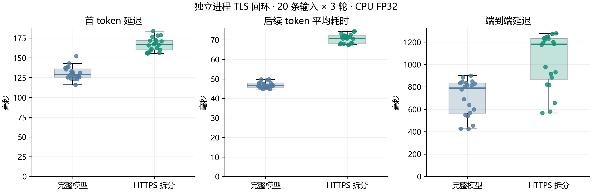
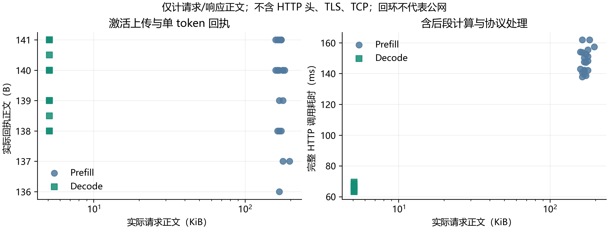

# Safe 独立进程 HTTPS 回环实验

日期：2026-11-15。真实Qwen2.5拆分路径经过独立suffix进程和实际TCP/TLS连接，60组生成序列、完整文本及停止原因与完整模型一致，核验792个token。后段796次前向恰好对应792个测量token及4个预热token；幂等与认证拒绝探针没有额外推进模型。62次KV分配全部释放，包括停机时故意遗留的未执行会话。

这组实验补齐上一阶段的实际认证传输与正文计量；当前CPU参考实现仍比完整本地模型慢，未观察到加速。回环、单机CPU竞争和完整模型oracle均为明确实验条件，不能推断公网延迟、异构设备或产品可用性。

## 实验配置

| 项目 | 设置 |
| --- | --- |
| 模型 | Qwen/Qwen2.5-0.5B-Instruct，revision `7ae557604adf67be50417f59c2c2f167def9a775` |
| 角色与计算 | K=2/24，H=896，CPU FP32/eager，4个计算线程、1个interop线程 |
| 输入与生成 | 20条固定中英文合成输入，模板后34–42 token；greedy，最多16个新token，EOS `{151643,151645}` |
| 父进程 | prefix、离线tokenizer、本机编排、HTTPS客户端；另持有完整模型，仅作评估oracle |
| 子进程 | 独立suffix、HMAC认证、nonce、会话/KV、HTTPS监听；不装载prefix或tokenizer |
| 协议 | FP32/base64激活JSON、严格DTO、单token回执、已验证临时TLS证书；不压缩 |
| 顺序与预热 | 双方各预热1次、最多4 token；seed=20261115，每轮打乱输入、每组随机化两种方法顺序 |
| 重复 | 20条×3轮，60组配对，120次生成；测量阶段30次EOS、30次长度停止 |
| 安全边界 | 临时证书与随机实验密钥在临时目录生成，退出后删除；没有DP、反演攻击或产品入口验收 |

实际执行实现提交为 `07dafd2e`，运行时脚本/锁文件原始字节SHA256、模型摘要、库版本与平台见 [report.json](report.json)。实现提交后还有中文文档和换行属性完善，不改变实验执行逻辑。父进程含完整模型，不能将其内存解释为纯prefix需求；本次未测独立角色峰值。

## 正确性与资源回收

- 60/60配对生成的token序列、完整文本、停止原因一致，共792/792个token；只保存token序列摘要，不保存输入/输出文本、激活、KV或logits。
- 实际socket探针验证回执查询、新nonce下同一业务请求返回原回执、重复nonce拒绝、正文篡改拒绝、跨owner与未知会话同响应。
- 默认CA信任库拒绝本实验自签证书；显式信任临时证书后成功建立TLS，未关闭证书/主机名验证。
- 后段总前向796次（792测量+4预热），62个KV创建/62个释放/0个活跃；终态关闭、预热、遗留会话停机清理计数一致。前段每组结束后注册表为空。
- 探针属于预热阶段，不计入稳态计量；最终遗留会话创建也排除在CSV之外，但计入KV回收核验。

## 延迟结果

先按输入对3轮取中位数，再在20条输入上计算中位数和四分位区间；下表为中位数 [Q25, Q75]。配对比先逐输入计算HTTPS/完整模型，再取中位数；不以两列中位数直接相除。IQR描述输入间分布，不是置信区间。

| 指标 | 完整模型 | HTTPS拆分 | 配对耗时比 |
| --- | --- | --- | --- |
| 首token（ms） | 129.13 [125.59, 135.95] | 167.00 [159.96, 172.02] | 1.26× |
| 后续token（ms/token） | 46.60 [45.67, 47.94] | 70.79 [68.20, 72.20] | 1.51× |
| 端到端（ms） | 789.00 [564.28, 834.27] | 1179.15 [866.94, 1232.19] | 1.47× |

首token从生成调用开始到首个回执可用；TPOT为`(最后回执到达−首次回执到达)/(输出数−1)`。端到端包含分词、创建会话、生成、本机文本解码及清理，排除模型加载和服务启动。完整模型同样包含分词、文本解码、缓存清理。当前后段返回Python词表并做有限值校验/greedy，oracle使用Torch argmax；方法差异也贡献额外时间，不能将差值全部归因于TLS或网络。与上一组32 token进程内实验的输出上限和时间不同，不能跨运行直接相减估计HTTPS开销。



[矢量PDF](figures/latency.pdf)。图中每个点对应一条输入汇总值，重复轮次不充当独立样本。

## 实际正文与HTTP调用

测量阶段共912次HTTP调用（60次创建、792步、60次关闭），请求正文合计14,347,032 B，响应正文130,569 B。正文计量不包含HTTP头、TLS记录、握手、TCP、重传或探针，不能作为完整链路流量。

| 项目 | Prefill | Decode |
| --- | --- | --- |
| 测量步数 | 60 | 732 |
| 原始激活中位数 | 129,024 B（126 KiB） | 3,584 B（3.5 KiB） |
| 实际请求正文中位数 | 172,475 B（约168.4 KiB） | 5,220 B（约5.10 KiB） |
| 请求正文范围 | 162,919–201,147 B | 5,220–5,221 B |
| 回执正文范围 | 136–141 B | 136–142 B |

本次回执小于前一阶段敏感性模型使用的256 B假设，但这里仅为正文，不能拿它替换完整wire开销。图中HTTP耗时包含socket、TLS、服务认证/解码、后段计算、采样、响应读取；不是纯网络RTT。



[矢量PDF](figures/payload_and_latency.pdf)。两个面板均先按输入汇总重复和同阶段步骤的中位数；X轴对数，回执字节微小差异来自token数字位数、step数字和终态布尔值长度。

## 数据、复现与验证

- [runs.csv](runs.csv)：120次生成的长度、停止原因、延迟、输出摘要与方法顺序。
- [http.csv](http.csv)：912次HTTP调用，正文大小、耗时、真实step/phase/position/原始激活字节；不含session ID、凭据、签名和载荷。
- [report.json](report.json)：通过状态、运行配置、协议探针、KV计数及CSV哈希。
- [figures/analysis.json](figures/analysis.json)：聚合口径、绘图脚本/报告摘要、字体及延迟中位数。

绘图入口核验原始字节哈希、配对覆盖、输出一致性、真实步骤连续性、位置与激活长度、控制流、时间跨度、停止原因及KV计数后才生成图。已增加16项证据回归，包括重算哈希后缺步/额外重发/错误step、phase、位置、异常延迟和KV计数矛盾拒绝。CSV/JSON禁止Git换行转换；HTTP锁和实验脚本也有明确换行属性，以保持报告内摘要可复核。

复现命令（从仓库根目录；已有制品，不自动下载；输出目录必须不存在）：

```powershell
apps/agentOS/.venv-safe/Scripts/python.exe -m pip install --require-hashes -r apps/agentOS/requirements.safe.http.lock
apps/agentOS/.venv-safe/Scripts/python.exe -m pip install --require-hashes -r apps/agentOS/requirements.safe.plotting.lock
apps/agentOS/.venv-safe/Scripts/python.exe -B apps/agentOS/evals/safe/exam/verify_https_transport.py `
  --source data/safe/source/qwen2.5-0.5b-instruct `
  --artifacts data/safe/artifacts/qwen2.5-0.5b-k2 `
  --manifest-digest 154770d9c59c47a080def5294976308829bdb0f480afa5efd9ad96cb2fe88f3f `
  --output data/safe/evidence/https-new-run --samples 20 --repeats 3 --max-new-tokens 16 --threads 4
apps/agentOS/.venv-safe/Scripts/python.exe -B apps/agentOS/evals/safe/exam/gen_fig_https_transport.py `
  --input data/safe/evidence/https-new-run
```

本次正式实验及绘图均退出0。另执行`python -O`、1条×1轮×4 token真实TLS冒烟，确认验收不依赖可被优化删除的assert。362项Safe/模型合同回归、18项数据转换测试及pip check通过；规格与质量独立审查发现并修复时钟回拨重放、HTTP歧义、请求ID恢复不一致、停机准入/取消清理竞态和敏感异常上下文遗留。

后续仍需共享持久nonce、跨设备/公网受控网络评估、总deadline与取消协商、资源/吞吐测量、产品接入及激活隐私/DP评估。本次不将P2/P3整体勾为完成。
