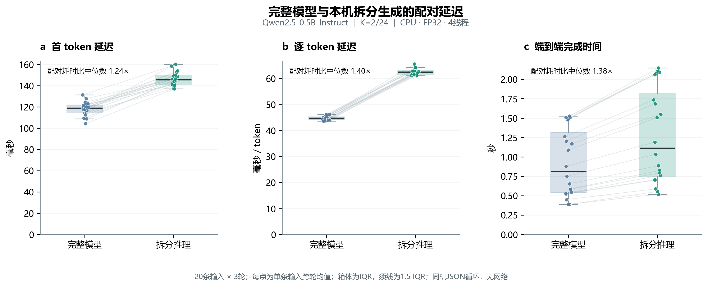
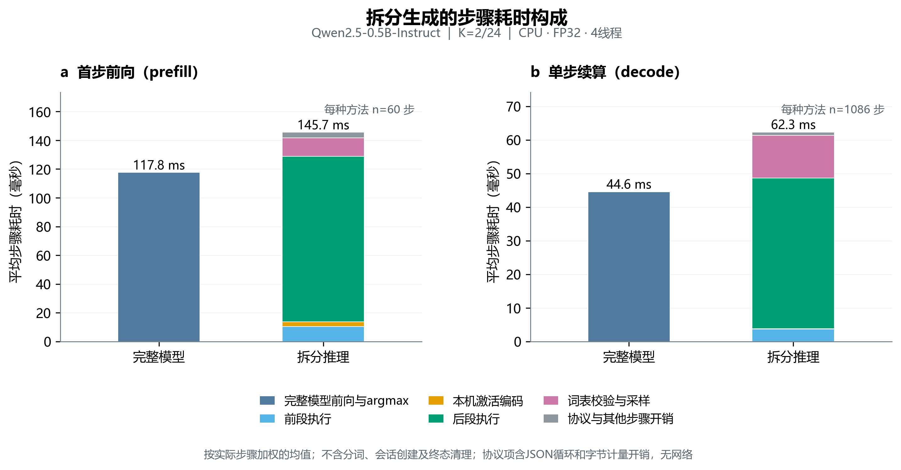
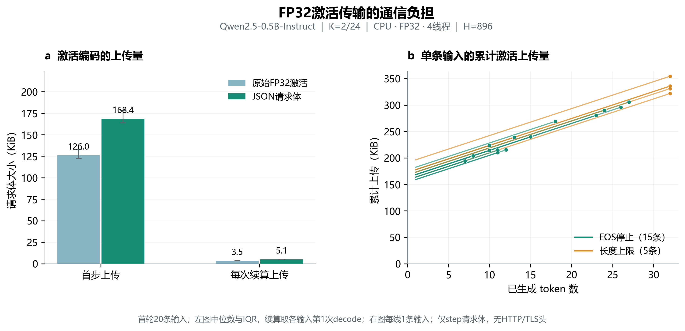

# Safe 本机生成对照实验

日期：2026-11-15。结论：进程内本机拆分生成与完整模型的60组生成序列、解码文本及停止原因完全一致，共核验1,146个token。当前CPU参考实现的拆分路径有额外耗时，未观察到加速；本组实验用于建立可复现的正确性与成本基线。

## 实验协议

| 项目 | 设置 |
| --- | --- |
| 模型 | Qwen/Qwen2.5-0.5B-Instruct，revision `7ae557604adf67be50417f59c2c2f167def9a775` |
| 切分 | 24个decoder block，K=2；H=896；本机独立prefix，后段独立suffix |
| 执行 | Windows、CPU、FP32、eager、batch=1、4个计算线程、1个interop线程 |
| 输入 | 既有20条固定中英文合成输入，固定chat template后34–42 token；不使用真实用户数据 |
| 停止规则 | greedy，最多32个新token；批准generation配置的EOS集合 `{151643, 151645}` |
| 完整模型基线 | 手写Transformers DynamicCache逐token循环 + Torch argmax，不调用默认generation配置 |
| 拆分路径 | 实际 `SplitInferenceService` → FP32/base64 → JSON/UTF-8循环传输 → `ContinuationService` → greedy回执 → 本机解码 |
| 预热与重复 | 双方各预热2次，每次最多4 token；之后20条×3轮，共60组配对、120次生成 |
| 顺序 | seed=20261115；每轮打乱输入顺序，每组随机化两种方法的执行顺序 |
| 网络与隐私 | 同机循环传输，没有HTTP/TLS、真实网络或DP；无压缩/量化 |

双方均禁用随机采样及源generation配置中的重复惩罚；只读取其EOS设置。模型加载排除在稳态延迟之外；主实验包含加载的总耗时约142.64秒。硬件标识、依赖版本、源权重SHA256、批准manifest摘要、运行时提交及脚本摘要见[原始报告](report.json)。

## 结果与统计口径

先对同一输入的3轮测量取均值，再以20条输入为统计单位计算中位数和四分位区间。下表采用**中位数 [Q25, Q75]**；配对耗时比是每条输入的“拆分/完整”比值的中位数，不能用两列中位数之比替代。重复运行不是60个独立输入，图中不将其视为独立样本。

| 指标 | 完整模型 | 拆分推理 | 配对耗时比中位数 |
| --- | --- | --- | --- |
| 首token延迟（ms） | 118.69 [114.87, 121.69] | 145.60 [141.24, 149.26] | 1.24× |
| 逐token延迟（ms/token） | 44.72 [44.07, 45.22] | 62.43 [61.68, 63.04] | 1.40× |
| 端到端完成时间（s） | 0.814 [0.541, 1.316] | 1.112 [0.749, 1.816] | 1.38× |

首token延迟从本机生成调用开始计至第一个token可用；TPOT为 `(最后token到达时间 - 首token到达时间)/(输出数 - 1)`，排除首步及最终文本解码/清理。端到端时间包含分词、会话、所有生成步骤、本机完整文本解码及KV清理。完整基线同样包含本机分词、文本解码和缓存清理。

60/60组token序列、完整文本和停止原因一致，匹配1,146/1,146个token；每轮输出382 token，其中15条EOS结束、5条到达32步上限。三轮共45次EOS、15次长度停止。每组结束后两侧角色KV注册表均为空。本实验只核验生成序列，不新增宣称全词表logits误差为0；全词表对照保留在上一阶段独立报告中。

## 实验图

所有图均由原始CSV生成，使用统一中文字体与配色，导出300 DPI PNG和矢量PDF，已经检查文字、图例和布局。IQR描述输入之间的差异，不是置信区间。

| 图像 | PNG预览 | 矢量PDF |
| --- | --- | --- |
| 配对延迟分布 | [fig_latency.png](figures/fig_latency.png) | [fig_latency.pdf](figures/fig_latency.pdf) |
| 步骤耗时构成 | [fig_time_breakdown.png](figures/fig_time_breakdown.png) | [fig_time_breakdown.pdf](figures/fig_time_breakdown.pdf) |
| 激活上传量 | [fig_activation_traffic.png](figures/fig_activation_traffic.png) | [fig_activation_traffic.pdf](figures/fig_activation_traffic.pdf) |



耗时构成按**实际步骤加权均值**计算，范围是前段开始执行到token回执返回，排除分词、会话创建和终态清理，与上一张图的统计口径分开。

| 拆分组件 | 首步均值（ms，n=60） | 续算均值（ms，n=1086） |
| --- | --- | --- |
| 前段执行 | 10.44 | 3.67 |
| 本机激活编码 | 3.30 | 0.14 |
| 后段执行 | 115.17 | 44.82 |
| 词表校验与greedy采样 | 12.90 | 12.74 |
| 协议及其他步骤开销 | 3.91 | 0.97 |

后段时间包括当前runner返回完整词表Python数值的转换。完整基线在Torch内直接argmax，不执行同样的Python词表校验；因此这里比较的是两条现有实现路径，不能把全部额外时间归因于模型切分本身。字节计量额外执行一次请求JSON序列化，其开销包含在拆分路径端到端与协议剩余项中。词表校验/采样约占续算步骤的20.4%，是后续优化的直接目标。



上传量取第一轮20条输入；左图续算取每条输入的第1次decode，避免长输出被重复加权。中位首步原始激活126.0 KiB，实际JSON请求体168.4 KiB；每步续算原始激活3.5 KiB，JSON请求体约5.10 KiB（5220字节）。它包含base64和step元数据，尚不包含HTTP/TLS头、会话创建、响应或链路重传。



## 原始数据与复现

- [runs.csv](runs.csv)：120次生成的首token/TPOT/端到端时间、停止原因、输入/输出长度、方法顺序和输出token序列摘要。
- [steps.csv](steps.csv)：两种方法共2,292个生成步骤；拆分步骤另有组件计时、原始激活及真实JSON字节数。
- [report.json](report.json)：实验设置、运行环境、正确性结论与原始CSV的SHA256。
- [figures/analysis.json](figures/analysis.json)：绘图聚合值、图注、字体、数据/脚本/图像摘要。

不保存输入/输出文本、激活、KV或完整logits。原始数据按字节哈希；父目录 `.gitattributes` 禁止CSV/JSON换行转换，保证不同平台检出后仍能验证。失败或旧报告不覆盖。

从仓库根目录运行。模型和角色制品须事先准备；输出路径必须不存在。绘图附加依赖通过 `apps/agentOS/requirements.safe.plotting.lock` 安装，基础模型运行环境保持独立。

```powershell
apps/agentOS/.venv-safe/Scripts/python.exe -m pip install --require-hashes -r apps/agentOS/requirements.safe.plotting.lock

apps/agentOS/.venv-safe/Scripts/python.exe -B apps/agentOS/evals/safe/exam/benchmark_local_generation.py `
  --source data/safe/source/qwen2.5-0.5b-instruct `
  --artifacts data/safe/artifacts/qwen2.5-0.5b-k2 `
  --manifest-digest 154770d9c59c47a080def5294976308829bdb0f480afa5efd9ad96cb2fe88f3f `
  --output data/safe/evidence/local-generation-new-run `
  --samples 20 --repeats 3 --max-new-tokens 32 --threads 4 --warmup 2 --seed 20261115

apps/agentOS/.venv-safe/Scripts/python.exe -B apps/agentOS/evals/safe/exam/gen_fig_local_generation.py `
  --input data/safe/evidence/local-generation-new-run
```

绘图入口先校验报告成功状态、CSV哈希、配对完整性、逐步计数和FP32字节数；任何不一致都拒绝绘图。中文字体使用微软雅黑，或安装Noto Sans CJK SC；不将字体文件加入仓库。

## 解释范围

这是一台共享Windows主机、一个小模型、一个固定切点、短上下文及20条合成输入的工程基线，不是语义质量、隐私攻击或普遍加速结论。随机化顺序和预热只能减轻部分计时偏差，没有CPU绑核/频率锁定；三轮重复与IQR用于描述本次观测，不报告显著性检验或置信区间。

完整网络推理还需认证、真实带宽/RTT、独立设备负载和资源配额评估；后续可在保持数值语义的前提下优化Python词表扫描与数据转换，再独立复测。尚未测量CUDA、多切点、量化/压缩、独立设备峰值内存、DP或激活反演风险。
