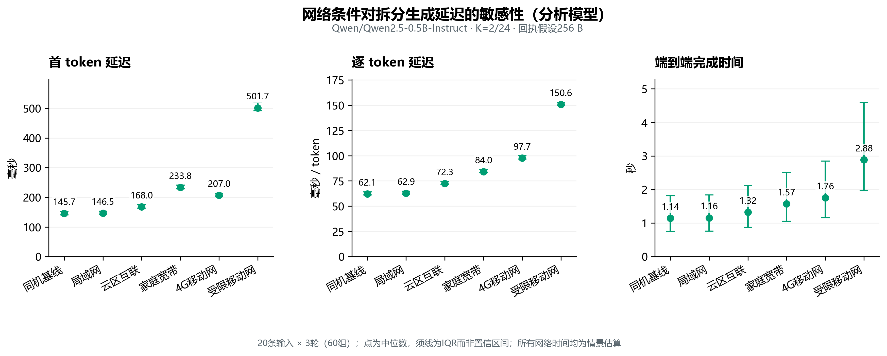
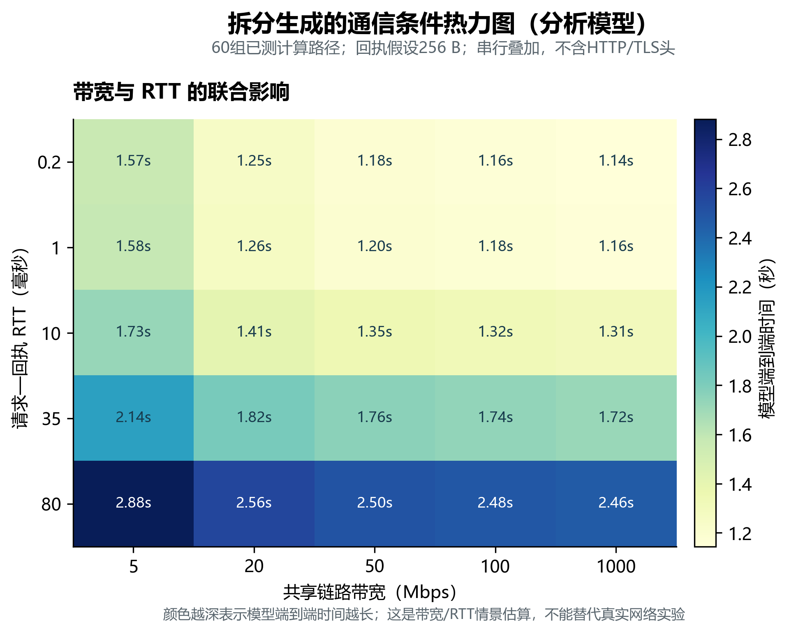

# Safe 拆分生成：网络敏感性分析

日期：2026-11-15。本组实验在已有真实模型生成记录上扩展通信分析，评估逐 token 拆分推理对基础 RTT 和带宽的敏感性。**这是串行网络叠加模型，不是局域网或公网实测，也没有新增隐私保护保证。**

## 输入证据与实验设计

- 来源：[本机生成配对实验](../2026-11-15-local-generation/README.md)。Qwen2.5-0.5B-Instruct，前 2/24 层在客户端执行，CPU FP32；20 条合成输入各重复 3 轮，60 组配对生成的 1,146 个 token 与完整模型一致。
- 本轮不重新加载模型，不访问网络。复用 60 条 split 运行的真实 `e2e_ms`、`ttft_ms`、`tpot_ms`，以及每一步实际编码后的 `request_json_bytes`。
- 6 个预设情景分别覆盖低延迟链路、高 RTT 链路与带宽受限链路，共输出 360 条分析记录。情景名称仅为便于理解的标签，参数不是运营商网络的实测分布。
- 另以同一组计算路径建立 5 种带宽 × 5 种 RTT 的网格；25 个网格中位数保存在 `figures/analysis.json`。
- 回执体统一假设为 256 B/step，报告明确记录 `response_bytes_measured=false`。该值不是实测，也不保证是回执大小的上界。
- 60 组记录含重复测量，不能视作 60 个独立输入样本。统计量为逐运行分布的中位数和 Q25–Q75，不是置信区间；此口径与上一组“先对每条输入跨轮取均值”的图不同。

## 公式与计量边界

RTT 是每次激活请求到 token 回执的基础往返延迟；每步只叠加一次，不再乘 2。本模型将有效载荷传输时间单独计入 RTT 之外，两个方向使用相同的带宽参数，并按串行传输处理：

```text
第 i 步通信时间（ms）
  = RTT_ms + (request_json_bytes_i + response_bytes) × 8 / (bandwidth_Mbps × 1000)

modeled_e2e_ms  = measured_split_e2e_ms + 所有步骤通信时间之和
modeled_ttft_ms = measured_split_ttft_ms + 第 0 步通信时间
modeled_tpot_ms = measured_split_tpot_ms + 后续 decode 步骤通信时间的均值
```

不假设计算与网络重叠；模型加载时间不计入生成延迟。输入基线保留本机 JSON 编码、协议处理和终态清理的实际开销，因此这不是异构端云设备之间的加速预测。HTTP/TLS 头、握手、连接复用差异、压缩、重传、拥塞、抖动、服务器排队和会话创建/关闭通信均未建模。单 token 输出没有 TPOT；缺失指标不会补零，无法汇总时明确拒绝。

## 结果

下表直接对应 `report.json` 的逐运行中位数。须线为各情景下 60 条记录的 IQR。

| 情景 | 带宽 / 基础 RTT | 首 token 延迟 | TPOT | 端到端完成时间 |
| --- | ---: | ---: | ---: | ---: |
| 同机基线 | 1000 Mbps / 0.2 ms | 145.7 ms | 62.1 ms/token | 1.14 s |
| 局域网 | 1000 Mbps / 1 ms | 146.5 ms | 62.9 ms/token | 1.16 s |
| 云区互联 | 100 Mbps / 10 ms | 168.0 ms | 72.3 ms/token | 1.32 s |
| 家庭宽带 | 20 Mbps / 20 ms | 233.8 ms | 84.0 ms/token | 1.57 s |
| 4G 移动网 | 50 Mbps / 35 ms | 207.0 ms | 97.7 ms/token | 1.76 s |
| 受限移动网 | 5 Mbps / 80 ms | 501.7 ms | 150.6 ms/token | 2.88 s |



在固定计算路径下，5 Mbps/80 ms 情景的端到端中位数约为 1000 Mbps/0.2 ms 情景的 **2.52 倍**。首步真实 JSON 请求体中位数约 **168.4 KiB**，后续 decode 请求约 **5.1 KiB/step**；对应原始 FP32 激活分别为 126 KiB 和 3.5 KiB，不能把原始张量大小当成线上请求体大小。

较高 RTT 在逐 token 往返中持续累积；较低带宽对首步较大的激活请求影响明显。例如，20 Mbps/20 ms 的首 token 延迟高于 50 Mbps/35 ms，但 TPOT 更低。这是两个通信参数的共同作用，不能仅按情景名称排出统一快慢次序。



热力图使用相同的 60 组计算路径，只改变通信项；横纵坐标均为离散网格，颜色表示模型端到端完成时间。它不表示设备实测、网络采样或额外模型生成。

## 文件与一致性校验

- [network_runs.csv](network_runs.csv)：360 条逐运行情景记录，保留实测计算项、网络参数、请求次数、总有效载荷和首步请求字节，支持重算公式。
- [report.json](report.json)：源报告 SHA256、模型 manifest、源计算提交、脚本/分析模块哈希、情景定义、回执假设、统计口径和 CSV SHA256。
- [figures/analysis.json](figures/analysis.json)：源报告/分析报告/绘图脚本哈希、字体、Matplotlib 版本、25 个网格中位数及四个图像文件的 SHA256。
- [延迟图 PNG](figures/fig_network_latency.png) / [矢量 PDF](figures/fig_network_latency.pdf)。
- [热力图 PNG](figures/fig_network_heatmap.png) / [矢量 PDF](figures/fig_network_heatmap.pdf)。

分析前验证源报告状态、CSV SHA256、输入/轮次/方法的完整配对、输出一致性、连续步骤、激活 FP32 形状及有限非负数。绘图前再次验证情景笛卡尔积、重复运行、跨情景计算路径、通信公式、全部汇总值和回执假设。仅更新哈希不能让重复记录、非法数值或错误汇总通过这些一致性检查；SHA256 本身不认证证据来源，也不防御同时重写全部证据的攻击。

## 复现

从仓库根目录执行。使用已安装 `requirements.safe.lock` 与 `requirements.safe.plotting.lock` 的可选 Safe 环境。所有输出目录必须不存在；脚本拒绝覆盖旧证据。

```powershell
apps/agentOS/.venv-safe/Scripts/python.exe -B apps/agentOS/evals/safe/exam/analyze_network_sensitivity.py `
  --input docs/superpowers/reports/safe/experiments/2026-11-15-local-generation `
  --output docs/superpowers/reports/safe/experiments/new-network-sensitivity `
  --response-bytes 256

apps/agentOS/.venv-safe/Scripts/python.exe -B apps/agentOS/evals/safe/exam/gen_fig_network_sensitivity.py `
  --input docs/superpowers/reports/safe/experiments/new-network-sensitivity

cd apps/agentOS
.venv-safe/Scripts/python.exe -B -m pytest tests/safe tests/components/test_model_partition.py -q -p no:cacheprovider
```

PNG 为 300 DPI，PDF 保留矢量元素并嵌入字体；中文字体优先使用微软雅黑，其次 Noto Sans CJK SC 或黑体。

## 下一阶段

1. 在现有 transport 端口实现已认证的真实激活请求与 token 回执，记录实际请求/响应体字节；会话生命周期通信单独计量。
2. 在受控局域网或网络仿真环境中记录实际 RTT、吞吐和端到端延迟，对照本分析模型验证残差；不能用 `sleep` 结果冒充真实网络测量。
3. 在真实链路跑通后再分阶段增加切分点、输入长度与激活编解码方案的对照，逐项验证输出一致性、通信量与会话回收。

这些是后续任务，本次没有实现公网认证传输、正式 DP 发布器或隐私攻击评估。
