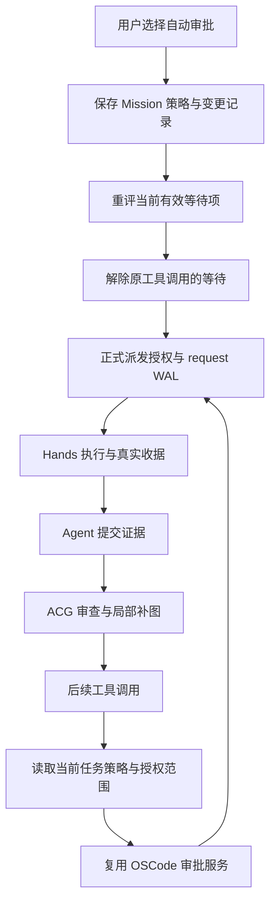

# ACG 任务自动审批设计

状态：自动审批已实现并部署。用户已取消旧任务和 `mission_2d3124c76052`，不再自动续跑；下文保留各阶段验证记录。日期：2026-11-17。

## 目标

用户在 ACG Copilot 中选择“自动审批”后，当前任务的文件修改和命令执行获得持续授权，Agent 可以继续执行、审查和补图，不必逐条等待人工确认。模式属于任务，刷新页面、图版本变化、断点恢复和服务重启均不丢失。

审批回答的是“这次操作是否获准执行”。操作是否成功、证据是否完整、任务是否满足验收，仍由执行收据和 ACG 审查判定。自动审批不代表自动验收通过。

本功能不增加审批次数、任务轮数或授权时长限制。已有单次 I/O 超时和显式取消继续由执行机制处理。

## 已核实的复用基础

- `apps/agent/app/tools/permissions.py` 已提供 `ChatPermissionService.authorize/resolve`，OSCode 正在使用。`ask` 请求批准，`auto` 自动批准文件修改，`full` 自动批准文件修改及命令。
- `FormalWorkspaceTools.execute` 已复用这个服务，但没有传入 `approval_mode`，因此正式任务始终使用 `ask`。
- 现有 `CopilotPermission = read_only | task_collaboration` 表达任务协作权限，与工具是否弹出审批是不同事实。任务权限已按 Mission 持久化。
- 正式工具已经具有 NodeRunner guard、工作区授权、request WAL、Hands 执行与收据闭环。这条路径继续作为唯一执行路径。
- 审批卡现已通过既有 RuntimeObservation 刷新同步状态，可以在 SSE 不可用时显示待审批项。

## 前端交互

沿用 Copilot 输入框左下角的菜单、暗色面板、现有字体和图标。增加一个选项，不增加独立设置页。

| 菜单选项 | 说明 | 内部协作权限 | 工具审批模式 |
| --- | --- | --- | --- |
| 仅对话 | 查看状态、解释问题和提出建议 | `read_only` | `ask` |
| 按需确认 | 继续协作，文件修改和命令执行按现有规则询问 | `task_collaboration` | `ask` |
| 自动审批 | 自动批准本任务的文件修改和命令执行 | `task_collaboration` | `full` |

ACG 的“自动审批”对应现有引擎的 `full`。使用现有 `auto` 会继续阻塞命令，不能实现本功能目标。首版不额外增加“只自动改文件”这一中间选项。

菜单标题为“授权范围 · 整个任务”。自动审批说明：

> 自动批准文件修改与命令执行，跨图版本和断点恢复持续有效，直到关闭。

菜单底部简要说明实际执行范围：

> 适用于本任务当前绑定的工作区授权。命令按当前系统用户权限执行。

不能把任意 shell 描述为被文件工作区沙箱隔离；现有命令能力并不提供这种保证。

选择模式即提交，无额外确认弹窗。请求中显示“正在设置…”，收到服务端回执后再显示新模式；失败则保留原模式并就地提示。选中“自动审批”后，底部持续显示该标签及现有 MagicStick 图标。

启用成功的回执显示“已开启自动审批，已处理 N 项待审批操作”。N 只统计真正解除等待的请求。切回按需确认显示“后续操作将按需确认”。

自动批准记录附在原工具活动中，显示“已自动批准”；展开显示时间、操作者、策略版本和实际执行结果。连续命令继续按现有工具活动分组，不新增大量独立审批卡。

当前节点的摘要在存在有效等待项时显示“等待审批”，不能把一次工具拒绝或审批过期直接显示为整个节点失败。节点终态继续以正式步骤状态为准。

“仅对话”限制 Copilot 发起协作操作，不等于暂停已经运行的任务；需要暂停执行时使用现有停止操作。

## 任务策略与持久化

把现有 Mission 级任务权限记录扩展为一个 `TaskOperatorPolicy`，复用现有持久化端口和迁移机制。旧的 get/set task Copilot permission 方法成为兼容入口，统一访问此记录，不再建立另一份协作权限来源。

策略包含：

- `missionId`、协作 `permission`、工具 `approvalMode`。
- 自动审批授权的 `workspaceId / grantId / resourceId`，由服务端从正式 Run 绑定取得。
- 独立递增的 `policyRevision`。
- 服务端确定的操作者及租户、修改时间、用户操作 `operationId`。

没有显式记录时保持原行为：`task_collaboration + ask`。升级不会自动启用。权限和审批模式在同一事务中变更，避免半完成设置。

策略属于当前 Mission，并匹配当前工作区授权。图 v2→v3、同 Run 新 Attempt、后续 Run 和重启可继续使用同一授权；更换工作区、grant 或执行资源后不自动把旧授权扩大到新范围。新 Mission 使用默认值。

`policyRevision` 独立于 `runtimeRevision`。模型或工具持续运行不能使用户切换模式反复冲突。浏览器缓存只用于展示，不能决定服务端实际授权。

## API

扩展现有 `POST /runs/{runId}/copilot/permission`，避免再增加一套平行设置入口：

```json
{
  "permission": "task_collaboration",
  "approvalMode": "full",
  "expectedPolicyRevision": 3,
  "operationId": "user-generated-stable-id"
}
```

服务端校验当前用户对 Mission 的写权限及正式绑定，事务性更新策略，返回实际策略、revision 和待审批处理结果。相同 operationId 与相同内容返回原回执，内容不同则冲突。旧请求仍按原语义设置协作权限及 `ask`，避免旧客户端无意保留自动审批。

`GET /runs/{runId}/copilot` 返回 `taskPermission`、`approvalMode`、`policyRevision` 和当前绑定的生效状态。历史 Run 只展示实际策略及历史记录，不能修改授权。

模式切换不创建新 Run，不修改图，不重新执行节点，不调用模型来猜测用户是否授权。

## 服务端执行流程



在应用层复用并整理现有审批服务为工具审批公共能力，保留 Chat/OSCode 的兼容名称和调用方式。核心运行时通过现有端口读取任务策略，不依赖 Chat 页面或模型输出。

每次正式工具调用读取最新任务策略，把匹配的审批模式传给现有 `authorize`。`full` 只把已有策略的 ASK 转为 ALLOW，不把 DENY 转为 ALLOW；现有工作区、工具可用性和执行许可继续由各自权威校验。首版不添加命令正则白名单、额外风险打分模型或隐藏轮数限制。

批准决定的来源、策略版本、操作者及操作身份作为附加元数据写入原 request WAL。复用原 operationKey、invocationId 和幂等身份，不增加绕过正式执行的通道，也不另建一份执行日志。

## 已有待审批、撤回与并发

启用模式后，服务端处理当前 Mission 中仍在运行且授权范围匹配的等待项，调用原 `resolve` 解除原调用等待。处理发生在后台，即使页面关闭也生效。

当前 `_PendingApproval` 缺少完整工作区和正式执行身份，需要补充受信上下文：Run、node、Attempt、commit、workspace 和 grant。模型不能填写这些字段。不能仅凭 `sessionId == runId` 就批准。

人工点击、自动策略和超时会竞争同一个 waiter，只能有一个决定成功。策略变更已提交但等待处理被中断时，后台可按同策略版本重新协调有效等待项；每个 operation 仍只解除一次。过期、拒绝、取消或已结束的历史审批不会复活。

派发前重新核对任务仍活跃、Permit、绑定和授权。由同一个 Mission 授权协调器串行处理策略变更与工具准入：在共同的策略锁内核对 `policyRevision`，并把批准决定随原 request WAL 持久化。该提交是派发授权生效点，不能仅通过派发前普通重读来规避撤回竞态。

切回按需确认后，尚未取得派发授权的操作重新进入人工审批。批准决定已持久化而 transport 尚未调用的窗口，也明确归为已授权操作，继续沿原调用身份派发、结算；策略撤回不追溯取消它。已经执行的命令同样不会被切换模式暗中取消。

现有冻结 session/receipt 的重放和断点恢复规则继续有效。出现外部结果未知时仍由正式结算处理，自动审批不能把结果未知变成执行成功。

## 审批与审查的关系

本功能处理 `fs.write / fs.patch / shell.exec` 等既有工具确认。文件读取和目录列举沿用现有自动允许行为。

ACG 的证据审查、补图和验收仍按已有机制推进。需要用户补充事实的提问继续显示；自动审批不能替用户编造答案，也不会自动同意取消、整图重跑或被显式设置为人工决定的任务验收。

## 代码改动范围

| 位置 | 改动 |
| --- | --- |
| `app/tools/permissions.py` | 复用模式评估、waiter 生命周期与 resolve；补充内部受信 scope 和决定来源 |
| `app/tools/formal_workspace.py` | 读取任务策略、派发前重验、把批准依据嵌入原 WAL |
| WorkflowStore / memory / SQLite | 扩展唯一任务权限记录、迁移、独立 revision 和操作幂等回执 |
| `runtime/planning_interaction.py` 与 `agentos_v2.py` | 扩展现有权限 API、投影实际模式、协调有效等待项 |
| `AcgCopilotPanel.vue` 与 API 类型 | 三项组合菜单、服务端回执状态、策略同步 |
| `PermissionSelector.vue` | 复用菜单视觉与键盘交互；不更改 OSCode 三种模式的既有语义 |
| `FormalToolApprovals.vue` / 工具活动投影 | 保留手动审批、呈现自动决定来源，沿用既有正式刷新 |

## 验收

1. 默认按需确认；选择自动审批后，真实文件修改和命令均无人工等待，读/list 行为保持一致。
2. 当前有效等待项继续同一个 invocation，不重跑节点或工具；重复设置、人工竞争及超时均不重复派发。
3. 同任务同工作区的图修订、断点恢复和服务重启继续生效；其他任务及更换授权范围不会继承旧的自动授权。
4. 关闭后下一次尚未取得派发授权的写入/命令恢复人工确认；关闭不会伪造执行取消。
5. 页面离线不影响策略执行；返回后能从正式投影看到当前模式、批准依据和工具结果。
6. 无效用户、已撤销 grant、无效 Permit 和未知外部结果继续按正式机制处理；自动审批不能将其显示为成功。
7. ACG 仍执行“证据 → 缺口审查 → 局部补读 → 再审查”，直到真实验收满足。

实现已通过策略持久化、迁移、CAS、审批等待、撤回与派发竞争、工具 WAL、前端菜单和网关投影的聚焦测试。

断点恢复补充：显式“恢复失败任务”可在自动审批策略范围内为已结算的原生工具会话建立新 Attempt，保留原 Run、图版本和已提交节点。恢复准入核对完整声明、请求、收据和结果，保存不可变的操作授权及证据指纹；未知外部结果仍需先结算。新 Attempt 获得保留原身份的历史工具观察，继续剩余范围。失败节点处于没有活动执行和事实提问的 Planner 等待屏障时，可直接使用此恢复入口。

显示链路以持久化 Run 的正式续跑状态重新建立实时流基线，保留节点历史并隔离旧 Attempt 的迟到事件。模型正常结束且仅遗漏根对象闭合符时进行确定性恢复，完整字段及原输出合同仍须通过校验。

部署验证：通过显式维护入口升级旧任务权限表及其原始更新触发器后，服务启动检查全部通过。`mission_e6e8960d879f` 的策略为 `full`、版本 1、当前工作区匹配；再次重启后保持生效，前端显示“自动审批”。通过已登录用户的恢复 API 续跑 `run_12d720733e29`，保留图 v3 和 5 个已完成节点，审查节点建立新 Attempt，前端图中可见运行状态和模型实时活动。此时任务仍在审查，尚未宣告验收完成。

正式工具通过已有绑定上下文的证据收集接口传递历史工具结果，审计和保护包装器显式转发该接口。对首轮模型调用前的失败，仅在原生 Agent 身份、终态、执行代次和正式 WAL 闭环均可证明没有派发工作时允许局部恢复；已有已结算证据及不可变授权继续保留，不以错误码或空模型轮数单独判断。

2026-11-17 运行恢复修复：工具宿主的租约、资源和授权失效保留稳定错误码并立即交回 ACG；SDK 不得吞掉宿主失败或取消后继续调用模型。参数错误提供工具 schema 和纠正提示；相同失败动作在证据没有变化时再次出现，交回宿主处理，有效补充证据继续执行。新提示在原模型回合 WAL 中记录协议版本，历史回放保持原请求身份。删除已无执行作用的 SDK 次数参数及重复配置。

并行节点失败先发停止通知，再等待清理；保留同期已提交结果。续租复用受拥有者管理的阻塞调用，移出事件循环；Redis 连接和读写超时各为 3 秒，租约 TTL 不变。重启对账在独占 Run fence 下关闭本地 native 子执行并补齐任务退出事实，工具是否结算仍由原账本证明。恢复多个中断节点共用原 Run、Permit 和图，先执行已授权恢复范围，首批新结果后恢复正常审查。失效的旧修订提案通过现有 graph-patch 值存储归档，恢复和 Planner 唤醒复用同一退役函数。

实际验证：完整只读恢复预检通过，三个中断节点原工具请求确认数为 12、38、13，没有未确认请求；原有 6 个完成节点、引用和图 v3 的指纹保持不变。经已登录用户的恢复及审查 API，`run_12d720733e29` 中 `_3 / _4 / _5` 已建立新 Attempt 并进入运行，自动审批 `full`、版本 1、范围匹配，没有待审批项。前端以当前 Run 状态为准，旧 SSE 和历史 Attempt 不再制造“运行中”；正式恢复同时重建显示基线，保留历史正文。

截至 2026-11-17 17:36（Asia/Shanghai），三个新 Attempt 的模型调用均返回 `MODEL_RATE_LIMITED`，按已有退避机制等待重试，尚无本轮新的读取结果，任务未宣告验收完成。Planner 异常历史仅记录类型，无法还原 round 27 的具体错误码；现已另补稳定错误码和白名单审计诊断并通过回归，该诊断增补待下次自然重启加载，未为此中断正在运行的任务。

2026-11-17 模型切换验证：通过已有模型档案 API 激活 DeepSeek，连通性检查通过，服务重启后配置保持。档案模型 `deepseek-v4-flash` 经既有别名规则归一为执行模型 `deepseek-flash`；正式新 Attempt 的模型回合记录确认为 DeepSeek，并出现新的目录列举、文件读取收据。

本次切换同时修正中断恢复入口：失败 Run 中已取消的未完成节点可以作为同 Run 恢复锚点，授权范围、预览和按钮能力复用中断节点集合；显式取消的 Run 仍不恢复。普通 Planner 暂停由同一规则决定预览和提交是否可以解除，删除预览单独忽略标记的分支及重复拒绝事件特殊处理。事实问题、条件等待、节点及控制审查继续保留。首次恢复回归 97 项通过；最后调整的聚焦回归 45 项通过，新增边界检查单独 38 项通过。

2026-11-17 18:24（Asia/Shanghai），用户明确要求改用干净的新任务，不再继续旧任务。已通过正常取消 API 停止 `run_12d720733e29`；18:25 只读核对为 `cancelled`、无活动节点，三个当前 Attempt 均已取消，原六个完成节点保留。DeepSeek 仍为默认服务，旧任务未宣告验收完成，后续不再对其提交恢复。

2026-11-17 Planner 决策边界修复：`mission_2d3124c76052` 的旧等待记录仅保留 `ValidationError` 类型，无法还原当时的具体字段。模型候选现在沿用原决策合同进行校验，失败时把字段和语义规则反馈给模型，在同一事实快照与规划截止时间内纠正；没有新增固定纠正轮数。重复同一无效动作且未修正规则时记录 `PLANNER_DECISION_NO_PROGRESS`，不靠改变解释文字继续空转。宿主单独持久化技术故障及经过白名单过滤的诊断，前端显示“规划处理失败”和“重新规划”；普通外部等待和事实提问保持原语义。重新规划复用原审查 API、检查点和并发校验，清除失败决策缓存后重新调用 Planner，保留已完成节点及输出引用。

读取覆盖诊断复用同一次正式工具收据核验，补充导致观察失效的工具、凭证引用、时间和范围内去重数量。无法核验副作用时只报告未知，不声称命令确实修改了文件。此次任务最后一次命令执行使此前 23 个文件路径和 41 个目录路径的观察失效；新诊断供 Planner 决定补采范围，不改变原证据有效性及覆盖指纹，不把旧读取直接认作当前覆盖。

验证：决策纠正 8 项、证据与工作区审查 186 项、运行时与投影联合回归 78 项通过；typed 故障持久化往返后的投影集 20 项通过，前端组件 72 项及类型检查通过。19:40（Asia/Shanghai）正常重启加载修复后，经已登录用户的原审查入口为 `run_a166a94eea46` 重新规划，第 19 轮返回有效 `continue`，原图 v6 的 `T9` 建立新执行，模型为 `deepseek-flash`。后续只读核对已新增 13 次目录列举、2 次文件读取的完成结果；前端图显示“当前执行 · 定向补齐未覆盖路径与缺失证据”及执行中节点。原 11 个完成节点的完整指纹一致；任务仍在运行，尚未宣告仓库验收完成，旧任务未恢复。

## 2026-11-17：修复读取审查循环与上下文投递

用户在 20:01 明确要求先停止 `mission_2d3124c76052`。正常取消后，`run_a166a94eea46` 保持 `cancelled`、revision 153、图 v8、无活动节点，15 个完成节点及其输出保留。本轮修复和独立测试不恢复此任务，也不恢复此前取消的旧任务。

修复依据是：覆盖事实来自可核验的执行收据，读取阶段应持续积累证据；ACG 管理全局范围和图修订，单节点只处理本批工作。此前 `AuditedToolRuntime.scoped()` 会重新加入所有 Hands 原生工具，导致只读审查仍可执行任意 shell。现在 scope 只能收缩，重新绑定、二次 scope、流式调用和文本执行入口均不能扩权。具有正式仓库读取或审查语义的节点只暴露 `fs.read/fs.list`；测试、命令和修改作为有对应能力的后续节点执行。

证据核验复用同一份正式收据及副作用信息。已核验的定点 patch/update 只淘汰目标文件和受影响的目录观察；创建文件还会淘汰可能自动创建目录的祖先观察。请求路径与收据路径不一致、失败或无法核验的写入，以及没有可信只读证明的 shell，仍按未知副作用处理。不会根据命令文字、返回码或模型自述认定 shell 只读；未受影响证据继续有效。

补图只为新增或改变的依赖生成资源合同，保留已完成旧边的通信、记忆和证据合同，包括原来没有显式资源声明的隐式旧边。理解节点提交结果后，即使尚未调用工具，也可以在范围未完成时触发 ACG 观察。编译器对从 JSON properties 隐式推导的通信字段采用稳定顺序，显式声明的字段顺序保留。接管时根据原激活记录核验并复用旧图冻结的执行包，保持原 Identity 和包指纹校验，不重编译后改签历史执行事实。

模型首次投递明确区分 `assignedAcquisition/assignedReview` 和全局 `observationProgress`。读取节点提交本批证据与缺口，审查节点核验本批结论，后续批次由 ACG 安排。每次工具回合后的反馈仅携带本批目标及全局覆盖计数、指纹，不再次追加全仓路径页。新反馈协议写入既有模型回合 WAL，历史未标记回合保持原反馈格式和原 requestHash；不会删改工具原文、模型历史或既有收据，也不增加固定执行或审查次数上限。

记忆召回先通过同一权威 store 的 scope 查询读取当前 Run 候选，再做类型、过期和相关性筛选。BM25 零相关记录不再仅凭排名位置获得 RRF 分数；无相关命中时允许返回空列表。查询由当前节点目标、名称、验收标准和来源引用构成，不把上游源码正文重新作为召回 query。记忆继续按 Agent 生成数据处理，保留来源引用，不能代替工具事实。本任务原运行的已提交节点记忆读取数为 0，不能将其原有重复读取归因为持久记忆。

独立完整集成测试使用真实 Runtime、SQLite、正式规划提交/激活/接管/Permit/NodeRunner，以及带签名收据的 mock Hands；分别覆盖预置初次扫描和仅理解节点两种计划。两种情况均在同一 Run 多批补读和审查后完成原分析、报告后缀：38 个文件（含冻结范围内的 `.git`、`.cache`）全部读取，4 个目录各列举一次，原已完成节点及引用保留，每个节点仅执行一次；审查主动请求 shell 在派发前被拒绝；覆盖单调，完成后重入不增加工具或模型请求。结果为 2 passed。上下文、证据组合回归 295 passed；新增精简反馈与历史回放验证后，上下文、动态读取和执行前缀聚焦回归 106 passed。测试组合有重叠，不将各组数目累加为唯一总数。

兼容边界：有正式 activation/materialization 的已执行旧图复用冻结原包。没有旧包来源的 legacy 图仍须严格编译并对照原 Identity；尚未执行的旧 candidate 若跨编译器产生不同包，现有接管会拒绝并保持原记录，不能直接重签为新包。正式已准入工具清单跨只读策略升级发生变化时，仍保留原模型请求身份校验；本轮不放宽旧 WAL，不自动恢复任何取消任务。

记忆投递恢复补充：首次 Agent 调用之前，执行器按同一 commitId 把完整记忆记录、召回事件、冻结策略及 run/step/attempt 身份写入既有受控操作 WAL。同次执行重入复用该快照，不因并行节点新增记忆、记录随后过期或查询实现升级改变已投递输入；新 Attempt 使用新 key 正常召回。历史已有模型回合但无快照时，不补写推定历史快照，继续由原 requestHash 精确判断能否回放，内容相同的空记忆请求仍可复用。没有新增数据库状态机，内存实现复用既有执行值仓库，正文不进入图、检查点或 Trace。

最终验证：记忆输入新增的并发提交、SQLite 关闭重开、原模型回合零新增调用回放、新 Attempt 重新召回、历史缺快照和身份/类型/范围边界等 7 项，以及执行图、记忆和执行值仓库联合回归共 87 passed。最终记忆快照与精简反馈版本下，多批完整链路再次验证为 2 passed（178.21 秒）。图接管、generation、初始 Permit 及编译确定性 75 passed；核心编译包和旧候选不可改签边界 47 passed。各测试组存在重叠，不汇总为唯一总数。

部署核对：全部验证完成后，已通过 `persistent_runtime.py recover --desktop` 正常重启服务加载本轮实现，退出码为 0。AI、Hands host、backend、frontend 健康端点均返回正常，桌面就绪。已登录 API 再次确认 `run_a166a94eea46` 为 `cancelled`、revision 153、active=[]、15 个完成节点；真实库只读基线确认图 v8、节点与输出引用指纹完全未变，当前无活动 Run。本轮没有恢复或重跑原任务。
