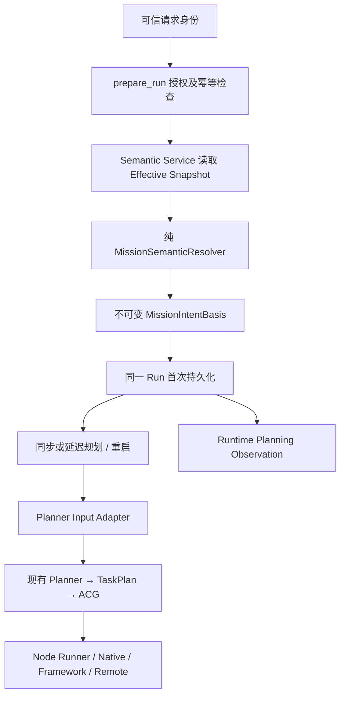

# PR-S00-02A：Mission Semantic Convergence Layer

## 范围与基线

- 本地 HEAD：`659cd50061ef7c1a66339621ac160e6bbb35337f`，分支 `master`。
- 开始时已有 PR-S00-01 的 7 个未提交路径；本轮保留它们，在共享合同、Service 和两种 WorkflowStore 上增量扩展。
- 本轮未创建 Git Commit、未推送、未打开或升级业务数据库。测试在系统临时目录运行；所有测试数据库均为临时数据库。
- 本轮没有修改 Planner 算法、Task Decomposer、ACG Builder/Compiler、Scheduler、Memory 实现、IdentityV2 Schema/Projection、Workspace 后端和前端。

## 实际调用链



Resolver 没有 Store、缓存、版本计数或写入能力。`MissionSemanticView` 仅表达当前正式状态；Run 中的 `MissionIntentBasis` 是不可替换的历史输入副本，不代表当前 Mission 状态。

### 正式状态与兼容状态

- `UNINITIALIZED` View 为 revision=0、objective=None，不从 title/input/Identity goal 升级事实。
- `INITIALIZED` View 读取正式 Objective、Constraints、Commit ID 和 revision。
- 只有显式允许兼容时，未初始化 Mission 才生成 `LEGACY_INPUT` 或 `LEGACY_TITLE` Basis；sourceRevision=0，commitId=None。
- 正式 Basis 为 `SEMANTIC`，sourceRevision>=1，并关联正式 Commit。
- 引用仍然是 `UNVERIFIED`。没有来源引用时允许 `NOT_APPLICABLE`，不会制造来源已验证的声明。
- 状态缺失、授权失败、损坏的状态或 Basis 不会退回旧输入。

### 冻结、版本与恢复

- 授权在读取当前状态前校验；幂等重放先返回原 Run，不重新捕获语义。重放仍重新校验权限，且 idempotency key 不能跨 Mission。
- Basis 在同步规划或 `planningDeferred` 占位之前生成，与 Run 首次保存共同持久化到已有 `executionState.missionIntentBasis`。
- 延迟规划、重启、节点执行和 Runtime Planning Observation 使用持久化 Basis。
- Mission r 更新到 r+1 后，旧 Run 继续基于 r 执行；新准备的 Run 捕获 r+1。本轮没有自动重规划或 Dispatch Fence。
- 单节点恢复和语义图修订继承原 Basis。用户主动新建 Run 则重新读取当前状态。
- 旧无 Basis Run 保持无绑定；普通保存不能为它补写 Basis。
- TaskPlan 的 `metadata.missionIntentBasisRef` 只保存版本及引用，不保存第二份正式目标。引用在现有 Identity 快照版本分配前附加，继续使用已有 planVersion 分配规则。
- 正式模式拒绝用户自行提供的显式计划包；恢复入口只允许与可信父 Run 完全一致的计划、Bindings 和 Blueprint。
- 没有引入 Planning Commit、commitmentRevision、Graph Activation 或 Artifact Version System。

### 指纹规则

Basis Schema 与 fingerprintVersion 均为 v1。SHA-256 输入为 UTF-8 规范 JSON：键排序、紧凑分隔符、禁止 NaN；Constraints 按 ID 排序，来源引用去重排序。不改写 Objective/Constraint 文本，不做 Unicode 归一化。输入包含 Mission ID、来源类型、来源 Revision、Commit ID、目标、约束、来源状态与版本字段，不包含时间、Token 或实时权限集合。

指纹用于持久化完整性与稳定引用，不是密码学授权签名。授权仍由 Service 和可信应用边界提供。

### 执行与材料边界

- Planner 输入副本移除旧目标别名，再从 Basis 生成兼容字段；正式空 Constraints 不会回退旧约束。
- 材料正文、材料引用、附件及运行配置保留；持久化 Mission 原始 input 不被修改。
- Node Runner 对已有 Agent 的 title/input 提供仅在适配器内存在的派生副本，并传递类型化 Basis；步骤 goal 保持局部职责。
- Native Prompt 分别表达 Mission 范围与 Planned Task 范围；上游 task_summary 不会替代 Mission 目标。
- Framework 输入区分 mission、step、materials；Remote Payload 在有 Basis 时附加 Basis，旧无绑定 Payload 保持兼容。
- Runtime 写阶段 Capsule 时使用冻结目标和约束，Memory 算法与 Schema 未修改；没有实现 Memory Overlay。

## 原子性与并发证据

- PR-S00-01 的语义提交仍在同一 SQLite `BEGIN IMMEDIATE` 中提交 State、Commit、Receipt、独立 Semantic Outbox；本轮不改变其事务结构，也没有将语义事件写入 lifecycle_outbox。
- Run 的 save_run、save_run_with_events、save_graph_patch_transition 在读取旧 Basis 前执行 `BEGIN IMMEDIATE`。共享校验器验证指纹、Mission 归属、TaskPlan 引用，以及已持久化 Basis 不可新增/删除/替换。
- 双连接测试验证同一 Run ID 的 bound/unbound 初次保存竞争只能成功一个；另一个返回冲突。
- Memory Store 复用已有锁和深复制行为，通过与 SQLite 相同的 Basis 合同测试。
- 不宣称 WorkflowStore、IdentityV2、Memory 或其他独立 SQLite 文件之间存在跨库 ACID。
- 正式 Snapshot 读取与 Run 首次落库不是跨实体原子事务；Basis 表达一次读取的已提交 Revision，随后 Mission 更新不使该历史依据失效。

## 修改文件与用途

以下路径均相对于仓库根目录。

| 文件 | 本轮用途 |
|---|---|
| apps/agentOS/src/contracts/mission_semantic.py | View、嵌套不可变 Basis、指纹和读取校验；扩展已有 S00-01 文件 |
| apps/agentOS/src/components/mission_manager/semantic_service.py | 不读取状态的权限重检入口；扩展已有 S00-01 文件 |
| apps/agentOS/src/components/mission_manager/semantic_resolver.py | 新增纯投影与显式兼容冻结 |
| apps/agentOS/src/runtime/planner_input_adapter.py | 新增规划输入和材料投影 |
| apps/agentOS/src/runtime/workflow_runtime.py | 注入、冻结、重放、延迟规划、显式计划边界 |
| apps/agentOS/src/contracts/planning.py | 允许 TaskPlan Basis 引用元数据 |
| apps/agentOS/src/contracts/runtime_planning.py | Observation 可选 Basis 引用 |
| apps/agentOS/src/runtime/planning_observation.py | 从 Run Basis 获取目标与版本依据 |
| apps/agentOS/src/runtime/runtime_recovery.py | 节点恢复继承父 Run Basis |
| apps/agentOS/src/runtime/semantic_revision.py | 图修订后继 Run 继承 Basis 与 TaskPlan 引用 |
| apps/agentOS/service/agents/base.py | 类型化上下文，校验与 Run Basis 一致 |
| apps/agentOS/src/components/executor/node_runner.py | 节点上下文、兼容副本和 ContextPack 目标接入 |
| apps/agentOS/src/runtime/acg_execution.py | 阶段 Capsule 的目标与约束采用冻结依据 |
| apps/agentOS/src/adapters/model/native.py | Native 目标与查询依据接入 |
| apps/agentOS/src/adapters/model/native_prompt.py | 分离正式 Mission 范围与步骤范围 |
| apps/agentOS/src/adapters/agent_architecture.py | Framework 语义、材料和步骤分离 |
| apps/agentOS/src/adapters/resource_execution.py | Remote Payload 可选冻结依据，保留旧上下文兼容 |
| apps/agentOS/src/support/stores/_policy.py | 共享 Basis 保存不变量 |
| apps/agentOS/src/support/stores/memory_workflow_store.py | 锁内调用共享校验；保留 S00-01 修改 |
| apps/agentOS/src/support/stores/sqlite_workflow_store.py | 已升级 Schema 激活、Run 写锁与共享校验；保留 S00-01 修改 |
| apps/agent/app/security/internal_auth.py | 从可信请求 Context 生成 SemanticPrincipal |
| apps/agent/app/execution/wiring.py | 显式启用、同库注入、owner/tenant 授权 |
| apps/agent/app/api/agentos_v2.py | 三处 prepare_run 身份传递，拒绝伪造控制字段与无身份创建 |
| apps/agentOS/tests/support/test_mission_intent_basis.py | 新增两种 Store 合同、不可变性与双连接测试 |
| apps/agentOS/tests/runtime/test_mission_semantic_convergence.py | 新增实际规划/执行/重启/修订接入测试 |
| apps/agent/tests/test_mission_semantic_convergence_boundary.py | 新增生产装配与可信 HTTP 边界测试 |
| 本文件 | 范围、验证证据与启用说明 |

## 验证记录

### 核心回归

测试范围：support、contracts、adapters，以及 Identity Lifecycle、ACG Run、Graph Patch、Semantic Patch、Planning Loop、Runtime Guards、新增语义收敛测试与 V2 Runtime Foundation。

最末次核心回归：**479 passed / 0 failed**，100.95 秒。另一次同范围为 478 passed / 1 failed，失败为下述既有毫秒级超时测试；保留此不稳定结果，不将它解释为稳定全绿。

最后补充核对显式兼容模式的 objective 优先级，保持旧 Planner 的 objective 输入优先；两种 Store 合同单独重跑 **20 passed / 0 failed**，1.73 秒。该兼容路径仍为 sourceRevision=0，不晋升正式事实。

### 应用回归

范围：新增应用边界、已有 Execution Runtime Wiring、Internal Service Auth，以及 Mission 创建幂等 API 测试。

**20 passed / 0 failed**，22.46 秒；2 条既有依赖弃用警告。

上述最终两个回归范围合计 499 项检查；本轮新增 31 项（核心 26 项、应用 5 项）。补跑合同范围与核心回归重叠，不额外计入合计数量。`git diff --check` 退出码为 0。

初次核心扩大回归出现 4 项 Remote SimpleNamespace 兼容失败，修正后通过；既有 `test_private_provider_activity_keeps_stream_alive_until_public_json_arrives` 在扩大回归中两次出现 20ms 首包超时，也在完整回归中通过。未改动该测试或实现，计时稳定性仍是已知限制。初次应用运行遗漏 pytest asyncio auto 配置，异步 API 测试未执行成功；显式配置后通过。新测试中的必填字段和接口名错误，以及无引用正式状态的 NOT_APPLICABLE 处理，均已修正并重跑。

没有执行浏览器、远程真实服务、真实 LLM、完整业务 E2E 或全仓库测试。未把这些标为通过。

### 可复现命令

为防止任何默认相对 DB 路径落到工作区，使用临时 cwd；禁用 pytest cache，应用测试不加载会清理旧目录的 conftest。下面从仓库根目录执行：

```powershell
@'
import os, sys, tempfile
from pathlib import Path
repo = Path.cwd()
root = repo / 'apps/agentOS'
os.chdir(tempfile.mkdtemp(prefix='s00-02a-core-'))
sys.dont_write_bytecode = True
sys.path[:0] = [str(root), str(root/'src')]
import pytest
paths = ['tests/support', 'tests/contracts', 'tests/adapters',
    'tests/runtime/test_identity_projection_lifecycle.py', 'tests/runtime/test_acg_run.py',
    'tests/runtime/test_graph_patch.py', 'tests/runtime/test_semantic_patch.py',
    'tests/runtime/test_planning_loop.py', 'tests/runtime/test_runtime_guards.py',
    'tests/runtime/test_mission_semantic_convergence.py', 'tests/runtime/v2/test_runtime_foundation.py']
raise SystemExit(pytest.main(['-c', str(root/'pytest.ini'),
    *[str(root/p) for p in paths], '-q', '-p', 'no:cacheprovider']))
'@ | python -
```

```powershell
@'
import os, sys, tempfile
from pathlib import Path
repo = Path.cwd()
temp = Path(tempfile.mkdtemp(prefix='s00-02a-app-'))
os.chdir(temp)
(temp/'.env').write_text('', encoding='utf-8')
sys.dont_write_bytecode = True
sys.path[:0] = [str(repo/'apps/agent'), str(repo/'apps/agentOS'), str(repo/'apps/agentOS/src')]
for key in ['AGENTOS_COMMUNICATION_DB', 'AGENTOS_LANGGRAPH_CHECKPOINT_DB',
    'AGENTOS_EXECUTION_VALUE_DB', 'AGENTOS_EXECUTION_MEMORY_DB', 'AGENTOS_CONTENT_MANIFEST_DB',
    'AGENTOS_PROVENANCE_DB', 'AGENTOS_AUDIT_DB', 'AGENTOS_WORKFLOW_DB_PATH', 'AGENTOS_IDENTITY_DB']:
    os.environ[key] = str(temp/(key+'.sqlite3'))
import pytest
paths = ['apps/agent/tests/test_mission_semantic_convergence_boundary.py',
    'apps/agent/tests/test_execution_runtime_application_wiring.py',
    'apps/agent/tests/test_internal_service_auth.py',
    'apps/agent/tests/test_agentos_v2_api.py::test_v2_create_mission_is_idempotent_and_rejects_fingerprint_conflicts']
raise SystemExit(pytest.main(['--noconftest', *[str(repo/p) for p in paths],
    '-o', 'asyncio_mode=auto', '-q', '-p', 'no:cacheprovider']))
'@ | python -
```

## 启用与限制

- `AGENTOS_MISSION_SEMANTIC_CONVERGENCE=true` 启用应用装配；默认关闭以保留旧启动行为。关闭时不能宣称所有新 Run 已收敛到正式语义。
- 启用前必须由独立、明确的操作安装 S00-01 v1 Schema。本轮没有执行业务库升级；启动只检查已存在的语义表与版本，不自动运行语义 DDL。
- 未初始化 Mission 默认不能创建绑定 Run。迁移期间若明确需要旧输入兼容，另设 `AGENTOS_ALLOW_LEGACY_MISSION_INTENT=true`；这不会生成 Semantic Commit。
- 已初始化 Mission 永远优先正式状态，兼容选项不能覆盖正式状态。
- 当前 SemanticPrincipal 从可信请求 Context 获取。无身份的内部调用不能自动获得语义读写权；创建后继 Run 的内部操作也需要可信执行主体。没有把持久化 Run.input 中的 actor 当作调用身份。
- 既有 owner/tenant 投影仅作为授权元数据；不从 Identity goal 读取正式目标。Identity 投影尚未完成的新 Mission 使用 HTTP 已盖章的 Runtime Mission 所有者字段进行授权。
- Basis 和任务范围在本地适配器受控；外部框架/远程实现收到合同后的实际行为没有做真实端点验收。
- 旧无绑定 Run 不回填。Workspace 和 Identity 展示仍属 S00-02B，当前可能显示兼容 goal。
- 并发时冻结后才发生的 Mission 修改不会阻止旧 Run 执行；更严格失效判定由后续版本绑定/激活 PR 处理。
- 新服务与存储接口只在可信内部代码边界使用；没有新增公开语义编辑 API。

## 自审结论与提交建议

- 没有新增第二套 Mission/Run 管理器、Resolver Store、Basis 表、长期语义写入口或版本分配器。
- 正式写入仍经过 S00-01 Service/CAS；派生 Basis 不修改 missionRevision。
- 新输入与授权路径不修改 Lifecycle 事件类型或 Identity 消费逻辑；Semantic Outbox 保持独立。
- Basis 权限不冻结；请求重放重新授权；来源引用不被提升成验证事实。
- Git Diff 混有既存 S00-01 与本轮 S00-02A：不能直接把整个工作区作为本轮提交。

建议人工分步提交：

1. 先按既有 S00-01 验收记录整理其基线；共享合同、Service、Memory/SQLite 文件需按 hunk 区分，不整文件误归属。
2. S00-02A 的合同、Resolver、输入适配、Store 不变量及合同测试。
3. Runtime、Planner 输入、节点上下文和恢复/修订接入，配套集成测试。
4. 可信身份装配、最小 HTTP 边界、应用测试与本验收文档。

后续 S00-02B 可处理 Workspace 展示和查询来源；S02 再建立 Proposal/Planning Commit。本轮没有提前实现这些内容，也不代表整个 S00 已落地。
