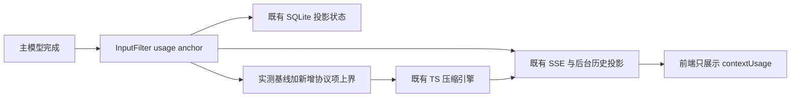

# 会话上下文水位统一

复用 ProtocolSession、ProjectionStore.usage_anchor_json、TypeScriptInputFilter 和现有 model_context / model_phase / usage SSE；不新增数据库、消息账本、后台计数器或模型调用。

规则：每次主模型调用发布并保存最后确认水位，失败不抹除它；下一次准备输入必须校验 route、fixedHash、协议前缀和历史 epoch，才能复用实测基线。SDK response 输出通过 SDK 自身的 replay 转换建立覆盖边界，禁止按全历史字节比例缩放。压缩判断和展示接收相同的测量结果；修改输入后的结果只标为估算上界，不能冒充供应商实测。摘要、标题等辅助调用不更新主模型水位。压缩提交通过已有 CAS，读取时按新投影前缀校验旧 anchor；冷恢复不能越过压缩版本恢复旧水位。

## 实现边界

- 扩展既有 usage_anchor_json 保存 watermark、SDK response 覆盖数量与哈希；不复制正文，不新增表或文件。每次 response.completed 保存，不等待整个用户轮次结束。分支 epoch、策略和 route 变化拒绝旧 anchor。
- 复用 SDK ModelResponse.to_input_items；覆盖成功时用实际 input+output 做基线，只计算之后新增协议项上界。来源不匹配则不用旧实测值，更不做全局字节/Token 比例缩放。
- 原 worker 的 sourceUsage 由 host 校验后提供，并绑定源码消息哈希；软预算触发后仍使用这份基线。候选裁剪/替换仅保守保留原水位并对新增项追加上界，不根据删除字节数猜测精确节约量。没有匹配锚点时继续使用既有保守策略，未引入新的粗略 tokenizer。
- 统计与自动压缩开关分离；measure-only 不调用 Node/摘要，也不修改模型输出上限。同步和流式模型都绑定同一 input filter。
- 沿既有 SSE 发布 contextUsage，shared chat-stream 统一解析，backend metadata 保留同一副本。GET /ai/chat/context/usage 只读原投影，可在 Runner 活跃时调用，不抢锁、不取消任务。恢复种子不能覆盖恢复期间的新事件。
- 前端优先读权威快照；失败保留最近确认水位，压缩版本由投影更新；仅旧历史兼容路径仍读取旧字段。实测、估算上界、未知用量明确区分，不用累计 Token 当窗口占用。
- 摘要预算耗尽返回 no_safe_range / SUMMARY_CALL_BUDGET_EXHAUSTED；继续遵守硬容量，不把正常预算耗尽伪报为摘要校验异常。

## 验证结果

- Python 模型流、协议日志、投影存储、手动压缩、只读快照和准备链路：70 项通过，1 项真实供应商测试按条件跳过。覆盖真实 SDK 工具循环后延续调用失败，SQLite 仍保存最后确认的 262 Token；覆盖已知 580 Token 的输入输出不再重复估算回复正文。
- TS 压缩引擎：51 项通过，类型检查通过。新增测试验证完整 UTF-8 上界超过硬容量时，匹配哈希的供应商基线仍贯穿 worker；哈希变化不能复用实测值。
- 前端流、历史恢复、压缩与信息栏：94 项通过，类型检查通过。后端相关 16 项通过，构建通过。
- 复用既有隔离浏览器核验脚本：主卡显示估算 240k/1m，同时注明最近实测 200k；工作集卡也使用 240k，容量与 66k 软预算分开。页面无横向溢出，卡片未超出 Inspector。证据位于 .tmp-tests/oscode-context-watermark-20261114.png / .json；未向真实对话发送模型请求。
- 检查常驻运行状态发现仍有 1 个 Chat 执行，因此本轮未重启 AI，也未刷新用户桌面。新 producer 和只读 API 需空闲时加载；不能将源码、离线与隔离页面测试通过表述为正在执行的旧生成器已热更新。

## 空闲后加载

后续复查 Chat 已结束，确认后台 Hands 执行均已结算、正式 Run 为空后，在运行时控制锁内平滑重载 AI。AI 与后端健康检查均为 UP；认证 GET /ai/chat/context/usage 返回 200，旧日志缺少可信完整 watermark 时按 unknown 返回，不补造 Token 数。后端当前编译代次确认已包含 contextUsage 投影。

用户桌面当时位于新建任务页面，因此没有整页刷新。仅在 Chat Store 无执行、无加载、无压缩时，通过 Pinia 自带 acceptHMRUpdate 做一次开发态更新；校验 routePreserved、formPreserved、contextPreserved、historyPreserved、snapshotActionLoaded、watermarkFieldLoaded 全为 true。没有引入生产态无条件 HMR，也没有重跑用户模型请求或后台命令。

限制：对压缩候选中被删内容，没有通过字节比例推算其真实 Token 节省量，而保守保留源水位并追加新消息上界；新的实际用量仍由下一次主模型响应校准。缺少可信锚点的旧失败日志不能凭空补回供应商未记录的统计。

验证范围：多次模型调用、工具追加、失败和取消、重启恢复、分支编辑、模型/工具配置变化、压缩版本边界、TS admission 与 UI 同口径；全部使用离线模型和隔离日志。原始记录不改写，不重放用户任务。
