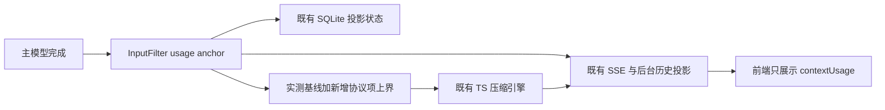

# 会话上下文水位统一

复用 ProtocolSession、ProjectionStore.usage_anchor_json、TypeScriptInputFilter 和现有 model_context / model_phase / usage SSE；不新增数据库、消息账本、后台计数器或模型调用。

规则：每次主模型调用发布并保存最后确认水位，失败不抹除它；下一次准备输入必须校验 route、fixedHash、协议前缀和历史 epoch，才能复用实测基线。SDK response 输出通过 SDK 自身的 replay 转换建立覆盖边界，禁止按全历史字节比例缩放。压缩判断和展示接收相同的测量结果；修改输入后的结果只标为估算上界，不能冒充供应商实测。摘要、标题等辅助调用不更新主模型水位。压缩提交通过已有 CAS，提交后清理旧 anchor；冷恢复不能越过压缩版本恢复旧水位。

验证范围：多次模型调用、工具追加、失败和取消、重启恢复、分支编辑、模型/工具配置变化、压缩版本边界、TS admission 与 UI 同口径；全部使用离线模型和隔离日志。原始记录不改写，不重放用户任务。
