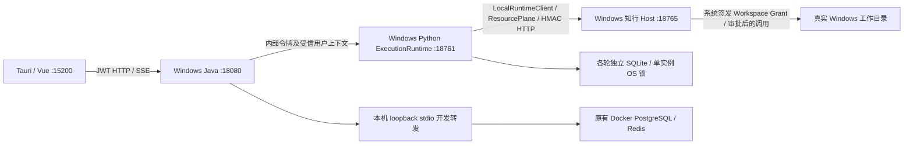
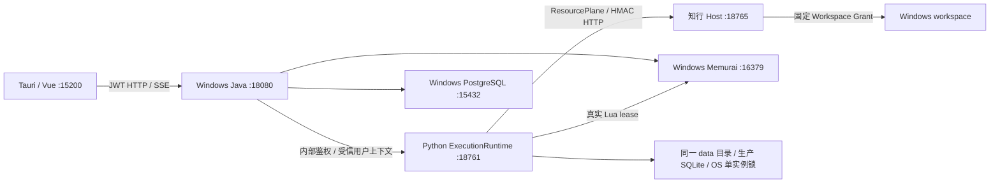

# PR-N01A ~ N03 Windows 原生运行链：实施与验收合并记录

> **文档性质**：阶段证据合并稿——实施与验收 4 篇（含完全移除 Docker）
>
> **覆盖时间**：2026-10-28 ~ 2026-10-29
>
> **当前定位**：现行 Windows 原生运行形态的来源记录；N02 为已被取代的中间态
>
> **合并日期**：2026-10-30

## 0. 合并说明与导读

本册把 **PR-N 系列（2026-10-28 ~ 2026-10-29）** 的 4 篇记录合并为一篇：N01A 原生执行基线与 R1 补充、N02 原生桌面过渡形态、N03 无 Docker 持久运行、PR-DOCKER-REMOVAL 完全移除 Docker。正文逐字保留原文，仅做两类机械处理：标题层级下移一级、指向已合并文档的相对链接改写。**N02 原文自带的「已废弃（2026-10-29）」横幅原样保留**，它是这段历史的一部分，不是本合并稿新加的判断。

### 0.1 这一阶段在解决什么

这一组记录是同一条演进线的四个断面：

1. **N01A**：把「Docker `exec` 进容器」换成 Windows 原生执行器——`LocalRuntimeClient → HMAC → Host` 的 list/read/write/patch，并建立依赖锁与隔离基线。宿主基础设施仍是旧 Docker 服务。
2. **N02**：把原生执行器接到桌面（Tauri + Java + Python + Host），但 PostgreSQL / Redis 仍通过 Docker relay 转发；它验证了「桌面能开发主链」，不是最终形态。
3. **N03**：换成固定 home 的持久原生栈——本机 PostgreSQL 15.19 + Memurai 4.1.2 + Java/Python/Host/Vite/Tauri，**全程关闭 Docker**，并验证重启、冷备份与恢复。
4. **DOCKER-REMOVAL**：分 5 批把数据、运行链、测试底座、仓库资产与本机容器/卷全部迁走、删净，N03 成为唯一运行形态。

### 0.2 一页结论

| 篇目 | 性质 | 结论 | 关键证据 |
|---|---|---|---|
| N01A | 实施与验收（含 R1） | **BLOCKED**，不能标记 ACCEPT（N01A-06 symlink） | 12 项中 11 项 PASS；R1 实测 BLOCKED→exit 2、FAIL→exit 1；N01A-11 为 50 passed / 1 skipped |
| N02 | 实施与验收（已被取代） | 原生桌面开发主链通过，但非产品级 ACCEPT | `run_9d65d25111cc` completed；修 7 个真实故障；依赖 Docker relay，非安装版 |
| N03 | 实施与验收 | 无 Docker 持久开发运行版贯通；**连续生产许可 BLOCKED**（范围外依赖） | 17 项 PASS；多次重启仍 1 Mission / 1 Run / 1 permit；冷备份 1359 文件恢复一致 |
| DOCKER-REMOVAL | 实施与验收 | Docker 完全移除完成（5 批提交），残留 1 项高优先风险 | 迁移 PG 7 表行数一致、14 个 SQLite integrity ok；Docker 关闭时集成测试 10/10；删 5 容器 / 7 网络 / 18 卷 |

### 0.3 演进主线与「当前形态」

```
Docker 容器栈
  └─ N01A  原生执行器（宿主仍用容器）
       └─ N02  原生桌面 + Docker relay（入口已退役）
            └─ N03  本机 PG/Memurai + 原生服务 + 固定 home（当前形态）
                 └─ DOCKER-REMOVAL  仓库与本机 Docker 资产清零
                      └─ EL-01  Electron 桌面宿主（见下一册）
```

> 判断「当前能不能用」只看 N03 与其运行手册；N01A 的 BLOCKED 是 symlink 权限导致的单项缺口，N02 是历史中间态。

### 0.4 贯穿全阶段的不变量

- **单实例、单用户、固定 home**：本轮是开发运行版，不是多租户或生产集群。
- **Docker 关闭也能测**：运行与测试不再要求容器；集成测试在 Docker 停止时通过。
- **身份与数据零变更**：迁移只搬数据，不重写账号、会话与 Run 身份。
- **不模拟通过**：symlink 无法创建时登记 BLOCKED，不拿 junction 或 Mock 替代。
- **如实保留残余风险**：`/api` 前缀重写在 Electron 打包中缺失会 404，这是已登记的阻断项。

### 0.5 明确未完成与下一阶段入口

- **N01A-06 symlink 仍 BLOCKED**：Windows 无创建 symlink 权限，真实全 PASS / exit 0 未实测；N03 沿用同一遗留。
- **N03 的生产许可仍 BLOCKED**：Memurai Developer 授权 ≤10 天；跨机器与在线备份未覆盖。
- **DOCKER-REMOVAL 未 push**（7 笔提交）；全量 571 例中 1 例既存守卫失败留在原处。
- 下一阶段：Electron 成为唯一桌面宿主，见 [`PR-EL-01-Electron桌面宿主-合并记录.md`](PR-EL-01-Electron桌面宿主-合并记录.md)。

### 0.6 阅读建议

按 1 → 4 阅读可以看清「为什么最终必须放弃 Docker」。若只关心当前能跑什么，直接读第 3 篇（N03）的「结论」「真实持久对象」「启停命令」，再看第 4 篇的「终态」与「残余风险」。

> 原文中指向 `desktop.ps1`、`README-N02.md` 与 `apps/desktop/src-tauri/*` 的链接，已随 N02 退役（`50399acb`）与 Tauri 退出（`88c04151`）失效。整理时保持原样，不改成占位链接——这些断链本身就是「文件已被删除」的证据。

## 篇目与阅读顺序

1. **PR-N01A Windows 原生 Runtime 实施与验收** — 实施与验收（含 R1 补充），2026-10-28 — 原文件 `PR-N01A-Windows-Native-Runtime-实施与验收.md`
2. **PR-N02 知弈 Windows 原生桌面主链路实施与验收** — 实施与验收（文档自注已废弃），2026-10-28 — 原文件 `PR-N02-Windows-Native-Desktop-实施与验收.md`
3. **PR-N03 Windows 无 Docker 持久运行实施与验收** — 实施与验收，2026-10-29 — 原文件 `PR-N03-Windows-Persistent-Native-实施与验收.md`
4. **PR-DOCKER-REMOVAL 完全放弃 Docker：迁移与清除实施/验收记录** — 实施与验收，2026-10-29 — 原文件 `PR-DOCKER-REMOVAL-完全放弃Docker-实施与验收.md`

---

## 1. 原文｜PR-N01A Windows 原生 Runtime 实施与验收

<!-- 原始记录：PR-N01A-Windows-Native-Runtime-实施与验收.md -->

> 原文件 `PR-N01A-Windows-Native-Runtime-实施与验收.md` ｜ 2026-10-28 ｜ 实施与验收（含 R1 补充） ｜ 原文 33933 字节

> 最新补充结论见第 8 节 PR-N01A-R1：**仍为 BLOCKED**。第 1～7 节保留首次实施记录；其中“BLOCKED 退出码未实测”的历史限制已由 R1 的真实 exit 2 证据关闭，symlink 夹具与真实全 PASS / exit 0 仍未满足。

日期：2026-10-28（Asia/Shanghai）。最终判定：**BLOCKED，不能标记 ACCEPT**。

**Python ExecutionRuntime 与知行 Local Runtime 的无 Docker AI 容器依赖最小文件链路已经在真实 Windows 上跑通。** 两个生产入口原生启动，真实生产装配的 `LocalRuntimeClient → HttpLocalRuntimeTransport → HMAC HTTP → Host` 完成 list/read/write/patch，并从磁盘独立复核内容和 SHA-256。但 N01A-06 的 symlink 子项因当前 Windows 令牌权限受阻，12 项未全部通过。本轮不进入 N01B。

### 1. 进入基线与保护范围

实施规范为 Downloads 中的 `PR-N01A-Windows-Native-Runtime-实施任务.md`，读取后以真实代码和现场结果重新判断。

- 分支 `master`，进入时 HEAD：`8b792fa0c2c422ed7548330ae3f1ea5bbf50883d`。
- 进入时已有 21 个 tracked 文件修改，涉及后端会话重检/流持久化、前端 Chat/SSE/Workbench/ACG；另有 `apps/frontend/src/stores/chat.stream.spec.ts` 和既有 Chat 修复记录两个 untracked 文件。完整列表见 [git-before.txt](../../artifacts/windows/native-n01a/20261028/git-before.txt)。本轮没有编辑这些文件。
- 进入/结束的原有 `git diff --binary` 内容一致，SHA-256 均为 `3f3e17ea65fa9165288aeeaea33e0c29fd84fd0479d64fd8ff09995f2f6ac8e5`。索引差异均为空。本轮没有 add、commit、push、reset、stash 或清理历史数据。
- 现有五个 Docker 服务（AI、Java、前端、PostgreSQL、Redis）一直保留运行。原有 Docker AI 的存在不构成本轮 Native 链路依赖：Native 未使用它的入口、挂载、数据库、令牌或模型配置，也没有新建 Docker AI 容器。
- [前后隔离/保护比较](../../artifacts/windows/native-n01a/20261028/isolation-and-preservation.json)；[实际成功启动的进程树](../../artifacts/windows/native-n01a/20261028/run-03/up.json)。

### 2. 真实源码检查与实现

实际阅读了任务要求列出的 Host main/bootstrap/grants/filesystem/http_server、AI main/wiring/instance_lock/tools runtime、AgentOS HTTP transport、两份依赖锁、prepare 脚本和 compose。确认既有生产代码已具备 HMAC、nonce 防重放、系统签发 Grant、canonical/reparse containment、文件原子写、Windows OS workflow 锁和正常退出清理；本轮复用这些实现，没有建立平行 Runtime。

本轮新增文件（原有业务源码、Compose 和两个原始锁未修改）：

| 文件 | 具体用途 |
|---|---|
| [requirements.native-tools.lock](../../apps/agent/requirements.native-tools.lock) | 独立 Windows 工具锁，保留原工具精确版本与原 hash，补齐 Windows wheel hash、colorama、pywin32 |
| [native.ps1](../../ops/scripts/infra/windows/native/native.ps1) | PowerShell 统一 preflight/up/status/down/smoke 入口 |
| [native_runtime.py](../../ops/scripts/infra/windows/native/native_runtime.py) | 路径/版本/端口门禁、专用配置、新库显式准备、两服务生命周期、PID 身份及进程树/端口/健康核验、正常停止与失败回收 |
| [smoke.py](../../ops/scripts/infra/windows/native/smoke.py) | 真实 app.main 装配、文件链路、磁盘复核、HMAC/授权/越界负例和第二 Uvicorn 争锁 |
| [verify_lifecycle.py](../../ops/scripts/infra/windows/native/verify_lifecycle.py) | 真 Host 已健康、AI 尚未启动时注入失败，验证回收与原服务不受影响 |
| [audit_secrets.py](../../ops/scripts/infra/windows/native/audit_secrets.py) | 检查本轮已知随机密钥在日志/回执/新增源码/索引中的泄露情况，不输出密钥值 |
| [refresh_tool_lock.py](../../ops/scripts/infra/windows/native/refresh_tool_lock.py) | 固定版本的 Windows hash 锁维护入口，TLS 读取 PyPI release JSON，pip 再校验真实 artifact bytes |
| [README.md](../../ops/scripts/infra/windows/native/README.md) | 安装、生命周期、复现、隔离及验收边界说明 |
| 本报告 | 逐项结果、证据与下一阶段必要条件 |

没有改动 ACG NodeRunner、Execution Permit、Review、Chat 审批或 Host 授权机制。Native 配置显式启用既有 Semantic/C2/Dispatch 三个开关；测试文件操作通过 Runtime 已装配的底层 LocalRuntimeClient，不向 ACG 注入可写 Chat 工具。

### 3. Windows 依赖实测

现场：Windows 11 `10.0.26100`，AMD64，CPython **3.14.5 / MSC 1944 / 64 bit**。基础解释器：`C:\Users\LZX\AppData\Local\Programs\Python\Python314\python.exe`。没有改用 3.11/3.13 规避安装问题。

专用虚拟环境：`C:\Users\LZX\AppData\Local\Temp\kinlin-n01a-20261028\venv`，`include-system-site-packages=false`。本机原有全局包版本与锁不同，未作为正式验收环境。

实测过程与根因：

1. 主锁 `requirements.lock` 的 Windows `--dry-run --ignore-installed --only-binary=:all: --require-hashes` 成功，生成 [解析回执](../../artifacts/windows/native-n01a/20261028/dependencies-main.json)。未出现需要本机源码构建的最终依赖；包括 numpy、onnxruntime、pandas、PyMuPDF 等均取得可用 Windows wheel。
2. 原 `requirements.tools.lock` 明确只锁 Linux wheel。实测 `cffi==2.1.0` Windows cp314 wheel 被拒绝：原期望 hash `d53d10f7da99ae46f7373b9150393e9c5eab9b224909982b43832668de4779f5`，下载 wheel hash `1b96bfe2c4bd825681b7d311ad6d9b7280a091f43e8f63da5729638083cd3bfb`。这是平台 artifact 不同，不能删除 hash 来安装。见 [原始失败日志](../../artifacts/windows/native-n01a/20261028/dependencies-tools.log)。
3. 新增独立 Windows 工具锁，保留所有原精确版本和原 hash，加入 PyPI 发布的 Windows/universal wheel hash。补齐 Click 的 Windows `colorama==0.4.6`；pip 随后指出 MCP 的 Windows 条件依赖 `pywin32>=311` 未固定，独立锁补入本次解析出的 `pywin32==312`，并校验 wheel hash。原 Linux 工具锁不变。
4. 锁维护时发生过 TLS EOF，保留原锁后重试；没有关闭 TLS 校验或配置 trusted-host。第一次/补齐过程失败日志保留，最终安装使用下面命令，成功且 `pip check` 无冲突。

```powershell
$base = "$env:TEMP\kinlin-n01a-20261028"
python -m venv "$base\venv"
$py = "$base\venv\Scripts\python.exe"
& $py -m pip install --require-hashes --only-binary=:all: `
  -r apps/agent/requirements.lock -r apps/agent/requirements.native-tools.lock `
  --report "$base\installed.json"
& $py -m pip check
```

[最终安装日志](../../artifacts/windows/native-n01a/20261028/install-complete.log)、[实际安装包与 artifact/hash 回执](../../artifacts/windows/native-n01a/20261028/installed.json)。测试专用 pytest 8.4.2 / pytest-asyncio 1.2.0 另装在同一隔离 venv，[测试依赖安装回执](../../artifacts/windows/native-n01a/20261028/test-dependencies.json)，随后 `pip check` 再次通过。没有放宽应用锁定版本。

### 4. 启动配置、命令与真实进程

成功 run：`C:\Users\LZX\AppData\Local\Temp\kinlin-n01a-20261028\run-03`。所有 Native 测试数据独立，未初始化仓库默认 data 或 Docker 卷。

| 配置/资源 | 本轮值或语义 |
|---|---|
| Python `APP_DATA_DIR` | 由 `AGENTOS_DATA_DIR=<run>\data` 决定；不是名为 APP_DATA_DIR 的环境变量 |
| Workflow / Checkpoint / Identity | `<run>\data\workflows.sqlite3` / `checkpoints.sqlite3` / `identity.sqlite3` |
| 其他 SQLite | 显式设置 EXECUTION_VALUE、CONTENT_MANIFEST、EXECUTION_MEMORY、PROVENANCE、AUDIT、RESOURCE、NODE、RESOURCE_HEALTH、EVOLUTION 各 AGENTOS_*_DB，均为 `<run>\data` 下绝对路径 |
| smoke 装配数据库 | `<run>\smoke-data-807e818f\`，与在线 AI 的数据库独立；每次 smoke 创建新库 |
| 附件 / Chroma / 缓存 | 各 data 目录下 attachments/chroma/cache；现有部分服务的相对 data 路径也因 cwd 为新 run 而隔离 |
| SQLite 临时文件 / TEMP / TMP | `<run>\temp` |
| Packs | `C:\Users\LZX\Desktop\kinlin_ai\apps\agent\packs`，只读发现真实 packs |
| PYTHONPATH | 仓库 apps、apps/agent、apps/agentOS、apps/agentOS/src 四个绝对路径 |
| Local Runtime | `127.0.0.1:18765`；资源 n01a-host、workspace n01a-workspace、grant n01a-grant、credential ID n01a-credential |
| 能力 | 仅 fs.list/read/write/patch，shell.exec 未启用 |
| AI | `127.0.0.1:18761`，workers=1，无 reload |
| Semantic/C2/Dispatch | 均 true；先只读检查，再通过现有 prepare 脚本显式初始化本轮新库并再次只读确认 READY |
| Provider / Redis / PostgreSQL | PROVIDER_STATE_ENABLED=false，不继承 coordination/provider Redis URL 或数据库地址、模型 API keys |
| 秘密 | 仅变量名：AI_INTERNAL_TOKEN、AGENTOS_RESOURCE_CREDENTIAL_KEY、AGENTOS_LOCAL_RUNTIME_CREDENTIAL_SECRET、ZHIYI_LOCAL_RUNTIME_CREDENTIAL_SECRET；随机生成，资源密钥为有效 Fernet key，Host/client HMAC 一致；DPAPI 当前用户加密落盘，正常停止后删除 |
| `.env` | run-local 空文件阻止既有配置加载器回退仓库 .env；不修改原配置加载机制 |

真实命令由隔离环境和 cwd 启动：

```text
<venv>\Scripts\python.exe -m runtime.main
<venv>\Scripts\python.exe -m uvicorn app.main:app --host 127.0.0.1 --port 18761 --workers 1
<venv>\Scripts\python.exe <repo>\scripts\prepare_agentos_runtime.py
<venv>\Scripts\python.exe <repo>\scripts\prepare_agentos_runtime.py --apply --initialize-empty
<venv>\Scripts\python.exe <repo>\scripts\prepare_agentos_runtime.py
```

成功进程树：Host venv launcher PID **45440** → 基础 Python **5744**，AI launcher **41456** → 基础 Python **25880**；各有独立隐藏 conhost。Windows venv 的 launcher/解释器子进程是同一服务树，不是多 worker 或平行 Runtime。状态检测核验真实树内 socket 的 loopback 地址和端口，而非仅凭父 PID。完整 executable、命令和创建时间见 [up.json](../../artifacts/windows/native-n01a/20261028/run-03/up.json)。

保留的中间失败：run-01 因新 launcher 漏配 apps/agentOS 路径，AI import `service` 失败；run-02 两服务实际健康，但旧状态检测只检查 venv 父 PID，误判无监听并正常回收。补齐路径、树级监听检测后 run-03 通过。原日志未删，未通过改门禁解决。见 [run-01](../../artifacts/windows/native-n01a/20261028/run-01/ai.log)、[run-02 误判回执](../../artifacts/windows/native-n01a/20261028/run-02/up-failure.json)。

### 5. 12 项验收

下表的 PASS 只覆盖写明的实测范围；symlink 阻断不由 junction 或 pytest skip 替代。

| 编号 | 判定 | 实测观察与证据 |
|---|---|---|
| N01A-01 | **PASS** | 两个生产服务树均为 Windows .exe，启动新目录，无新 Docker AI 容器；[进程树](../../artifacts/windows/native-n01a/20261028/run-03/up.json)、[Docker 前后](../../artifacts/windows/native-n01a/20261028/isolation-and-preservation.json) |
| N01A-02 | **PASS** | /health/ready：status=UP；dataDirectory/workflowStore/packsRegistered 全 true；[原始 JSON](../../artifacts/windows/native-n01a/20261028/run-03/up.json)。/health/dependencies=DEGRADED，modelProvider=UNCONFIGURED，providerConversationState=DISABLED，不误报生产依赖可用 |
| N01A-03 | **PASS** | Host /health online，resourceId=n01a-host，protocolVersion=1，能力集合恰为四项 fs；[smoke 回执](../../artifacts/windows/native-n01a/20261028/run-03/smoke.json) |
| N01A-04 | **PASS** | 实际 app.main 构造并进入 lifespan 的 Runtime，其 LocalRuntimeClient/HttpLocalRuntimeTransport 对独立 Host list/read/write/patch；最终磁盘字节 alpha LF gamma LF，共12字节。SHA-256 `17cbbec0b19b84e7729ef8bba7e45944bfa331f56fa873b4e796d1730b8f953f`，另用 PowerShell Get-FileHash 独立复核一致；[回执](../../artifacts/windows/native-n01a/20261028/run-03/smoke.json)、[磁盘内容副本](../../artifacts/windows/native-n01a/20261028/disk-hello.txt) |
| N01A-05 | **PASS** | 错签名 HTTP401 AUTHENTICATION_FAILED；同 nonce 第二次 HTTP409 REPLAY_REJECTED。nonce 首次请求故意用无效 grant，首次和重放均无文件写入；检查负例文件不存在、原文件字节不变；[HTTP 日志](../../artifacts/windows/native-n01a/20261028/run-03/smoke.log) |
| N01A-06 | **BLOCKED** | `../outside` 与真实 Windows junction 写越界均 PATH_OUTSIDE_WORKSPACE，外部哨兵保持原值；但创建目录 symlink 失败 WinError1314，尚不能实测 symlink 请求拒绝。当前令牌没有 SeCreateSymbolicLinkPrivilege，AllowDevelopmentWithoutDevLicense 值不存在。未提权、未启用开发者模式、未放宽 ACL；[回执](../../artifacts/windows/native-n01a/20261028/run-03/smoke.json)、[令牌权限](../../artifacts/windows/native-n01a/20261028/windows-privileges.txt)、[注册表只读结果](../../artifacts/windows/native-n01a/20261028/developer-mode.json) |
| N01A-07 | **PASS** | 真实 HTTP/已装配 client 负例：GRANT_NOT_FOUND、WORKSPACE_MISMATCH、RESOURCE_MISMATCH；缺授权、传入 allowedRoot 均 PROTOCOL_MISMATCH，无副作用；[回执](../../artifacts/windows/native-n01a/20261028/run-03/smoke.json) |
| N01A-08 | **PASS** | 第二个完整 Uvicorn 进程争用在线 AI 同一 workflow DB，退出1，日志明确 another AgentOS runtime owns runtime.instance.lock，首进程仍健康；[第二进程日志](../../artifacts/windows/native-n01a/20261028/run-03/contender.log)、[回执](../../artifacts/windows/native-n01a/20261028/run-03/smoke.json) |
| N01A-09 | **PASS** | 独立 failure-exercise 中 Host 真正健康后、AI 启动前故意失败，Host 回收、端口释放、凭据移除，原服务树仍健康；主 run 随后正常 Ctrl+C 退出，逐个等待子进程，数据库目录可重命名，OS workflow 锁可重取，端口释放；重复 down 也成功，停止后 status 非零。见 [失败回收](../../artifacts/windows/native-n01a/20261028/run-03/startup-rollback.json)、[停止回执](../../artifacts/windows/native-n01a/20261028/run-03/down.json)、[停止后状态](../../artifacts/windows/native-n01a/20261028/status-after-down.json) |
| N01A-10 | **PASS（隔离边界）** | 原容器 ID/镜像清单、全部卷名、PostgreSQL schema-only dump、Docker AI 14个SQLite schema 摘要前后一致；挂载原 JSON 顺序变化，但按 Destination 排序后完全一致。Native 配置无 Docker DB 连接/挂载，不执行 Docker schema upgrade 或卷操作；[比较](../../artifacts/windows/native-n01a/20261028/isolation-and-preservation.json)、[挂载语义比较](../../artifacts/windows/native-n01a/20261028/mounts-semantic-comparison.json)。运行中的原服务可有正常后台数据写入，本轮没有对卷做逐字节冻结，因此不声称卷所有字节静止不变 |
| N01A-11 | **PASS，明确保留1个skip** | 同一 Windows 隔离 venv 中 apps/local-runtime/tests：50 passed / 1 skipped / 153.23s；Chat HTTP E2E：1 passed / 1 warning / 10.86s。symlink 用例的环境 skip 不算 symlink 通过，阻断计入06；[Local 回归](../../artifacts/windows/native-n01a/20261028/pytest-local.log)、[Chat HTTP E2E](../../artifacts/windows/native-n01a/20261028/pytest-agent-http.log) |
| N01A-12 | **PASS（本轮秘密）** | 停止前扫描29个日志/JSON/新增代码与索引，没有本轮随机 HMAC/Fernet key/token 明文；staged diff为空。秘密未放入命令行，调用者环境未写入秘密；DPAPI文件在停止/回收时移除，证据副本不包含凭据文件、SQLite库或venv；[审计](../../artifacts/windows/native-n01a/20261028/run-03/secret-audit.json) |

没有使用 Mock 结果替代上述 Windows 原生文件验收。既有 targeted tests 中的测试 fixture 与正式装配 smoke 是两类独立证据。未配置模型，现有服务日志中会出现“模拟响应模式”的模型初始化提示；本轮没有调用模型生成文件操作，文件、HTTP、HMAC、授权、磁盘复核均为真实实现。

smoke 使用另一个 **真实 app.main 装配进程**和独立 smoke SQLite，在在线 FastAPI/Host 存活期间执行底层 client 调用；并未声称从 Java、浏览器、Chat 模型流或 ACG 任务触发了写文件，也没有新增可任意执行工具的 HTTP 测试端点。

### 6. 复现与当前停止状态

当前两 Native 服务均已停止；保留 run-01/02/03 的测试目录与证据，旧 Docker 服务未停。生命周期入口拒绝复用既有目录；重新复现必须指定不存在的新绝对目录。

```powershell
$py = "$env:TEMP\kinlin-n01a-20261028\venv\Scripts\python.exe"
$entry = '.\ops\scripts\infra\windows\native\native.ps1'
$run = "$env:TEMP\kinlin-native-$([guid]::NewGuid().ToString('N'))"
& $entry preflight -RunDir $run -Python $py
& $entry up -RunDir $run -Python $py -AiPort 18761 -HostPort 18765
& $entry status -RunDir $run -Python $py
& $entry smoke -RunDir $run -Python $py
& $py ops/scripts/infra/windows/native/verify_lifecycle.py $run
& $py ops/scripts/infra/windows/native/audit_secrets.py $run
& $entry down -RunDir $run -Python $py
```

preflight 实测不创建目标目录；PowerShell wrapper preflight 与重复 down 均退出0。当前相同令牌下 symlink 仍应 BLOCKED。首次 smoke 执行时 JSON 已明确记录 BLOCKED，但入口原先仍退出0；已修正最终入口遇 BLOCKED 回执时返回2。该退出码修正经过源码编译检查，发现权限阻断后未再次启动 Runtime 复跑，不能写成已实测 exit2。

针对回归的实际命令：

```text
cwd=apps/local-runtime
<venv>\Scripts\python.exe -m pytest tests -q --basetemp <base>\pytest-local

cwd=<run>，使用隔离环境（不继承 proxy/业务秘密）
<venv>\Scripts\python.exe -m pytest <repo>\apps\agent\tests\test_chat_local_runtime_http_e2e.py -q -rs
```

Agent 测试自带 conftest 将其 SQLite/Chroma 放入仓库忽略的 `.tmp-tests/kinlin-agent-*-tests-<uuid>` 专用新目录，没有复用历史数据。生产 Native run 的所有 SQLite 则位于上述 TEMP run 根内。

### 7. 风险差异、检查与下一阶段依赖

相对于任务文档描述的 N-00 风险，已用新证据关闭：Windows3.14主锁 wheel 可用性；Linux工具锁不可直接用于Windows（以独立平台锁解决）；/app、/run/secrets、cwd 相对路径污染（以隔离绝对路径和受控 cwd 解决）；真实 HMAC 文件链路、nonce、授权、junction containment；单实例和正常/失败回收。N-00 原始完整审计文档未在本轮材料中找到，以上按实施任务内的风险描述对照，不伪造原审计条目编号。

仍开放：symlink 实测权限条件（N01A-06）；最终 BLOCKED 退出码修正的再次运行验证；生产模型、Provider PostgreSQL/Redis 会话持久化、多实例协调、Java→Native网络、Chat审批到模型工具调用、完整 ACG 业务任务与生产灾备均不属于本轮已证明范围。测试工具兼容矩阵也不能推出任意宿主命令或 AppContainer 工具全部可用。

`git diff --check` 退出0，见 [检查回执](../../artifacts/windows/native-n01a/20261028/diff-check.txt)。已有文件有 Git LF/CRLF 提示，未自动格式化它们。新增 Python 文件逐个 `compile` 检查通过；所有新增文件另做空白检查。没有修改任何原 tracked 文件。本报告与新增源码均未暂存/提交。测试证据在仓库已忽略的 `artifacts/windows/native-n01a/20261028/`，并保留 TEMP 原件；它们是本机证据，不会随源码 commit 自动入库。

N01B 的具体必要条件（仅列出，未实施）：

1. 先补齐当前权限条件下无法执行的 symlink 实测，并让最终 smoke 入口复跑确认退出码；由用户/环境管理者提供已具备符号链接能力的合规环境。本轮不修改权限。
2. 评审并实测 Docker Java 到 Windows Native 的受控可达地址、端口及边界。当前 loopback 配置不能直接当成跨容器可达证明，不能用默认0.0.0.0解决。
3. Java/Python 的内部 token、可信用户/租户头、会话重检、SSE断连/取消/超时必须形成端到端验收；不能让容器可达性替代身份认证。
4. 明确选择测试专用 Native 库还是经授权的数据迁移；生产数据若需迁移，先备份、只读 schema 检查、显式 upgrade 和停机/锁策略。不能把当前新空库当作生产历史已迁移。
5. 决定 Docker AI 与 Native Python 的职责和流量切换/回滚条件，避免双写同一 SQLite；保护现有 PostgreSQL/Redis 与 Docker卷，单实例限制继续生效。
6. 单独验证 Provider State、协调 Redis、模型可用性和 ACG Permit/Review 的正式任务链路，再决定是否允许下一阶段冻结。

最终判断：**独立的 Windows 原生最小文件运行链路已真实可用；PR-N01A 整体验收因 symlink 子项 BLOCKED，尚未 ACCEPT。**

### 8. PR-N01A-R1 补充验收（2026-10-28，Asia/Shanghai）

#### 8.1 本轮结论与保护范围

**本轮结论：BLOCKED；不能标记 ACCEPT。** 已真实验证最终 `native.ps1 smoke` 的 BLOCKED / exit 2 和 FAIL / exit 1；尚缺合法的真实 symlink 夹具，不能执行 symlink HTTP 越界负例，也不能实测完整 smoke 全 PASS / exit 0。纯汇总逻辑的 PASS / 0 检查不算安全端到端通过。

当前 HEAD 仍是 `8b792fa0c2c422ed7548330ae3f1ea5bbf50883d`。本轮只修改已有 N01A 工具的 `native.ps1`、`native_runtime.py`、`smoke.py`、`README.md` 及本报告；没有新增平行测试框架，没有修改业务 Runtime 或 ACG 执行语义，也没有重新安装/调整依赖锁。

此前 21 个 tracked 修改和原有 Chat untracked 源码/记录逐文件 SHA-256 未变，tracked binary diff 和 staged diff 均与本轮进入时一致，索引仍为空。原始 `artifacts/windows/native-n01a/20261028/` 的 **75 个证据文件**完整保留，前后文件清单和 hash 全部一致。见 [保护核验](../../artifacts/windows/native-n01a/20261028-R1/preservation.json)。报告修改前原件另存 [report-before-R1.md](../../artifacts/windows/native-n01a/20261028-R1/report-before-R1.md)。本轮未调用 Docker 或数据库管理命令，未修改 Docker、Spring Boot、PostgreSQL、Redis，不进入 N01B，不自动暂存/提交 Git。

#### 8.2 symlink 夹具准备与 Runtime 执行已分离

新增已有入口动作 `native.ps1 fixtures`，在独立目录、两个服务启动之前运行，既不导入 `app.main`，也不启动 Local Runtime：

1. 先只读检查现有 `workspace/symlink`。必须是 Windows **IO_REPARSE_TAG_SYMLINK = 0xA000000C**；junction 不满足条件。
2. 链接必须位于本轮 workspace，目标限定为本轮 workspace 外的临时 `outside` 目录或 `outside/sentinel.txt`。不会复制/移动其他工作区的链接，不接受历史服务数据目录。已有哨兵保持原内容。
3. 只有没有可复用链接时，准备动作才尝试普通用户 `symlink_to`。WinError 1314 明确产生 BLOCKED，不提权、不启用开发者模式、不放宽 ACL。
4. `up` 只接受不存在的新目录，或带有可核验准备回执的 fixture-only 新目录；检查无历史 Runtime 数据、哨兵 hash 未变。新目录直接 up 时也在任何 Runtime 启动前执行准备阶段。
5. `smoke` 执行阶段不再创建/修复 symlink 或 junction，也不重置哨兵；只消费夹具，并核对准备时间早于 Runtime 启动时间。

在有合法夹具的环境中，现有脚本会通过正式装配的 LocalRuntimeClient / HMAC HTTP 执行 symlink 的 read、overwrite-write、patch；目录链接再执行 list 和 new-file-write。每个适用负例必须返回 `PATH_OUTSIDE_WORKSPACE`，同时核对外部哨兵内容/hash/mtime 和目录条目不变。**这些 symlink 分支本轮没有执行，不计为 PASS。** `../` 与真实 junction 的独立负例仍保留并实际通过。

正向文件操作改为 workspace 内 `files/hello.txt`，list 也使用 `files/`。原因是夹具提前准备后，workspace 根目录包含越界 reparse point；既有 Host 按策略拒绝 list 根目录。本轮没有放宽该策略，正常目录的 fs.list/read/write/patch 仍走相同生产链路。

#### 8.3 当前 Windows 条件与实际夹具结果

本轮目录：`C:\Users\LZX\AppData\Local\Temp\kinlin-n01a-r1-20261028-202516\run`。继续使用原来已锁定并校验的 Windows 3.14.5 隔离 venv，没有改用全局 Python 包。

只读检查旧 `run-03/workspace`，只有 `junction` 与 `hello.txt`，没有真实 symlink。用户也确认没有提供已准备的 symlink，要求合法条件不足时保留 BLOCKED。当前用户令牌缺少 `SeCreateSymbolicLinkPrivilege`；`AllowDevelopmentWithoutDevLicense` 注册表值仍不存在。前后只读结果一致，未更改系统设置。见 [已有夹具](../../artifacts/windows/native-n01a/20261028-R1/existing-fixtures.json)、[令牌权限](../../artifacts/windows/native-n01a/20261028-R1/windows-privileges.txt)、[开发者模式读取](../../artifacts/windows/native-n01a/20261028-R1/developer-mode-before.json)。

真实 `native.ps1 fixtures` 结果为 **BLOCKED / exit 2 / WinError 1314**；准备回执明确早于服务启动，见 [夹具回执](../../artifacts/windows/native-n01a/20261028-R1/run/fixture-preparation.json)、[退出码](../../artifacts/windows/native-n01a/20261028-R1/fixtures-exit.json)。

随后普通权限启动原有两个生产服务：Host launcher PID **43584** → Python **31544**，AI launcher **21500** → Python **30232**。直接查询各个实际 Python 进程的 Windows token 均为：

```text
elevated = false
integritySid = S-1-16-8192  (Medium)
symlinkPrivilegePresent = false
symlinkPrivilegeEnabled = false
```

见 [实际进程树及 token](../../artifacts/windows/native-n01a/20261028-R1/run/up.json)。查询使用 TOKEN_QUERY，没有调整 token；preflight 还会拒绝 elevated / high integrity 的验收启动条件。监听仍是 `127.0.0.1:18761` 与 `127.0.0.1:18765`，workers=1，Shell 未启用，Semantic/C2/Dispatch 门禁保持不变。

#### 8.4 smoke 结果与退出码真实复验

汇总规则现在明确为：**FAIL 优先于 BLOCKED；全部 smoke 检查 PASS 才返回 0**。worker 非零退出、缺少/无效/过期回执、检查项缺失或状态未知均为 FAIL。每次使用独立 invocation ID、日志、回执和 smoke 数据库，核验本次 worker 回执身份，避免上次结果被误用。`smoke.json` 是当前调用的汇总，不会抹掉按 invocation ID 保存的原始回执。

| 场景 | 真实执行和结果 | 判定 |
|---|---|---|
| Runtime 均在线，缺少合法 symlink 夹具 | 直接运行最终 `native.ps1 smoke`；invocation `663fdb70`；worker 完成并退出0，控制器看到 N01A-06 BLOCKED 后返回 **2**，汇总 status=BLOCKED，其余7个 smoke 检查 PASS | **PASS：BLOCKED 退出码验收**，不代表 symlink 通过 |
| 真实 Host 不可用，且已有上一轮 BLOCKED 回执 | 核验身份后只停止本轮 Host，AI 仍 ready；再次直接运行相同 `native.ps1 smoke`；新 invocation `c01cac8c`；新 worker 观察 Host absent，退出1；新汇总 status=FAIL，PowerShell 返回 **1**。未复用 `663fdb70` 回执 | **PASS：FAIL 退出码及新回执隔离验收**；这是受控失败场景，不是安全实现被判 REJECT |
| 所有 smoke 检查真实 PASS | 当前无法准备 symlink 夹具，不能构造完整真实通过运行；没有跳过06、伪造夹具或将 junction 当作 symlink | **BLOCKED：真实全 PASS / exit 0 尚未实测** |
| 汇总函数纯逻辑契约 | 7个契约检查验证 PASS→0、BLOCKED→2、FAIL→1、FAIL优先、worker失败、缺项/未知状态等 | **PASS（仅逻辑契约）**，不能替代上一行的真实安全验收 |

真实命令及证据：

```powershell
$py = "$env:TEMP\kinlin-n01a-20261028\venv\Scripts\python.exe"
$entry = '.\ops\scripts\infra\windows\native\native.ps1'
$run = "$env:TEMP\kinlin-n01a-r1-20261028-202516\run"
& $entry fixtures -RunDir $run -Python $py  # 本轮：2，准备阶段 BLOCKED
& $entry up -RunDir $run -Python $py        # 本轮：0，真实普通用户进程
& $entry smoke -RunDir $run -Python $py     # 本轮：2，663fdb70
# 单独核验并停止 state.json 中本轮 Host；未按进程名终止服务，AI 保持健康
& $entry smoke -RunDir $run -Python $py     # 本轮：1，c01cac8c，真实 Host absent
& $py ops/scripts/infra/windows/native/audit_secrets.py $run
& $entry down -RunDir $run -Python $py      # 本轮：0
& $entry status -RunDir $run -Python $py    # 本轮：1，两个服务均已停止
```

[BLOCKED 退出码](../../artifacts/windows/native-n01a/20261028-R1/smoke-blocked-exit.json)、[BLOCKED 完整回执](../../artifacts/windows/native-n01a/20261028-R1/smoke-blocked-receipt.json)、[原始 HTTP/worker 日志](../../artifacts/windows/native-n01a/20261028-R1/run/smoke-663fdb70.log)、[真实失败准备](../../artifacts/windows/native-n01a/20261028-R1/real-failure-setup.json)、[FAIL 退出码](../../artifacts/windows/native-n01a/20261028-R1/smoke-fail-exit.json)、[FAIL 回执](../../artifacts/windows/native-n01a/20261028-R1/smoke-fail-receipt.json)、[汇总逻辑契约记录](../../artifacts/windows/native-n01a/20261028-R1/exit-code-contract.json)。没有用 Mock 替代 Runtime、HMAC、Windows token 或文件系统检查。

#### 8.5 无副作用与退出清理

真实 `../` 和 junction 负例均返回 `PATH_OUTSIDE_WORKSPACE`。外部哨兵一直保持：

```text
内容：untouched
SHA-256：d59c2a5f721ce135ce54628b1ad8ad8b8eb26c8bbe2e2abe1cdca97e2d6ab446
mtime_ns：1793190515647647600
outside 目录条目：仅 sentinel.txt
```

smoke 回执已检查字节、hash、mtime 和目录条目；[磁盘哨兵副本](../../artifacts/windows/native-n01a/20261028-R1/sentinel-after.txt)和[实际安全回执](../../artifacts/windows/native-n01a/20261028-R1/smoke-blocked-receipt.json)保留。symlink 请求数为0，因为 fixture 准备失败；不能将这一无副作用观察当成已证明 symlink 拒绝。

最终 down 实际通过：两条服务及两个 smoke worker 的4个所属进程记录均不存在；按 run cwd/命令参数检查无残余进程；18761/18765 可独占绑定；lifecycle 锁可重新取得；主 AI、BLOCKED worker、FAIL worker 的 **3 个 workflow OS 锁**均可重新取得；**37 个 SQLite 文件**以 Windows OPEN_EXISTING、share=0 独占打开检查成功，未修改数据库字节；DPAPI 凭据文件不存在。见 [down 回执](../../artifacts/windows/native-n01a/20261028-R1/run/down.json)、[独立清理复核](../../artifacts/windows/native-n01a/20261028-R1/cleanup-verification.json)、[停止后 status 退出码](../../artifacts/windows/native-n01a/20261028-R1/status-after-down-exit.json)。测试数据和全部原始日志保留，没有递归清理目录。

停止前本轮秘密审计扫描29个日志/JSON/新增工具文件，未发现随机 HMAC/Fernet/token 明文，索引仍为空；[秘密审计](../../artifacts/windows/native-n01a/20261028-R1/run/secret-audit.json)。证据副本不含 SQLite 数据库、DPAPI 凭据或 venv。

#### 8.6 12 项最新状态与剩余必要条件

| 项目 | 本轮后判定 | 证据时效与范围 |
|---|---|---|
| N01A-01 / 02 / 03 / 04 / 05 / 07 / 08 | PASS | R1 真实 smoke 再次执行，详见 `663fdb70` 回执；文件四项操作、HMAC/授权负例及争锁均保持通过 |
| N01A-06 | **BLOCKED** | R1 重新执行 `../`、junction 并通过；symlink 独立夹具准备仍 WinError1314，未执行 symlink HTTP 负例 |
| N01A-09 | PASS | 原失败启动回收证据保留；R1 对两种 smoke 结果后的进程、端口、lifecycle/3个workflow锁、37个SQLite文件、凭据做了真实清理复核 |
| N01A-10 | PASS（沿用原隔离证据） | R1 未操作 Docker 或业务数据库；原75个证据文件未变，不将本轮源码保护检查冒充新一次 Docker 数据取证 |
| N01A-11 | PASS（沿用原回归，仍保留1个skip） | 本轮没有重新运行此前50 passed / 1 skipped与Chat HTTP 1 passed的整套targeted tests；仅运行本轮相关真实smoke及汇总契约，不把旧回归写成新回归 |
| N01A-12 | PASS（本轮秘密） | R1 已重新审计及确认临时凭据删除，未暂存或提交 |

源码编译、Markdown证据链接、空白检查与保护核验见 [R1 源码检查](../../artifacts/windows/native-n01a/20261028-R1/source-verification.json)；Git diff check 见 [检查退出码](../../artifacts/windows/native-n01a/20261028-R1/diff-check.json)。

要解除剩余 BLOCKED，必须具备以下合法环境条件之一，而不是给 Local Runtime 增加权限：

- 由环境所有者在**新的专用临时目录**预先准备真实 Windows symlink：`<new-run>\workspace\symlink` → `<new-run>\outside` 或 `<new-run>\outside\sentinel.txt`；其中 `outside` 是真实临时目录，`sentinel.txt` 是真实临时文件，普通 Runtime 用户本来就能读取测试所需元数据。执行 `fixtures` 只读识别并复用它，然后以普通用户启动 Runtime；或使用本来就具备合法普通用户 symlink 创建能力的环境。本轮没有创建提权进程、调整系统策略或 ACL。
- 在该条件下重新运行正式 HMAC HTTP 的 symlink read/write/patch 等适用负例，得到拒绝和无副作用的实证；再真实运行 `native.ps1 smoke`，确认完整 smoke 的 status=PASS / exit0，并完成停止清理。当前纯汇总契约的0退出值不能补足这一步。

**R1 最终判定仍为 BLOCKED。Windows 原生最小运行链路可用这一结论保持；N01A-06 和真实全 PASS / exit0 仍未闭合，所以 N01A 不能 ACCEPT。N01B 未实施。**

---

## 2. 原文｜PR-N02 知弈 Windows 原生桌面主链路实施与验收

<!-- 原始记录：PR-N02-Windows-Native-Desktop-实施与验收.md -->

> 原文件 `PR-N02-Windows-Native-Desktop-实施与验收.md` ｜ 2026-10-28 ｜ 实施与验收（文档自注已废弃） ｜ 原文 18331 字节

> **已废弃（2026-10-29）**：N02 的 Docker relay 桌面开发入口已退役（`desktop.ps1` 与
> `README-N02.md` 已删除），`desktop_runtime.py` 收敛为共享窗口助手。当前桌面运行形态见
> [N03 Windows 原生持久环境](../../ops/scripts/infra/windows/native/README-N03.md)。

日期：2026-10-28。实施基线：`master`，HEAD `8b792fa0c2c422ed7548330ae3f1ea5bbf50883d`。

### 结论及范围

**Windows 原生开发环境的 Chat 文件主链和正式 Mission/Run 主链已实际跑通。** 验收使用真实 Tauri WebView2、Windows 目录选择器、Java/Python/知行三个原生进程、正式 JWT/内部鉴权/HMAC/Grant，以及真实 DeepSeek 模型。通过界面完成文件审批、写入、Patch、回读和正式 ACG 执行许可、调度、进度、终态、交付文件查看。没有用 Mock 数据替代这些证据。

这不是完整产品所有功能的 ACCEPT：实时语音 WebSocket 尚缺 Java 桥接端点，动态多工作区授权、持久安装版服务管理也未实现。当前可用范围是单用户、单个启动时明确授权目录的开发主链。N01A 的真实 symlink 创建权限限制仍为 **BLOCKED 遗留风险**，未重做补充验收、未改为 PASS，也未降低路径隔离策略。

原始 N01A/R1 报告保留在 [N01A 报告](PR-N01A-N03-Windows原生运行链-合并记录.md)。本报告独立记录 N02，不覆盖此前结论。

### 实际运行链路



- Tauri 运行相同的 `kinlin_desktop_lib::run()`，使用独立开发二进制 `kinlin-native-dev`，没有第二套桌面业务逻辑或执行器。
- Java 使用正式 `application.yml`、PostgreSQL、Flyway、Hibernate `validate`、JWT 和内部鉴权，不切换 H2，不依赖 Docker backend。
- Python 是生产 `app.main:app`、单 worker，知行是生产 `runtime.main`。继续使用现有 `LocalRuntimeClient`、HTTP transport、ResourcePlane、Grant authority 和持久运行状态，不另建状态真源。
- 18761/18765/18080/15200/15432/16379 均绑定 loopback。19222 是本机 WebView2 开发取证端口，停止时回收，不用于发布版。
- PostgreSQL/Redis 保留原容器，通过 `docker exec -i postgres-container nc ...` 的本机 stdio 转发访问。转发保留数据库认证，不发布数据库公网端口，不修改容器网络配置。
- 每次启动创建独立 PostgreSQL 库和角色，选择空 Redis 逻辑库；无可用空库时拒绝启动，不 FLUSH。SQLite、上传、WebView 配置和工作目录均按运行目录隔离。

### 本轮源码和配置

| 文件 | 改动及用途 |
| --- | --- |
| [desktop.ps1](../../ops/scripts/infra/windows/native/desktop.ps1) | 统一 `up/status/down` Windows 入口 |
| [desktop_runtime.py](../../ops/scripts/infra/windows/native/desktop_runtime.py) | 复用 N01A 生命周期与环境；增加数据库受控转发、独立测试库、Java/Vite/Tauri 启停和真实窗口管理 |
| [README-N02.md](../../ops/scripts/infra/windows/native/README-N02.md) | 依赖、实际启动命令、隔离方式及限制 |
| [local_workspace.py](../../apps/agent/app/api/local_workspace.py) | 从正式 HMAC 客户端获取已有根目录；登录用户只能确认该启动 Grant 的根目录，其他路径 403 |
| [main.py](../../apps/agent/app/main.py) | 注册上述用户工作区 API |
| [runtime.py](../../apps/agent/app/tools/runtime.py) | 修正 Chat SDK 外层超时未包含人工审批预算；先取消全部自有等待任务再等待清理，避免取消时遗留队列任务 |
| [test_chat_permissions.py](../../apps/agent/tests/test_chat_permissions.py) | 审批预算与 SDK 工具副本回归；流式审批关闭后无遗留任务回归 |
| [NativeWorkspacePicker.vue](../../apps/frontend/src/components/platform/NativeWorkspacePicker.vue) | Windows 原生目录选择、现有 Grant 确认；仅在 Chat 展示，最终放在正常文档流中避免遮挡按钮 |
| [DesktopRuntimeStatus.vue](../../apps/frontend/src/components/platform/DesktopRuntimeStatus.vue) | 原生服务在线后挂接目录选择组件 |
| [components.d.ts](../../apps/frontend/components.d.ts) | Vite 自动生成的新组件类型声明 |
| [vite.config.ts](../../apps/frontend/vite.config.ts) | WebSocket Upgrade 仍发往 Java；HTTP/SSE 使用既有 Java 代理配置和本轮后端地址 |
| [Cargo.toml](../../apps/desktop/src-tauri/Cargo.toml) / [native_dev.rs](../../apps/desktop/src-tauri/src/native_dev.rs) | 独立开发 exe 复用同一桌面库，保留原默认二进制 |

Java 业务、安全和 ACG 核心源码无需新增改造；本轮使用环境变量完成原生 PostgreSQL/Redis、内部令牌、Python 地址及精确 CORS 来源配置。构建包含工作区原先已有的修改，但没有编辑这些修改。

#### 实际故障与最小修复

1. **stdio 转发命令不兼容**：容器是 BusyBox `nc`，不支持 OpenBSD 的 `-N`。以真实容器命令及失败日志定位后移除不兼容参数，未改数据库认证。
2. **Java CORS 拒绝登录**：15200 未列入允许来源，真实登录返回 403。启动环境显式加入本机 Vite/Tauri 来源，未改为通配符。
3. **Python 初始化超时**：Windows 上多份旧客户端初始化与系统代理发现耗时较大。子进程限定 `NO_PROXY=127.0.0.1,localhost`，保留 TLS 校验，启动等待按实际就绪耗时调整为 180 秒。
4. **原桌面 exe 被占用**：旧开发进程在运行，Cargo 无法覆盖 `kinlin-desktop.exe`。增加调用相同库的薄开发二进制，未终止旧桌面来强行替换。
5. **Chat 审批失效**：SDK 工具外层 30 秒超时先于现有 300 秒人工审批 TTL，真实界面出现过期审批 404、文件未生成。为每次 Chat 上下文复制工具定义并设置包含审批和执行预算的外层超时；共享工具、审批 TTL、Host 执行限额、ACG 工具目录保持原约束。修正后等候 49.56 秒仍未写文件，点击允许后才执行。
6. **取消后队列任务遗留**：真实停止出现 `Task was destroyed but it is pending`。原 finally 顺序等待第一个任务可能中断后续取消，改为先取消所有自有 waiter，再共同等待。增加资源回收回归；重启最终源码后再通过桌面停止，日志到正常 shutdown 未再出现该错误。
7. **提示条遮挡**：工作区提示条曾阻挡 Mission 创建按钮，先限定 Chat 路由；截图复核又发现其覆盖输入区边缘，最终改为顶部正常布局。原失败及后续截图均保留。

### 真实端到端验收

证据目录：[结构化证据及日志](../../artifacts/windows/native-n02/20261028/)。原始完整运行目录为 `C:\Users\LZX\AppData\Local\Temp\kinlin-n02-20261028-204856`，没有复制 SQLite、浏览器配置或凭据进入交付证据。

| 验收内容 | 结果 | 实际证据与边界 |
| --- | --- | --- |
| 三个服务 Windows 原生启动 | PASS | `run-05/desktop-up.json`、`desktop-state.json`、Java/AI/Host 日志；均有真实 Windows PID、命令行和健康检查 |
| Java 连接 PostgreSQL/Redis | PASS | 正式 PostgreSQL 配置，Flyway v1–v11 成功；`native-api-checks.json` 的 ready/dependencies 均 200；独立库 `n02_5429a3d623`，复验另建 `n02_11ff517140` |
| 桌面登录和业务数据 | PASS | 真 Tauri WebView2 CDP 操作注册/登录，正常进入 Chat、读取会话、创建和读取 Mission；不是单独浏览器页面替代 Tauri |
| 真实 Windows 目录选择 | PASS | `native-folder-selection.json` 和 Windows 原生目录对话框截图；UIAutomation 操作真实对话框，选择 `run-04\workspace`，正式 API 确认成功 |
| 工作区授权与鉴权负例 | PASS | 未登录 401，选取启动 Grant 外目录 403；客户端不能指定新 allowedRoot 或扩大授权；见 `native-api-checks.json` |
| Chat 审批后写入与回读 | PASS | 实际 DeepSeek `write_file` → 人工允许一次 → Host HMAC → `read_file`；审批前文件不存在，之后真实磁盘为 `alpha\nbeta\n` |
| Chat Patch 与回读 | PASS | 独立 `patch_file` 审批，将第二行 beta 改为 gamma；工具记录 +1/-1，随后真实读取；未用覆盖写伪装 Patch |
| 正式 Mission 创建与执行 | PASS | UI 创建 `mission_3726793f5680` / `run_9d65d25111cc`；通过正式任务图、激活暂停、交接、执行许可、执行按钮进入调度 |
| ACG 进度、终态和结果 | PASS | 两个节点从执行到 completed，执行树 succeeded，Run completed；界面显示 OUTPUT `final.md` 并真实打开；模型调用记录为 DeepSeek 实际两次调用 |
| 文件落盘及重复执行检查 | PASS | `persisted-final-check.json`：1 Mission、1 Run、1 dispatch command、1 permit；最终文件 12 字节及 SHA-256 一致，取消/断连测试文件未生成 |
| 断连和恢复 | PASS（本次场景） | 真 WebView 断网并刷新，出现 `ERR_INTERNET_DISCONNECTED`；Java upstream subscription cancelled、Python downstream cancelled，恢复后可重新访问；未审批写入无副作用。未声明覆盖任意执行阶段 exactly-once |
| 主动停止与清理 | PASS | 真界面停止接口 200；修正后的取消日志及 `run-04/run-05 desktop-down.json` 证明正常 shutdown、OS 锁和 13 个 SQLite 独占句柄可打开；所有自有进程树退出，七端口释放，DPAPI 凭据删除 |
| 一致的退出码与冲突拒绝 | PASS | 正常 up/status/down 为 0；端口已占用启动为 1 且未创建目标运行目录；停止后 status 为 DOWN、退出 1，不把不可用状态当成功 |
| 新运行隔离 | PASS | `fresh-run-isolation.json`：新 PostgreSQL 数据库、新 WebView 配置、空工作目录、SQLite Run 数量 0，没有读取上一轮数据 |
| 实时语音 WebSocket | 未实现 | 已保留 `/ai` Upgrade 的 Java 路由边界，但 Java 目前只有 HTTP/SSE 代理，没有实时语音 WS 桥接与相应握手鉴权合同；未通过直连 Python 演示或宣称成功 |
| 动态多目录 / 多用户授权管理 | 未实现 | 当前仅确认启动时系统签发的单个 Grant；更换目录需显式停止并指定 `-Workspace` 后新建运行。未实现用户级跨目录授权界面 |
| N01A symlink 越界 | 已知 BLOCKED 风险 | 本机创建真实 symlink 所需条件仍不足；保留原报告，不因 N02 放宽路径策略或重测替代 |

#### Chat 磁盘结果

真实文件：`C:\Users\LZX\AppData\Local\Temp\kinlin-n02-20261028-204856\run-04\workspace\native-note.txt`。

```text
alpha
gamma
```

UTF-8，末尾换行，12 字节。SHA-256：`17cbbec0b19b84e7729ef8bba7e45944bfa331f56fa873b4e796d1730b8f953f`。
写入后、Patch 前、Patch 后、断连恢复后和最终停止后均有独立磁盘检查。待审批的 `n02-cancel-never.txt`、`n02-disconnect-never.txt`、`n02-final-cancel.txt` 均不存在。

#### 正式 Mission 证据

- 目标是输出一段首次使用知弈 Windows 桌面版的中文说明，不请求网络或文件写入。
- 真实语义规划产生两个节点：`task_understanding` 和 `artifact_generation`。二者均绑定原生 `native_general_agent`，沿既有正式 ACG 能力目录执行。
- 执行许可 `xpermit_7bb83af4d3c9355948e4b5381bd61cf1218db37e`，dispatch `dispatch_91536b1ddd75ee2c0fb24f47b5520daf5a128f7e`。没有跳过界面许可按钮直接调用执行器。
- `mission-model-calls.json`：DeepSeek `deepseek-flash`，实际调用耗时 6556ms / 15595ms，Token 使用 2525 / 5598，均 finishReason=stop。
- `mission-final-output.json` 保存正式 outputRef 返回的结构化内容；界面实际加载 artifact download 200 并显示 `final.md`，正文包含授权目录、文件审批、任务创建执行。
- 文件写入能力没有注入 ACG。现有 NodeRunner 仍按 skill manifest / readonly catalog 绑定工具；**这次 Mission 证明正式规划与模型执行，不证明 ACG 节点已可写任意工作目录**。将文件任务纳入 Mission 需要后续正式能力绑定与 Grant/审批合同接线。

关键截图：

- [Windows 原生目录选择](../../output/playwright/n02-20261028/native-folder-dialog.png)
- [审批超过 30 秒仍等待](../../output/playwright/n02-20261028/fixed-approval-after-30s.png)
- [Chat 写入和回读](../../output/playwright/n02-20261028/chat-write-read-success.png)
- [Chat Patch 和回读](../../output/playwright/n02-20261028/chat-patch-read-success.png)
- [正式执行许可](../../output/playwright/n02-20261028/mission-permit-before-execute.png)
- [ACG 完成](../../output/playwright/n02-20261028/mission-acg-completed.png)
- [真实 final.md](../../output/playwright/n02-20261028/mission-final-result.png)
- [真实停止](../../output/playwright/n02-20261028/chat-final-cancelled.png)
- [真实断网](../../output/playwright/n02-20261028/desktop-offline.png)
- [最终顶部目录选择布局](../../output/playwright/n02-20261028/final-workspace-layout.png)：`run-06` 用最终脚本重新启动、注册并通过真实桌面登录后复核，目录条与输入框不重叠。

### 回归、原始失败与保留边界

- Java：`mvn -DskipTests package` 成功；`AiProxyServiceTest,PythonServiceAuthenticationTest,AiSseGatewayServiceTest,AiSseGatewaySessionRevocationTest,SessionRecheckGateTest` 共 **26 passed**。
- Python：`test_chat_permissions.py`、`test_chat_local_runtime.py`、`test_chat_local_runtime_http_e2e.py`，最终 **19 passed**；一条既有 Pydantic class Config 弃用警告。单测中的 fake SDK 只用于资源回收回归，以上桌面/模型/Host 验收均为真实服务。
- 前端：`vue-tsc -p tsconfig.desktop.json --noEmit` 退出 0；真实 Tauri 编译运行 `kinlin-native-dev.exe` 成功。
- 保留 `run-01/02/03` 和首次 Chat 的失败日志，没有清理失败证据制造全绿。规划早期 `execution-tree` 未生成时出现过 404 轮询，之后正式执行树 200、最终 Problems 0；没有改安全门禁使其消失。
- `preservation-check.json`：本轮前已存在的 **21 项 tracked diff 完全相同**，受保护 untracked 文件 hash 无变化；HEAD 未变，Git index 为空，没有自动提交。
- 原五个 Docker 容器保持 healthy，未停止、替换或删除；未操作旧库/卷。原先的前端开发服务仍运行。
- 原桌面 Cargo watcher 在 Cargo 清单变更时自动重编译，旧 PID 不是稳定身份；最终原 `kinlin-desktop.exe` PID 26000 仍在。`final-resource-audit.json` 中按旧 PID 25852 检查的 `oldDesktopPreserved=false` 是过时 PID 检查，保留原记录并在 `resource-audit-clarification.json` 明确说明，不能当作“同一 PID 一直存在”的证据。本轮生命周期停止的是记录的 `kinlin-native-dev` 自有进程树。
- 本轮测试数据库/角色和日志保留，停止时不清空 Redis、不 DROP DATABASE。开发转发及其 Windows 子进程全部回收。证据归档已排除凭据、浏览器配置、原始登录填充日志和 SQLite；已知运行秘密及生产 provider/Redis 秘密扫描未发现泄漏。

### 可重复启动与操作

详见 [N02 运行说明](../../ops/scripts/infra/windows/native/README-N02.md)。本机已验证 JDK 21.0.11、Maven 3.9.12、Node 24.19.0 和 N01A Python 3.14 依赖环境。

```powershell
# 仓库根目录；先确保现有 PostgreSQL/Redis 容器运行
Push-Location apps/backend
mvn -DskipTests package
Pop-Location
$entry = '.\ops\scripts\infra\windows\native\desktop.ps1'
$py = "$env:TEMP\kinlin-n01a-20261028\venv\Scripts\python.exe"
$run = "$env:TEMP\kinlin-n02-$([guid]::NewGuid().ToString('N'))"
& $entry up -RunDir $run -Python $py -Desktop
& $entry status -RunDir $run -Python $py
# 桌面注册/登录；Chat 顶部选择 $run\workspace；写入/Patch 时点击系统审批
# 项目 > 新建 Mission；按正式控制区准备、激活、交接、申请许可、执行；查看 OUTPUT
& $entry down -RunDir $run -Python $py
```

已有目录可在 up 指定 `-Workspace 'C:\明确授权的目录'`。运行目录必须独立且不存在；每次 up 为新的隔离开发会话，不承诺复用此前测试用户数据库。当前所有本轮原生服务在验收后停止，磁盘和测试数据留存。

### 下一阶段：完全移除 Docker 的具体工作

1. 为 Windows 本机 PostgreSQL/Redis 提供可重复安装、仅 loopback 监听、服务身份、认证秘密管理、备份恢复和升级流程；先迁移独立测试库并验证 Flyway/JWT/session 行为，再计划旧业务数据迁移。不能直接删除现有卷。
2. 把开发 stdio 转发替换为受控本机数据库端点；为持久用户环境提供可恢复启动配置、稳定数据库身份、Redis 命名空间、DPAPI 凭据续用/轮换和 schema 升级处理。当前新建测试库模式不能直接冒充生产安装。
3. 将 Vite 开发代理替换为安装版明确的本机 Gateway/Java 地址，完成签名构建、安装/升级/卸载、进程监督、服务崩溃恢复与端口冲突提示；移除发布版 CDP 调试入口。
4. 若要支持实时语音，先补正式 Java WebSocket 桥接与握手身份、用户会话撤销、超时/关闭传播，再验证真实语音依赖；不能把前端改成直连 Python。
5. 将用户选择目录与正式用户/任务级 Workspace Grant 生命周期连接，支持受控根目录切换与多用户隔离；对 ACG 文件操作实现正式能力绑定、授权和审核合同，保持既有执行许可与状态真源。
6. 在合法具备真实 symlink 夹具条件的 Windows 环境补完 N01A-06；继续保留 canonical/reparse containment、HMAC nonce、Grant 和 OS 单实例机制。

仅当数据库迁移、恢复演练及安装版主链均独立通过验收，并获得数据清理授权后，才进入旧 Docker 服务/卷的下线。N02 没有进行这一步。

---

## 3. 原文｜PR-N03 Windows 无 Docker 持久运行实施与验收

<!-- 原始记录：PR-N03-Windows-Persistent-Native-实施与验收.md -->

> 原文件 `PR-N03-Windows-Persistent-Native-实施与验收.md` ｜ 2026-10-29 ｜ 实施与验收 ｜ 原文 19484 字节

日期：2026-10-29。基线 HEAD：`8b792fa0c2c422ed7548330ae3f1ea5bbf50883d`。

### 结论

**无 Docker 的 Windows 本机持久开发运行版已实际贯通。** 真实桌面完成登录、Chat 审批写入和 Patch、正式 Mission/Run 执行和 canonical final deliverable 查看；全部应用进程正常停止后，使用同一个数据目录重新启动、重新登录原账户、查看旧会话和结果，并继续通过真实模型调用读取原文件。冷备份和恢复也已实际演练。

最终应用使用固定 `%LOCALAPPDATA%\ZhiyiNative\python` Python 环境，不再依赖 N02 的 TEMP venv。最终 Java、Python、知行、PostgreSQL、Memurai、Vite 和真实 Tauri 桌面保持 **UP**，方便继续使用。整个本轮验收期间 Docker Desktop 和 daemon 始终关闭，没有为了检查旧环境而启动它们。

**范围限制：Memurai Developer 仅允许开发测试，连续运行上限为 10 天。** 当前交付不是无限期连续生产部署许可，也未通过自动周期重启规避限制；生产或 24×7 长期运行需要合适的 Enterprise 授权及对应版本验证。此限制与应用数据是否可跨重启保存分开记录。官方说明：[下载及版本限制](https://www.memurai.com/get-memurai)、[独立进程配置](https://docs.memurai.com/en/config-file)。

没有重做 N02 权限审计，没有改变 ACG/TaskPlan/Checkpoint/Execution Permit 语义，也没有向正式 ACG 节点注入 Chat 文件工具。N01A symlink 仍为已知 BLOCKED 遗留风险，不伪装为通过。

### 依赖检查及选择

| 项目 | 当前代码与实际验证 |
| --- | --- |
| 原 Docker PostgreSQL | Dockerfile 固定声明 `postgres:15.17-alpine`；daemon 本轮始终关闭，未把源码声明伪称为本轮容器内实际版本探测 |
| 原 Docker Redis | Dockerfile 固定声明 `redis:7.4.9-alpine`；原有 Compose 和数据卷未改动 |
| 本机 PostgreSQL | EDB Windows x64 ZIP **15.19**，与原部署同为 15 主版本；实际 `SHOW server_version` 为 15.19 |
| Java 数据合同 | 正式 PostgreSQL/JPA，Flyway 11 项迁移，Hibernate validate；没有 H2 替代，也没有关闭 Flyway |
| 应用角色 | 固定 `zhiyi_app`，`rolsuper=f / rolcreatedb=f / rolcreaterole=f`；管理角色和密码独立，不给 Java 超级用户身份 |
| Redis 兼容实现 | Memurai Developer **4.1.2**，本机实际报告 API **7.2.5**；不宣称支持 Redis 7.4 的全部特性 |
| 当前 Redis 用法 | Java Spring Cache 角色缓存、TTL；AgentOS 生产 `RedisLeaseCoordinator` Lua lease 协调。真实登录会话权威仍是 PostgreSQL `iam_login_sessions` |
| Provider state | 保留 N02 的关闭状态，不把可选 provider Redis 状态冒充登录或 Chat 历史真源；本机 DB 2 预留 |
| Python | CPython 3.14；原两份 hash 锁文件安装到固定用户目录；`pip check` 通过 |
| 桌面构建环境 | 复用已有 JDK 21、Maven、Node、Rust/MSVC、WebView2 和 N02 的同库薄开发二进制 |

#### 供应链和系统改动范围

- PostgreSQL ZIP 从 EDB HTTPS 官方地址下载，固定 SHA-256：`cc54e2d349f48c7743ad0c509b755ea565ff04bb5c5e71745d114074cab0c453`。该 hash 是本轮供应商下载后的固定摘要，不是独立供应商签名；`postgres.exe` 未带 Authenticode 签名，没有将其宣称为签名验证通过。
- Memurai MSI hash 与微软 winget 4.1.2 清单一致：`11d009c8e93912e1899b5263d0e7d78907903913e1672b30020612ada6d27446`；实际 Authenticode 为 Valid，签名主体 Janea Systems。
- 使用 Windows Installer 只读数据库 API 提取内嵌 CAB，再用系统 expand 解包；没有执行 msiexec 安装。提取工具也在独立目录真实复验，所得 exe 与已运行的 exe 摘要一致。
- 未安装、修改或启动 PostgreSQL/Memurai Windows 系统服务，未改系统 PATH、开发者模式或防火墙。只收紧本轮新建私有目录 ACL：当前用户和 SYSTEM。没有放宽执行器权限。
- 依赖 ZIP/MSI、许可证文件和固定版本元数据保留在 `%LOCALAPPDATA%\ZhiyiNative\dependencies`。

### 实际调用链与持久身份



N03 入口没有 Docker CLI、docker exec、stdio relay 或容器健康依赖。复用 N02 的安全环境、窗口管理和进程控制工具，未调用 N02 的新建测试库 up 路径。所有监听端点都在 loopback；19222 是本机开发 WebView 取证端口，发布版必须移除。

固定 home：`C:\Users\LZX\AppData\Local\ZhiyiNative\default`。

| 位置/身份 | 持久化内容与行为 |
| --- | --- |
| `environment.json` | 固定数据库、依赖位置、Workspace 根目录；首次创建，后续不换库、不换根 |
| `credentials.dpapi` | 固定 PG 管理/应用密码、Redis 密码、JWT 密钥、内部令牌、HMAC、资源加密键和模型密钥；当前 Windows 用户 DPAPI 密文 |
| `postgres\` | 独立完整 PostgreSQL cluster；固定数据库 `zhiyi`、应用角色 `zhiyi_app` |
| `redis\` | AOF everysec + RDB；DB 0 Java，1 coordination，2 provider 预留，3 验收探针 |
| `data\` | 同一生产 Runtime 的 SQLite、Checkpoint、Artifact/manifest、ResourcePlane 等；没有平行工作流库 |
| `workspace\` | 默认授权根目录，跨启动复用同一 opaque Grant/Resource 身份和 HMAC 凭据 |
| `uploads\` / `webview\` | Java 上传和独立桌面用户配置 |
| `logs\<UTC时间>-<标识>\` | 每次启动各进程日志和 up 结果，正常启停不覆盖旧日志 |

首次 init 从明确的密钥文件读取 DeepSeek key 并转存 DPAPI；后续 up 不再读取旧 `.secrets/kinlin-win-p1-001`。Redis AUTH 和 initdb 所需密码只短暂写入私有 temp 文件，启动读取后即删除，不出现在进程命令行。正常 down 保留 DPAPI 和全部数据，临时明文仍清理。

首次 SQLite 使用正式 schema 准备工具显式初始化；后续启动只读检查已存在 schema。没有通过初始化空库、忽略 schema 错误或删除锁文件“恢复”业务数据。目录级生命周期 OS 锁串行化同一 home 的管理操作；重复 up 明确拒绝。

### 源码改动

| 文件 | 本轮职责 |
| --- | --- |
| [persistent.ps1](../../ops/scripts/infra/windows/native/persistent.ps1) | 固定持久 Python 的统一 init/up/status/down/recover/backup/restore 入口 |
| [persistent_runtime.py](../../ops/scripts/infra/windows/native/persistent_runtime.py) | 首次身份初始化、原生 PG/Memurai、同目录重复启动、生产应用装配、生命周期管理和冷恢复 |
| [prepare_persistent_dependencies.py](../../ops/scripts/infra/windows/native/prepare_persistent_dependencies.py) | 固定版本用户目录下载、hash 校验、免安装 MSI/CAB 提取 |
| [persistent_checks.py](../../ops/scripts/infra/windows/native/persistent_checks.py) | 真实 Redis/Lua 探针及正式 HTTP/SQL/文件摘要的重启前后记录；没有 Mock 服务或第二套执行框架 |
| [README-N03.md](../../ops/scripts/infra/windows/native/README-N03.md) | 可复现部署、启停、备份恢复、许可证及路径限制 |
| [native_runtime.py](../../ops/scripts/infra/windows/native/native_runtime.py) | 既有 down 清理增加可选 `preserve_credentials`；默认仍删除 N01A/N02 临时凭据，N03 显式保留。继续复用原 Windows OS 锁和 SQLite 独占句柄验证 |

本轮没有编辑原有 tracked 修改，也没有编辑 Java、Vue、Tauri 和 ACG 业务源码。基线 46 个既有修改/未跟踪文件中，只有上述共享清理 helper 被有意增量扩展；其余原文件摘要保持一致。没有 Git commit、stage 或清理原 untracked 文件。

### 真实验收结果

证据根目录：[artifacts/windows/native-n03/20261029](../../artifacts/windows/native-n03/20261029/)。

| 验收项 | 结果 | 证据 |
| --- | --- | --- |
| PostgreSQL Windows 原生 | PASS | 实际 postgres.exe、15.19、loopback、SCRAM，Flyway v1–v11；`native-database-contract.json`、进程和日志 |
| Memurai AUTH / TTL | PASS | 无 AUTH 被拒绝，正确 AUTH 可访问；真实 TTL 过期；`redis-before-restart.json` |
| 生产 Lua lease 合同 | PASS | 真实 coordinator 获取、容量拒绝、续租、错误 owner 拒绝、释放及过期回收，未用 stub |
| Java 实际缓存合同 | PASS | 创建独立验收角色，两次正式 HTTP 返回一致，Memurai 中产生角色缓存 key、TTL 3600；重启后同角色仍可读取；`java-cache-native.json` / `java-cache-after-restart.json` |
| AOF/RDB 恢复 | PASS | 重启日志从 AOF base/incr 加载；三次真实探针持久 marker SHA 相同，AOF/RDB 状态 ok |
| 桌面登录 | PASS | 真 Tauri WebView2 登录 native_n03；重启后界面退出、再登录原账户；冷恢复后重新登录成功 |
| Chat 审批创建 / 修改文件 | PASS | 实际 DeepSeek + write_file/patch_file 审批卡；写入后回读，Patch 后 `version=2`，磁盘独立摘要 |
| 正式 Mission / Run | PASS | 真界面创建、物化、激活暂停、交接、申请许可、执行；三个正式节点完成，无额外 Chat 写工具注入 |
| Canonical final deliverable | PASS | 界面 CANONICAL 标识、sealed manifest、artifactKey=final；正式 download 4245 字节，SHA 与 manifest 相同；`canonical-download-proof.json` |
| 全进程关闭 / 单实例锁 | PASS | 三次正常 down；自有进程树退出、七端口释放、OS workflow 锁和 13 个 SQLite 独占句柄可重新打开；DPAPI 保留 |
| 正常重启恢复 | PASS | `restart-comparison.json`：账户/会话/消息计数、Run、许可/dispatch 数、输出摘要、文件摘要、凭据摘要全部一致 |
| 重启后继续真实操作 | PASS | GUI 打开历史会话并再次实际调用 read_file；从项目页打开原 Run 和 final.md；不是仅检查数据库文件存在 |
| 冷备份与恢复 | PASS | 1359 文件摘要；恢复前整体目录保留；新增恢复探针只留在 rollback 副本，活动 home 恢复到快照；`restore-comparison.json` 全部一致 |
| 固定 Python 下再次重启 | PASS | 原两份 hash 锁安装到 LOCALAPPDATA，pip check；`durable-restart-comparison.json` 全部一致；该环境下再次真实模型读文件成功 |
| Docker 完全关闭 | PASS | 初始和最终 Docker 服务 Stopped、无 Desktop/backend 进程、daemon pipe 不存在、docker info 非零；全部上述操作期间未启动 Docker |
| 重复启动 / 活库备份负例 | PASS | 均返回 1；活库备份目标未创建，没有覆盖运行环境或复制活动数据库 |
| 无限期连续生产部署许可 | BLOCKED（范围外依赖） | 当前 Memurai Developer 授权不允许生产，且 10 天自动关闭；需合适商业授权/替代方案验证，不掩盖为生产通过 |
| N01A symlink | 已知 BLOCKED 遗留 | 未重测、未降级路径隔离，不作为本轮前置阻断 |

#### 本轮实际持久对象

- 用户：`native_n03`。密码留在用户 DPAPI 私有凭据中，不写入报告或 Git。
- 会话：`ctx_686835c0-3742-4fa7-87a1-737e3222d672`。
- Mission：`mission_83fa339cfc05`；Run：`run_3e98155633c2`，终态 completed。
- Execution Permit：`xpermit_2de16526c2436e4e2fdcaec59afdfff688384a55`。
- Dispatch：`dispatch_95dd20bee05da5659c21d8a418dfcb3aa62e098a`。多次重启后始终只有 1 Mission、1 Run、1 permit、1 dispatch，没有重放为新执行。
- 三个节点为 task_understanding、information_extraction、artifact_generation。实际 DeepSeek `deepseek-flash` 调用耗时 16439/7190/13699ms，Token 使用 4133/3446/5505；不是 Mock 输出。
- Canonical Artifact：`artifact_a41a396adb0c`，artifactKey `final`；sealed manifest `manifest_ec6dddd1c5504e3483273e6a86fb9d41`。
- Canonical 文件下载：4245 字节，SHA-256 `41ae92919caff5ee1aae282410c3128b441ed6854820c561028e8ba5ff0a55d3`。副本：[canonical-final.md](../../artifacts/windows/native-n03/20261029/canonical-final.md)。
- 输出 HTTP 结构化内容摘要跨重启和恢复不变：`c784e05cf9fc55f19106619ba1c42fa61d9b60f8f90e2024b629e2047c88300b`。它是整个 output JSON 的摘要，与 canonical Markdown 文件摘要是不同对象。

真实磁盘文件：`C:\Users\LZX\AppData\Local\ZhiyiNative\default\workspace\n03-persistent.txt`，25 字节、UTF-8、末尾换行：

```text
N03-PERSISTENT
version=2
```

SHA-256：`baa3a841b27ce5c3ccd6b7851fe97f5a72b4b6f0b3b04f0c0b32ee9fe301319d`。

第一次重启前后是 1 用户、1 会话、4 消息、2 登录 session；重新登录并继续真实读取后变为 6 消息、3 session，冷恢复前后相同。之后再次登录、固定 Python 环境下再调用一次模型读取，会正常增加消息/session，不应把这些有意新增操作误判为恢复不一致。

#### 桌面证据

- [审批写入](../../output/playwright/n03-20261029/chat-approved-write.png)
- [审批 Patch 和回读](../../output/playwright/n03-20261029/chat-patch-read-persistent.png)
- [正式执行许可](../../output/playwright/n03-20261029/mission-permit-issued.png)
- [重启前 final.md](../../output/playwright/n03-20261029/final-deliverable-before-restart.png)
- [重启后旧会话](../../output/playwright/n03-20261029/chat-history-after-relogin.png)
- [重启后真实模型读文件](../../output/playwright/n03-20261029/chat-real-read-after-restart.png)
- [重新登录后原 Run 结果](../../output/playwright/n03-20261029/final-deliverable-after-relogin.png)
- [冷恢复后 canonical 结果](../../output/playwright/n03-20261029/final-deliverable-after-cold-restore.png)
- [固定 Python 下真实读取](../../output/playwright/n03-20261029/chat-durable-python-real-read.png)
- [最终保持运行的桌面](../../output/playwright/n03-20261029/final-running-desktop.png)

### 备份与恢复方案

实际快照：`C:\Users\LZX\AppData\Local\ZhiyiNative\backups\snapshot-20261029-n03`。
实际恢复前副本：`C:\Users\LZX\AppData\Local\ZhiyiNative\default.pre-restore-3cdf581b67`。

采用完整停机后整 cluster 的冷备份，包含 PostgreSQL、Redis AOF/RDB、SQLite/Artifact、内部 workspace、上传、配置及 DPAPI，记录逐文件摘要。不把活动数据库目录复制当作一致性备份；符合 PostgreSQL 的 [文件系统级备份要求](https://www.postgresql.org/docs/15/backup-file.html)。

恢复先验证摘要和 DPAPI，再将当前 home 改名为同父目录的唯一 rollback 副本，然后恢复到原路径。没有递归删除现有用户数据。快照不包含日志、浏览器登录状态和 temp；原日志仍保留在 rollback 副本并归档为证据。外部 Workspace 不在 home 冷备份内，必须独立备份。备份遇到 reparse point 会拒绝，不跟随它拷贝区外内容。

当前恢复范围为同一 Windows 用户/机器、相同 PostgreSQL 主版本/二进制和原 home 路径；保留 Artifact 绝对路径和 DPAPI 合同。跨机器秘密导出、逻辑迁移、在线增量备份及任意执行中崩溃的 exactly-once 恢复不在本轮通过范围。

### 启停、状态和恢复命令

完整依赖步骤见 [README-N03](../../ops/scripts/infra/windows/native/README-N03.md)。当前机器依赖已准备好，可以直接：

```powershell
# 仓库根目录，普通 Windows 用户
$entry = '.\ops\scripts\infra\windows\native\persistent.ps1'
& $entry status
& $entry down
& $entry up -Desktop
# 遇到部分运行状态时，以保存的进程身份正常停止再恢复同一环境
& $entry recover -Desktop
```

首次部署才调用 `init`，重复 init 只返回已有环境，不换库、不轮换密钥。数据 home 可用 `-HomeDir` 指定；更换目录不是重建当前用户环境的常规操作。Tauri 窗口关闭不等于整套后台都停止，完整关闭使用 `down`。

```powershell
& $entry down
$snapshot = "$env:LOCALAPPDATA\ZhiyiNative\backups\snapshot-$([guid]::NewGuid().ToString('N'))"
& $entry backup -Snapshot $snapshot
& $entry restore -Snapshot $snapshot
& $entry up -Desktop
```

### 回归、原始问题及证据边界

- Python 原有 Chat permission/Local Runtime/HTTP E2E 回归 **19 passed**，一条已有 Pydantic class Config 弃用警告；该回归在既有 N01A 工具环境执行，最终固定运行环境另经 pip check 和真实重启/模型/文件调用验证。Java 鉴权、代理、SSE、session revocation 相关 **26 passed**。未运行要求 Testcontainers 的 Docker 集成基座，也未把它们报告为通过；本轮原生数据库合同由真实原生服务和桌面链路验证。
- 固定 Python 依赖按 hash 锁安装成功、`pip check` 无损坏依赖；实际生产进程命令行指向 LOCALAPPDATA，不指向 TEMP。包的完整安装记录保留。
- 依赖大 ZIP 的单次下载在本机代理下停滞；改用有界 Range 下载，组装后验证固定完整摘要，没有关闭 TLS 校验或安全软件。
- 仍观察到规划阶段 execution-tree 404 轮询和结果页可选 context-packs 404，以及一条 Vue 既有警告；真实 canonical 结果、正式 Run 终态、文件工具和重启恢复不受阻。没有扩展成 N02 重审，也没有抹去 console/log 原证据。
- 活动 runtime.instance.lock 会阻止直接整文件读取；秘密扫描改对真实冷快照执行，没有放宽 ACL 或绕过 OS 锁。已知运行秘密在日志/证据以及冷快照的 SQLite/Redis 数据中未发现明文泄漏。浏览器自身的 JWT 存储保留既有合同，不宣称其属于 DPAPI 数据库。
- 证据归档不包含 DPAPI 密文、完整 PostgreSQL/SQLite 数据库或 WebView 配置；实际快照和 rollback 副本继续留在私有本机目录。备份和历史日志不会自动清理。

### 下一阶段：安装包与服务管理

1. 确定长期生产 Redis 兼容实现及许可证；使用 Memurai Enterprise 时验证授权、版本、升级和故障退出，不把开发授权的 10 天限制藏进生产。
2. 构建签名的 Tauri 发布版和固定前端资源/Gateway，移除 Vite/Cargo 开发启动及 CDP 19222，打包受控 CPython 和 Windows 依赖，减少对本机开发工具的要求。
3. 设计用户级 supervisor 或明确授权的系统服务安装/卸载、服务身份、启动顺序、进程树回收、端口冲突和托盘完整退出；系统级服务/防火墙变更须先获授权。
4. 增加 PostgreSQL/SQLite 版本升级、迁移前快照及回滚流程；完善在线/增量备份、保留策略、跨机器 DPAPI 密钥迁移与凭据轮换，不丢失 canonical Artifact 路径/身份。
5. 提供安装版的数据位置、备份状态、密钥失效和故障恢复界面，替代目前开发运维入口；当前运行目录不是每次新建的 N02 测试环境。
6. 动态多工作区、语音 WebSocket、正式 ACG 文件能力和 N01A symlink 补验继续作为独立后续事项。现有路径隔离、Chat 审批和 ACG 执行许可保持原样。

本轮没有卸载 Docker、删除旧库/卷或迁移历史业务数据。原 Docker 开发部署配置保持可用；本机持久环境与其完全隔离。

---

## 4. 原文｜PR-DOCKER-REMOVAL 完全放弃 Docker：迁移与清除实施/验收记录

<!-- 原始记录：PR-DOCKER-REMOVAL-完全放弃Docker-实施与验收.md -->

> 原文件 `PR-DOCKER-REMOVAL-完全放弃Docker-实施与验收.md` ｜ 2026-10-29 ｜ 实施与验收 ｜ 原文 10870 字节

日期：2026-10-29（Asia/Shanghai）。基线：`master`（批次 1 起点 `4374f744` 之前）。
性质：实施与验收证据；运行形态权威仍为 [N03 README](../../ops/scripts/infra/windows/native/README-N03.md)。

### 终态

- **日常运行**：N03 Windows 原生持久栈（本机 PostgreSQL 15.19 + Memurai + Java/Python/Vite + Electron），不调用 Docker。
- **部署形态**：原生运行 + Electron 安装包（安装包业务流仍受下述残余风险约束）。
- **测试底座**：后端集成测试由测试 JVM 自管 PostgreSQL/Redis 临时实例；不依赖 Docker/Testcontainers。
- **仓库**：Compose、Dockerfile、nginx、容器部署/发布脚本、Testcontainers 依赖与相关测试全部删除。
- **本机**：本项目 5 个容器与 7 个项目网络已删除；Docker Desktop 4.52.0 保留（项目所有者明确后续用于其他项目），
  旧项目数据卷保留在 Docker 内。**项目不再随 Docker 启动而拉起任何容器。**

### 批次与提交

| 批次 | 内容 | 提交 |
| --- | --- | --- |
| 1 | Docker 数据一次性迁移（PG/agentOS/uploads，冷备 + 回执 + 行数/摘要对表） | `4374f744` |
| 2 | 运行链切原生 18080；N02 Docker 桌面入口退役；停机 hardening；Electron 独立 userData | `50399acb` |
| 3 | 后端集成测试改自管 PG/Memurai；删 Testcontainers；CI 改 apt 原生服务 | `bccc8e90` |
| 4a | 删除 Compose/Docker 构建、部署与发布资产 | `7d369ac8` |
| 4b | 应用侧删 Dockerfile/nginx/容器 profile；TUI 直连 N03；删 LHTB Docker 适配 | `57efb829` |
| 4c | README/文档索引改原生；历史容器文档加废弃声明 | `2eac7530` |
| 5 | 本项目容器/网络清除；Docker 关闭状态下 N03 与测试验收；本记录 | （本提交） |

### 数据迁移（批次 1）

归档：`D:\kinlin-archive`（4155 文件，17.04GB，迁移回执含逐文件 SHA-256）。

| 数据 | 结果 |
| --- | --- |
| PostgreSQL `kinlin_ai` → N03 `zhiyi` | 7 表行数逐一一致（43 用户 / 97 消息 / 17 会话 / 14 会话凭证），Flyway V1–V11 完整 |
| agentOS 14 个 SQLite → `home/data` | integrity_check 全 ok、SHA-256 校验；166 Mission / 199+143 Run / 1334 语义任务 / 1186 执行步 / 113 工件 / 3721 溯源链 |
| uploads | 4 文件并入 |
| 容器绝对路径 `/app/data` 残留 | 全库扫描零命中，无需重写 |

功能实证：容器时代真实账号在原生栈登录成功（200 + JWT），历史会话原文返回。

### 运行链切换（批次 2）

- Vite 代理默认 `9050(Docker 网关) → 18080(N03 Java)`，删除 `proxyThroughHostGateway` 特例。
- Electron main/app-assets/前端平台层默认 API origin → `18080`；`.env.electron` 同步。
- N02 退役：`desktop_runtime.py` 收敛为 `spawn_app/show_desktop/close_desktop/wait_until`；
  删除 `desktop.ps1`、`README-N02.md`；`_common.ps1` 等容器开发脚本随后在批次 4 删除。
- 停机硬化：优雅信号失败后只对 `native.owned()` 核验过的进程树 `terminate/kill`，回执记录 `stopModes/escalated`。
- 启动失败取证：`up-failure.json` 先落原始栈 + 服务日志尾，再清理，清理失败不掩盖首因。
- N03 桌面固定 `home/electron` userData，消除与热更新链的 Electron 单实例锁冲突。
- 热更新链显式剥离外部注入的 `ELECTRON_RUN_AS_NODE`。

真机冒烟（2026-10-29）：热更新链 `start-desktop-hot.ps1` 窗口打开、Vite 代理 `/api/health/ready` 200；
N03 `up -Desktop` 窗口 + CDP 19222 + 代理 200；两次 down 均 PASS。

### 测试底座（批次 3）

- `NativePostgres`：`ZHIYI_PG_BIN` → `%LOCALAPPDATA%\ZhiyiNative\dependencies\postgresql-15.19\pgsql\bin`
  → CI `/usr/lib/postgresql/*/bin`；临时目录 `initdb` + 随机 loopback 端口，JVM 关闭 `pg_ctl stop` 清理。
- `NativeRedis`：Windows 用 N03 同源 Memurai 4.1.2，Linux/CI 用 `redis-server`；临时配置无 AUTH；`stop()/restart()` 同端口。
- 迁移重放改为同一实例第二个全新 database（fresh 语义保留）；Redis 降级测试改基座 `stopRedis()`。
- `pom.xml` 删除 Testcontainers；`backend-ci.yml` apt 安装 postgresql/redis-server 并导出 `ZHIYI_PG_BIN`。

验收：Docker Desktop 关闭、引擎不可达状态下，`PostgresMigrationIntegrationTest + RoleCacheRedisIntegrationTest`
10/10 通过（PostgreSQL 15.19 临时实例、Memurai 7.2.5 协议）；全量 `mvn test` 571 例中仅 1 例既存守卫失败（见残余）。

### 仓库清零（批次 4）

删除：根 `compose.yaml/.dockerignore/.env.example`、`.config/compose`、`.config/env`；`ops/docker`、`ops/deploy`、
`ops/scripts/release`；镜像/预检/备份/恢复/schema 审计等容器模块与测试；Windows compose ps1 全套；
dev/deploy/rollback/setup-dev-env 与 4 个退役存根；三应用 Dockerfile/nginx/entrypoint；
`application-compose.yml`；Testcontainers 依赖；LHTB Docker benchmark；TUI Docker 启动分支。

全仓 `docker` 残留审计（tracked 源码/配置，排除历史文档与语料）仅剩：
`.github/workflows/backend-ci.yml`（“零 Docker”说明）、`README.md`（“不需要 Docker / 零 Docker”说明与历史 RFC 链接）、
`apps/agent/app/tools/terminal.py`（危险命令正则，保留项）、`ops/.../README-N03.md`（“无 Docker”环境名）、
`ops/.../README.md`（“No Docker”说明）、`ops/.../migrate_from_docker.py`（迁移工具，保留项）。
RAG 语料与历史容器文档按计划保留。

验证：前端 vitest 108 文件 / 726 例；ops 31 例；agentOS 架构门禁 16 例；后端 571 例（1 例既存失败）。

### 本机收尾（批次 5）

- 2026-10-29 22:57 Docker Desktop 重新启动后，`unless-stopped` 自动拉起本项目 5 容器；立即执行：
  `docker rm -f` 移除 `kinlin-win-p1-001-{ai-service,backend,frontend,postgres,redis}-1`，并删除 7 个项目网络。
- 随后 `docker desktop stop`：无 Docker 进程、`docker-desktop` WSL 发行版 Stopped、引擎不可达。
- Docker Desktop 4.52.0 与 `D:\docker mirror\DockerDesktopWSL\disk\docker_data.vhdx`（初始 33.63GB，
  后续压缩见下）保留，供其他项目使用；本项目不再有容器/网络，故 Docker 启动不会复活本项目栈。
- 项目数据卷先保留复核（18 个，p1-001 13 + p1-002 5，约 19.3GB）；项目所有者随后确认“全部删除”：
  - 删除前把 3 个未归档旧卷补冷备到 `D:\kinlin-archive\legacy-volumes-20261029\`：
    `agentos_data_v11`（26.98MB，43 entries）、`agentos_wkn_data_v1`（0.70MB，22 entries）、
    p1-002 `postgres_data_v11`（6.51MB，1345 entries）；`SHA256SUMS.txt` 已落盘，tar 可正常列出。
  - 随后 `docker volume rm` 删除全部 18 个 `kinlin-win-p1-00{1,2}_*` 卷，无失败。
  - 剩余 10 个卷（1.031GB）均属其他项目/无主卷：`vitatrace_*` 6 个、`docker_postgres_data`/`docker_redis_data`、
    2 个 0B 匿名卷；未触碰。
- 验收后观察到 Docker Desktop 被外部重新启动（`docker info` = 29.0.1）；复核 `docker ps -a` 为空、
  无 `kinlin-win-p1-001_*` 网络、10 个其他项目卷仍在。即：Docker 继续服务其他项目，但**本项目没有任何
  会随 Docker 启动而复活的容器/卷**。
- 镜像清理（项目所有者追加指令）：删除 `kinlin-ai-{service,frontend,backend,redis,postgres,debug-proxy}:dev`
  与 `testcontainers/ryuk`（含 daocloud 镜像 tag）；`docker system df` 的 Images 5.963GB → 1.001GB。
  随后按已删除 Dockerfile 的 `FROM` 归属复核，再删除 `postgres:15.17-alpine`、`redis:7.4.9-alpine`
  （含 daocloud tag）与 frontend 的 `node:22-alpine` digest 镜像；Images 1.001GB → 320MB。
  剩余 `alpine:latest`、`python:3.11-slim`、`ubuntu:20.04` 无法归属到本项目 Dockerfile，保留给其他项目。
- 磁盘压缩（追加指令）：`docker desktop stop` + `wsl --shutdown` 后
  `D:\docker mirror\DockerDesktopWSL\disk\docker_data.vhdx`：
  31.73GB（初始）→ 26.04GB（删镜像 + 首次 TRIM）→ **9.78GB（删 18 个旧卷后 shutdown）**，
  累计回收约 21.95GB；`wsl --manage docker-desktop --set-sparse true --allow-unsafe` 已将该盘转为稀疏 VHD，
  后续删除会随 shutdown 自动收缩。9.78GB ≈ 1.03GB 其他项目卷 + 0.32GB 镜像 + Docker VM 自身约 8.4GB；
  再用管理员 `Optimize-VHD` 可能小幅回收，但 `fstrim` 仅剩 40MiB 可释放，收益有限。
- Docker 重启复核：引擎 29.0.1、3 个通用镜像、10 个其他项目卷、0 容器，数据完好。

#### Docker 关闭状态验收（2026-10-29 22:58–23:01）

| 项 | 结果 |
| --- | --- |
| `docker info` / Docker 进程 / `docker-desktop` WSL | 引擎不可达；无进程；Stopped |
| `persistent.ps1 up`（无 `-Desktop`） | `status=UP`，5 服务全部 alive，PG/Redis/Java readiness 全 true |
| Vite 代理 `http://127.0.0.1:15200/api/health/ready` | 200 `{"status":"UP","checks":{"postgres":true,"redis":true}}` |
| `persistent_checks.py` | PASS（Memurai 7.2.5、Lua lease 全通过） |
| `persistent.ps1 down` | PASS（全部 graceful/shutdown/pg_ctl，无 escalated） |
| 后端原生 PG/Redis 集成测试 | 10/10 PASS（临时实例端口 55600） |

结论：项目运行链、测试底座与本机启动均不依赖 Docker。

### 残余风险与待办

1. **打包 Electron 的 `/api` 前缀（高优先，打包发布前必须处理）**：前端服务层统一使用 `/api/...`，
   旧 Docker nginx 与 Vite 负责按控制器前缀重写（保留 `/api/agentos/v2` 等，其余去掉 `/api`）。
   现在打包壳直连 Java 18080 时没有这层重写，业务 API 会 404。EL-01 验收已登记“9050 网关未运行时
   业务流未验证”。建议在打包发布前二选一：Java 侧增加精确的 legacy `/api` 前缀兼容过滤器，或 Electron
   主进程提供仅 loopback 的本地重写网关；并补一组真实登录/Mission 的安装包验收。
2. **后端既存守卫失败**：`QueryProjectionArchitectureTest` 对 `AgentOsReviewController#toolApprovals`
   （`ResponseEntity<Map<String,Object>>` 动态透传）判不合格；该文件属并行 workspace/审批会话在途改动，
   已按项目所有者决定留给该会话修复，不在本次 Docker 清理中改产品代码或放宽守卫。
3. 本项目旧卷已全部删除（3 个未归档旧卷已补冷备到 `D:\kinlin-archive\legacy-volumes-20261029\`）；
   Docker 内仅剩 10 个其他项目卷（1.031GB），未触碰。vhdx 已压到 9.78GB。
4. Memurai Developer 仅限开发测试、连续运行 ≤10 天；长期生产需 Enterprise 授权与独立验收。
5. 本地 `master` 领先 `origin/master` 7 笔，未 push（遵守不 push 纪律）。

---

## 附录：来源清单与合并说明

| # | 原文件 | 日期 | 性质 | 原文大小 |
|---:|---|---|---|---:|
| 1 | `PR-N01A-Windows-Native-Runtime-实施与验收.md` | 2026-10-28 | 实施与验收（含 R1 补充） | 33933 字节 |
| 2 | `PR-N02-Windows-Native-Desktop-实施与验收.md` | 2026-10-28 | 实施与验收（文档自注已废弃） | 18331 字节 |
| 3 | `PR-N03-Windows-Persistent-Native-实施与验收.md` | 2026-10-29 | 实施与验收 | 19484 字节 |
| 4 | `PR-DOCKER-REMOVAL-完全放弃Docker-实施与验收.md` | 2026-10-29 | 实施与验收 | 10870 字节 |

> **合并规则**：正文逐字保留，仅做两类机械处理：(1) 标题层级下移一级，原文 H1 由本节标题替代；(2) 指向已合并 / 已归档文档的相对链接改写为新文件名。结论、数字、命令与代码块未改动。
>
> **完整性校验**：合并时对每篇原文做归一化比对（忽略标题层级与链接目标），本篇 4 篇全部一致。
>
> **恢复原件**：原文件已从当前目录移除，完整内容保留在 Git 历史中。整理提交前用 `git checkout HEAD -- "docs/开发记录/<原文件名>"`；提交后用 `git checkout HEAD~1 -- "docs/开发记录/<原文件名>"`。
