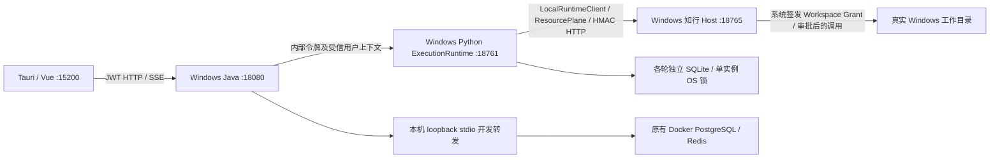

# PR-N02 知弈 Windows 原生桌面主链路实施与验收

> **已废弃（2026-10-29）**：N02 的 Docker relay 桌面开发入口已退役（`desktop.ps1` 与
> `README-N02.md` 已删除），`desktop_runtime.py` 收敛为共享窗口助手。当前桌面运行形态见
> [N03 Windows 原生持久环境](../../ops/scripts/infra/windows/native/README-N03.md)。

日期：2026-10-28。实施基线：`master`，HEAD `8b792fa0c2c422ed7548330ae3f1ea5bbf50883d`。

## 结论及范围

**Windows 原生开发环境的 Chat 文件主链和正式 Mission/Run 主链已实际跑通。** 验收使用真实 Tauri WebView2、Windows 目录选择器、Java/Python/知行三个原生进程、正式 JWT/内部鉴权/HMAC/Grant，以及真实 DeepSeek 模型。通过界面完成文件审批、写入、Patch、回读和正式 ACG 执行许可、调度、进度、终态、交付文件查看。没有用 Mock 数据替代这些证据。

这不是完整产品所有功能的 ACCEPT：实时语音 WebSocket 尚缺 Java 桥接端点，动态多工作区授权、持久安装版服务管理也未实现。当前可用范围是单用户、单个启动时明确授权目录的开发主链。N01A 的真实 symlink 创建权限限制仍为 **BLOCKED 遗留风险**，未重做补充验收、未改为 PASS，也未降低路径隔离策略。

原始 N01A/R1 报告保留在 [N01A 报告](PR-N01A-Windows-Native-Runtime-实施与验收.md)。本报告独立记录 N02，不覆盖此前结论。

## 实际运行链路



- Tauri 运行相同的 `kinlin_desktop_lib::run()`，使用独立开发二进制 `kinlin-native-dev`，没有第二套桌面业务逻辑或执行器。
- Java 使用正式 `application.yml`、PostgreSQL、Flyway、Hibernate `validate`、JWT 和内部鉴权，不切换 H2，不依赖 Docker backend。
- Python 是生产 `app.main:app`、单 worker，知行是生产 `runtime.main`。继续使用现有 `LocalRuntimeClient`、HTTP transport、ResourcePlane、Grant authority 和持久运行状态，不另建状态真源。
- 18761/18765/18080/15200/15432/16379 均绑定 loopback。19222 是本机 WebView2 开发取证端口，停止时回收，不用于发布版。
- PostgreSQL/Redis 保留原容器，通过 `docker exec -i postgres-container nc ...` 的本机 stdio 转发访问。转发保留数据库认证，不发布数据库公网端口，不修改容器网络配置。
- 每次启动创建独立 PostgreSQL 库和角色，选择空 Redis 逻辑库；无可用空库时拒绝启动，不 FLUSH。SQLite、上传、WebView 配置和工作目录均按运行目录隔离。

## 本轮源码和配置

| 文件 | 改动及用途 |
| --- | --- |
| [desktop.ps1](../../ops/scripts/infra/windows/native/desktop.ps1) | 统一 `up/status/down` Windows 入口 |
| [desktop_runtime.py](../../ops/scripts/infra/windows/native/desktop_runtime.py) | 复用 N01A 生命周期与环境；增加数据库受控转发、独立测试库、Java/Vite/Tauri 启停和真实窗口管理 |
| [README-N02.md](../../ops/scripts/infra/windows/native/README-N02.md) | 依赖、实际启动命令、隔离方式及限制 |
| [local_workspace.py](../../apps/agent/app/api/local_workspace.py) | 从正式 HMAC 客户端获取已有根目录；登录用户只能确认该启动 Grant 的根目录，其他路径 403 |
| [main.py](../../apps/agent/app/main.py) | 注册上述用户工作区 API |
| [runtime.py](../../apps/agent/app/tools/runtime.py) | 修正 Chat SDK 外层超时未包含人工审批预算；先取消全部自有等待任务再等待清理，避免取消时遗留队列任务 |
| [test_chat_permissions.py](../../apps/agent/tests/test_chat_permissions.py) | 审批预算与 SDK 工具副本回归；流式审批关闭后无遗留任务回归 |
| [NativeWorkspacePicker.vue](../../apps/frontend/src/components/platform/NativeWorkspacePicker.vue) | Windows 原生目录选择、现有 Grant 确认；仅在 Chat 展示，最终放在正常文档流中避免遮挡按钮 |
| [DesktopRuntimeStatus.vue](../../apps/frontend/src/components/platform/DesktopRuntimeStatus.vue) | 原生服务在线后挂接目录选择组件 |
| [components.d.ts](../../apps/frontend/components.d.ts) | Vite 自动生成的新组件类型声明 |
| [vite.config.ts](../../apps/frontend/vite.config.ts) | WebSocket Upgrade 仍发往 Java；HTTP/SSE 使用既有 Java 代理配置和本轮后端地址 |
| [Cargo.toml](../../apps/desktop/src-tauri/Cargo.toml) / [native_dev.rs](../../apps/desktop/src-tauri/src/native_dev.rs) | 独立开发 exe 复用同一桌面库，保留原默认二进制 |

Java 业务、安全和 ACG 核心源码无需新增改造；本轮使用环境变量完成原生 PostgreSQL/Redis、内部令牌、Python 地址及精确 CORS 来源配置。构建包含工作区原先已有的修改，但没有编辑这些修改。

### 实际故障与最小修复

1. **stdio 转发命令不兼容**：容器是 BusyBox `nc`，不支持 OpenBSD 的 `-N`。以真实容器命令及失败日志定位后移除不兼容参数，未改数据库认证。
2. **Java CORS 拒绝登录**：15200 未列入允许来源，真实登录返回 403。启动环境显式加入本机 Vite/Tauri 来源，未改为通配符。
3. **Python 初始化超时**：Windows 上多份旧客户端初始化与系统代理发现耗时较大。子进程限定 `NO_PROXY=127.0.0.1,localhost`，保留 TLS 校验，启动等待按实际就绪耗时调整为 180 秒。
4. **原桌面 exe 被占用**：旧开发进程在运行，Cargo 无法覆盖 `kinlin-desktop.exe`。增加调用相同库的薄开发二进制，未终止旧桌面来强行替换。
5. **Chat 审批失效**：SDK 工具外层 30 秒超时先于现有 300 秒人工审批 TTL，真实界面出现过期审批 404、文件未生成。为每次 Chat 上下文复制工具定义并设置包含审批和执行预算的外层超时；共享工具、审批 TTL、Host 执行限额、ACG 工具目录保持原约束。修正后等候 49.56 秒仍未写文件，点击允许后才执行。
6. **取消后队列任务遗留**：真实停止出现 `Task was destroyed but it is pending`。原 finally 顺序等待第一个任务可能中断后续取消，改为先取消所有自有 waiter，再共同等待。增加资源回收回归；重启最终源码后再通过桌面停止，日志到正常 shutdown 未再出现该错误。
7. **提示条遮挡**：工作区提示条曾阻挡 Mission 创建按钮，先限定 Chat 路由；截图复核又发现其覆盖输入区边缘，最终改为顶部正常布局。原失败及后续截图均保留。

## 真实端到端验收

证据目录：[结构化证据及日志](../../artifacts/windows/native-n02/20261028/)。原始完整运行目录为 `C:\Users\LZX\AppData\Local\Temp\kinlin-n02-20261028-204856`，没有复制 SQLite、浏览器配置或凭据进入交付证据。

| 验收内容 | 结果 | 实际证据与边界 |
| --- | --- | --- |
| 三个服务 Windows 原生启动 | PASS | `run-05/desktop-up.json`、`desktop-state.json`、Java/AI/Host 日志；均有真实 Windows PID、命令行和健康检查 |
| Java 连接 PostgreSQL/Redis | PASS | 正式 PostgreSQL 配置，Flyway v1–v11 成功；`native-api-checks.json` 的 ready/dependencies 均 200；独立库 `n02_5429a3d623`，复验另建 `n02_11ff517140` |
| 桌面登录和业务数据 | PASS | 真 Tauri WebView2 CDP 操作注册/登录，正常进入 Chat、读取会话、创建和读取 Mission；不是单独浏览器页面替代 Tauri |
| 真实 Windows 目录选择 | PASS | `native-folder-selection.json` 和 Windows 原生目录对话框截图；UIAutomation 操作真实对话框，选择 `run-04\workspace`，正式 API 确认成功 |
| 工作区授权与鉴权负例 | PASS | 未登录 401，选取启动 Grant 外目录 403；客户端不能指定新 allowedRoot 或扩大授权；见 `native-api-checks.json` |
| Chat 审批后写入与回读 | PASS | 实际 DeepSeek `write_file` → 人工允许一次 → Host HMAC → `read_file`；审批前文件不存在，之后真实磁盘为 `alpha\nbeta\n` |
| Chat Patch 与回读 | PASS | 独立 `patch_file` 审批，将第二行 beta 改为 gamma；工具记录 +1/-1，随后真实读取；未用覆盖写伪装 Patch |
| 正式 Mission 创建与执行 | PASS | UI 创建 `mission_3726793f5680` / `run_9d65d25111cc`；通过正式任务图、激活暂停、交接、执行许可、执行按钮进入调度 |
| ACG 进度、终态和结果 | PASS | 两个节点从执行到 completed，执行树 succeeded，Run completed；界面显示 OUTPUT `final.md` 并真实打开；模型调用记录为 DeepSeek 实际两次调用 |
| 文件落盘及重复执行检查 | PASS | `persisted-final-check.json`：1 Mission、1 Run、1 dispatch command、1 permit；最终文件 12 字节及 SHA-256 一致，取消/断连测试文件未生成 |
| 断连和恢复 | PASS（本次场景） | 真 WebView 断网并刷新，出现 `ERR_INTERNET_DISCONNECTED`；Java upstream subscription cancelled、Python downstream cancelled，恢复后可重新访问；未审批写入无副作用。未声明覆盖任意执行阶段 exactly-once |
| 主动停止与清理 | PASS | 真界面停止接口 200；修正后的取消日志及 `run-04/run-05 desktop-down.json` 证明正常 shutdown、OS 锁和 13 个 SQLite 独占句柄可打开；所有自有进程树退出，七端口释放，DPAPI 凭据删除 |
| 一致的退出码与冲突拒绝 | PASS | 正常 up/status/down 为 0；端口已占用启动为 1 且未创建目标运行目录；停止后 status 为 DOWN、退出 1，不把不可用状态当成功 |
| 新运行隔离 | PASS | `fresh-run-isolation.json`：新 PostgreSQL 数据库、新 WebView 配置、空工作目录、SQLite Run 数量 0，没有读取上一轮数据 |
| 实时语音 WebSocket | 未实现 | 已保留 `/ai` Upgrade 的 Java 路由边界，但 Java 目前只有 HTTP/SSE 代理，没有实时语音 WS 桥接与相应握手鉴权合同；未通过直连 Python 演示或宣称成功 |
| 动态多目录 / 多用户授权管理 | 未实现 | 当前仅确认启动时系统签发的单个 Grant；更换目录需显式停止并指定 `-Workspace` 后新建运行。未实现用户级跨目录授权界面 |
| N01A symlink 越界 | 已知 BLOCKED 风险 | 本机创建真实 symlink 所需条件仍不足；保留原报告，不因 N02 放宽路径策略或重测替代 |

### Chat 磁盘结果

真实文件：`C:\Users\LZX\AppData\Local\Temp\kinlin-n02-20261028-204856\run-04\workspace\native-note.txt`。

```text
alpha
gamma
```

UTF-8，末尾换行，12 字节。SHA-256：`17cbbec0b19b84e7729ef8bba7e45944bfa331f56fa873b4e796d1730b8f953f`。
写入后、Patch 前、Patch 后、断连恢复后和最终停止后均有独立磁盘检查。待审批的 `n02-cancel-never.txt`、`n02-disconnect-never.txt`、`n02-final-cancel.txt` 均不存在。

### 正式 Mission 证据

- 目标是输出一段首次使用知弈 Windows 桌面版的中文说明，不请求网络或文件写入。
- 真实语义规划产生两个节点：`task_understanding` 和 `artifact_generation`。二者均绑定原生 `native_general_agent`，沿既有正式 ACG 能力目录执行。
- 执行许可 `xpermit_7bb83af4d3c9355948e4b5381bd61cf1218db37e`，dispatch `dispatch_91536b1ddd75ee2c0fb24f47b5520daf5a128f7e`。没有跳过界面许可按钮直接调用执行器。
- `mission-model-calls.json`：DeepSeek `deepseek-flash`，实际调用耗时 6556ms / 15595ms，Token 使用 2525 / 5598，均 finishReason=stop。
- `mission-final-output.json` 保存正式 outputRef 返回的结构化内容；界面实际加载 artifact download 200 并显示 `final.md`，正文包含授权目录、文件审批、任务创建执行。
- 文件写入能力没有注入 ACG。现有 NodeRunner 仍按 skill manifest / readonly catalog 绑定工具；**这次 Mission 证明正式规划与模型执行，不证明 ACG 节点已可写任意工作目录**。将文件任务纳入 Mission 需要后续正式能力绑定与 Grant/审批合同接线。

关键截图：

- [Windows 原生目录选择](../../output/playwright/n02-20261028/native-folder-dialog.png)
- [审批超过 30 秒仍等待](../../output/playwright/n02-20261028/fixed-approval-after-30s.png)
- [Chat 写入和回读](../../output/playwright/n02-20261028/chat-write-read-success.png)
- [Chat Patch 和回读](../../output/playwright/n02-20261028/chat-patch-read-success.png)
- [正式执行许可](../../output/playwright/n02-20261028/mission-permit-before-execute.png)
- [ACG 完成](../../output/playwright/n02-20261028/mission-acg-completed.png)
- [真实 final.md](../../output/playwright/n02-20261028/mission-final-result.png)
- [真实停止](../../output/playwright/n02-20261028/chat-final-cancelled.png)
- [真实断网](../../output/playwright/n02-20261028/desktop-offline.png)
- [最终顶部目录选择布局](../../output/playwright/n02-20261028/final-workspace-layout.png)：`run-06` 用最终脚本重新启动、注册并通过真实桌面登录后复核，目录条与输入框不重叠。

## 回归、原始失败与保留边界

- Java：`mvn -DskipTests package` 成功；`AiProxyServiceTest,PythonServiceAuthenticationTest,AiSseGatewayServiceTest,AiSseGatewaySessionRevocationTest,SessionRecheckGateTest` 共 **26 passed**。
- Python：`test_chat_permissions.py`、`test_chat_local_runtime.py`、`test_chat_local_runtime_http_e2e.py`，最终 **19 passed**；一条既有 Pydantic class Config 弃用警告。单测中的 fake SDK 只用于资源回收回归，以上桌面/模型/Host 验收均为真实服务。
- 前端：`vue-tsc -p tsconfig.desktop.json --noEmit` 退出 0；真实 Tauri 编译运行 `kinlin-native-dev.exe` 成功。
- 保留 `run-01/02/03` 和首次 Chat 的失败日志，没有清理失败证据制造全绿。规划早期 `execution-tree` 未生成时出现过 404 轮询，之后正式执行树 200、最终 Problems 0；没有改安全门禁使其消失。
- `preservation-check.json`：本轮前已存在的 **21 项 tracked diff 完全相同**，受保护 untracked 文件 hash 无变化；HEAD 未变，Git index 为空，没有自动提交。
- 原五个 Docker 容器保持 healthy，未停止、替换或删除；未操作旧库/卷。原先的前端开发服务仍运行。
- 原桌面 Cargo watcher 在 Cargo 清单变更时自动重编译，旧 PID 不是稳定身份；最终原 `kinlin-desktop.exe` PID 26000 仍在。`final-resource-audit.json` 中按旧 PID 25852 检查的 `oldDesktopPreserved=false` 是过时 PID 检查，保留原记录并在 `resource-audit-clarification.json` 明确说明，不能当作“同一 PID 一直存在”的证据。本轮生命周期停止的是记录的 `kinlin-native-dev` 自有进程树。
- 本轮测试数据库/角色和日志保留，停止时不清空 Redis、不 DROP DATABASE。开发转发及其 Windows 子进程全部回收。证据归档已排除凭据、浏览器配置、原始登录填充日志和 SQLite；已知运行秘密及生产 provider/Redis 秘密扫描未发现泄漏。

## 可重复启动与操作

详见 [N02 运行说明](../../ops/scripts/infra/windows/native/README-N02.md)。本机已验证 JDK 21.0.11、Maven 3.9.12、Node 24.19.0 和 N01A Python 3.14 依赖环境。

```powershell
# 仓库根目录；先确保现有 PostgreSQL/Redis 容器运行
Push-Location apps/backend
mvn -DskipTests package
Pop-Location
$entry = '.\ops\scripts\infra\windows\native\desktop.ps1'
$py = "$env:TEMP\kinlin-n01a-20261028\venv\Scripts\python.exe"
$run = "$env:TEMP\kinlin-n02-$([guid]::NewGuid().ToString('N'))"
& $entry up -RunDir $run -Python $py -Desktop
& $entry status -RunDir $run -Python $py
# 桌面注册/登录；Chat 顶部选择 $run\workspace；写入/Patch 时点击系统审批
# 项目 > 新建 Mission；按正式控制区准备、激活、交接、申请许可、执行；查看 OUTPUT
& $entry down -RunDir $run -Python $py
```

已有目录可在 up 指定 `-Workspace 'C:\明确授权的目录'`。运行目录必须独立且不存在；每次 up 为新的隔离开发会话，不承诺复用此前测试用户数据库。当前所有本轮原生服务在验收后停止，磁盘和测试数据留存。

## 下一阶段：完全移除 Docker 的具体工作

1. 为 Windows 本机 PostgreSQL/Redis 提供可重复安装、仅 loopback 监听、服务身份、认证秘密管理、备份恢复和升级流程；先迁移独立测试库并验证 Flyway/JWT/session 行为，再计划旧业务数据迁移。不能直接删除现有卷。
2. 把开发 stdio 转发替换为受控本机数据库端点；为持久用户环境提供可恢复启动配置、稳定数据库身份、Redis 命名空间、DPAPI 凭据续用/轮换和 schema 升级处理。当前新建测试库模式不能直接冒充生产安装。
3. 将 Vite 开发代理替换为安装版明确的本机 Gateway/Java 地址，完成签名构建、安装/升级/卸载、进程监督、服务崩溃恢复与端口冲突提示；移除发布版 CDP 调试入口。
4. 若要支持实时语音，先补正式 Java WebSocket 桥接与握手身份、用户会话撤销、超时/关闭传播，再验证真实语音依赖；不能把前端改成直连 Python。
5. 将用户选择目录与正式用户/任务级 Workspace Grant 生命周期连接，支持受控根目录切换与多用户隔离；对 ACG 文件操作实现正式能力绑定、授权和审核合同，保持既有执行许可与状态真源。
6. 在合法具备真实 symlink 夹具条件的 Windows 环境补完 N01A-06；继续保留 canonical/reparse containment、HMAC nonce、Grant 和 OS 单实例机制。

仅当数据库迁移、恢复演练及安装版主链均独立通过验收，并获得数据清理授权后，才进入旧 Docker 服务/卷的下线。N02 没有进行这一步。
