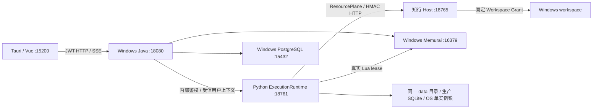

# PR-N03 Windows 无 Docker 持久运行实施与验收

日期：2026-10-29。基线 HEAD：`8b792fa0c2c422ed7548330ae3f1ea5bbf50883d`。

## 结论

**无 Docker 的 Windows 本机持久开发运行版已实际贯通。** 真实桌面完成登录、Chat 审批写入和 Patch、正式 Mission/Run 执行和 canonical final deliverable 查看；全部应用进程正常停止后，使用同一个数据目录重新启动、重新登录原账户、查看旧会话和结果，并继续通过真实模型调用读取原文件。冷备份和恢复也已实际演练。

最终应用使用固定 `%LOCALAPPDATA%\ZhiyiNative\python` Python 环境，不再依赖 N02 的 TEMP venv。最终 Java、Python、知行、PostgreSQL、Memurai、Vite 和真实 Tauri 桌面保持 **UP**，方便继续使用。整个本轮验收期间 Docker Desktop 和 daemon 始终关闭，没有为了检查旧环境而启动它们。

**范围限制：Memurai Developer 仅允许开发测试，连续运行上限为 10 天。** 当前交付不是无限期连续生产部署许可，也未通过自动周期重启规避限制；生产或 24×7 长期运行需要合适的 Enterprise 授权及对应版本验证。此限制与应用数据是否可跨重启保存分开记录。官方说明：[下载及版本限制](https://www.memurai.com/get-memurai)、[独立进程配置](https://docs.memurai.com/en/config-file)。

没有重做 N02 权限审计，没有改变 ACG/TaskPlan/Checkpoint/Execution Permit 语义，也没有向正式 ACG 节点注入 Chat 文件工具。N01A symlink 仍为已知 BLOCKED 遗留风险，不伪装为通过。

## 依赖检查及选择

| 项目 | 当前代码与实际验证 |
| --- | --- |
| 原 Docker PostgreSQL | Dockerfile 固定声明 `postgres:15.17-alpine`；daemon 本轮始终关闭，未把源码声明伪称为本轮容器内实际版本探测 |
| 原 Docker Redis | Dockerfile 固定声明 `redis:7.4.9-alpine`；原有 Compose 和数据卷未改动 |
| 本机 PostgreSQL | EDB Windows x64 ZIP **15.19**，与原部署同为 15 主版本；实际 `SHOW server_version` 为 15.19 |
| Java 数据合同 | 正式 PostgreSQL/JPA，Flyway 11 项迁移，Hibernate validate；没有 H2 替代，也没有关闭 Flyway |
| 应用角色 | 固定 `zhiyi_app`，`rolsuper=f / rolcreatedb=f / rolcreaterole=f`；管理角色和密码独立，不给 Java 超级用户身份 |
| Redis 兼容实现 | Memurai Developer **4.1.2**，本机实际报告 API **7.2.5**；不宣称支持 Redis 7.4 的全部特性 |
| 当前 Redis 用法 | Java Spring Cache 角色缓存、TTL；AgentOS 生产 `RedisLeaseCoordinator` Lua lease 协调。真实登录会话权威仍是 PostgreSQL `iam_login_sessions` |
| Provider state | 保留 N02 的关闭状态，不把可选 provider Redis 状态冒充登录或 Chat 历史真源；本机 DB 2 预留 |
| Python | CPython 3.14；原两份 hash 锁文件安装到固定用户目录；`pip check` 通过 |
| 桌面构建环境 | 复用已有 JDK 21、Maven、Node、Rust/MSVC、WebView2 和 N02 的同库薄开发二进制 |

### 供应链和系统改动范围

- PostgreSQL ZIP 从 EDB HTTPS 官方地址下载，固定 SHA-256：`cc54e2d349f48c7743ad0c509b755ea565ff04bb5c5e71745d114074cab0c453`。该 hash 是本轮供应商下载后的固定摘要，不是独立供应商签名；`postgres.exe` 未带 Authenticode 签名，没有将其宣称为签名验证通过。
- Memurai MSI hash 与微软 winget 4.1.2 清单一致：`11d009c8e93912e1899b5263d0e7d78907903913e1672b30020612ada6d27446`；实际 Authenticode 为 Valid，签名主体 Janea Systems。
- 使用 Windows Installer 只读数据库 API 提取内嵌 CAB，再用系统 expand 解包；没有执行 msiexec 安装。提取工具也在独立目录真实复验，所得 exe 与已运行的 exe 摘要一致。
- 未安装、修改或启动 PostgreSQL/Memurai Windows 系统服务，未改系统 PATH、开发者模式或防火墙。只收紧本轮新建私有目录 ACL：当前用户和 SYSTEM。没有放宽执行器权限。
- 依赖 ZIP/MSI、许可证文件和固定版本元数据保留在 `%LOCALAPPDATA%\ZhiyiNative\dependencies`。

## 实际调用链与持久身份



N03 入口没有 Docker CLI、docker exec、stdio relay 或容器健康依赖。复用 N02 的安全环境、窗口管理和进程控制工具，未调用 N02 的新建测试库 up 路径。所有监听端点都在 loopback；19222 是本机开发 WebView 取证端口，发布版必须移除。

固定 home：`C:\Users\LZX\AppData\Local\ZhiyiNative\default`。

| 位置/身份 | 持久化内容与行为 |
| --- | --- |
| `environment.json` | 固定数据库、依赖位置、Workspace 根目录；首次创建，后续不换库、不换根 |
| `credentials.dpapi` | 固定 PG 管理/应用密码、Redis 密码、JWT 密钥、内部令牌、HMAC、资源加密键和模型密钥；当前 Windows 用户 DPAPI 密文 |
| `postgres\` | 独立完整 PostgreSQL cluster；固定数据库 `zhiyi`、应用角色 `zhiyi_app` |
| `redis\` | AOF everysec + RDB；DB 0 Java，1 coordination，2 provider 预留，3 验收探针 |
| `data\` | 同一生产 Runtime 的 SQLite、Checkpoint、Artifact/manifest、ResourcePlane 等；没有平行工作流库 |
| `workspace\` | 默认授权根目录，跨启动复用同一 opaque Grant/Resource 身份和 HMAC 凭据 |
| `uploads\` / `webview\` | Java 上传和独立桌面用户配置 |
| `logs\<UTC时间>-<标识>\` | 每次启动各进程日志和 up 结果，正常启停不覆盖旧日志 |

首次 init 从明确的密钥文件读取 DeepSeek key 并转存 DPAPI；后续 up 不再读取旧 `.secrets/kinlin-win-p1-001`。Redis AUTH 和 initdb 所需密码只短暂写入私有 temp 文件，启动读取后即删除，不出现在进程命令行。正常 down 保留 DPAPI 和全部数据，临时明文仍清理。

首次 SQLite 使用正式 schema 准备工具显式初始化；后续启动只读检查已存在 schema。没有通过初始化空库、忽略 schema 错误或删除锁文件“恢复”业务数据。目录级生命周期 OS 锁串行化同一 home 的管理操作；重复 up 明确拒绝。

## 源码改动

| 文件 | 本轮职责 |
| --- | --- |
| [persistent.ps1](../../ops/scripts/infra/windows/native/persistent.ps1) | 固定持久 Python 的统一 init/up/status/down/recover/backup/restore 入口 |
| [persistent_runtime.py](../../ops/scripts/infra/windows/native/persistent_runtime.py) | 首次身份初始化、原生 PG/Memurai、同目录重复启动、生产应用装配、生命周期管理和冷恢复 |
| [prepare_persistent_dependencies.py](../../ops/scripts/infra/windows/native/prepare_persistent_dependencies.py) | 固定版本用户目录下载、hash 校验、免安装 MSI/CAB 提取 |
| [persistent_checks.py](../../ops/scripts/infra/windows/native/persistent_checks.py) | 真实 Redis/Lua 探针及正式 HTTP/SQL/文件摘要的重启前后记录；没有 Mock 服务或第二套执行框架 |
| [README-N03.md](../../ops/scripts/infra/windows/native/README-N03.md) | 可复现部署、启停、备份恢复、许可证及路径限制 |
| [native_runtime.py](../../ops/scripts/infra/windows/native/native_runtime.py) | 既有 down 清理增加可选 `preserve_credentials`；默认仍删除 N01A/N02 临时凭据，N03 显式保留。继续复用原 Windows OS 锁和 SQLite 独占句柄验证 |

本轮没有编辑原有 tracked 修改，也没有编辑 Java、Vue、Tauri 和 ACG 业务源码。基线 46 个既有修改/未跟踪文件中，只有上述共享清理 helper 被有意增量扩展；其余原文件摘要保持一致。没有 Git commit、stage 或清理原 untracked 文件。

## 真实验收结果

证据根目录：[artifacts/windows/native-n03/20261029](../../artifacts/windows/native-n03/20261029/)。

| 验收项 | 结果 | 证据 |
| --- | --- | --- |
| PostgreSQL Windows 原生 | PASS | 实际 postgres.exe、15.19、loopback、SCRAM，Flyway v1–v11；`native-database-contract.json`、进程和日志 |
| Memurai AUTH / TTL | PASS | 无 AUTH 被拒绝，正确 AUTH 可访问；真实 TTL 过期；`redis-before-restart.json` |
| 生产 Lua lease 合同 | PASS | 真实 coordinator 获取、容量拒绝、续租、错误 owner 拒绝、释放及过期回收，未用 stub |
| Java 实际缓存合同 | PASS | 创建独立验收角色，两次正式 HTTP 返回一致，Memurai 中产生角色缓存 key、TTL 3600；重启后同角色仍可读取；`java-cache-native.json` / `java-cache-after-restart.json` |
| AOF/RDB 恢复 | PASS | 重启日志从 AOF base/incr 加载；三次真实探针持久 marker SHA 相同，AOF/RDB 状态 ok |
| 桌面登录 | PASS | 真 Tauri WebView2 登录 native_n03；重启后界面退出、再登录原账户；冷恢复后重新登录成功 |
| Chat 审批创建 / 修改文件 | PASS | 实际 DeepSeek + write_file/patch_file 审批卡；写入后回读，Patch 后 `version=2`，磁盘独立摘要 |
| 正式 Mission / Run | PASS | 真界面创建、物化、激活暂停、交接、申请许可、执行；三个正式节点完成，无额外 Chat 写工具注入 |
| Canonical final deliverable | PASS | 界面 CANONICAL 标识、sealed manifest、artifactKey=final；正式 download 4245 字节，SHA 与 manifest 相同；`canonical-download-proof.json` |
| 全进程关闭 / 单实例锁 | PASS | 三次正常 down；自有进程树退出、七端口释放、OS workflow 锁和 13 个 SQLite 独占句柄可重新打开；DPAPI 保留 |
| 正常重启恢复 | PASS | `restart-comparison.json`：账户/会话/消息计数、Run、许可/dispatch 数、输出摘要、文件摘要、凭据摘要全部一致 |
| 重启后继续真实操作 | PASS | GUI 打开历史会话并再次实际调用 read_file；从项目页打开原 Run 和 final.md；不是仅检查数据库文件存在 |
| 冷备份与恢复 | PASS | 1359 文件摘要；恢复前整体目录保留；新增恢复探针只留在 rollback 副本，活动 home 恢复到快照；`restore-comparison.json` 全部一致 |
| 固定 Python 下再次重启 | PASS | 原两份 hash 锁安装到 LOCALAPPDATA，pip check；`durable-restart-comparison.json` 全部一致；该环境下再次真实模型读文件成功 |
| Docker 完全关闭 | PASS | 初始和最终 Docker 服务 Stopped、无 Desktop/backend 进程、daemon pipe 不存在、docker info 非零；全部上述操作期间未启动 Docker |
| 重复启动 / 活库备份负例 | PASS | 均返回 1；活库备份目标未创建，没有覆盖运行环境或复制活动数据库 |
| 无限期连续生产部署许可 | BLOCKED（范围外依赖） | 当前 Memurai Developer 授权不允许生产，且 10 天自动关闭；需合适商业授权/替代方案验证，不掩盖为生产通过 |
| N01A symlink | 已知 BLOCKED 遗留 | 未重测、未降级路径隔离，不作为本轮前置阻断 |

### 本轮实际持久对象

- 用户：`native_n03`。密码留在用户 DPAPI 私有凭据中，不写入报告或 Git。
- 会话：`ctx_686835c0-3742-4fa7-87a1-737e3222d672`。
- Mission：`mission_83fa339cfc05`；Run：`run_3e98155633c2`，终态 completed。
- Execution Permit：`xpermit_2de16526c2436e4e2fdcaec59afdfff688384a55`。
- Dispatch：`dispatch_95dd20bee05da5659c21d8a418dfcb3aa62e098a`。多次重启后始终只有 1 Mission、1 Run、1 permit、1 dispatch，没有重放为新执行。
- 三个节点为 task_understanding、information_extraction、artifact_generation。实际 DeepSeek `deepseek-flash` 调用耗时 16439/7190/13699ms，Token 使用 4133/3446/5505；不是 Mock 输出。
- Canonical Artifact：`artifact_a41a396adb0c`，artifactKey `final`；sealed manifest `manifest_ec6dddd1c5504e3483273e6a86fb9d41`。
- Canonical 文件下载：4245 字节，SHA-256 `41ae92919caff5ee1aae282410c3128b441ed6854820c561028e8ba5ff0a55d3`。副本：[canonical-final.md](../../artifacts/windows/native-n03/20261029/canonical-final.md)。
- 输出 HTTP 结构化内容摘要跨重启和恢复不变：`c784e05cf9fc55f19106619ba1c42fa61d9b60f8f90e2024b629e2047c88300b`。它是整个 output JSON 的摘要，与 canonical Markdown 文件摘要是不同对象。

真实磁盘文件：`C:\Users\LZX\AppData\Local\ZhiyiNative\default\workspace\n03-persistent.txt`，25 字节、UTF-8、末尾换行：

```text
N03-PERSISTENT
version=2
```

SHA-256：`baa3a841b27ce5c3ccd6b7851fe97f5a72b4b6f0b3b04f0c0b32ee9fe301319d`。

第一次重启前后是 1 用户、1 会话、4 消息、2 登录 session；重新登录并继续真实读取后变为 6 消息、3 session，冷恢复前后相同。之后再次登录、固定 Python 环境下再调用一次模型读取，会正常增加消息/session，不应把这些有意新增操作误判为恢复不一致。

### 桌面证据

- [审批写入](../../output/playwright/n03-20261029/chat-approved-write.png)
- [审批 Patch 和回读](../../output/playwright/n03-20261029/chat-patch-read-persistent.png)
- [正式执行许可](../../output/playwright/n03-20261029/mission-permit-issued.png)
- [重启前 final.md](../../output/playwright/n03-20261029/final-deliverable-before-restart.png)
- [重启后旧会话](../../output/playwright/n03-20261029/chat-history-after-relogin.png)
- [重启后真实模型读文件](../../output/playwright/n03-20261029/chat-real-read-after-restart.png)
- [重新登录后原 Run 结果](../../output/playwright/n03-20261029/final-deliverable-after-relogin.png)
- [冷恢复后 canonical 结果](../../output/playwright/n03-20261029/final-deliverable-after-cold-restore.png)
- [固定 Python 下真实读取](../../output/playwright/n03-20261029/chat-durable-python-real-read.png)
- [最终保持运行的桌面](../../output/playwright/n03-20261029/final-running-desktop.png)

## 备份与恢复方案

实际快照：`C:\Users\LZX\AppData\Local\ZhiyiNative\backups\snapshot-20261029-n03`。
实际恢复前副本：`C:\Users\LZX\AppData\Local\ZhiyiNative\default.pre-restore-3cdf581b67`。

采用完整停机后整 cluster 的冷备份，包含 PostgreSQL、Redis AOF/RDB、SQLite/Artifact、内部 workspace、上传、配置及 DPAPI，记录逐文件摘要。不把活动数据库目录复制当作一致性备份；符合 PostgreSQL 的 [文件系统级备份要求](https://www.postgresql.org/docs/15/backup-file.html)。

恢复先验证摘要和 DPAPI，再将当前 home 改名为同父目录的唯一 rollback 副本，然后恢复到原路径。没有递归删除现有用户数据。快照不包含日志、浏览器登录状态和 temp；原日志仍保留在 rollback 副本并归档为证据。外部 Workspace 不在 home 冷备份内，必须独立备份。备份遇到 reparse point 会拒绝，不跟随它拷贝区外内容。

当前恢复范围为同一 Windows 用户/机器、相同 PostgreSQL 主版本/二进制和原 home 路径；保留 Artifact 绝对路径和 DPAPI 合同。跨机器秘密导出、逻辑迁移、在线增量备份及任意执行中崩溃的 exactly-once 恢复不在本轮通过范围。

## 启停、状态和恢复命令

完整依赖步骤见 [README-N03](../../ops/scripts/infra/windows/native/README-N03.md)。当前机器依赖已准备好，可以直接：

```powershell
# 仓库根目录，普通 Windows 用户
$entry = '.\ops\scripts\infra\windows\native\persistent.ps1'
& $entry status
& $entry down
& $entry up -Desktop
# 遇到部分运行状态时，以保存的进程身份正常停止再恢复同一环境
& $entry recover -Desktop
```

首次部署才调用 `init`，重复 init 只返回已有环境，不换库、不轮换密钥。数据 home 可用 `-HomeDir` 指定；更换目录不是重建当前用户环境的常规操作。Tauri 窗口关闭不等于整套后台都停止，完整关闭使用 `down`。

```powershell
& $entry down
$snapshot = "$env:LOCALAPPDATA\ZhiyiNative\backups\snapshot-$([guid]::NewGuid().ToString('N'))"
& $entry backup -Snapshot $snapshot
& $entry restore -Snapshot $snapshot
& $entry up -Desktop
```

## 回归、原始问题及证据边界

- Python 原有 Chat permission/Local Runtime/HTTP E2E 回归 **19 passed**，一条已有 Pydantic class Config 弃用警告；该回归在既有 N01A 工具环境执行，最终固定运行环境另经 pip check 和真实重启/模型/文件调用验证。Java 鉴权、代理、SSE、session revocation 相关 **26 passed**。未运行要求 Testcontainers 的 Docker 集成基座，也未把它们报告为通过；本轮原生数据库合同由真实原生服务和桌面链路验证。
- 固定 Python 依赖按 hash 锁安装成功、`pip check` 无损坏依赖；实际生产进程命令行指向 LOCALAPPDATA，不指向 TEMP。包的完整安装记录保留。
- 依赖大 ZIP 的单次下载在本机代理下停滞；改用有界 Range 下载，组装后验证固定完整摘要，没有关闭 TLS 校验或安全软件。
- 仍观察到规划阶段 execution-tree 404 轮询和结果页可选 context-packs 404，以及一条 Vue 既有警告；真实 canonical 结果、正式 Run 终态、文件工具和重启恢复不受阻。没有扩展成 N02 重审，也没有抹去 console/log 原证据。
- 活动 runtime.instance.lock 会阻止直接整文件读取；秘密扫描改对真实冷快照执行，没有放宽 ACL 或绕过 OS 锁。已知运行秘密在日志/证据以及冷快照的 SQLite/Redis 数据中未发现明文泄漏。浏览器自身的 JWT 存储保留既有合同，不宣称其属于 DPAPI 数据库。
- 证据归档不包含 DPAPI 密文、完整 PostgreSQL/SQLite 数据库或 WebView 配置；实际快照和 rollback 副本继续留在私有本机目录。备份和历史日志不会自动清理。

## 下一阶段：安装包与服务管理

1. 确定长期生产 Redis 兼容实现及许可证；使用 Memurai Enterprise 时验证授权、版本、升级和故障退出，不把开发授权的 10 天限制藏进生产。
2. 构建签名的 Tauri 发布版和固定前端资源/Gateway，移除 Vite/Cargo 开发启动及 CDP 19222，打包受控 CPython 和 Windows 依赖，减少对本机开发工具的要求。
3. 设计用户级 supervisor 或明确授权的系统服务安装/卸载、服务身份、启动顺序、进程树回收、端口冲突和托盘完整退出；系统级服务/防火墙变更须先获授权。
4. 增加 PostgreSQL/SQLite 版本升级、迁移前快照及回滚流程；完善在线/增量备份、保留策略、跨机器 DPAPI 密钥迁移与凭据轮换，不丢失 canonical Artifact 路径/身份。
5. 提供安装版的数据位置、备份状态、密钥失效和故障恢复界面，替代目前开发运维入口；当前运行目录不是每次新建的 N02 测试环境。
6. 动态多工作区、语音 WebSocket、正式 ACG 文件能力和 N01A symlink 补验继续作为独立后续事项。现有路径隔离、Chat 审批和 ACG 执行许可保持原样。

本轮没有卸载 Docker、删除旧库/卷或迁移历史业务数据。原 Docker 开发部署配置保持可用；本机持久环境与其完全隔离。
