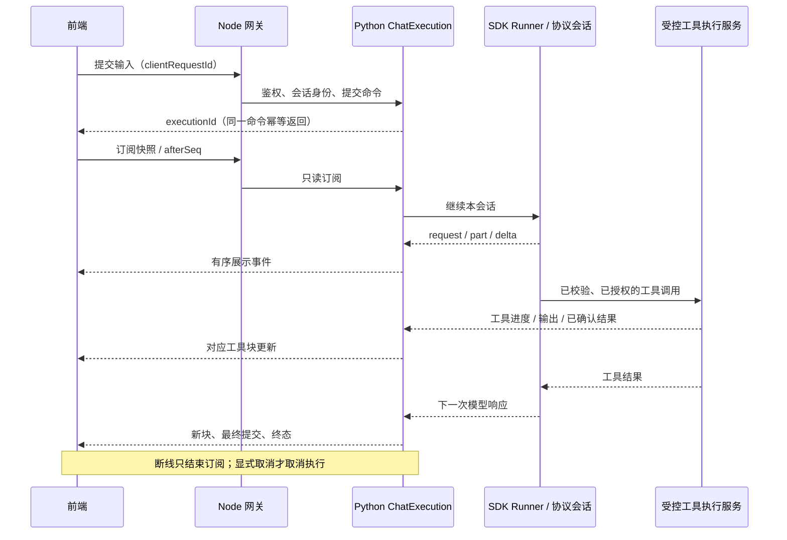

# OScode 链路审计与优化建议

日期：2026-11-14。范围：模型流、工具循环、历史保存、断线恢复、前端时间线和长任务。

## 结论

OScode 已经有真实的模型与命令输出流。主要差距是：把一轮工作压成一条字符串和一份工具摘要，且执行生命周期绑定浏览器请求。改成 Socket 本身不能补齐事件边界、恢复和后台任务。

用户提供的两种界面，关键区别是：

```text
当前：多次正文追加到同一篇文章；所有工具另行汇总为“已完成 N 项操作”。
目标：进展说明 → 对应工具及结果 → 下一段进展说明 → 对应工具及结果 → 最终回答。
```

建议保留现有 SSE、OpenAI Agents SDK Runner、工具审批和协议会话，从有序事件和展示投影入手，不再增加一套 Agent 调度器。

## 审计基线与方法

| 对象 | 本次实际检查的基线 |
| --- | --- |
| OScode | 当前工作区；包含此前尚未提交的修改，不将本次发现一概归因于某个历史提交 |
| 本机 ZCode | `F:/ZCode`，HEAD `fec975905a2abd4c07e35c40d51fa097a2258ec9`，提交日期 2026-11-13 |
| DeepSeek Harness | 用户提供的官方仓库；本次拉取 HEAD `39163dd30f703a79079e2d2446545cff3c453738`，提交日期 2026-11-13 |

Harness 审计副本位于 `.tmp-tests/oscode-harness-audit-20261114`。这里记录明确提交，不宣称未来版本的行为。源码对照以实现为准，不仅根据 README 推断。

本轮检查了真实页面的消息状态和操作元数据，没有重发用户任务，没有把真实推理正文或命令输出写入本报告。模型请求测试使用离线响应。

本轮落地范围：修正已复现的 SSE 序号回退并添加回归测试；其余为源码证据与改造设计，没有借审计重新设计界面或改变后台任务政策。

## 已确认的问题

### 1. 正文与工具的先后关系在前后端均丢失（优先级 P0）

证据：

- `apps/frontend/src/stores/chat.ts` 的 `appendStreamContent` 只做 `message.content += delta`；工具另外进入 `executionSummary`。
- `apps/frontend/src/components/MessageBubble.vue` 将工具汇总放在顶部，整段正文通过同一个 `v-html` 渲染；命令、文件与审批详情放在 `ConversationWorkFeed`。
- `apps/backend/src/chat.ts` 的 `StreamCapture` 同样拼接 `content`，并使用 Map 汇总工具；历史保存没有正文块与工具块的共同顺序。

离线输入：`正文“先检查文件。” → read_file → 正文“再验证结果。”`。

实际保存：`先检查文件。再验证结果。`，没有块边界和时间线字段。即便前端临时穿插显示，刷新后也无法从现有历史还原准确落点。

改造：使用有稳定标识的有序块；前端显示和历史恢复读取同一份展示投影。旧的 `content` 留作复制、导出和旧客户端兼容，不再是时间线的唯一数据源。不要根据已保存文本猜测或伪造旧工具的落点。

### 2. 心跳与运行时事件分别编号，传输序号可能回退（P0，本轮已修复）

位置：`apps/agent/app/api/chat.py::_stream_sse_events`。

Runtime 为内容事件生成局部序号，SSE 包装器在等待时另发有序号的心跳。修复前，包装器虽更新内部最大值，却仍原样输出下一条 Runtime 事件的旧序号。

回归复现：`[1, 2, 3, 2, 3]`，期望 `[1, 2, 3, 4, 5]`。当前前端没有消费序号做去重，因此不能据此断言它已直接造成此次丢字；但今后加入重连和去重时，它会成为真实的数据完整性问题。

本轮修复：由 SSE 出口统一为每个下发事件分配递增序号；复制原事件，不改变 Runtime 的原始序号。正文、心跳、完成和错误共享出口序列。此序列仍是一次连接内的序列，**不是已经实现的持久化恢复游标**。

测试：`apps/agent/tests/test_sse_streaming.py::test_heartbeats_and_runtime_events_share_one_wire_sequence`，包含两个确定发生的心跳，检查顺序、内容、终态与原事件不变。

### 3. 流、工具和思考阶段缺少完整的身份与结束边界（P0/P1）

位置：`apps/agent/app/tools/runtime.py::_stream`、`app/llm/observable_chat_model.py`、`apps/backend/src/chat.ts::StreamCapture`。

当前 `model_phase` 有 `turn`，但正文、推理等事件没有共同的 `attemptId`、`partId`；多次模型请求的输出最终进入同一组全局字符串。

SDK 路径转发 `reasoning_delta`，却没有与每次请求配对的 `reasoning_start/end`。后端只有收到 `reasoning_end` 才设置 `reasoningCompleted`。离线验证：`reasoning_delta → content_delta → done(completed)` 的整轮结果为完成，但历史里的思考摘要仍为 `interrupted`。

改造：建立请求/内容块生命周期，完整区分以下状态：

```text
请求准备 → 等待模型首段数据 → 接收可展示推理/正文
                         → 工具参数生成 → 等待审批 → 执行工具
工具完成 → 下一次模型请求
每次尝试：completed / interrupted / failed
整轮执行：running / waiting_approval / completed / failed / cancelled
```

“工具参数正在生成”和“工具已经执行”必须是不同状态。可以提前显示工具名、参数接收量和允许展示的摘要，但参数未完整、未验证或未审批时不得执行工具。

命令的“执行结束”也不等于 `exitCode=0`：应保留退出码及结果语义，避免把全部已返回的调用都展示成业务成功；同样不能把 `rg` 无匹配等所有非零退出一概当成基础设施故障。

### 4. 传输断开等同于取消执行，无法恢复仍在工作的对话（P1）

证据：

- 前端 `invalidateMessageRequest()` 会 abort 当前连接，`loadHistory()` 会调用它。
- Node 的 `abortForReply()` 在浏览器连接关闭时中止上游请求。
- Python SSE 在断连后关闭迭代器；Runtime finally 取消 Runner、工具执行和待审批会话。
- Node 在流的 `finally` 中保存最终/中断历史，没有这轮执行的持续事件查询与订阅恢复合同。

因此现有“恢复协议上下文”不等于“恢复执行中的事件流”。不能只给前端加自动重连，重发 POST 还可能重复提交用户消息或重复调用工具。

改造：把执行所有者放在服务端，建立独立的 `ChatExecution`。启动命令与订阅分离，订阅消失只停止这条订阅；用户显式停止才触发取消政策。必须同时定义服务退出、闲置保留、资源上限与结果未知状态，不能无期限遗留任务。

### 5. 高频更新与全文重算存在开销放大路径（P1，卡顿贡献尚待性能追踪）

已确认的代码路径：

- 每个内容事件都追加 Pinia 响应式字符串。
- `MessageBubble.renderedMessageHtml` 随内容变化重新解析整篇 Markdown，再通过 `v-html` 替换内容。
- 推理预览会对完整推理字符串做空白规整和 `Array.from`，最后才截取尾部。
- `ChatView` 对正文变更触发滚动逻辑；工具输出事件包含累积 terminal 文本，也会反复替换摘要。

Vue 自身会合并同一调度周期内的一些更新，因此不能简单把“一条 token”等同“一次 DOM 绘制”。但跨周期的全文解析与全量替换仍存在，长代码和长推理会放大开销。本轮没有用它解释已确认的 300 秒无字节超时，也未进行真实性能归因。

改造：在状态发布边界做约 16–33 ms 的文字合并，设字数/事件数上限；工具、审批、错误、结束等结构事件到达前先 flush，绝不跨身份和结构边界合并。已结束块保持稳定引用，只有活动尾块更新。优先拆块与缓存，再按实测决定是否需要虚拟滚动。隐藏窗口不能仅依赖 `requestAnimationFrame` 推进协议。

### 6. 现有 Chat 工具是前台等待模式，缺少模型可用的后台作业合同（P1）

`configure_chat_tool_runtime()` 构造 `LocalRuntimeToolExecutor` 时没有传入独立 limits，当前该类默认 `timeoutSeconds=30`。显式命令 timeout 也会被截到这份 limits。不要把另一项 `TOOL_TERMINAL_MAX_TIMEOUT_SECONDS=120` 误当作这条执行路径的实际 120 秒预算。

`_execute_command()` 已能获得 `executionId` 并消费 stdout/stderr 事件，但会一直等待终态才返回模型；finally 会移除活动映射。没有给模型提供“已启动但仍运行”的后台句柄、后续输出游标和完成通知。

改造：在现有受控执行服务上定义后台作业，不另起绕过审批的进程执行通道。工具启动后可返回 `running + executionId + outputCursor`；模型后续使用有界的输出读取/等待操作，完成时发布终态。继续保留超时、取消、输出截断和幂等校验。进程或服务重启后，无法证明结果的作业保持 UNKNOWN，不伪造完成。

### 7. 断流后只能结束整轮；缺少可观察的请求级恢复（P2，依赖前述基础）

当前 SDK 有响应开始前的请求重试，模型已开始输出后则保留部分内容并结束。这个保守边界避免了重跑工具，但也会使可恢复的模型连接故障直接终止长任务。

改造：基于完整工具结果与请求身份做有限恢复。每次重试必须有新 `attemptId`，保留失败前缀及原因，并在界面显示重试次数。已完成工具由持久协议/结果记录确认，不可重放整轮 Runner。只有部分输出而尚未执行工具时，从供应商可接受的前一边界重开，不能把新输出直接接到失败段落伪装成连续生成。认证、权限和确定性参数错误不自动重试。

## 参考实现中可借鉴的具体机制

### 本机 ZCode

| 实现位置（相对 `F:/ZCode`） | 本轮确认的机制 | OScode 对应改造 |
| --- | --- | --- |
| `packages/shared/src/zcode-protocol-v4/rows.ts` | `assistantText/reasoning/toolCall` 独立行；有 response 身份与生命周期 | 正文、进展、工具保留顺序和稳定 ID |
| `packages/ui/src/v4/conversationTurnFlowItems.ts` | 按 `orderedRows` 生成正文与工作段 | 主区显示连续工作脉络；详情可折叠 |
| `packages/services/src/session/continuousStreamCoalescer.ts` | 默认 16 ms 合并小文本；4096 字符、128 事件上限；结构事件前 flush | 降低更新压力，保持审批和终态顺序 |
| `packages/shared/src/zcode-protocol-v4/transport.ts` | `logEpoch + seq`，snapshot/resume，`fromSeq/toSeq` | 快照、补发、去重、缺口恢复 |
| `apps/zcode-cli/packages/core/src/runtime/methods/turn-model-step.ts` | 每次模型步骤创建 assistant/step 记录和请求事件 | 让每次续答可定位、可恢复 |
| `apps/zcode-cli/packages/core/src/runtime/methods/streaming-tool-coordinator.ts` | 工具与恢复账本；流中提前执行也受只读、并发安全、无破坏、无需审批等条件约束 | 先落实工具可观察性，暂不全面照搬提前执行 |
| `apps/zcode-cli/packages/core/src/runtime/methods/streaming-recovery.ts` | 从已确认工具结果或前一个安全边界恢复，失败输出单独标记 | 请求级恢复，防工具重复执行 |
| `apps/zcode-cli/packages/adapters/src/exec/bash-progress-poller.ts` | 有界的命令输出预览，默认共享 1 秒读取调度器 | 长命令输出进度；这是内部输出采样，不等于前端轮询整个会话 |

### DeepSeek Harness

以下位置均对应上述固定提交，不能把该版本的 provider 协议直接套给所有模型。

| 实现位置 | 本轮确认的机制 | OScode 对应改造 |
| --- | --- | --- |
| `packages/llm/llm-deepseek/src/translate.ts` | 将 provider 事件规范为块开始、文字/推理/工具参数增量、块结束、usage、finish | 统一规范化事件，同时保留供应商续传所需元数据 |
| `packages/llm/llm/src/assembler.ts` | 单一增量块组装算法，正常和中断读取共用 | 避免 live/history 两套拼接算法分叉 |
| `packages/core/agent-loop/src/assistant-stream.ts` | attempt、turn、step、revision、index；先有持久提交，再发布 committed 结束 | 区分实时预览与已提交结果 |
| `packages/llm/llm/src/assistant-stream.ts` | 保留块与时间信息的紧凑流记录 | 恢复顺序，不必逐 token 产生一条数据库事务 |
| `packages/api/gateway/src/client/journal-stream.ts` | 先快照，再有序增量；游标、重连和缺口修复 | SSE 承载同样的订阅合同 |
| `packages/core/session/src/surface.ts` | 人类看到的记录与模型压缩后的 surface 分开，压缩不抹掉已展示历史 | 展示日志与模型输入投影分离 |
| `packages/jobs/tool-jobs/src/index.ts`、`packages/shell/tool-pwsh/src/background.ts` | 作业输出、状态、取消、有界等待和完成通知 | 在现有执行边界补后台作业能力 |
| `packages/llm/llm-retry/src/index.ts` | 供应商策略驱动的请求恢复；先记录重试，再执行可取消等待 | 让恢复过程可见、有上限且可停止 |

## 目标所有者与事件顺序



所有者约束：

- Runner 继续负责模型与工具循环，不复制成第二套调度器。
- SDK 协议会话保存模型所需的完整消息、工具调用与结果；供应商要求的推理/签名等按适配合同保存与回传。
- `ChatExecution` 拥有整轮执行状态和公开事件发布；公开事件关联协议记录与 `callId`，不从 UI 文本推断执行事实。
- Node 网关负责鉴权、路由与历史兼容投影，不再把浏览器连接当作执行所有者。
- 前端拥有折叠、滚动、选中态和展示缓存，不生成工具已完成等业务事实。
- 持久事件游标与临时 UI 帧的序号必须区分；连接心跳不占持久业务游标。
- 服务重启后的可恢复性必须单独实现；把任务移到服务端不自动意味着所有进程可在重启后续跑。

建议公开事件的最小身份：`executionId / requestId / attemptId / partId / sequence / type / data`；工具额外关联 `callId / executionId`（名称须避免 Chat 执行与命令执行混淆）。后续最终合同应使用无歧义名称，例如 `chatExecutionId / toolExecutionId`，并有运行时 schema 校验。

## 分批落地与验收

| 批次 | 工作 | 必须同时完成的验收 |
| --- | --- | --- |
| A：顺序与状态 | 统一序号；按请求/块保存与显示；补齐生命周期；旧消息兼容 | 两次模型请求和两个工具之间顺序正确；刷新后相同；中断不变成功；思考与正文持续更新 |
| B：更新性能 | 小增量合并、结构边界 flush、稳定历史块、活动尾块增量渲染 | 大量小片段不阻塞停止按钮；审批/终态无延迟错序；后台窗口能结算；实测记录解析、布局与长任务耗时 |
| C：执行恢复 | 启动/订阅分离；持久游标、快照、缺口补发、幂等提交与显式取消 | 切换会话和断网后回到正确进度；重复帧不重复显示；陈旧流不污染新任务；同一提交不重复执行 |
| D：后台命令 | 复用受控执行的作业句柄、输出游标、完成通知与取消 | 长命令可持续显示真实输出；读输出不重启命令；拒绝审批不启动；异常退出保留明确结果 |
| E：请求恢复 | 基于已确认边界的有限重试与恢复事件 | 工具执行后断流不会重复副作用；失败尝试可见；重试可取消；不可恢复错误直接结束 |

A 与 B 是直接改善截图体验的第一阶段；C、D 支持可靠长任务；E 在它们之后再做。只改状态文案、拉长 300 秒超时、循环刷新会话，均不能替代这些合同。

额外验收边界：

1. 先返回一段进展、调用工具、再返回下一段文字，三者不能合并或搬位。
2. 写文件参数持续生成时显示“准备写入”，完整且授权后才显示“正在写入”。
3. 长命令输出持续到达时，界面显示工具进度，不显示模型正在思考。
4. 工具结束后模型等待首段数据时显示真实等待；本地心跳不伪装成模型输出。
5. 已完成工具后模型断流，重连只补发事件；继续执行从已确认结果出发。
6. 压缩模型上下文后，已展示的进展与工具结果仍能完整查阅。
7. 复制最终回答、复制本轮工作记录与导出协议上下文是不同操作，避免把原始协议字段或未批准参数混入用户报告。

## 本轮验证结果与限制

- 序号缺陷修复前，新增测试实际失败：`[1,2,3,2,3] != [1,2,3,4,5]`。
- 修复后执行 `test_sse_streaming.py`、`test_oscode_tool_continuation.py`、`test_model_stream_policy.py`：24 项通过。
- 使用现有后端 `StreamCapture` 的编译产物复现了正文落点丢失，以及整轮完成但思考摘要为 interrupted；未修改这些行为来掩盖审计结果。
- 已检查真实界面的状态与操作元数据；当时仍有对话执行中，本轮不重载服务。因此序号修复已在代码与离线测试中生效，运行服务需在当前任务结束后重载。
- 未完整构建或运行 ZCode、DSH 的全部测试，不宣称它们在本机环境中全部验证通过。
- 本轮未完成渲染性能 Trace，也没有再次调用付费模型，不能承诺这次局部修复能消除全部停顿。


## 实施记录（2026-11-14，审计之后）

本节记录本轮实施结果；前文“当前缺陷”和“本轮验证结果与限制”描述的是审计时状态。实现复用原 SDK Runner、协议会话、PostgreSQL messages、SSE 解析器、ConversationWorkFeed 和受控 Local Runtime，没有替换工具调度器，也没有新增 Socket、数据库表或命令执行后门。

### 实际所有权与接口

根据现有服务边界，执行的持续收流所有者落在 Node `ChatExecutions`，Python 仍独占模型/工具循环和 SQLite 协议会话。浏览器只订阅公开展示投影。这是对前文目标图中 `Python ChatExecution` 的落地调整。

- `POST /api/chat/executions`：使用 UUID `clientRequestId` 提交；在既有事务内保存用户消息和助手占位消息，返回 `chatExecutionId/contextId/messageId`。
- 同一用户、同一命令标识、同一请求体返回同一执行；改变请求体返回冲突。已有对话仍在执行时拒绝另一轮提交。
- `GET /api/chat/executions/:id/events?after=...`：鉴权后先发送一致快照，再发有序增量。订阅断开不取消 Python 收流。
- `POST /api/chat/executions/:id/cancel`：显式取消；停止按钮早于提交确认时，前端先记住停止意图，取得执行标识后取消同一执行。
- 旧同步/流式接口继续兼容，未迁移调用者不会被强制改写。

公开块和重试通知存入现有 `messages.metadata.transcript`；前后端共用 `apps/backend/src/shared/chat-stream` 的纯投影与批处理模块。模块作为编译输入进入每个不可变热更新构建，避免临时构建目录相对导入失效。

### 展示与更新

- 按真实顺序保留正文、供应商可展示推理/公开进展、工具以及重试通知，不再把所有正文拼接到工具列表的一侧。
- 每次模型尝试都有独立 `attemptId`，内容块有 `partId`；收到正文或模型结束时收束本次推理阶段。
- 工具参数生成、等待审批、命令执行、读取输出、下一次模型等待分别显示。心跳不会替换业务阶段，也不伪装成模型输出。
- 文字默认合并 16 ms，4096 字符或 128 个事件触发提前发布；审批、工具、错误和终态之前同步 flush。使用定时器，不依赖可见窗口的 animation frame。
- Markdown 按块渲染，已完成块保持稳定；工具详情直接复用 ConversationWorkFeed。非零退出码保留显示，不把“进程已结束”自动解释成业务目标成功。
- 出错前只有进展块而没有正文时，也会显示错误提示；已中断文字有明确标记，新尝试不会伪装成原片段的无缝续写。

### 恢复的准确边界

这里实现的是“执行内游标 + 持久快照”，不是逐 token 的永久事件日志：

- 每个执行保留最多 1024 个/约 2 Mi 字符的实时帧；已完成执行的实时缓存保留 60 秒。
- 快照约每 250 ms 在收到事件时节流保存；终态先保存再发布，最终游标与终态一致。
- 重连固定重建快照，不按传入游标跨进程补播旧 token；实时缓存出现缺口时再基线化，前端替换投影并去重。
- 传输 EOF/网络故障最多重连两次，只 GET 同一执行；丢失提交确认时最多重发一次相同命令标识和请求体。
- 服务热更新等待脱离浏览器的执行及最终保存结束；数据库暂不可用时仍可提供 liveness，首次持久操作共享恢复屏障。
- 服务重启后，旧 running 执行在首次持久操作前标记 interrupted，保留正文、已确认工具和块顺序，不自动重跑模型或外部副作用。
- 解决了快照 yield 期间丢增量、慢订阅缺口后缺终态、订阅离开时残留监听器，以及同一事务时间戳相同造成用户/助手消息顺序随机等边界。

此实现按本机单一 Node 服务所有者运行；不宣称已经实现多实例接管或崩溃后无缝续跑。

### 后台命令

`run_command` 经原审批流程和原 LocalRuntimeToolExecutor 启动。默认等待约 1 秒；未结束时返回已接受的 executionId、outputCursor 和 running 状态。新增 `get_command_output`、`cancel_command` 只操作同一认证用户、租户、工作区、会话下的既有句柄，不重新启动命令。

- 命令权限、幂等键、进程树、超时、输出截断、终态收据继续由原 Local Runtime/Hands 承担。
- 复用已有终端预算配置作为 Chat 执行 limits，消除组合根隐式回落为 30 秒的差异；不取消超时限制。
- 输出读取最多等待 10 秒；输出游标是此句柄的事件版本，返回有界快照及 changed 标志，不等同 SSE 游标。
- 作业注册表最多保留 64 个句柄，完成记录保留 10 分钟；已完成的模型轮次解除事件队列引用，后台命令仍由原执行服务的期限约束。
- 当前轮次中继续发布原 stdout/stderr/完成事件；整轮已结束后，下一轮通过输出工具查询实际结果。没有另建跨轮次常驻通知总线。
- Python 重启或句柄过期后返回 COMMAND_JOB_UNKNOWN；无法确认结果时不声称完成、不自动重发命令。
- 取消工具和取消等待均有测试确认到达原执行句柄，审批拒绝或非法等待参数不会启动命令。

### 请求级恢复

ObservableChatModel 对网络/流超时只补一次当前模型请求的恢复。每次恢复使用新 attemptId，显示持久重试通知和中断边界；同一调用的已确认工具结果保留在相同模型输入中。

不重启 Runner，不从最初用户输入重跑整轮。模型 response.completed 已交付后不在此层重试；认证、权限和参数错误不进入这条重试。SDK 原有的响应开始前重试仍在原层处理。

### 验证与实测

- 后端：完整 118 项测试通过，包含独立临时 PostgreSQL、真实 loopback HTTP、热更新、进程退出和新增恢复测试；生产数据库不作为测试库。
- 前端：类型检查通过，65 项相关流式、会话归属、压缩、Markdown/SSE 测试通过；包含顺序块、纯进展失败提示及确认前停止测试。
- Python：78 项相关测试通过；包含真实 SDK + httpx.MockTransport 的两轮工具续答、一次请求恢复成功/耗尽、审批/取消和后台作业归属。另在原生依赖组合下验证了 28 项测试；不调用付费模型。
- 独立 headless Edge 合成测试：10,000 个小片段、50,025 字符活动尾块，合并为 81 次状态发布；正文/进展/工具/正文顺序正确；已完成块 DOM 改写为 0；未出现横向溢出。
- 最近一次合成运行约 1555 ms，观察到 1 个超过 50 ms 的浏览器 long task，最大约 107 ms。该测量不是旧版/新版性能对照，也没有证明所有长尾 Markdown 解析停顿已消除。
- 真实 Electron 会话仅做状态读取，未注入合成内容或重发用户任务。Node 已通过热更新加载；确认没有进行中的正式任务及持久 Chat 后，平滑重载 Python 并检查健康状态与新工具注册。

后续仍需真实长任务 Trace 判断活动尾块的进一步解析/虚拟化收益；目前不因这次合成测试宣称所有界面卡顿已经根除。

## 上下文统计与响应延迟复查（2026-11-14）

### 真实统计与证据边界

“上下文投递”描述本次请求发往模型的协议输入，包含会话历史、工具调用与结果、工具定义等，不仅是界面可见的消息正文。

旧实现将 `len(request.content)` 写为 `contextInputTokens`，再用它除以 Token 窗口。真实会话的 836,280 是序列化请求体的 UTF-8 字节数，并非 836,280 Token。最近一次供应商 usage 为输入 201,114、输出 1,867，窗口占用统计 202,981 / 1,048,576，约 19%；请求体约 816.7 KiB。此前显示约 80% 属于单位错误。

上一轮缓存为 196,416 / 198,417，最近一轮为 0 / 201,114，供应商明确提供了缓存统计。生成中展示上轮缓存时，界面现在明确标记“上轮缓存命中率”。未证明本次缓存未命中的具体原因，不将其直接归因于某个本地改动。

最近真实轮次的提交时间约为本地 16:25:07，供应商 HTTP 200 响应头日志为 16:25:24，旧界面记录整轮约 57 秒。旧 `thinkingDurationMs` 在 done 时被覆盖为整个响应时长，不能解释为纯思考时间，也不能当作首次出字时间。约 17 秒的前置等待包括本地准备、传输和供应商处理；旧数据不足以进一步拆分，不能认定全部花在模型或网络。

### 本轮修改

- 传输层使用 `requestBodyBytes` 和 `contextMeasurement=request-bytes`，不再将请求体字节数转换为 Token。前端保留最近真实 usage；读取旧历史时识别 `protocol-utf8-upper-bound` 并按字节显示，禁止据此生成 Token 百分比。
- 复用现有事件、共享投影与消息元数据，传递并保存网关准备、AI 服务上下文准备、供应商响应头/首字节、整轮首段进展/正文耗时。信息栏新增“响应耗时”，明确最近模型请求和整轮的计时边界，不将重叠时长相加。历史数据不会补造不存在的阶段统计。
- 忽略空正文/推理 delta 的首段计时，避免无可见内容的帧被当作首次出字；思考阶段在结束时结算，不再被后续正文和 done 的整轮时长覆盖。
- 协议会话打开时只读取原始 journal 的最后一条来判断是否已有历史，Runner 再读取一次完整平衡投递视图，消除长会话的重复全量读取。使用原始 `SQLiteSession.get_items(limit=1)`，避免平衡视图过滤孤立工具结果导致错误判断为空会话。
- 网关恢复历史只查询投递启动所需正文、附件和执行摘要，不再读取未使用的大段推理与 transcript 元数据。没有截断真实协议历史，也没有自动修改用户的极致推理设置。
- 修复 ChatView 向 MessageBubble 转交消息时遗漏 `transcript` 的问题，使已有顺序展示逻辑实际收到数据。

### 加载生效与验证

检查发现已打开的 Electron 窗口仍保留旧 Pinia store 的发送函数，组件热更新没有替换这些闭包。当前 store 未注册 `acceptHMRUpdate`；直接在执行过程中替换它也可能破坏控制器和取消归属，因此本轮未添加无条件 store 热替换。

确认页面无执行、无输入草稿，数据库无活动正式任务或持久 Chat 后，平滑重载 Python，健康检查返回 UP；随后重载原 Electron 页面。CDP 确认新 `chat.ts` 与 `executionStream.ts` 已加载，原路由、contextId 和 22 条历史消息保持一致，真实界面显示 19% 及独立的 816.7 KiB 请求体说明。

- 后端完整构建与测试：119 项通过。
- 前端类型检查通过；相关流式、会话归属、压缩、工作流、消息块、信息栏和 SSE 测试原 116 项通过；补充耗时面板测试后，信息栏所在测试文件 43 项全部通过，相关用例合计 117 项。
- Python 相关协议、流式超时、权限、工具续答、缓存和压缩投递测试：最终 71 项通过。测试进程退出后另有 SDK tracing 后台线程写入已关闭日志流的提示，不影响上述断言和退出码；未通过生产代码吞掉该提示。
- 未发起额外真实模型请求，没有通过更改模型、降低推理强度或自动压缩用户历史制造更低耗时结果。分阶段指标需要下一次真实用户请求后才能判断剩余延迟的主要来源。

本轮消除了确定的重复读取与错误统计，并确认新代码进入运行窗口；尚无新旧真实请求延迟对照，不宣称已消除供应商等待或全部端到端延迟。

### 后续真实用户请求的阶段数据

用户随后提供耗时截图；只读检查同轮完成消息，未重发模型请求。该轮输入 202,987 Token、输出 1,657 Token，供应商明确报告缓存命中 0；有效推理强度 max，公开 transcript 只有一个模型 attempt 的进展与正文，无工具调用。

| 指标 | 实测 |
| --- | --- |
| 网关准备 | 112 ms |
| AI 服务上下文准备 | 827 ms |
| 模型请求发出至供应商响应头 | 14,054 ms |
| 模型请求发出至供应商首字节 | 14,090 ms |
| AI 服务本轮开始至首段进展事件 | 14,943 ms |
| AI 服务本轮开始至首段正文事件 | 30,672 ms |
| AI 服务本轮总耗时 | 43,201 ms |

同轮可对齐：`14,943 - 827 - 14,090 = 26 ms`，表示 AI 服务收到首字节后很快形成首段进展事件，未显示出 SDK 在这一段积压十几秒的证据；该数值没有测量浏览器收到事件至绘制的耗时。首段进展至正文 15,729 ms，正文开始至本轮结束 12,529 ms。主要可观测等待位于供应商首包和后续生成阶段；首包内部的上传、网络、排队与输入处理尚无法分别确认，不能仅凭这些数值证明缓存未命中或极致模式各造成多少延迟。

同时修复截图中的说明文字与最后一行重叠：耗时面板的说明继承了通用 `margin-top:-8px`，现仅对该面板覆盖为 `8px`。真实页面热更新后，测得说明与末行间距由 -8px 变为 +8px，截图确认无重叠；未重载会话或发送模型请求。

## 第一性原理复查：必要输入、首段可见、等待归属

### 检查目标

按用户点击发送到第一段有用内容实际可见的路径，分别检查：组装的数据是否必要、同一信息是否重复、上游何时开始输出、公开进展是否真的展开、后续正文等待是否独立存在。维持现有 SDK Runner、协议日志、SSE、执行归属和审批合同，不以更换通信协议代替定位，也不擅自降低推理强度。

### 只读实证

- 一个审计快照中，界面 26 条消息正文共 43,197 字节，协议日志实际有 262 个条目、约 880,030 字节。工具返回占 534,378 字节，历史进展/推理占 211,675 字节，工具参数占 79,207 字节。界面消息数不能代表模型输入规模。
- 其中 80 条命令返回把相同终端快照同时放在 `data.result` 与 `data.terminal`，重复字段共占 252,062 字节；这里的数值都是字节，不是 Token。
- 用已安装 SDK 的真实消息转换器重建同一份历史，消息 JSON 从 845,054 字节降至 592,992 字节，减少约 29.8%。这不包含工具定义等全部请求字段，也不能直接推算 Token 或延迟降幅。
- 对最近连续三轮转换后的消息做逐条比较，前一轮输入完整作为后一轮的前缀保留，只追加新条目。没有在当前转换逻辑中发现每轮重导入整个 UI 历史、重复插入原始用户轮次或随机重排旧消息的证据。
- 另一个无工具轮次的供应商统计为输入 204,653、缓存 202,944，约 99.16%；首字节 3,559 ms、首段进展 4,035 ms、首段正文 54,702 ms、总耗时 72,135 ms。缓存命中已恢复，进展到正文阶段仍持续 50,667 ms；因此“持续缓存未命中解释全部等待”的假设不成立。该轮使用 max，未做切换档位的真实对照，不能量化更换档位后的收益。
- 新的 `ChatTranscriptBlock` 将进展放在默认关闭的 details 中，尽管 SSE 在持续更新，用户仍可能等到正文开始才看到实际文本。此前 legacy 气泡的跟随尾部逻辑没有覆盖这个新的顺序块组件。
- 自动压缩配置默认关闭；已有引擎的默认触发比例为窗口预算的 85%。这主要是容量保护，尚不是按首字延迟目标设置的工作上下文预算。完整协议日志与实际投递工作集仍需区分，后续应复用现有引擎设计独立的延迟预算，而不是再次创建摘要/Agent 循环。

### 已实施

1. 在现有纯协议工具中加入共享的命令结果去重函数，只对已知命令工具、且两个字典完全相等的 alias 去重。历史 session 仅投递去重视图，原 SQLite 日志不改；新工具结果同样只序列化一份。流式执行记录仍保存完整 terminal，错误输出、退出码、截断标记和状态均保留。不同值、未知工具、非目标 JSON 和普通消息不受影响。
2. 正在生成的公开进展初次出现时展开，保持有界滚动窗口并跟随尾部；用户手动收起或向上滚动后保留其选择。已完成的历史块默认折叠；实时块完成后不强行收起正在阅读的内容。
3. 复用 httpcore 的 request trace，记录连接、TLS、请求体发送和响应头等待的阶段时长，继续通过原事件与白名单元数据展示。trace 的 header、body、网络对象和凭据不进入公开事件；原 trace 回调保留。缺少阶段事件时不伪造为 0。现有 14 秒记录没有这些阶段数据，不能倒推成纯供应商排队。

历史去重会改变投递前缀，下一次请求可能需要重新建立上游缓存；后续投递的前缀在离线连续轮次比较中保持稳定。本轮没有真实付费请求，也没有修改推理档位或调用摘要模型。

### 验证与加载

- 新增协议去重回归用例先在旧逻辑下失败；修复后确认输出内容仍完整、原始 journal 不变、不同 terminal/result 保留，投递视图可重复应用。
- 新增进展可见性和滚动用例先复现默认折叠与不跟随问题；修复后前端类型检查及 76 项相关测试通过。耗时字段展示断言另行复验。
- Python 相关模型、会话、工具、审批、SSE、压缩投递及缓存测试最终共 112 项通过；包括真实 loopback HTTP 检查等待响应头阶段、原 trace 回调和敏感输入不泄漏。loopback 不等于真实供应商 TLS/HTTP2 端到端验收。SDK tracing 退出日志流告警仍存在，未吞掉它。
- 后端完整构建与 119 项测试通过；新增阶段字段的存储/白名单断言也通过。
- 独立 headless Edge 的合成进展在没有任何正文块时直接可见；本次状态更新到首帧回调约 11 ms，跟随尾部、240 px 滚动窗口与无横向溢出均确认。该数字不是实际点击发送到首字的延迟。
- 等真实对话结束、草稿为空且后端活动检查通过后，Python 平滑重载并返回 ready。前端组件通过热更新加载；真实会话没有重发或注入测试内容。

仍待下一次正常请求验证：去重后的实际 Token/耗时变化，以及连接、上传和上游等待分别占多少。暂不依据一次缓存统计调整连接池，不移除供应商工具续答要求的历史推理字段，也不把进度提示冒充模型已返回的内容。
