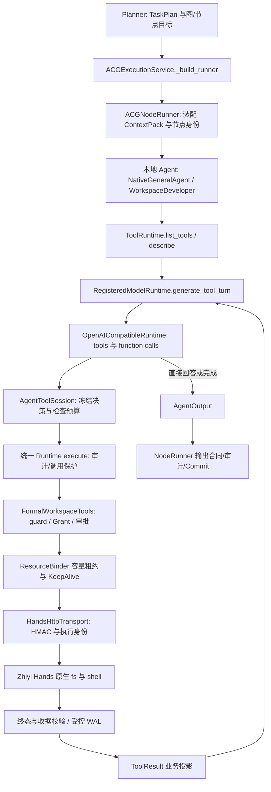

# PR-TOOL-01：ACG 统一工具运行时与 Hands 接入

实施日期：2026-11-12（Asia/Shanghai）

状态：`SELF-TESTED`，等待后续独立审计与验收。

范围：本地受支持 ACG Agent → 统一工具运行时 → 既有正式 Zhiyi Hands 执行链。

本状态表示已实施并完成自测，不表示扩展回归全部通过，也不表示已经独立验收。仓库缺失示例模块、Hands 既有 junction 用例及真实模型 opt-in 测试的边界见 D 节。

## A. 改造前审计

### 1. 工作区基线

- 分支：`master`。
- HEAD：`75a3d00b8f1ddf497ef6dec9aae1887a3fc87559`。
- 先执行 `git status --short`、`git branch --show-current`、`git rev-parse HEAD`，再读取当前代码；未依赖历史快照。
- 开始时已有 8 个文件修改，全部保留，未编辑这些文件：

```text
.github/workflows/backend-ci.yml
apps/frontend/components.d.ts
apps/frontend/src/components/workspace/RuntimeInspector.vue
apps/frontend/src/components/workspace/WorkspaceLifecycleBar.vue
apps/frontend/src/views/MissionWorkspaceView.spec.ts
apps/frontend/src/views/MissionWorkspaceView.vue
apps/frontend/src/workbench/contributions/project/LifecycleEvidence.vue
apps/frontend/src/workbench/contributions/project/ProjectRunSidebarView.vue
```

### 2. 实际执行链路

`WorkflowRuntime / ExecutionRuntime` 的执行端口进入 `ACGExecutionService._build_runner`。该方法解析运行内 Agent、资源执行适配器及冻结模型路由，向 `ACGNodeRunner` 传入工具 runtime。`AgentRunContext.tool_runtime` 是通往 Agent 的注入点；`AgentInvocationAdapter` 负责注册表解析；本地资源适配器保持同一个节点上下文。

工具生产装配位于 `apps/agent/app/execution/wiring.py`：已有 runtime 被包装为 `FormalWorkspaceTools`。正式链路为：

```text
FormalWorkspaceTools
  → 执行许可 guard / WorkspaceAuthority
  → ChatPermissionService.authorize
  → 再检查 guard / WorkspaceAuthority
  → LocalRuntimeHealthProjector
  → ResourceBinder.bind_ready + LeaseKeepAlive
  → LocalRuntimeExecutionRequest
  → HandsHttpTransport.execute_with_identity
  → HMAC HTTP / Hands admission / workspace grant / engine
  → 校验终态、关联身份及 receipt checksum
  → ExecutionValueStore 收据引用 + 节点结果
```

`contracts/local_runtime.py` 的正式枚举和 `hands/hands/engine.ts` 的 dispatch 均包含五个能力。原 Formal 工具只暴露 `read_file`、`list_files`、`write_file`、`patch_file`、`run_tests` 旧别名，没有统一发现接口。原 `run_tests` 通过服务器配置的测试 executable 生成 `shell.exec`，不是新的执行后端。

### 3. 必答问题及改造前结论

| 问题 | 当前代码审计结论 |
|---|---|
| 所有 ACG 节点都注入 runtime 吗？ | 有共同注入点，但依赖应用装配；未配置时可以为 `None`，不能把注入等同于工具可用。 |
| runtime 有发现、描述、执行三项能力吗？ | 原协议有 execute/scoped 等，缺 list_tools/describe，缺原生统一 Schema。 |
| 所有 Agent 都看到原生 Hands 吗？ | 否。Formal 仅旧别名；ACG 汇总注册 Agent 的 allowed_tools，节点再按 SkillManifest 收窄。 |
| allowed_tools / SkillManifest 是否限制？ | 是。`acg_execution._build_runner` 汇总 profile.allowed_tools；`node_runner.__call__` 按 SkillManifest 或现有集合 scoped。 |
| 模型适配器支持 Tool Calling 吗？ | 应用 Chat provider 有相关实现，ACG 的 RegisteredModelRuntime 主要是 JSON 生成；兼容适配器非流式响应原来只解析 content。流中的 tool_call 瞬时事件也不代表具备执行循环。 |
| 模型调用后是否执行并回传？ | 通用 ACG Agent 没有完整 Function Calling 会话。 |
| 只有 WorkspaceDeveloper 自主调用吗？ | WorkspaceDeveloper 有专用的 JSON actions 有界循环；NativeGeneralAgent 有程序指定的检索/计算调用，不能视为通用自主工具选择。 |
| 普通 Agent 可以使用同样的 Hands 方式吗？ | 原来没有共同的模型工具循环。 |
| 多节点身份是否独立？ | Formal bind_context 已返回新实例，可复用；但原工具白名单影响可用性。实施中另发现同一节点连续工具调用复用已释放租约身份的问题。 |
| 远程 Agent 有中心 Hands 通道吗？ | 没有。`build_remote_execution_payload` 只序列化节点目标、输入、引用和身份；未序列化 runtime，也没有工具回调协议。 |

### 4. 安全事实边界

Hands HTTP 的 HMAC、时间窗、nonce 防重放、授权、幂等账本和收据验证已经存在，均复用。工作区 authority 仍从当前 Run 解析，模型不提供 grant、资源凭据或宿主根路径。

必须区分 Shell 策略的真实实现：本次审计确认 `hands/shell-policy.ts` 会固定并验证 PowerShell 可执行程序身份，拒绝不可信 shell 路径。仓库只有旧工具提示文字提到 `CommandPolicy`；没有发现可直接复用的独立细粒度命令白名单引擎。原 `local_runtime.py` 亦保留细粒度 Shell 策略的 TODO。本轮没有新建策略引擎，保留现有 shell 身份策略、进程控制、能力开关、Grant 与必要审批；不把通用 `shell.exec` 描述为命令沙箱或任意子进程都受文件工作区隔离。

## B. 改造内容

### 1. 修改文件与职责

| 文件（相对仓库根） | 改动 |
|---|---|
| `apps/agentOS/src/contracts/tools.py`（新增） | ToolDefinition、ToolResult、兼容既有 data/record 的 ToolExecutionResult，以及五项正式 Hands 描述。 |
| `apps/agentOS/src/adapters/tool_adapter.py` | 在已有协议上添加 list_tools / describe；保留原调用接口。 |
| `apps/agent/app/tools/formal_workspace.py` | 发现 canonical 工具；fs 名称转既有执行入口；shell 复用授权与正式 Hands；独立租约身份；验证结果复用。 |
| `apps/agentOS/src/adapters/audited_tool_runtime.py` | 受信任 Hands 目录默认可见；legacy scope 继续受控；每节点独立事件视图。 |
| `apps/agentOS/src/adapters/guarded_tool.py` | 透传目录；保留取消、超时和受控错误码；unknown outcome 不可自动恢复为普通工具错误。 |
| `apps/agentOS/src/components/executor/node_runner.py` | 不再用 SkillManifest 分配节点工具；为上下文绑定实际节点 attempt；继续 scoped/bind_context 隔离调用状态。 |
| `apps/agentOS/src/runtime/acg_execution.py` | 注明 Hands 与 legacy scope 的职责；给现有取消控制流稳定错误码，避免被会话吞掉。 |
| `apps/agentOS/src/contracts/capability.py` | 模型响应增加瞬时 tool_calls / assistant_message 字段，不写入审计 metadata。 |
| `apps/agentOS/src/adapters/openai_runtime.py` | 解析标准 function calls；保留 call ID、原参数和 reasoning_content；拒绝非法协议。 |
| `apps/agentOS/src/adapters/model_runtime.py` | 通过现有模型注册表进行单轮 Function Calling。 |
| `apps/agentOS/src/adapters/guarded_model.py` | 为单轮工具模型调用保留并发闸门、超时和取消。 |
| `apps/agentOS/src/runtime/app_setup.py` | 让已有配置合同携带模型能力声明，检查 tools 布尔类型。 |
| `apps/agent/app/execution/wiring.py` | 复用应用已有 provider_model_capabilities，防止生产模型注册后 tools 仍为 unknown。 |
| `apps/agentOS/src/adapters/agent_tools.py`（新增） | 节点独立 AgentToolSession；有界多轮模型/工具会话及受控决策 WAL。 |
| `apps/agentOS/src/adapters/model/native.py` | 通用 Agent 接入会话；保留原检索、任务证据范围、JSON/流式回退和输出合同修复。 |
| `apps/agent/packs/workspace/__init__.py` | 复用同一会话；保留旧专用循环与文件变更/真实测试/最终快照验收。 |
| `apps/agentOS/tests/adapters/test_unified_tools.py`（新增） | ACG 节点、Mock Model、签名 Mock HTTP、授权、收据、租约、取消、恢复测试。 |

未改 Planner、TaskPlan、图编译、ResourceBinder 实现、Hands engine/transport 实现、Marketplace、PDF Parser 或 File Converter。没有增加第三方依赖；为 OScode 复测执行的 npm ci 仅安装其 lockfile 已有依赖。

### 2. 统一接口

```python
definitions = tool_runtime.list_tools()  # tuple[ToolDefinition, ...]
definition = tool_runtime.describe("fs.read")  # ToolDefinition | None
result = await tool_runtime.execute(
    "fs.read", {"path": "notes.txt"},
    operation_key=f"{context.commit_id}:tools:0:call:0",
)
observation = result.as_tool_result()  # ToolResult；剔除可信执行记录
```

`ToolDefinition` 包含 `name/source/description/parameters`。本轮五个目录项的 source 均为 `hands`。目录每次返回新描述，修改一节点的 Schema 不会污染其它节点。`ToolExecutionResult.data/record` 保留专用 Agent 已使用的接口；`ToolResult` 统一表达模型需要的状态、业务输出及安全错误。

| 工具 | 合同与实际适配 |
|---|---|
| fs.read | path；支持 Hands 已有 binary / versioned。由正式 FS_READ 请求执行。 |
| fs.list | path；实际调用 Hands listDir，模型只接收条目业务属性。 |
| fs.write | path/content；保留 createIfAbsent / expectedVersion。 |
| fs.patch | path/oldText/newText 的字面量替换，保留 replaceAll / expectedVersion；不新增 patch 引擎。 |
| shell.exec | command/workdir，或 runner/path 的系统管理测试变体；两种参数形态由 oneOf 合同互斥。均为 SHELL_EXEC，复用同一授权、租约、传输与收据路径。 |

canonical 名使用 `fs.read` 等；模型 function 名通过服务端映射为 `fs__read`，避免供应商不接受点号。映射显式保存，名称冲突会在调用模型前失败，不反向猜测名称。

### 3. 共享能力与执行授权

所有本地节点都从同一受信任适配器取得完整 Hands 目录。AuditedToolRuntime 默认包含 native 目录项，不因 Agent allowed_tools 为空或 SkillManifest 只声明其它工具而隐藏 Hands。现有非 Hands 工具授权没有全局解除；注册表不是由 Planner 维护。

每节点仍构造新的 scoped / bind_context 视图，FormalWorkspaceTools 的 context、guard 与外层 events 均独立。可共享的是服务引用和执行适配器，不是绑定了第一节点的可变上下文。

多次调用的容量租约使用独立派生租约 attempt 标识；不改写 AgentRunContext、Hands 请求或收据中的原节点 attemptId。每个调用只释放自己的租约。unknown outcome 仍隔离资源、保留不确定租约及 WAL，不能伪造释放证明。

### 4. Agent 自主调用与完成条件

- NativeGeneralAgent 在模型明确声明 tools 能力且工具目录已配置时进入 AgentToolSession。GeneralAgent、ResearchAgent 是测试中构造的不同业务 profile/子类，使用同一生产通用实现；仓库没有另造三个不同的原生执行注册表。
- 原 information_retrieval 的本地知识/网络证据取得路径保留，之后支持模型可自主补充 Hands 调用。明确 task_input_only 的证据边界保持原样，不因共享工具扩大任务证据授权。
- WorkspaceDeveloper 在支持的模型上使用同一 Function Calling 会话；不支持的旧模型继续原有 JSON actions 循环。
- 外部 framework 适配器、远程 Agent 和未实现工具协议的自定义 Agent，不能因为拿到 context 就被写成“已支持模型工具调用”。它们仍需使用既有运行时接口或显式实现自己的协议。
- 支持直接返回、多轮连续调用、一轮多个调用按模型顺序执行，以及 role=tool 结果回传。保留 assistant 整轮 tool_calls、关联 ID 和必要 reasoning_content。
- 延用 WorkspaceDeveloper 的 32 动作上限作为共享会话默认预算；非法参数、未知工具和失败调用也计数。超额批次在分发前拒绝。恢复重放从冻结决策重建同一预算，不额外获得新的动作轮次。
- WorkspaceDeveloper 只有实际文件变更、最新系统管理测试成功以及最终文件快照成立时才完成。任意 command 返回 0 或模型自行声称测试成功不能替代该条件。
- tools 能力不明/关闭的模型沿用既有路径，不声称其具有原生 Function Calling。原 GatewayStructuredGenerationRuntime 仍是 JSON 生成回退；生产默认装配的注册模型由已有能力目录显式声明支持情况。

### 5. 结果、安全及恢复语义

模型结果投影保留文件内容、相对目标、条目名、exitCode/stdout/stderr 和错误码；移除 Hands receipt、Grant、绑定记录、签名材料、executedBy 和真实 workdir 等执行元数据。文件内容和命令输出作为不可信业务数据，不提升为系统指令。

执行仍经过：租户/Run 边界、WorkspaceAuthority、相对路径限制、当前 Grant、审批、后续许可重查、能力开关、ResourceBinder 租约、HMAC/nonce、正式收据验证、取消与超时。Shell 的 command 通过原 run_command 审批动作，不继承服务器测试程序的隐含信任。模型不能指定 executable、securityProfile、credential、workspace root 或 Grant。

恢复复用已有 run-owned SQLiteExecutionValueStore 工具 WAL，不新建独立追溯系统：

1. 工具分发前冻结模型轮次及请求 hash。
2. 外部请求前持久化原正式请求和节点身份；操作键始终稳定。
3. 终态收据验证、keepalive 收尾并确认无续租失败后，保存结果；缓存命中仍检查当前 guard / workspace authority 和冻结请求归属。
4. 已验证结果重放不再执行副作用。已发出但本地结果未写入的同一请求，通过既有 Hands durable idempotency admission 取得原执行结果；身份、输入或授权变化时 fail closed，要求对账。
5. 未知执行结果、校验失败及续租失败终止会话并走既有资源隔离；不作为普通可重试工具错误继续推理。

这不是对所有外部故障承诺 exactly-once；依赖既有 Hands 持久化账本/收据与受控恢复边界。ACG checkpoint/state 仍只保存引用，未保存 live runtime、工具参数或完整对话。没有改变 TaskPlan 唯一来源、Commit 和图恢复协议。

## C. 实际代码执行流程



Planner 不接触工具选择和调用顺序。每轮由模型决定是否调用、调用何种工具；Hands 执行结果回到同一节点会话后继续推理。执行适配器只负责工具分发与安全边界。

## D. 测试证据

### 1. 新增节点级测试

`apps/agentOS/tests/adapters/test_unified_tools.py` 使用生产 NodeRunner、通用 Agent、WorkspaceDeveloper、RegisteredModelRuntime、兼容模型适配器、FormalWorkspaceTools、ResourceBinder、HandsHttpTransport、权限服务与 SQLiteExecutionValueStore。

模型 HTTP 和外部 Hands HTTP 使用 Mock；签名构造、发送、对账、结果协议及 receipt 验证均是真实 Python 实现。Mock Hands 检查 HMAC、nonce、Grant/Workspace 关联，并模拟已有服务幂等账本；Shell 不执行真实宿主命令。

覆盖：三种 Agent profile 目录与 Schema 一致、无需 allowed_tools、SkillManifest 不隐藏工具、五个正式能力、文件版本参数、fs.patch 字面量替换、模型按实际文件结果回答、直接完成、多轮与同轮多调用顺序、非法 JSON/参数/未知名称、失败回传、动作预算、路径逃逸、审批拒绝与取消、模型取消、工具取消、超时、许可/Grant 撤销、跨工作区 Grant 拒绝、无效收据隔离、三节点并发与独立租约、敏感执行元数据投影、WorkspaceDeveloper 完成约束、生产能力声明、函数名冲突、远程载荷边界。

恢复测试另覆盖：已提交节点不重复调用；重新创建会话复用冻结决策/收据；改变已冻结参数被拒绝；提交前故障恢复不重复写入；Hands 执行完但结果 WAL 写入前中断，重试发出相同请求但外部副作用只发生一次。

### 2. 测试命令与结果

证据保存在 `output/pr-tool01/`，JUnit 文件包含逐项断言结果，不以删测试、xfail 或降低断言取得通过。

```powershell
# cwd: apps/agentOS，统一工具专项
python -m pytest -q tests/adapters/test_unified_tools.py --tb=short `
  --junitxml=../../output/pr-tool01/unified-final.xml

# cwd: apps/agentOS，定向与紧邻回归
python -m pytest -q tests/adapters/test_unified_tools.py `
  tests/adapters/test_hands_integration.py tests/adapters/test_audited_tool_runtime.py `
  tests/adapters/test_guarded_runtime.py tests/runtime/test_app_setup.py `
  tests/adapters/test_openai_runtime.py tests/adapters/test_native_agent.py --tb=short `
  --junitxml=../../output/pr-tool01/targeted.xml

# cwd: apps/agentOS，扩展回归；收集错误仍保留，并运行其它可收集测试
python -m pytest -q tests/adapters tests/test_acg_execution_graph.py tests/runtime `
  tests/components/executor tests/components/scheduler tests/components/resource `
  tests/contracts/test_local_runtime_contracts.py tests/contracts/test_compiled_acg.py `
  --continue-on-collection-errors --tb=short `
  --junitxml=../../output/pr-tool01/agentos-final-regression.xml

# cwd: apps/agent。显式加入已有跨目录测试依赖路径。
python -m pytest -o "pythonpath=. ../agentOS ../agentOS/src ../agentOS/tests/runtime" -q `
  tests/test_tool_runtime.py tests/test_chat_tools.py tests/test_chat_permissions.py `
  tests/test_chat_local_runtime.py tests/test_hands_transport_chat.py `
  tests/test_execution_runtime_application_wiring.py tests/test_execution_runtime_domain_packs.py `
  tests/test_execution_adapter_settlement.py tests/test_managed_execution_settlement.py `
  tests/test_oscode_context_compaction.py tests/test_chat_hands_http_e2e.py `
  --continue-on-collection-errors --tb=short `
  --junitxml=../../output/pr-tool01/agent-final-regression.xml

# cwd: apps/agentOS/src/hands
node node_modules/vitest/vitest.mjs run --reporter=dot --reporter=junit `
  --outputFile=../../../../output/pr-tool01/hands-regression.xml
node node_modules/vitest/vitest.mjs run tests/adversarial.spec.ts tests/p0.spec.ts `
  --maxWorkers=1 --reporter=dot --reporter=junit `
  --outputFile=../../../../output/pr-tool01/hands-failure-recheck.xml
node node_modules/vitest/vitest.mjs run --maxWorkers=1 --reporter=dot --reporter=junit `
  --outputFile=../../../../output/pr-tool01/hands-final-regression.xml

# cwd: apps/agentOS/src/oscode-context，已有 lockfile 依赖
npm ci --ignore-scripts
node --test test/engine.test.ts test/evaluate.test.ts

# cwd: repo root
ruff check --select F,E9 apps/agentOS/src/contracts/tools.py `
  apps/agentOS/src/adapters/agent_tools.py apps/agentOS/tests/adapters/test_unified_tools.py
git diff --check
```

| 测试组 | 最终结果 | 证据 |
|---|---|---|
| 新增统一运行时节点专项 | **39 passed** | `unified-final.xml`；同一文件全部用例也包含在最后的 targeted.xml 中 |
| 定向及紧邻回归 | **108 passed** | `targeted.xml`；包含新增 39 项、Hands 集成、包装器、生产模型装配、原生 Agent 和模型协议 |
| AgentOS 扩展回归 | **850 passed / 1 failed / 2 collection errors** | `agentos-final-regression.xml`；三项均因缺失同一个 examples.contract_review 模块 |
| Agent / OScode / Chat 原工具路径回归 | **110 passed / 1 existing opt-in skipped** | `agent-final-regression.xml`；含两个真实 Windows Chat→Hands E2E |
| 最后一次 Agent 装配/原工具路径补充回归 | **32 passed** | `agent-adjacent-final.xml` |
| Hands 全量最终串行回归 | **96 passed / 1 failed** | `hands-final-regression.xml`；保留 junction 对照断言失败 |
| Hands 首轮及失败文件复测 | **95 passed / 2 failed**；随后 **27 passed / 1 failed** | `hands-regression.xml`、`hands-failure-recheck.xml` |
| OScode TypeScript 上下文算法 | **36 passed** | `node --test test/engine.test.ts test/evaluate.test.ts` 实际输出；补装原依赖后通过 |
| 新模块/测试 Ruff F/E9；全部改动 Python E9 | **通过** | 最后命令返回 exit 0 |
| git diff --check | **通过** | exit 0；只有已有/所涉文件行尾转换提示 |

这些测试组存在重叠，不应相加作为独立用例总数。完整首次扩展回归另保留 `agentos-regression.xml`（835 passed / 1 failed / 2 collection errors），后续增加恢复等专项覆盖后得到上表结果。没有为获得通过而删除、跳过失败测试或降低断言。

### 3. 已确认的回归限制与最小后续方案

1. `examples.contract_review` 在当前 HEAD 未入树、工作区亦不存在。`test_contract_review_delivery.py`、`test_kernel_vertical_slice.py` 收集失败；`test_dispatch_admission.py` 间接导入同一缺失模块也失败。未制造替代示例、未删除用例。后续应由原模块维护 PR 恢复正式示例或将共享夹具移到明确测试模块，再重跑三项。
2. Hands 全量首轮 `95 passed / 2 failed`；对两个失败文件串行复跑 `27 passed / 1 failed`；最终全量串行 `96 passed / 1 failed`。持续失败是 `adversarial.spec.ts` 的工作区内 junction 允许写入对照；对外部路径的拒绝断言已执行通过。另一个 p0 超时用例首轮因 shell 启动后未及时输出 before 而失败，串行复跑通过。`git diff HEAD -- apps/agentOS/src/hands` 为空，TS 测试不经过本轮 Python 改动；未擅自修改 Hands 文件系统安全基座或放宽断言。junction 问题应单独复现、诊断真实路径/重解析点处理后修复。
3. OScode 初轮因本地没有安装其已声明 `js-tiktoken` 而回退 upper-bound，`35 passed / 1 failed`；安装原 lockfile 的依赖后 `36 passed / 0 failed`，未改源文件或锁文件。
4. Agent 回归的一个既有真实 Provider 用例要求显式 opt-in，默认跳过；未设置任何新 skip。真实 Chat→Hands 文件/命令/取消的两个 Windows E2E 用例已执行通过。该结果不替代本轮 Mock Model 的节点级证明，也不宣称完成真实供应商在线验收。

## E. 架构兼容性与支持边界

### Marketplace

本轮未接入、未修改 Marketplace。未来商店适配器可按同一 ToolDefinition（source=marketplace）、execute 和 ToolResult 合同供给工具，由同一个运行时入口分发；Agent 会话不依赖 Hands 专有工具名或执行实现。需要在服务端组合目录/分发并由受信任装配代码赋予 source，不能相信插件自行声称 source=hands 来绕过其生命周期或授权。

当前无额外插件注册中心、ToolManifest 或分布式网关。Marketplace 继续自行管理安装、启动、停止、卸载与健康状态。Hands 是平台原生能力，不在商店中显示或安装。

### 远程 Agent

现有 HTTP 远程执行只接受节点任务并返回 AgentOutput，不提供中心化 Hands 回调。本轮没有把 runtime、密钥或 Grant 序列化到远程，也没有增加 Tool Gateway。远程节点仍不算本 PR 已支持的自主 Hands 节点。后续最小方案需独立设计受控回调协议、身份与授权绑定、取消、超时和收据关联；本轮不实现。

### Trace / Auditor

继续使用既有 tool_executions、runtime events、收据引用及 run-owned 工具 WAL。参数、原始对话和完整收据不进入图 State/Checkpoint/安全审计 metadata。没有独立 Auditor，也没有完整统一 Tool Trace 持久化系统。后续可将已有操作键、节点身份、source、收据引用归一到统一 provenance；其跨来源追溯和审计查询仍未实施。

## F. Git 状态与交付

- 基线与结束分支均为 `master`，HEAD 维持 `75a3d00b8f1ddf497ef6dec9aae1887a3fc87559`。
- B 节列出本轮 17 个代码/测试文件，另新增本实施报告与 `output/pr-tool01/` 测试证据。
- A 节的 8 个用户已有修改保留。工作区因此是有修改/新增文件状态，未清理或重置用户内容。
- 执行期间另观察到以下并行工作的前端修改/新增，同样未触碰，且不计入本轮交付文件：

```text
apps/frontend/src/components/workspace/FormalExecutionControls.spec.ts
apps/frontend/src/components/workspace/FormalExecutionControls.vue
apps/frontend/src/components/workspace/RunProgressEditor.spec.ts
apps/frontend/src/components/workspace/RunProgressEditor.vue
apps/frontend/src/features/workspace/runLifecycle.ts
apps/frontend/src/workbench/contributions/project/LifecycleEvidence.spec.ts
apps/frontend/src/components/workspace/LifecycleProgress.vue
```

- 未自动提交、Push、Merge 或部署。
- `git diff --check` 已执行；仅 Git 行尾转换提示，不存在空白错误。
- 新增模块/测试的 Ruff F/E9 检查通过。

最终状态：`SELF-TESTED`。统一目录、通用模型工具调用、正式 Hands 分发、结果回传与节点隔离已形成可复核实现；扩展回归的既有阻塞及未实现能力按上述边界保留，等待独立审计与验收。
