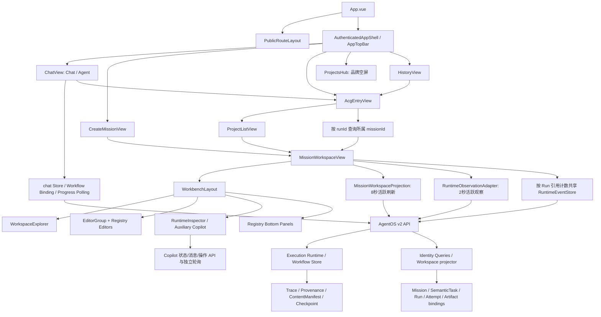

# PR-UI-00｜前端生命周期工作台架构审计

日期：2026-10-31（Asia/Shanghai）  
范围：Mission Lifecycle Driven Workbench Audit；代码、调用链、现有定向测试及架构分析。  
结论标记：CONFIRMED 表示当前源码或本次命令证实；PROPOSED 表示迁移建议；NOT_IMPLEMENTED 表示本轮未实施；NOT_VERIFIED 表示未完成真实运行验收。

## 1. Executive Summary

**整体评级：B-，已有可复用的统一 Workbench，但尚未形成完整的 Mission 生命周期驱动交互。** 此评级为本次架构判断，不是测试得分。

主要结论：

1. **保留现有 Workbench。** Registry、EditorGroup、任务/产物稳定槽位、Run 级事件流、只读投影、正式控制链和 Inspector 已形成可用基础，不需要重做 Dashboard 或新建 Workspace Store。
2. **生命周期事实已有来源，展示决策仍分散。** Execution Runtime 的 `completed` 经 Workspace API 投影为 `succeeded`；规划、审核、激活暂停、许可与 Dispatch 还需要读取详细 Run。只读 `activeRun.status` 无法还原完整生命周期。
3. **首次默认 Editor 不等于生命周期交接。** `openDefaultEditor()` 在已有标签时直接返回；首次打开完成 Run 可进入 canonical Artifact，但运行中完成不会自动交接。首次打开失败 Run 通常进入 Graph，规划早期失败没有 Graph 时进入 mission.md，不会默认进入故障运行文档。
4. **创建入口存在实际合同分叉。** Composer 提交正式 `semantics`、附件身份和运行配置；Chat/Agent 共用另一套 payload，仅携带最近八条非空消息的 role/content。Chat 启动后仍留在 Chat 的进度区域，需要另行进入 Mission Workspace。
5. **历史只读边界不完整。** 正式控制和审核有历史禁用；但失败 Run 恢复入口不检查 historical，并可选择 `current_run`，会重新执行历史 Run。Copilot 有意允许任务协作，也必须区分“历史证据可讨论”和“源历史 Run 不可变”。
6. **证据层可用但不能宣称完整呈现。** Trace、Provenance、Attempt、执行树与 Checkpoint 后端能力存在；前端 Observation 却固定输出 `operational: null`，旧字段驱动的恢复结论/节点生命周期面板无法因此得到数据。

本次未确认 P0 级越权、数据破坏或执行合同失守；P1 为生命周期闭环与只读边界缺口，P2 为一致性及维护性问题。未发现 P0 不代表已做完整安全审计。

### 1.1 基线与现场

开始前执行 `git status --short`、`git branch --show-current`、`git rev-parse HEAD`：

```text
branch: master
HEAD: 2610d1e89ffd0ae97886beb966aa3db14d0dee5c
expected: 7339d25fe6375bee50e54c374a206d5c4d23a8e1
 M apps/frontend/src/components/ModelRuntimeControls.vue
```

`git log expected..HEAD` 显示一条额外提交：`2610d1e8 feat(release): 产出内部版便携发行包与免登录桌面启动链路`。本报告审计当前 HEAD 与工作区，不冒充预期基线快照。对 views、workbench 和两处指定 Python 文件执行基线至 HEAD 的路径差异查询，输出为空；发行提交仍可能影响外围运行环境。本轮未切分支、重置、提交、推送、迁移数据库或修改业务/测试/配置。初始同名报告不存在。仓库文件检索及上级目录检查未发现适用 AGENTS.md。

## 2. Current Architecture



依据：`apps/frontend/src/App.vue:11`、`components/app/AuthenticatedAppShell.vue:342`、`router/index.ts:84`、`views/AcgEntryView.vue:42`、`views/MissionWorkspaceView.vue:647`、`workbench/composition.ts`、`workbench/contributions/*/index.ts`（本段未写前缀的路径均在 `apps/frontend/src/`）。

固定骨架已存在：左侧 Explorer、中央 Editor、右侧 Secondary/Auxiliary Sidebar、底部 Panel、状态栏。当前左树为 Overview/Steps/Output，Runs 主要在状态栏，不完全是目标中的四项 Primary Sidebar；这是信息架构差距，不是缺少 Run 能力。Command/Conversation Editor 尚未注册。Terminal 由 Shell 的 `DesktopTerminalDock` 单独承载，不是当前 Mission Registry 内的 Run 级底部页签。

## 3. Mission Lifecycle Mapping

| 阶段 | 设计基准 | 当前真实行为 | 判断 |
|---|---|---|---|
| Creation | 自然语言、约束、附件、需求讨论进入同一 Mission | Composer 上传 READY 附件、创建 material，POST Mission 后 replace 到 Workspace；Chat/Agent 另造 payload 并留在 Chat | 部分满足；创建与身份恢复分叉 |
| Planning & Confirmation | 展示 Contract、Planner、TaskPlan、ACG、前置条件和权限 | Run 先持久化并异步提交；Progress 展示 Planner 阶段；正式链显式 materialize→activate→handoff→permit→dispatch | 后端支持分阶段控制；前端缺少统一阶段引导 |
| Execution | 同一 Run 的图、任务、尝试、实时输出和产物联动 | Workspace context + Observation + 共享 SSE；Graph/Task/Artifact 可手动互相定位 | 核心可复用；自动关注和状态口径不统一 |
| Review / Pause | 在当前工作区审核、恢复，并区分暂停/权限 | Copilot 中审核与正式控制；审核回执触发刷新；历史审核禁用 | 大体具备；共用 paused 外观及入口分叉需整理 |
| Failure / Recovery | 默认暴露失败节点、恢复依据和安全恢复 | 直接失败首开通常 Graph；导航 Run 可进 Progress；恢复取第一个 failed step，支持 successor/current 两模式 | 缺少失败首开策略；历史可原地重试 |
| Completion / Delivery | 完成后交接 canonical artifact、证据和下载 | 首开完成 Run 优先严格 final + run_deliverable；已有 Editor 时不自动交接；缺产物有诊断 | 身份门禁正确；实时完成闭环缺失 |

### 3.1 Stage 1：Creation 的五个问题

**普通对话如何成为 Mission：** ChatView 的 `upgradeChatToWorkflow()`（`apps/frontend/src/views/ChatView.vue:1747`）调用 chat Store 的 `upgradeToWorkflow()`，最终进入 `startConversationWorkflow()`（`apps/frontend/src/stores/chat.ts:691`）。它新建 Mission/Run 并在本地绑定 Conversation，不是把 conversationId 当 missionId 使用。

**Chat 与 Agent：** 普通发送走 `sendMessageStream()`；Agent 发送经 `sendAgentWorkspaceMessage()` 自动调用 upgrade；显式 Chat upgrade 与 Agent 共享同一启动函数，但 source 分别为 chat/agent，input 的文本键不同。View 传 general/general、auto，Store 中 legal/case_analysis/human_in_loop 仅是默认回退，不能误报成当前 View 的实际选项。Composer 使用 `buildWorkbenchStartRequest()`（`apps/frontend/src/features/acg/workbench.ts:145`）并提交 formal semantics、约束、预期产物、模型/规划/插件等配置。

**是否丢上下文：** 不能称为“完全丢失”：Store 提交 `chatContextId`、`chatRoleId`、`chatContext`。但截取先 `.slice(-8)` 再过滤非空 content，仅投影 role/content，早期讨论、fileUrl 与消息身份不进入该快照；尚未证明 Planner 全量消费原始聊天。Agent 初始 draft 的 contextId 还可能为空。Workspace 类型及 context 没有 Conversation 槽位，也没有调用 chat Store 恢复需求讨论。

**附件是否正式执行：** Composer 链路为 uploadAttachment→READY→attachmentIds→`prepare_execution_input()`（`apps/agent/app/api/agentos_v2.py:860`）。后端校验所属用户、解析状态、总大小、sealed MATERIAL，把 extractedContentRef 合并为 materialRefs/sourceMaterials。`apps/agentOS/src/components/planner/task_decomposer.py:866`、`:986` 将材料引用纳入 workset/source refs；`runtime/planning_commit.py:322` 校验来源。源码证明它有正式引用链，未真实上传/执行验收。Chat 的 `handleFileSelected()`（`ChatView.vue:1822`）走 chatStore.sendMessage 的文件 URL；upgrade 的八条快照不带 fileUrl，也不发 attachmentIds，不能认定两者等价。

**是否重复创建：** API 最终汇聚同一 `POST /missions`，但 Composer、chat Store 和旧 `AcgVisualizationView.vue:1548` 有独立 payload 构建。旧 Visualization 在当前非测试 src 检索中没有被别处引用，路由已经改为 AcgEntryView；应区分“活跃双入口”与“遗留代码”，不能把旧页面误画为当前路由。

幂等性：Composer 在组件内缓存 signature/request，失败重试复用 clientRequestId；Chat 在 sessionStorage 保存请求身份。后端 `_idempotency()`（`agentos_v2.py:656`）按 caller/clientRequestId 与 payload fingerprint 校验，重复可重提已有 Run，不同 body 返回 409。Composer 缓存未持久化，刷新页面后的未知结果恢复不足；恢复/再次运行每次点击又生成 UUID，不能把后端支持幂等误认为所有 UI 重试都复用身份。

命名核对：在 `apps` 范围检索 `MissionLaunchRequest` 没有命中；当前实际合同名是前端 `AsyncWorkflowStartRequest`、后端 `MissionCreateRequest`，不是一个已实现的统一 MissionLaunchRequest。报告按真实合同追踪，不因设计名称推定已有统一启动抽象。

### 3.2 Stage 2：真实先后顺序

```text
CreateMissionView.submit / chat.startConversationWorkflow
  → POST /api/agentos/v2/missions
  → 校验语义 / 幂等 / 附件材料
  → runtime.create_mission(defer_identity_projection=True)
  → 正式 semantics commit（请求包含且服务启用时）
  → runtime.prepare_run(defer_acg_planning=True)
  → coordinator.submit(runId)
  → 返回 MissionResponse（包含 missionId、runId；HTTP 202）
  → 前端加载 Workspace / 观察 Run 及 Planner 事件
  → 正式规划结果及确认交互
  → materialization → activation(paused) → handoff → permit → dispatch
```

证据：`apps/agent/app/api/agentos_v2.py:2433`、`apps/agentOS/src/runtime/workflow_runtime.py:798`、`apps/frontend/src/features/acg/formalControl.ts:12`、`services/api/agentos/api/c2.ts`。这是“先建 Run 再规划”，不是“Run 创建前已有完成计划”；也不代表 202 已经执行或完成。正式控制受 `planning_commit_authority` 等服务能力影响，未验证当前部署开关。

MissionEditor 展示当前正式语义、revision 和 selectedRunBasis；修改说明明确只作用于后续 Run。RunProgressEditor 的 IntentProfileArtifact、PlanningStageArtifact 展示运行文档中的 profile/task-plan/detail/relations，部分指标从已记录事件/plan/fallback graph 取得；它们是结果展示组件，不是规划执行权威或人工确认 API。执行前置条件由 `nextFormalAction` 的 commit/graph/materialization/activation/handoff/permit/revision 引用检查约束。

### 3.3 Editor 策略逐项核对

| 时点 | 当前中央默认内容 | 缺口/边界 |
|---|---|---|
| 创建后 pending/running | Progress，另开 mission.md 和 final/Graph 标签 | 由 Workspace summary 粗状态判定 |
| 规划完成、尚待正式操作 | 继续原 Editor；正式操作在 Copilot | 没有规划→确认的中央自动交接 |
| 执行中 | 保持原 Editor；Progress 内文档更新 | 手动查看稳定，但无系统跟随偏好 |
| 实时失败 | 保持原 Editor | 无失败诊断默认选择及一次性交接 |
| 直接打开 failed | final（如投影有合法交付）优先，否则 Graph，否则 mission.md | 通常不进入 Progress；早期规划失败甚至无图 |
| waiting_review | Workspace summary 映射 running，默认 Progress；详细 Run 将状态解释为 paused | 没有自动显露审核对象/动作的策略 |
| 首开 completed/succeeded | canonical final Artifact，否则 Graph/mission.md | 严格身份匹配正确 |
| active→completed | 继续原 Editor | `openEditors.length` 导致早退 |
| 手动切换历史 Run | `selectRun()` 强制 focusProgress | 与首次直达同一历史 Run 的策略不一致 |

核心证据：`apps/frontend/src/views/MissionWorkspaceView.vue:483-543`、`:673-705`、`:729-743`。建议维护**纯 UI 意图**（system-follow / user-selected、上次已处理 transition），只在用户保持系统跟随时交接；这不是新增业务状态真源。用户阅读 Artifact、Graph、文件或历史证据时不得因每轮 Runtime 刷新抢焦点。

## 4. Real Call Graph

### 4.1 路由与入口

| 入口 | 实际路由/组件/后续调用 | 处理判断 |
|---|---|---|
| 普通 Chat | `/chat?workspace=chat` → ChatView → chat API/stream | 合理独立对话能力，保留 |
| Agent 快速启动 | `/chat?workspace=agent` → sendAgentWorkspaceMessage → startAgentRun → POST missions → Chat Progress | 与 Composer 同属 Mission 启动，应统一合同和落点 |
| Chat Workflow Upgrade | upgradeToWorkflow → POST missions → local binding → activateWorkflowRun | 保留“对话转工程”，整合到统一 Workspace |
| Mission Composer | `/agentos/missions/new` → CreateMissionView → buildWorkbenchStartRequest → POST missions → Workspace | 作为配置较完整的创建入口保留 |
| ACG 入口 | `/agentos/acg` → AcgEntryView → 无 runId 显示 ProjectListView；有 runId 则 getRun→Workspace | 合理兼容桥接；不是另一套执行工作台 |
| Projects Hub | `/agentos/projects` → ProjectsHubView | 当前只有品牌花环，没有实际加载/完成跳转；导航语义需澄清 |
| ProjectList | listMissions → open Mission → Workspace；new → Composer | 合理项目管理入口 |
| History | `/history` → Chat history 或 AcgHistoryPanel；Chat history→contextId；Run history→ACG/Workspace 桥接 | 合理检索入口，不应另造运行状态 |
| 顶栏项目/命令 | AppTopBar → ProjectsHub / new / open Mission / Chat 等路由 | 同一目的可保留快捷入口，统一命名与目的地 |
| Shell 左导航 | Chat/ACG 导航、Chat/Agent 模式、近期 Agent Missions | 已存在并列模式认知，需渐进收敛 |

路由依据：`apps/frontend/src/router/index.ts:71-199`；Shell 模式选择及本地持久化在 `components/app/AuthenticatedAppShell.vue:909`；顶部命令在 `components/app/AppTopBar.vue:457`；History Chat 恢复在 `views/HistoryView.vue:116`。旧 federated-agent-workbench/legal 路由重定向到 Agent Chat，不是独立 Workspace。

### 4.2 Workspace 数据与动作

```text
MissionWorkspaceView.loadWorkspace(runId)
  → agentosApi.getMissionWorkspace(missionId, {runId, signal})
  → GET /missions/{missionId}/workspace?runId=...
  → Identity workspace projector + Runtime 状态合并 + Mission semantics/basis
  → Registry project.explorer / EditorGroup / Inspector / Panels

RuntimeObservationAdapter.start(selectedRunId)
  → Promise.allSettled(Run, Trace[workspace], Provenance,
      ExecutionTree, ResourceObservation, Reviews, ContextPacks)
  → RuntimeObservation → WorkbenchContext → Registry panels/sections

acquireRunRuntimeStore(runId)
  → shared Map(runId, store/client/refs)
  → GET /runs/{runId}/events（fetch SSE，带 Bearer）
  → node/attempt/planner stream → RunProgress / Inspector Live Output

Graph node → semanticTaskKey → TaskEditor → ArtifactEditor
Artifact / Task locateGraph → semanticTaskKey → graph node + focusNodeId
Bottom RuntimeSelection → graph node/task selection

Copilot review / FormalExecutionControls
  → 审核或正式命令 API → refresh-run
  → loadWorkspace(selectedRunId) + Copilot refresh

从失败处继续 → getWorkflowRun → 首个 failed step → 模式选择
  → POST /runs/{runId}/steps/{stepId}/retry
再次运行 → getWorkflowHistoryConfig
  → POST /missions/{missionId}/runs（sourceRunId）
  → selected/current run 更新 → URL → Progress

ArtifactEditor → GET Artifact Content/Detail → document projection
  → Inspector evidence/provenance/trace refs → download endpoint
```

SSE 与 Polling 是互补通道：SSE 是临时非回放输出，Run/Trace 等查询提供持久事实。不能仅因并存就判定为重复状态真源。Observation 内执行树请求还复用于 Resource loader，已有去重。Copilot 自有 3 秒活跃/15 秒终态/后台 30 秒轮询（`AcgCopilotPanel.vue:310`），Chat 有另一套 useWorkflowProgress；两者都不是共享 SSE 的替代品，但会增加重叠查询及展示解释维护成本。

## 5. State Authority

### 5.1 身份与权威

| 对象 | 身份/来源 | 前端角色与边界 |
|---|---|---|
| Mission | missionId；Identity Mission、正式 semantic aggregate/revision；运行依据另有 basis | 工程长期身份；当前语义不覆盖历史 Run basis |
| Conversation | chat contextId；Chat API 的历史消息 | 对话上下文；不得用 local draft ID 代替后端会话身份 |
| ChatWorkflowBinding | conversationId/messageId/missionId/runId；localStorage | 导航索引/兼容缓存，非可恢复的服务端关系权威 |
| Run | runId；Execution Runtime Workflow Store/status/revision | 执行生命周期权威；Workspace summary 是压缩投影 |
| SemanticTask | taskId / semanticTaskKey；Identity 与计划绑定 | 稳定逻辑步骤；不等于某次 Attempt |
| Attempt | attemptId / attemptNumber；Identity attempt repository/execution tree | 具体尝试；不得拿最新 Attempt 状态冒充所有尝试 |
| Graph Activation | graphId/version/activationId；formalControl/正式回执 | 激活、暂停、交接、许可、Dispatch 各自独立 |
| Review | persisted subjectId/type、revision/updatedAt、review record | 审核决定走正式 API；waiting_review 不等于许可未申请 |
| Artifact | artifactId/key/type、producerAttemptId、Run artifact binding、sealed ContentManifest | final + run_deliverable 才能成为 canonical 交付；REUSED 保留 sourceRunId |
| Runtime Observation | 多源只读查询拼装；runId + unavailableSources | 展示视图，不能成为调度或执行权威 |
| RuntimeEventStore | Run 级临时 SSE 投影、node/attempt 输出 buffer | 提升实时性；丢流后不能当完整审计历史 |
| workflowRuns Store | 本地 Run references + 后端 summaries 同步 | 跨页面索引；不可提升为 Run 生命周期真源 |

后端权威合并证据：`apps/agent/app/api/agentos_v2.py:1671`、`:1840-1930`；Identity 类型在 `apps/agentOS/src/domain/models.py:41-77`；前端合同在 `apps/frontend/src/services/api/agentos/types/workspace.ts`、`workbench/context.ts`、`stores/workflowRuns.ts:43`。

### 5.2 原始状态到界面映射

| 原始状态（对象） | 当前界面表现 | 是否准确 | 建议 |
|---|---|---|---|
| Mission created/planning/ready/running/completed/archived | MissionEditor 直接显示 mission.status；正式语义另显示 UNINITIALIZED/INITIALIZED | 局部准确；不能表示当前 Run | 独立 Mission 标签与 Run 阶段 |
| Runtime Run pending/planning | Workspace 均为 pending；Progress 详细观察可显示 PLANNING | 丢失粗投影阶段，详细源可补 | 详细事实优先、显式来源 |
| Runtime Run running/retrying/waiting_review | Workspace 均为 running；详细 Progress 可分 running/paused | Summary 单独不足 | 不用 summary 推断审核与恢复 |
| Runtime Run completed | Workspace succeeded；Progress 两者都识别完成 | 完成识别正确，但默认 Run 选择只接受 succeeded | 统一显示解析，不改 Runtime 合同 |
| Runtime Run failed | Progress failed；首开 Editor 不保证 Progress | 状态正确，关注对象不足 | 默认失败运行文档+失败目标 |
| Runtime Run cancelled | Progress 合入 failed 显示“运行失败” | 丢失主动取消语义 | 单列 Cancelled 展示 |
| Runtime Run superseded | 可再次运行；Progress runState 落 unknown | 不准确/不完整 | 显示被后继替代及 lineage |
| Attempt pending/running/failed/succeeded/cancelled | GraphNode 用最新 Attempt 原值；Task entry 转 completed/skipped | 多口径；cancelled→skipped 丢失原因 | 原状态与展示态并存，分对象解释 |
| SemanticTask created/ready/running/blocked/completed/cancelled/retired/superseded | 无 Attempt 时映射 pending/ready/running/pending/completed/skipped | blocked/退役等被折叠 | 不把 blocked 表示成普通待执行 |
| Graph PLANNING_ACCEPTED / MATERIALIZED_INACTIVE / ACTIVATION_PREPARED | 正式控制给出下一动作，Progress 可显示 formal status | 基本准确 | 保留正式动作解析器 |
| Graph ACTIVATED_PAUSED / handoff STATE_PREPARED | 正式控制显示暂停/待许可；Progress 内部都归 paused | 部分准确 | 细分 pause reason，不能泛称审核 |
| Permit ISSUED、Dispatch 已接受 | 正式控制区分未执行与已提交；202 不认作完成 | 正确 | 保留，切勿用 status=running 跳过授权 |
| Review waiting_review / approved / rejected | Copilot 根据 review subject 展示按钮与回执，刷新 Run | 主链具备；普通 ReviewPanel 只专门区分 control/step | 以正式 subject 统一适配 Planner/Control/Step |
| Artifact canonical final + run_deliverable | 成功 Run 对外暴露并首开；supporting 不提升 | 正确 | 保留双重身份及成功公开门禁 |
| 成功但缺 canonical Artifact | Workspace diagnostic；中央回退 Graph/mission | 数据诊断正确，交付引导弱 | Progress 中显示“完成但未交付” |
| Runtime 未获取/源失败 | unknown/未观测、unavailableSources | 多数组件已防止编造状态 | 保留各源降级，不推断执行成功 |

状态证据：`apps/frontend/src/components/workspace/RunProgressEditor.vue:215-258`、`workbench/runtime/runDocument.ts:66`、`workbench/runtime/runProgress.ts`、`workbench/contributions/project/ProjectRunSidebarView.vue:159`、`utils/statusSemantic.ts:20`、`apps/agentOS/src/runtime/v2/workspace.py:571`。当前确实有多个组件自行解释 Run/节点状态；颜色工具只统一 tone，不足以承担生命周期语义。

### 5.3 Conversation 恢复与 Copilot 边界

`chat.workflow_bindings.v1`、`workflow.run.references.v1`、`chat.conversation_workspace.v1` 是本地可丢缓存；`conversationWorkspace.ts` 仅存 chat/agent 模式，不是 Mission 关系。已提交的 Run.input 中可能保留 chatContextId 与八条快照，不能因此断言后端完全没有关联信息；但 WorkspaceProjection/WorkbenchContext 无正式 Conversation reference、消息恢复和授权失败语义，当前 Workspace 没有恢复原始讨论的实现。

PROPOSED：先定义“权威 Conversation 引用、来源/访问控制、失效与旧记录回退”的合同缺口；核对现存 Chat 持久化和 Run input 是否足以提供只读恢复，再决定是否需要后端合同演进。本轮不提出新表字段实现。Mission Conversation 是需求讨论；Run Copilot 使用 Run context、权限、proposal/revision、command receipt，继续保留，不可通过共享一个 conversationId 抹平执行边界。

## 6. Gap Analysis（P0 / P1 / P2）

以下均为 CONFIRMED 源码行为，影响判断为架构分析；未做真实浏览器复现。每项预期均为 PROPOSED / NOT_IMPLEMENTED。

### P0

没有已证实的 P0。未将缺少前端展示推断为后端缺少执行/恢复能力。

### P1-01：缺少生命周期 Editor 交接及失败首开策略

- 文件/函数：`apps/frontend/src/views/MissionWorkspaceView.vue:491`，`openDefaultEditor()`、`loadWorkspace()`、`focusProgressEditor()`。
- 代码证据：`if (openEditors.value.length) return`；仅 pending/running 被判 runActive；loadWorkspace 没有 terminal transition→delivery/failure 的决策。
- 当前：首次完成可开 final，实时完成/失败保留旧 Editor；直接失败多开 Graph；切换 Run 又强制 Progress。
- 预期：根据选中 Run 的阶段推荐默认对象，system-follow 时一次性交接，manual-selection 时仅提示；失败优先 Progress/失败对象。
- 影响：六阶段连续体验、交付发现、失败定位；不能仅添加 watch(status) 无条件抢焦点。
- 测试：Workspace 的 active 首开、completed 首开、投影刷新有 Mock 覆盖；没有完成/失败实时交接及“用户主动 Editor 不被抢占”的专项断言。

### P1-02：历史失败 Run 可原地重试

- 文件/函数：`apps/frontend/src/views/MissionWorkspaceView.vue:362`、`:813`，`canRerunSelectedRun`/`rerunSelectedRun`；`apps/frontend/src/utils/retryModeChoice.ts:6`；`apps/agent/app/api/agentos_v2.py:2974`。
- 代码证据：canRerun 仅判断 terminal；failed 分支无 isHistorical 保护；模式选择可返回 current_run；API 传 `reuse_source_run=request.mode == "current_run"`。
- 当前：查看标注 Historical 的失败 Run 时仍可重新执行该源 Run。
- 预期：历史对象禁止 current_run；允许显式创建 successor，保留旧事实。Run Copilot 的历史 proposal 也要按目标是否改变源 Run逐类验证，不能只看“可聊天”。
- 影响：历史只读承诺、版本对比与故障证据稳定性；这是产品只读边界问题，未证明跨用户越权。
- 测试：Workspace 从 failed 继续用例 Mock 返回 successor；Copilot 有 read_only/历史协作测试；缺少历史 failed→current_run 的禁止断言及真实 API 场景。

### P1-03：Chat/Agent 创建 payload 与正式 Composer 分叉

- 文件/函数：`apps/frontend/src/stores/chat.ts:691`、`features/acg/workbench.ts:145`、`views/CreateMissionView.vue:525`；`apps/agent/app/api/agentos_v2.py:2437`。
- 代码证据：Composer builder 返回 semantics；chat.startConversationWorkflow 没有 semantics、attachmentIds、materialRefs；后端在 semantic service 启用且禁止 legacy intent 时返回 422。
- 当前：同为 Mission 创建，所带语义、材料、配置不同；某些正式配置下 Chat/Agent 旧 payload 会被拒绝。是否命中当前部署 NOT_VERIFIED。
- 预期：共用启动 payload/校验/幂等适配；保留轻量与完整 Composer 两种输入方式，成功统一进入 Workspace。
- 影响：Agent 快速启动、Chat upgrade、附件与正式语义完整性。
- 测试：Chat/Store 用 Mock accepted response；Composer 有正式 payload/READY 附件测试；缺少两个入口通过真实正式语义 API 的合同集成门禁。

### P1-04：需求讨论无法在 Workspace 可靠恢复

- 文件/函数：`apps/frontend/src/stores/chat.ts:703`、`:721`、`utils/conversationWorkspace.ts`、`services/api/agentos/types/workspace.ts`、`workbench/context.ts`。
- 代码证据：八条 role/content 快照；关系保存在 localStorage；WorkbenchContext/Projection 没有 Conversation 恢复接口；Registry 无 Command/Conversation Editor。
- 当前：原会话可在 Chat history 按 contextId 读取，但 Workspace 未承接；新设备/本地索引失效时不能保证恢复导航。
- 预期：明确权威 reference 和兼容来源，Workspace 只读恢复原讨论，权限失效有说明；Copilot 独立保留。
- 影响：长期 Mission 连续性、原始需求、审阅和重开历史。
- 测试：本地 binding 与 Chat history 的 Mock 覆盖不等于 Mission 内恢复；缺少清除本地索引后从 Mission 恢复的集成测试。

### P1-05：当前 Run 身份由前端启发式固定

- 文件/函数：`apps/frontend/src/views/MissionWorkspaceView.vue:357`、`:483`、`:675`，`isHistorical`、`defaultRunId`。
- 代码证据：优先 pending/running，再 succeeded，否则最后一项；`currentRunId.value ||= defaultRunId(nextProjection.runs)` 仅首次赋值。后端 activeRun/isActive 指当前所选投影，并不等于“最新可操作 Run”。
- 当前：无活跃运行时，“旧 succeeded + 新 failed”会把旧成功视为 current，新失败显示 historical；其它窗口创建后继时 current 标记不会自动更新。
- 预期：明确 selected/current/latest 的语义来源和刷新规则，优先利用既有后端 lineage/最新事实；不以 UI 缓存决定执行授权。
- 影响：历史徽标、审核/取消禁用、恢复上下文与跨标签页一致性。
- 测试：当前↔历史切换有 Mock 覆盖；缺少旧成功+新失败、外部创建新 Run 的组合测试。

### P1-06：独立 GraphEditor 没有接入持久节点状态

- 文件/函数：`apps/frontend/src/components/workspace/GraphEditor.vue:12`、`:44`；`components/agentos/AcgTopologyGraph.vue:421`。
- 代码证据：GraphEditor 只把 SSE nodes 映射成 runtimePhases，未传 stepStates/completedStepIds；Topology 的 nodeStatus 仅读 runtimePhases、stepStates、completedStepIds，然后回退 pending，不使用 WorkspaceGraphNode.status。
- 当前：历史/终态首开没有回放 SSE 节点状态（后端只发 Run 终态事件），图中的执行状态可回退待执行；失败默认 Graph 因此更难直接定位。Topology 虽有 currentTaskId 自动锚点，其输入不足时不代表能正确找到失败节点。
- 预期：GraphEditor 复用现有选中 Run 的持久执行状态投影，SSE 只补实时增量；保持手动定位/视口策略。
- 影响：历史图、失败图、完成图及刷新后的节点状态；不推断后端缺少节点事实。
- 测试：Workspace 的 Graph 多使用 stub，验证 focus/open 事件；不证明真实历史节点颜色和锚点正确。缺少无 SSE 回放的历史图合同测试。

### P2-01：展示解析散落并折叠对象状态

- 文件/函数：`RunProgressEditor.vue:228`、`workbench/runtime/runDocument.ts:66`、`ProjectRunSidebarView.vue:159`（均在 `apps/frontend/src/`）；后端 `apps/agentOS/src/runtime/v2/workspace.py:571`。
- 代码证据：cancelled 被归 TERMINAL_BAD 显示失败；superseded 落 unknown；Task BLOCKED→pending、Attempt CANCELLED→skipped；侧栏 statusValue 混取 node/entry/run。
- 当前/预期：展示可读但口径不同；建议纯函数按对象类型产生 label、reason、tone、推荐视角，保留 raw 状态与来源，不改 Runtime 状态。
- 影响：状态辨识、审核与暂停解释；现有 RunProgress unknown/formal pause 有 Mock 测试，缺少跨组件映射一致性矩阵。

### P2-02：恢复面板仍依赖未填充的 operational

- 文件/函数：`apps/frontend/src/workbench/runtime/observation.ts:725`、`contributions/runtime/RuntimeAuditSidebarView.vue:68`、`contributions/project/ProjectRunSidebarView.vue`。
- 代码证据：readRuntimeObservation 固定 `operational: null`、`patchRefs: []`，同时读取 executionTree 的 lineage/lifecycles；Audit recoveryOutcome 仍读 operational.recoveryOutcome。
- 当前：Trace/recoveryTrace 可显示；恢复结论和旧节点生命周期部分始终未观测。不能说完整恢复证据已被 UI 呈现。
- 预期：对齐既有 execution-tree/lifecycle/trace 投影，缺失来源明确说明；先核对字段语义，不能伪造 operational 或扩张后端。
- 影响：恢复依据与交付审计发现性。Observation Mock 测试已运行；缺少真实恢复执行树→Audit 全链测试。

### P2-03：重试操作身份寿命不足

- 文件/函数：`apps/frontend/src/views/CreateMissionView.vue:524`、`views/MissionWorkspaceView.vue:818`、`utils/retryModeChoice.ts`。
- 代码证据：creationRetry 仅组件变量；rerunSelectedRun 每次调用 createClientRequestId。
- 当前：同次 Composer 失败重试可复用；刷新丢缓存；恢复/再运行响应丢失后再点可能提交新身份。
- 预期：保留原操作身份与 payload fingerprint 直至明确结果，重新校验事实后继续；不缓存并恢复执行授权。
- 影响：不确定网络响应下的重复 successor 风险，具体是否重复仍受源 Run 状态与后端校验约束。Composer retry 有 Mock 测试，rerun lost-response 无专项覆盖。

### P2-04：Registry 外仍有专用编排与观察回退

- 文件/函数：`apps/frontend/src/components/workspace/RuntimeInspector.vue:203`、`components/app/AuthenticatedAppShell.vue:356`、`components/workbench/AcgCopilotPanel.vue:310`、`views/ChatView.vue:1732`。
- 代码证据：Inspector 无父 runtimeStore 时自行 acquire；桌面 Terminal 在 Shell；Copilot 与 Chat 各有轮询。
- 当前：共享 SSE 按 Run/ref 计数，不能误报每个 Inspector 各建独立连接；终态父级不提供 store 时 Inspector 仍可开启只得到终态快照的 SSE。外围独立观察需要清晰所有权。
- 预期：Registry 负责扩展点，Workspace 容器负责 Run 观察会话；Terminal/本地文件明确 Mission 与 Run 作用域。保留工具原有独立能力。
- 影响：订阅成本、数据时序、维护边界。runtimeEvents 共享/断线测试已通过；缺少 Chat→Workspace→历史完整订阅数量验收。

### P2-05：导航语义与统计细节不一致

- 文件/函数：`apps/frontend/src/views/ProjectsHubView.vue:1`、`components/app/AuthenticatedAppShell.vue:118`、`workbench/contributions/project/ProjectRunSidebarView.vue:176`。
- 代码证据：ProjectsHub 只有静态预加载外观；Shell 保留 Chat/Agent 并列模式；attemptCount 有 graphNode.attemptId 就返回 1。
- 当前：用户看到多个概念入口；Graph Inspector 的 Attempt 数不能表示真实累计次数。
- 预期：项目菜单与 Mission 入口一致，普通 Chat 独立但关联对话进 Workspace；Attempt count 从已有真实集合/entry 取得，无来源则未观测。
- 影响：发现性与工程数据可信度。当前八个重点套件未覆盖 Hub 功能落点和多 Attempt 统计。

## 7. Reuse / Refactor Matrix

| 模块 | 当前实现 | 处理建议 | 原因 |
|---|---|---|---|
| WorkbenchLayout / split / status bar | 稳定布局、尺寸与显示状态 | 保留 | 已支持固定骨架，无需另建 Dashboard |
| Registry / composition / contributions | editor/sidebar/inspector/panel/command 等扩展点 | 保留并扩展 | 足够承载 Conversation 与生命周期展示 |
| MissionWorkspaceView | 加载、订阅、选择、导航、恢复和默认 Editor 集中 | 拆分纯展示策略及观察所有权 | 降低巨型容器复杂度，不新建业务 Store |
| EditorGroup | 标签、动态 Registry Editor、Run+Artifact key | 保留 | 稳定身份、missing 槽位可复用 |
| WorkspaceExplorer | Mission/Steps/Output | 保留，渐进整合 Runs 发现入口 | 现有树可支撑目标对象导航 |
| RunProgress / RunDocument | Planner→任务→agent/tool/result/artifact 文档 | 保留，统一状态显示与默认选择 | 已有真实事件文档模型 |
| GraphEditor / Topology | 手动定位、局部上下文/视口与图显示 | 保留，补持久状态适配 | 不重做图；历史状态不能依赖流回放 |
| ArtifactEditor / deliverableIdentity | 严格 canonical、内容读取和下载 | 保留 | supporting 不提升，符合真实交付原则 |
| ArtifactProjection | 结构化文档、evidence/provenance/trace refs | 保留 | 纯展示投影，不应改成执行权威 |
| MissionEditor / semantic basis | 当前 Mission 与历史 Run 依据区分 | 保留 | 与长期工程、版本运行一致 |
| ObservationAdapter / RuntimeEventStore | 持久查询+临时流，generation/abort/refcount | 保留，整理投影与消费边界 | 已有跨 Run 隔离基础 |
| Chat/Agent launch / Composer | 同 API，多 payload 构造与不同落点 | 整合 | 统一正式语义、附件与操作身份 |
| ChatWorkflowBinding / workflowRuns | 本地导航兼容索引 | 保留作缓存，废弃其关系权威角色 | 本地存储不可作为跨设备恢复保证 |
| Run Copilot / FormalExecutionControls | 任务权限、preview/confirm、正式命令 | 保留，明确历史目标动作门禁 | 不能并入普通聊天权限 |
| ReviewPanel / useWorkflowReview | revision/operationId、冲突刷新 | 保留共享机制，整合 subject 展示 | 同工作区已有 showReview 去重 |
| AcgEntry / History / ProjectList | 兼容桥、历史检索、项目管理 | 保留并统一 Workspace 跳转 | 合理独立入口，不是重复工作模式 |
| ProjectsHub / 旧 Visualization | 空屏 / 未见活跃引用的旧综合页 | 先核实使用，再收敛或废弃 | 本轮不删除路由/文件 |
| DesktopTerminalDock / 文件工具 | Shell/Mission 范围能力 | 保留，标清作用域后考虑 Registry 接入 | Historical Run 只读不自动意味着工程文件不可编辑 |

## 8. 测试审计与验证边界

### 8.1 本次执行

先读取 `apps/frontend/package.json`：真实命令 `test = vitest run`。环境：Node `v24.19.0`，npm `11.17.0`，现有 `node_modules/.bin/vitest.cmd` 可用；没有安装依赖。已读取 Vite test 配置：jsdom，`retry: 1`；插件 d.ts 只在 serve 模式生成。

在 `apps/frontend` 执行：

```powershell
npm.cmd test -- src/views/MissionWorkspaceView.spec.ts src/components/workspace/RunProgressEditor.spec.ts src/views/CreateMissionView.spec.ts src/views/ChatView.spec.ts src/components/workspace/WorkspaceExplorer.spec.ts src/components/workbench/AcgCopilotPanel.spec.ts src/components/agentos/WorkflowReviewPanel.spec.ts src/components/workbench/WorkbenchLayout.spec.ts src/components/workspace/FormalExecutionControls.spec.ts src/workbench/runtime/observation.spec.ts src/workbench/runtime/runtimeEvents.spec.ts src/workbench/runtime/artifactProjection.spec.ts src/stores/chat.workflow.spec.ts
```

结果：**exit 0，13 files passed，169 tests passed，46.49 秒**。各文件用例数依次为 31、30、7、16、6、19、6、9、12、11、13、3、6。未把其它未运行测试计入通过。

输出有两类必须保留的限制：MissionWorkspace 直接 mount 导致 `onBeforeRouteLeave/onBeforeRouteUpdate` 的 “No active route record” 警告；同套件有 jsdom XMLHttpRequest `AggregateError` 网络错误打印。Vitest 最终仍通过，不能把它解释为所有网络路径成功或真实 Router 守卫验收完成。没有为消除输出修改源码、测试、配置或清理缓存。

### 8.2 十项覆盖矩阵

| 验收项 | 已有测试证据 | 本次覆盖等级 / 缺口 |
|---|---|---|
| 创建到 Workspace | CreateMissionView “starts a Run…hands it to Workspace”、READY attachment payload | Vue 组件+Mock API/Router；真实服务、权限和附件执行未验证 |
| Active→Completed | Workspace 有 completed 首开及活跃任务状态/产物刷新；Progress 有终态显示 | 没有完整 Run transition→canonical Editor 交接测试 |
| Active→Failed | Progress 有 failed planner、事件状态显示 | 无 Workspace 实时失败自动关注与不抢焦点测试 |
| 直接 Failed 首开 | Workspace failed 恢复用例、Progress 历史 Run ID | 未断言失败首开中央 Editor/失败节点/无图规划失败全过程 |
| Waiting Review 与恢复 | ReviewPanel approve/reject/409、Copilot review subject、Formal controls | Mock 单元/组件；没有真实等待→批准→执行恢复集成 |
| Historical 只读 | Workspace current/history、Copilot read_only/历史导航、Formal disabled | 有局部门禁，缺少历史 current_run retry 禁止场景 |
| Conversation 恢复 | Chat 显式 runId 优先、404 binding、聊天 Store local binding | 无 Mission Workspace 原讨论恢复及丢本地缓存集成 |
| 多 Run | Workspace 切换/missing Artifact、Chat stale poll、Copilot stale response、Observation generation | Mock 跨组件基础好；缺少外部新 Run、URL back/forward 同路径联动验收 |
| 最终交付 | canonical 首开、ArtifactProjection 文档投影 | 真实 sealed manifest、二进制下载、Provenance 完整性未验证 |
| 断线恢复 | runtimeEvents clean EOF 重连、sequence epoch、auth失效/登出；Observation abort/旧响应；Workspace deferred projection | Mock fetch/API；未真实断开网关、重启 Runtime、恢复浏览器连接 |

### 8.3 额外边界

- Run 切换：ObservationAdapter.stop 清 timer、abort、generation；SSE release 由 refs 到零断开；selectedRunId 回调校验有效。稳定 Artifact 槽位缺失显示 missing，不属于错误残留。
- 潜在残留仍需验证：切换请求发出时保留旧 projection 到新请求成功，期间 selectedRunId/旧投影可能不同；URL query 的浏览器前进后退也需要专项验收。Shell key 是 route.path，Workspace 未见 runId query watcher，因此不能用 selectRun 按钮测试替代 URL 恢复测试。
- Trace/Provenance 有持久 API；Workspace 使用 `view=workspace` 的 Trace export，前端还有结构化/脱敏/长度限制。本次不能声称 UI 保留并呈现所有原始 Trace 字节。
- Checkpoint endpoint（`apps/agent/app/api/agentos_v2.py:3154`）和恢复协调器存在；本次未运行后端测试、浏览器、Docker、真实模型/工具执行、失败恢复或下载流程。禁止用 169 条 Mock 为这些事实背书。

## 9. Migration Roadmap

所有后续 PR 均为 PROPOSED / NOT_IMPLEMENTED；实施前单独确定变更范围。本轮没有新增 API/表/Runtime 合同或 Workspace Store。

| PR | 目标与变更范围 | 依赖 | 风险 | 测试门禁 | 验收条件 |
|---|---|---|---|---|---|
| PR-UI-01 | 纯展示生命周期解析器：消费现有 Run/formal/review/artifact facts；统一标签、原因与推荐视角 | 本审计；确认状态来源/优先级 | 误把显示态当执行授权 | 对象分型状态矩阵、unknown/降级、completed↔succeeded、cancelled/superseded、正式暂停/审核 | 不改业务状态；各组件同事实同解释；保留 raw/source |
| PR-UI-02 | Workspace Editor 跟随策略：首次/transition/用户选择分开；失败默认和交付提示 | UI-01 | 抢用户焦点、重复切换 | pending→planning→running→review→failed/completed；用户手动 Editor；Artifact 延迟到达；重复 polling | system-follow 才交接；manual 不抢占；缺交付明确诊断 |
| PR-UI-03 | 历史只读、selected/current/latest 身份和 URL Run 切换；恢复操作身份 | UI-01，明确 existing lineage 来源 | 历史原地重试、错误禁用当前 Run、跨 Run 响应污染 | 历史 failed current_run 禁用；successor 可用；旧成功+新失败；外部后继；back/forward；未知响应重试 | 所选历史不可变；新版本有新 runId；URL/Editor/观察/权限一致 |
| PR-UI-04 | 统一 Mission 启动适配：Chat upgrade/Agent/Composer 的语义、附件、幂等与 Workspace 落点 | UI-01/02；现有 MissionCreateRequest 合同 | 老输入兼容、formal semantics 422、附件所有权 | 两条入口真实 API 合同；READY/FAILED；同 key 同 body/冲突；丢响应；旧记录 | 创建后进同一 Workspace；输入上下文无静默丢失；权限不从客户端伪造 |
| PR-UI-05 | 先确认 Conversation reference 合同，再加入 Registry Conversation Editor/只读恢复；保留 Run Copilot | UI-04；现存 Chat 持久化/访问控制盘点 | 混 ID、跨用户读取、把聊天权限升格为执行权限 | 丢本地缓存/新设备；旧 Run.input 引用；不存在/无权；切换 Mission/Run；Copilot 权限独立 | Workspace 可恢复需求来源；不能恢复时明确原因；不新造关系权威 |
| PR-UI-06 | Graph 持久状态、恢复证据/执行树投影、资源观察所有权 | UI-01/03；核对现有 execution-tree/Trace 合同 | Attempt 与 Task 混淆、把临时输出当交付 | 无 SSE 的历史/失败图；多 Attempt；Checkpoint/REUSED provenance；断线/重启；订阅释放 | 历史图不伪装 pending；恢复依据能查；完成节点保留且引用可追溯 |
| PR-UI-07 | 渐进导航收敛，Runs/Tasks/Artifacts 入口与作用域一致；核实旧页与 Hub | UI-02/04/05/06 | 深链破坏、普通 Chat 能力回退 | Router 深链/历史/兼容桥；真实浏览器六阶段；桌面 Terminal 作用域 | 生命周期不要求换独立产品页面；旧链接可达；普通 Chat 仍可独立 |

若 UI-05 盘点证明需要合同扩展，应先独立合同评审，再拆服务端 PR；不在纯前端迁移中偷偷新增数据模型。高优先级 UI-03 的历史只读修复可在 UI-01 接口稳定后提前进行。

真实验收必须使用同一个 Mission 的多 Run：创建→规划→确认→执行→等待审核→恢复→失败→successor→完成→canonical 下载→重开历史，记录 Run/Attempt/Artifact/checkpoint/provenance 身份；增加 Planner 早期无图失败、完成但无交付、断线重连、手动阅读不被打断三类反例。不能以接口 202、单元测试或截图单独替代该验收。

## 10. Final Recommendation

**在现有 Workbench 容器中，补齐“权威事实→纯展示生命周期→受用户意图约束的 Editor/Inspector/操作推荐”这一层。** Mission 身份与长期语义固定，Run 是可持续重开的运行文档，SemanticTask/Attempt/Artifact 继续使用已有身份与引用；Runtime 负责执行状态，前端只解释和呈现。

具体顺序是先统一状态显示和历史只读，再实施可退出的系统跟随交接，随后统一启动合同与需求讨论恢复，最后收敛导航和证据展示。继续使用 Registry 扩展 Conversation、Graph、Task、Artifact 和证据视角；不新建 Dashboard、Workspace Store 或第二套业务状态机。Run Copilot 的执行权限、正式确认与回执链保持独立，历史源 Run 的不可变性必须覆盖每种操作目标。

本轮交付仅为此报告。最终已执行 `git status --short`、`git diff --name-only`、`git ls-files --others --exclude-standard`：仅有用户原有 `ModelRuntimeControls.vue` 修改及本报告新增，没有其它 tracked/untracked 变更。未提交、推送或实施重构。
