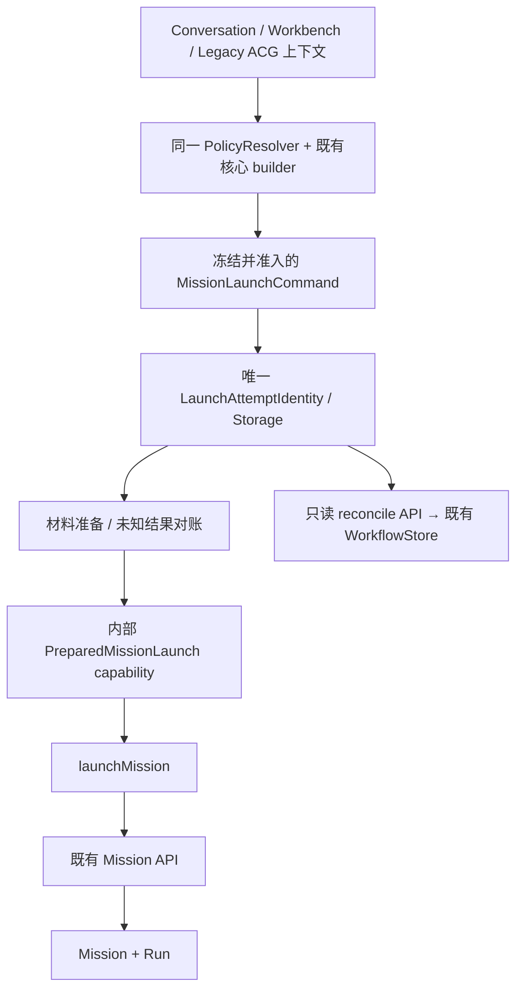

# PR-UI-01-R1｜Mission Launch Safety & Policy Convergence

## 阶段 1：独立审计与实施计划

基线、当前 HEAD、GitHub master 均为 `58fb2c7f451c98b4c9a99f355bbd17e2d239aa29`。分支 master。原有 ModelRuntimeControls.vue 修改、未跟踪 PR-UI-00 报告保留；本轮不提交、不推送、不部署。

当前链路：入口→request adapter→buildWorkbenchStartRequest→LaunchAttempt→launchMission→workflowApi→POST missions。Chat 按显式 ID、Workbench 按 JSON signature；ChatView 409 清 identity；helper 任意 409 清缓存/重置 ID。inFlight 无操作身份判断；Store 按 Conversation 合并不同操作。Workbench/旧 ACG 的快照只有组件寿命。Conversation adapter 保有策略默认值。

409 真实来源：agentos_v2.create_mission 中附件错误已有 detail.code=ATTACHMENT_NOT_READY；幂等冲突返回 detail 文本；semantic commit 返回结构化 status；其它未识别冲突必须关闭自动重建。WorkflowStore 使用 Mission creationKey/creationFingerprint、Run idempotencyKey/idempotencyFingerprint；SQLite tasks payload 的 JSON creationKey 和 Run payload 已持久化，Memory store 同样支持。现有 API 需要 Mission/Run ID，没有原操作创建结果对账。

实施顺序：先复现 P0，保留所有异常身份，给创建冲突补充稳定机器标识并增加按原请求身份的只读对账（带可信用户/租户校验；复用 WorkflowStore，零 schema 变更）；专项测试通过后再统一操作身份/跨组件持久化、PolicyResolver、Command 边界与架构门禁；最后扩大回归并复核同一源码快照。

## 1. 原始问题复现与阶段门禁

本轮没有直接沿用上一轮结论。重新读取全部入口、实际 wire contract、Memory/SQLite WorkflowStore 和 Java 网关后，复现了以下问题：

| 级别 | 基线代码证据 | 真实行为 | 修复 |
|---|---|---|---|
| P0 | `features/mission/launchAttempt.ts` 原 catch(409) 清快照/把 clientRequestId 置空；ChatView 原 409 清 Conversation identity | ATTACHMENT_NOT_READY 也会导致下一次请求使用新 ID；新增测试在修复前失败，明确观测到两个不同 UUID | 所有错误保留身份；按机器合同分类；未知结果先对账 |
| P0 | API 只支持按 Mission/Run ID 读取；Run key 查询看不到早期 Mission creation anchor | 客户端丢响应后无法核对“Mission 已创建、Run 未准备” | 增加只读原操作对账，直接使用既有 WorkflowStore |
| P1 | helper `if(inFlight)return inFlight`；Store 按 Conversation 合并 | 不同操作可能拿到第一个操作的结果 | 按 owner + operationId 合并；入口已有别的操作时 BUSY |
| P1 | Workbench/旧 ACG 的 cache 只有组件寿命 | 卸载后未知提交、材料引用失去恢复入口 | 三入口共享持久身份和显式恢复动作 |
| P1 | Conversation adapter 自行覆盖策略；Workbench builder 内解析插件策略 | 策略解析分散 | 同一 PolicyResolver 保留入口差异 |
| P1 | launchMission 接收任意 wire request | 只完成调用点收敛，缺少结构限制 | Command 准入 + 内部 Prepared capability + 静态架构测试 |

P0 最先完成：原失败测试转绿；前端冲突/旧 helper/ChatView 专项 31 条、后端 SQLite 对账 4 条通过后才进入 P1。后续扩展了对账、权限、冲突和恢复对抗测试。

## 2. 409 分类与处理矩阵

不通过英文错误文案分类。Python 原有 detail 正文兼容保留，创建路由为可识别冲突添加 `X-Mission-Launch-Conflict`；Java 的 typed gateway 仅将三种白名单值转换为稳定 `code`。未知 header 不透传，错误正文、prompt 和请求内容不通过新通道暴露。前端同时识别原 Python detail.code、白名单 header 和 Java code。

| 情况 | 机器证据 | 身份/提交状态 | 恢复方式 |
|---|---|---|---|
| 网络超时/响应丢失 | 无已确认响应 | 原 ID + 原快照；uncertain | 显式恢复先对账；CREATED 直接承接结果；NOT_FOUND/CREATING 才允许原身份重试 |
| 503/网关 502 | 非成功响应 | 原身份；uncertain | 不自行重试或生成新身份，按原操作对账 |
| 附件未就绪 | ATTACHMENT_NOT_READY | 原身份；ready | 附件 READY 后显式重发原快照；不重新上传附件 |
| 请求身份冲突 | CLIENT_REQUEST_ID_CONFLICT | 原身份；conflict | 对账；未确认成功则阻断创建，不能换 ID 绕过 |
| Mission 语义冲突 | MISSION_SEMANTIC_CONFLICT | 原身份；conflict | 查询持久 semantic receipt；需要审阅的创建返回 REQUIRES_REVIEW |
| 其它业务/未知 409 | 没有受支持的创建冲突机器码，包括通用 AGENTOS_REQUEST_REJECTED | 原身份；conflict，Fail Closed | 对账/人工核对；即使 NOT_FOUND 也不自动再次创建 |
| 确认成功 | 有效 Mission/Run 回执或 CREATED 对账 | accepted | Binding 持久化/页面跳转成功后才 complete，清理本操作缓存 |

NOT_FOUND 是某次读取尚未发现记录，不是“原请求绝未被接受”的证明，所以它从不授权改换 clientRequestId。所有网络重试由显式调用触发，服务不定时重提副作用。

## 3. 创建结果对账：最小服务端能力

新接口：`POST /api/agentos/v2/mission-launches/reconcile`（Java 对外）；Python 路由为 `/agentos/v2/mission-launches/reconcile`，由既有 `/ai` 前缀服务挂载。请求仍使用原 MissionCreateRequest/AsyncWorkflowStartRequest，包含原 clientRequestId 和原 wire snapshot；没有复制 Mission 创建数据模型。

1. 必须有可信用户上下文；没有可信用户返回 401。
2. `_idempotency(request)` 使用与原创建完全相同的 caller/tenant key 和 Pydantic 规范化 payload 生成服务端 key/fingerprint，不信任客户端 fingerprint。
3. WorkflowStore 新增只读 `find_mission_by_creation_key()`，Memory 和 SQLite 实现均返回副本；SQLite 查询现有 tasks JSON 中的 creationKey，没有新增表、列或 migration。
4. 与既有 `find_run_by_idempotency_key()` 联合读取；逐项校验 authenticatedUserId/authenticatedTenantId，空 tenant 按既有可信 unscoped 用户语义归一。
5. 只返回状态、当前调用者可见的必要 IDs，以及确认 CREATED 时既有安全 Run 投影；不返回输入、creation key、服务端 fingerprint 或其它用户资源信息。
6. 不调用 create_mission/prepare_run/coordinator.submit，不修复或修改历史 Mission/Run。已确认的前端 Mission/Run ID 也不允许被后续不一致回执覆盖。

| 对账状态 | 条件 | 客户端行为 |
|---|---|---|
| NOT_FOUND | 当前调用者的原 key 没有 Mission/Run 锚点；其它 owner 的记录不披露 | 保留原身份；非 conflict 的显式恢复可重放原请求 |
| CREATING | Mission 已持久化，Run 尚不存在，且无已记录语义冲突 | 保留 missionId；仅允许同一原请求继续准备 |
| CREATED | 同一创建 Mission/Run、请求 fingerprint 一致，记录可见且未删除 | 规范化已有结果，不再提交创建 |
| CONFLICT | 原 key 已存在，但服务端请求指纹不一致 | 阻断；不能把客户端的新语义绑定到旧 Mission |
| REQUIRES_REVIEW | 创建语义 receipt 冲突、记录删除/不可继续、孤立 Run 等 | 人工核对；不自动重建/删除身份 |

真实 SQLite 测试覆盖：丢失成功回执、prepare_run 中断、语义初始化冲突、跨用户/租户、无认证、无 tenant 的可信用户；共享 Store 合同测试覆盖 Memory/SQLite 查询不改写原对象。

## 4. LaunchAttemptIdentity 最终合同

定义在 `apps/frontend/src/features/mission/launchAttempt.ts:12`：

```typescript
interface LaunchAttemptIdentity {
  schemaVersion: 2
  operationId: string
  clientRequestId: string // 与 operationId 相同；与 wire snapshot 一致
  entry: 'conversation' | 'workbench' | 'legacy-acg'
  commandSnapshot: AsyncWorkflowStartRequest
  requestSnapshot: AsyncWorkflowStartRequest
  requestFingerprint: string
  wireFingerprint: string
  materialPreparationState: 'pending' | 'ready' | 'uncertain'
  submissionState: 'ready' | 'submitting' | 'uncertain' | 'conflict' | 'accepted'
  conflict: MissionLaunchConflict
  createdAt: string
  updatedAt: string
  missionId?: string
  runId?: string
}
```

这是一条提交记录：commandSnapshot 保留准备前输入，requestSnapshot 保留材料准备后实际发送的不可漂移 wire body。两者属于同一操作，不由不同页面分别存储；Run 状态仍由后端 Runtime 决定。

身份生命周期：

- **新操作**：入口没有未确认操作，Command 经准入，begin 生成一次 ID；兼容调用显式传入的旧 ID 也必须服从原记录一致性。
- **重试**：同 ID/同指纹返回原操作；不同请求指纹返回 IDENTITY_CONFLICT；不同 ID 占用同一入口返回 BUSY。
- **恢复**：resume(operationId) 只使用已保存快照；当前表单/消息/模型设置不重建原请求。三个 UI 都提供显式“核对并恢复原提交”。
- **冲突**：保留原 ID 和所有快照，查询服务端；未确认成功不得清理或切换身份。
- **成功**：先 accepted，再完成 Binding 或跳转，再 complete(operationId)；下一个明确新操作才能生成新 ID。

并发索引按 owner + operationId，而不是仅按 Conversation 或某个 helper 实例。相同操作跨组件/Store 重建共享请求 Promise；不同操作不会拿到第一个任务的结果。多个入口指针引用同一操作时只有一份 canonical snapshot。

## 5. 稳定请求指纹

`command.ts:16` 的 canonical serializer 对对象键排序，保持有序业务数组。`missionCommandFingerprint()` 采用带版本的完整 canonical JSON，而非不稳定的普通 JSON.stringify，也不是有碰撞风险的简易哈希。

参与字段：semantics、domain/intent/workflow/review、插件 scope、security/priority、目标/约束/预期产物、执行及规划参数、材料内容和引用、附件身份、插件数据、Conversation/chatContext 等实际输入。`entry` 也纳入区分历史来源语义。

排除字段：clientRequestId、展示 title、input.taskName、input.debugTrace。Attachment IDs / materialRefs / enabledPluginIds 作为集合排序去重；缺省、null、显式空数组依然不同。其余数组保留顺序，尤其最近消息、计划数据和插件业务数组。字段重排或只改展示标题不会新建身份，但发送仍保持第一次冻结的原始 wire body。

wireFingerprint 对完整 requestSnapshot 做 canonical serialization，用于恢复时检测结构漂移；服务端 `_idempotency` 仍独立采用现有 SHA256 及原完整 API 字段规则。客户端指纹从不代替服务端幂等或权限判断。

## 6. 持久化、恢复与材料生命周期

使用现有浏览器 Storage，而非新增业务 Store。统一位置为 sessionStorage：

```text
mission.launch.attempt.v2:{encoded-owner}:{entry-slot}
  → 仅保存 operationId 指针
mission.launch.operation.v2:{encoded-owner}:{operationId}
  → 唯一 LaunchAttemptIdentity 快照
```

owner 使用已有 userId/tenantId。账号切换后原 helper 拒绝操作；浏览器有 token 但没有稳定 userId 时 Fail Closed，不把凭据存入 key 或 snapshot。sessionStorage 在同一标签页刷新/路由切换后恢复，不承诺关闭标签页或换设备后的恢复。

恢复规则：schema/IDs/指纹/状态/时间字段须一致；损坏快照阻断而不是忽略后新建；超过七天先对账，能确认 CREATED 的仍可承接，不能确认的过期记录隔离并保留，禁止自动删除后再建。

材料处理：发送 createMaterial 前先持久化 uncertain；成功后记录 manifestId、追加已有 materialRefs、删除实际发送 body 的 inline materialText；恢复使用原引用，不再次创建。材料创建本身响应丢失时，既有 API 无原操作查询，保留 uncertain 并要求人工核对，不伪造引用或重复上传。附件上传保持原入口操作，原 ID 及绑定关系保留；恢复不重新上传。

成功后 complete 只清理这个已接受操作及其入口指针；Conversation Binding 先持久化。旧 `chat.workflow_submission.*` / `mission.launch.request.v1:*` 仅按原 ID 兼容迁入，同一操作成功后才清理关联旧提交缓存。旧提示有 ID 但无完整原请求时不能猜测重建；旧 material uncertain 同样隔离。历史 Binding、工作模式及其它存储不删除。

API Key、Authorization、密码、access/refresh token、providerConnections、clientSecret 等凭据字段在任何持久化/副作用前递归拒绝。执行请求继续只带已有 thinking/effort 等设置；不持久化完整模型连接配置。

## 7. PolicyResolver 与唯一启动边界

`policy.ts:15` 是统一策略解析权威：

| 入口/情况 | 有效策略 |
|---|---|
| Conversation 兼容默认 | legal / case_analysis / human_in_loop；未提供 scope 保持 omitted |
| Conversation View preset | conversation-workspace profile → general / general / auto；默认值不再散落在 View |
| 显式字段 | 覆盖 inherited/default；显式默认值也按显式值处理 |
| 继承字段 | 仅在显式值 undefined 时继承 |
| workflowId='' | 保留显式清空；不擅自换成历史值 |
| enabledPluginIds=[] | 显式无插件；与 omitted/null 区别保留 |
| enabledPluginIds=null | 保留 wire 的自动 scope 语义；不转成 [] |
| Workbench / Legacy ACG | 保留 Draft 和 Extension 的 domain/intent/workflow/review；scope 仍以 Draft 为准 |

原 `buildWorkbenchStartRequest()` 作为兼容公开 builder 保留，插件策略循环移入 Resolver；目标、隐私 Web Search 权威、高级规划参数、材料和插件输入没有复制另一套实现。Conversation adapter 不再自行写默认 domain/intent/review。



Command 使用运行时 WeakSet 准入并深冻结；service 只接收内部 Prepared capability，伪造 wire request 会在触及 API 前被拒绝。Prepared 内部签发还检查 operationId 与 wire clientRequestId 一致。

架构测试扫描非测试前端源码，限制直接 startWorkflow/startWorkflowAsync、POST missions、service/admission 导入、快照恢复函数、核心 builder 调用及业务页面存储/默认值。旧 ACG 中只为合法 rerun 保留直接核心 builder；初始创建只经 Command/Attempt。Rerun、Revision、Retry、Resume、Review 的后端合同和既有独立语义不改。

此处的结构性约束是应用代码/类型/运行时准入与 CI 静态门禁，不是浏览器客户端能替代的安全边界；最终资源授权仍在后端。

## 8. 行为测试、对抗测试与过程失败记录

新增/扩展的重点：

- launchSafety：真实复现附件 409 后原 UUID 被改写，修复后同请求同身份。
- conflict：原 Python detail、Java code、白名单 header、未知/通用错误均不用文案猜测。
- launchAttempt：同 ID/同请求、同 ID/异指纹、不同 ID BUSY、跨组件/跨入口指针同操作合并、丢成功回执对账、Mission 已创建/Run 未准备、Material 丢响应、附件等待、语义冲突、未知 409、过期、凭据、切账号、旧快照及缺失快照。
- service：保留原 ID/响应校验/AbortSignal/HTTP 与 Contract Error；新增 raw wire 不能直接进入 API。
- policy：默认/显式/继承/清空/null/空 scope、Workbench/Legacy 插件、Review/执行设置及跨入口核心语义比较。
- Store：同操作合并、同 Conversation 的不同 Chat/Agent 意图 BUSY、重建后恢复、Binding 持久化前不清快照、未确认操作不能更换 ID 或策略。
- 三个实际 Vue 入口：普通聊天隔离；Composer 卸载后原 Material 和完整 wire snapshot 复用；Conversation/Legacy ACG 显式恢复；既有页面跳转/Run 操作回归。
- Python：真实临时 SQLite + trusted middleware 对账；故障注入发生在 create/semantic commit/prepareRun 边界；请求指纹与资源归属均走真实服务；Memory/SQLite read-copy 合同。
- Java：真实 controller mapping、原 ID body 透传、白名单冲突码、敏感正文不转发、既有 API/投影架构回归。

过程失败没有隐去：首次 Python 收集缺少既有跨目录测试 helper，随后仅在测试进程 sys.path 加入 `apps/agentOS/tests/runtime`，未改生产配置；新增只读测试曾遇到 Run terminal 后的异步尾部 Trace 写入，改为等待测试执行任务收尾，保留完整记录比较；新 Store 策略测试暴露上一个用例未消费的一次性 Mock 队列，beforeEach 改用 resetAllMocks 隔离，未删用例或放宽断言。最初 409 失败复现和中间失败输出保留在会话/Temp 日志中，最终正式门禁使用单独 final 日志。

## 9. 最终源码快照与正式门禁

最终快照范围：`apps/frontend/src`、`apps/backend/src`、指定 Python API 与对账测试、`apps/agentOS/src/support/stores`、共享 WorkflowStore 合同测试。将 925 个 `.ts/.vue/.tsx/.json/.java/.py` 文件按路径排序，对路径、NUL、原字节、NUL 计算 SHA256：

```text
faa9f7fda0f28ffd64fb07e975877cf450d0bb6b08bac2a4a5a08487b5cde14b
```

最终同快照正式结果：

| 门禁 | 结果 |
|---|---|
| 前端定向及架构 | exit 0；13 files / 125 tests；85.64s |
| 前端全量 | exit 0；129 files / 887 tests；134.88s |
| Python API/Store 扩大回归 | exit 0；108 passed；122.20s |
| Java AgentOS controller/gateway/serialization/architecture | exit 0；10 suites / 67 tests；0 failures/errors/skipped |
| frontend TypeScript + web build | `build:web` 中 vue-tsc 成功；Vite 构建 21.24s，exit 0 |
| git diff --check | exit 0；仅换行符提示，没有 whitespace error |
| 敏感信息扫描 | 本轮代码中常见长格式 API token / 私钥模式无匹配；另有凭据字段拒绝行为测试 |

这些命令在本轮代码冻结后执行；随后只补充文档。中间 P0 31+4、P1 首批 68 等仅为阶段门禁，不混入最终统计。前端用例数相对基线 841 增加至 887；未跳过或删除既有业务用例。

最终命令：

```powershell
# cwd apps/frontend
npm.cmd test -- src/features/mission src/views/ChatView.spec.ts src/views/CreateMissionView.spec.ts src/views/AcgVisualizationView.spec.ts src/stores/chat.workflow.spec.ts src/features/acg/workbench.spec.ts
npm.cmd test
npm.cmd run build:web

# cwd 仓库根目录：仅为既有跨目录 test helper 设置测试进程 import path
python -c "import sys; sys.path.insert(0, 'apps/agentOS/tests/runtime'); import pytest; raise SystemExit(pytest.main(['apps/agent/tests/test_mission_launch_reconciliation.py','apps/agent/tests/test_agentos_v2_api.py','apps/agent/tests/test_mission_semantic_commands.py','apps/agent/tests/test_agentos_v2_workspace_api.py','apps/agent/tests/test_agentos_v2_artifact_api.py','apps/agentOS/tests/support/test_workflow_store_contract.py','-q']))"

# cwd apps/backend
mvn.cmd -q '-Dtest=AgentOs*Test,MissionProjectionArchitectureTest' test
```

Java 67 条来自此次 Surefire XML：Artifact 13、ContractSerialization 3、Event 3、Gateway 7、Mission 13、Observation 10、Review 7、RouteCompatibility 3、Run 6、MissionProjectionArchitecture 2。Python 扩大门禁包含新增 reconcile 7 条、共享 Memory/SQLite Store 合同及既有创建/幂等/附件/语义/Workspace/Artifact API 回归。

已有测试环境警告保留：Vitest 的 Workspace 直接 mount 会打印 Router guard 警告及 jsdom 网络 AggregateError；原配置 retry=1 未改。Python 有 Starlette/httpx、Pydantic deprecation 警告。Java 的错误投影与超时测试有预期 ERROR 日志和 ByteBuddy/MockMvc 提示。它们没有被隐藏，也不能解释为真实生产网络已验收。

最终日志位于本机 Temp（同名 final 日志与过程失败日志分开）：

```text
C:\Users\LZX\AppData\Local\Temp\pr-ui-01-r1-final-frontend-targeted.log
C:\Users\LZX\AppData\Local\Temp\pr-ui-01-r1-final-frontend-full.log
C:\Users\LZX\AppData\Local\Temp\pr-ui-01-r1-final-python.log
C:\Users\LZX\AppData\Local\Temp\pr-ui-01-r1-final-java.log
C:\Users\LZX\AppData\Local\Temp\pr-ui-01-r1-final-build.log
```

最终非测试调用搜索结果：

```text
features/mission/launchAttempt.ts:117  唯一新 operationId 生成点
features/mission/launchAttempt.ts:198  Prepared capability → launchMission
features/mission/admission.ts:8       内部 capability 签发定义
features/mission/launch.ts:14         服务定义
features/mission/launch.ts:20,21      options 两个互斥分支，单次只调用一次 startWorkflowAsync
services/api/workflow.ts:130,134     既有底层 facade 定义/透传
services/api/agentos/api/mission.ts:77 底层 HTTP API 定义
```

以上路径均相对 `apps/frontend/src`。`startAgentRun` / `upgradeToWorkflow` 仍为 source 兼容包装；Store 只有一条统一的操作编排。直接创建 API 的其余匹配仅为底层 API 兼容方法和测试，不在业务页面。架构测试限制未来新增普通 Mission Create 旁路，同时允许旧 ACG 的合法 rerun 使用原 builder。

## 10. 剩余限制与独立验收要求

1. Material 创建响应丢失没有可复用的材料幂等查询合同，本轮选择保留/隔离并要求人工核对；不会自动把未知结果当作失败而再创建。
2. sessionStorage 支持当前标签页刷新/路由恢复；关闭标签页、清空浏览器存储或跨设备后，客户端原请求可能不可用，需要独立恢复产品合同。不能承诺本地存储被清理后仍自动恢复。
3. 过期/损坏/旧提示无完整请求时不会自行清空或生成新身份；当前保守的人工核对流程不等于已实现完整运维修复界面。
4. SQL 复用既有 JSON creationKey 查询，没有新增索引/schema；这是低频对账查询，未做海量创建记录性能验收。
5. 真实浏览器、生产 JWT→Java→Python 联调、服务重启/断网、真实模型/工具执行仍需独立 ACCEPT。本轮通过真实临时后端与 Vue/Mock 传输测试，不能宣称生产 E2E 已验收。
6. Runtime/Planner/Scheduler/历史 Run/数据库模型不改；没有进行双视图改造或其它 UI 视觉重构。

## 11. 修改文件与关键位置

| 文件/模块 | 关键职责/位置 |
|---|---|
| frontend/features/mission/command.ts | canonicalLaunchJson / missionCommandFingerprint / 准入及深冻结 / 三入口 Command factories / Conversation 续提匹配 |
| frontend/features/mission/policy.ts:15 | resolveMissionLaunchPolicy，唯一默认与插件策略解析 |
| frontend/features/mission/launchAttempt.ts:12,44,86,130,148,153 | Identity、持久化、begin、complete、reconcile、resume |
| frontend/features/mission/admission.ts:8 | 内部 Prepared capability 与操作身份一致性 |
| frontend/features/mission/launch.ts | 受限初始启动、公共 Result 校验 |
| frontend/features/mission/request.ts / acg/workbench.ts | 复用 builder 并委托策略，不复制 API wire contract |
| frontend/features/mission/conflict.ts / conversationLaunchIdentity.ts | 机器冲突分类；旧 identity 只读兼容，不再生成旁路身份 |
| frontend/services/api/{workflow.ts,agentos/api/mission.ts} | 对账 API 透传及响应联合类型 |
| frontend/stores/chat.ts | 统一操作编排、持久化 Binding、显式 pending/resume，删除 Conversation 粗粒度合并 |
| frontend/views/{ChatView,CreateMissionView,AcgVisualizationView}.vue | 提供上下文和结果呈现，恢复原提交，不持有幂等存储策略 |
| agent/app/api/agentos_v2.py:2428 | 只读对账、409 稳定 header、语义 receipt 与归属核验 |
| agentOS/src/support/stores/{workflow_store,memory_workflow_store,sqlite_workflow_store}.py | 查原 Mission creation anchor，不改持久化模型 |
| backend/controller/AgentOsMissionController.java:50 | 对外 reconcile 路由，使用已有验证与 gateway |
| backend/gateway/{AgentOsPaths,AgentOsGatewayService}.java | 路径定义、白名单机器码转码，保持旧错误正文/不透传敏感字段 |
| 各新增/扩展 spec、Python、Java test | 行为与架构门禁，见上一节 |

表中 frontend 相对 `apps/frontend/src`，backend 相对 `apps/backend/src/main/java/com/kinlin/ai`；其它路径相对仓库根目录。

## 12. 现场保护与交付状态

原有 ModelRuntimeControls.vue 的 SHA256 仍为 `7548ea9489e46c2c1c96f42d38200fce235d44b3f3f01978a19bab73a6fee934`；PR-UI-00 报告仍为 `c25ef8e3dbed0dac4e36ee3b1f521e11bb61c86ec3bf4bd991c1124fe6b0ee16`。没有纳入修改或清理。

本轮所有实施修改保持未提交，等待独立代码级验收；不 Push、不 Merge、不部署、不创建最终提交。最终只能报告 SELF-TESTED，不宣布 ACCEPT。

**交付状态：SELF-TESTED。** 最终 HEAD 仍为 `58fb2c7f451c98b4c9a99f355bbd17e2d239aa29`；正式源码指纹复核与测试前一致。所有 R1 修改留在工作区，原有组件修改及 PR-UI-00 文档保持。
