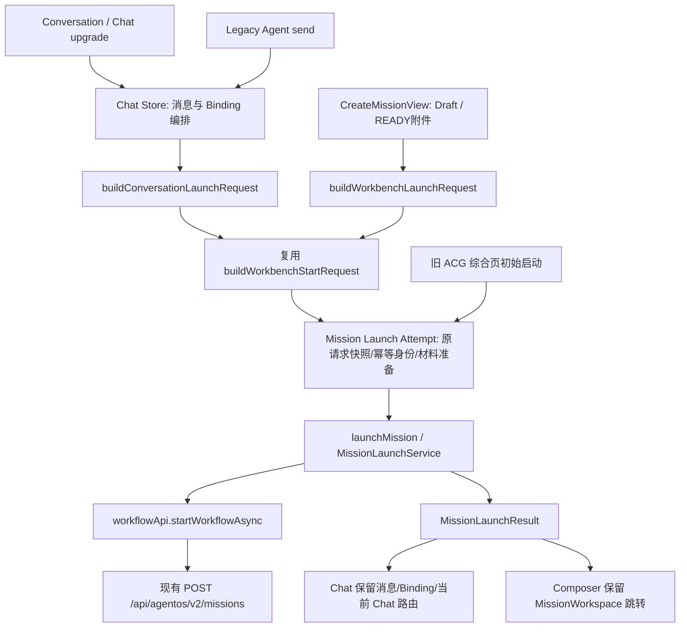

# PR-UI-01｜统一 Mission Launcher 实施记录

日期：2026-10-31（Asia/Shanghai）

状态：**SELF-TESTED**。本轮未进行独立 ACCEPT、真实后端执行验收或部署。

## 1. 基线、范围与现场保护

开始时已执行 `git status --short`、`git branch --show-current`、`git rev-parse HEAD`：

```text
branch: master
HEAD: a51fb993a71e43fe374c1885d3dad30eea8f21a7
预期审计基线: 7339d25fe6375bee50e54c374a206d5c4d23a8e1
 M apps/frontend/src/components/ModelRuntimeControls.vue
?? docs/开发记录/PR-UI-00-前端生命周期工作台架构审计-2026-10-31.md
```

预期基线至当前 HEAD 有四条发行相关提交：`2610d1e8`、`7dd15992`、`309f9f8b`、`a51fb993`。本轮在当前现场实施，未切换、重置或改写历史。检索未发现适用 AGENTS.md。上述两个已有文件保持原字节内容，核验 SHA256：

| 已有文件 | SHA256 |
|---|---|
| ModelRuntimeControls.vue | `7548EA9489E46C2C1C96F42D38200FCE235D44B3F3F01978A19BAB73A6FEE934` |
| PR-UI-00 审计报告 | `C25EF8E3DBED0DAC4E36EE3B1F521E11BB61C86EC3BF4BD991C1124FE6B0EE16` |

范围仅为“创建新 Mission + 启动初始 Run”的前端请求构造、调用、幂等与响应处理。未修改后端、API wire 类型、数据库、Planner/TaskPlan/ACG、Scheduler、Workspace Projection、Run Copilot、Retry/Resume/Review 合同、路由结构、package.json 或配置文件。没有删除页面、WorkspaceMode 或历史存储；没有提交、Push、Merge、部署。

## 2. 改造前后的真实调用链

改造前：

```text
ChatView(Chat upgrade / Agent send)
  → chat.startConversationWorkflow：自行构造分支 payload
  → workflowApi.startWorkflowAsync

CreateMissionView.submit
  → buildWorkbenchStartRequest + material 创建 + creationRetry
  → workflowApi.startWorkflowAsync

旧 AcgVisualizationView.startRun
  → builder + material 创建 → workflowApi.startWorkflowAsync
```

改造后：



Legacy Agent 和 Chat 的区别保留为历史来源、兼容标题/文本别名；任务核心语义、快照处理、Material 准备、正式 API 调用、响应校验不再各有实现。

普通消息仍是 `ChatView.sendMessage → chatStore.sendMessageStream`。rerun 仍调用 `rerunWorkflowAsync`，单节点 retry 仍调用 `retryWorkflowStepAsync`，审核/恢复仍由既有正式 API 处理，均不进入新 Mission Launcher。

## 3. 新增 feature 与合同

目录：`apps/frontend/src/features/mission/`。

| 文件 | 职责 |
|---|---|
| request.ts | Conversation/Workbench 输入上下文适配；统一复用现有 Workbench builder |
| launch.ts | 无 Vue、无 Router 的唯一初始启动调用权威；传递 signal、校验身份、返回结果 |
| launchAttempt.ts | 单次提交请求快照、显式重试、重复点击合并、Material 引用缓存 |
| conversationLaunchIdentity.ts | 从 ChatView 迁出的现有 sessionStorage 请求身份策略 |
| 同名四个 spec.ts | 请求、服务、幂等、旧存储兼容的独立测试 |

API wire contract 继续是 **AsyncWorkflowStartRequest**，没有另复制 MissionLaunchRequest 或修改它的定义。新增 ConversationLaunchContext / LaunchMaterials 仅是前端适配输入；WorkbenchDraft / PluginUiExtension / buildWorkbenchStartRequest 的原公开 API 保持不变。

架构结论补充：本轮统一的是核心 builder 的复用、提交快照/材料处理、启动 API 调用与结果校验，并不表示所有启动策略已经完全收敛。Conversation adapter 仍覆盖历史 domain/intent/reviewMode/scope；Chat 按显式 operation ID、Workbench 按 Draft signature 识别重试。launchMission 接收已构造的 wire request，尚无结构性约束强制未来调用方经过统一 builder/attempt。现有调用链已收敛，不等于未来无法绕过；测试通过也不能证明所有策略权威已消除。

```typescript
interface MissionLaunchOptions { signal?: AbortSignal }
interface MissionLaunchResult {
  missionId: string
  runId: string
  run: WorkflowRun
  clientRequestId: string
}
```

`launchMission(request, options?)` 每次只发一次异步启动；不自动重试，不同步 fallback，不路由跳转。不接受缺失、非字符串或空白 missionId/runId 的响应，抛既有 WorkflowApiContractError；HTTP 409/503 和底层 Contract Error 原样传播，不伪造 ID。

ChatWorkflowStartResult 保留 `response`、`binding` 供现有 View 使用，并增加 `launch: MissionLaunchResult`；`response` 即 `launch.run`。Composer 使用同一 Result 的 missionId/runId 进行现有跳转，旧综合页使用 `.run` 承接既有展示。

## 4. 请求字段对照

| 字段 | Conversation / Legacy Agent | Workbench Composer |
|---|---|---|
| title | 保留 Chat/Agent 历史标题；可显式指定 | Draft title / 现有自动标题 |
| semantics.objective | 两入口均为用户目标 | Draft taskGoal |
| semantics.constraints | 当前对话启动无结构化约束控件，默认空数组，不擅自抽取聊天文字 | 既有 constraint IDs/text/sourceRefs |
| semantics.sourceRefs | 适配器支持显式引用，默认空 | 默认空，支持外部 context.sourceRefs |
| domain / intent / workflowId | 保留调用选项；View 仍传 general/general；旧 Store 默认值兼容保留 | 既有 Plugin Extension contribution |
| reviewMode | 保留选项；View auto；旧 Store 回退 human_in_loop | Draft / 既有插件合法贡献 |
| input.source | chat / agent 保留 | acg 保留 |
| userIntent / taskGoal | 两入口现在均提供核心目标别名 | 保留现有 builder / 插件逻辑 |
| caseText / chatText | Chat 兼容字段保留 | 不额外制造旧 Chat 字段 |
| conversationId | 显式保存本次工作会话身份 | 无则不制造 |
| chatContextId / chatRoleId | 单独保存 Chat Store 的服务端上下文/角色，可为空 | 不制造 |
| chatContext | 最近八条消息，延续先截取再过滤非空、只传 role/content 的策略 | 不制造 |
| thinkingMode / reasoningEffort | View 传当前模型设置中的执行选项；重试冻结 | 现有 Draft/模型设置映射保持 |
| Web Search | 适配器可携带明确选择；普通 Chat 原有设置流程保留 | Draft 隐私选择最终覆盖插件或额外 input |
| planning mode/diversity/seed/capability | 复用 native builder 的默认配置 | 全量保留 dynamic/template_preferred、diversity、seed、capability |
| expectedArtifacts / materialIds / pluginData | 复用 native Draft 的默认值 | 原数组/深拷贝插件数据保留 |
| enabledPluginIds | 显式传递时保留；原有 omitted-scope 行为保留 | Draft 的显式 scope；插件不能改写 |
| attachmentIds / materialRefs | 适配器可接收，当前 Chat 文件 URL 不会被假冒为正式附件 | READY attachment IDs + 已有材料引用 + inline material 准备结果 |
| clientRequestId | sessionStorage identity + 原请求快照 | Draft signature + 原请求快照 |
| debugTrace / lowEntropyOptions | 不擅自启用 UI 中未提供的诊断选项 | 现有开关保持 |

模型配置边界：没有把 apiKey、baseUrl、providerConnections 放入 Mission 请求或重试缓存；普通聊天的模型选择、连接和发送路径未改。现有初始 Run builder 没有逐 Run selectedModel 路由合同，本轮不声称改变服务端模型路由，只承接已有 thinking/effort 执行选项。Conversation 与 chatContext 的两个 ID 没有互相覆盖。

## 5. source 与后端字段语义调查

本轮只读追踪了 `apps/agentOS/src` 与 `apps/agent/app`。

| 字段/组 | 当前真实使用与代码证据 | 本轮决策 |
|---|---|---|
| input.source | `support/stores/_policy.py:139,169-172` 任务/Run 列表按 source/sources 过滤；sqlite/memory workflow store 形成 overview；`agentos_v2.py:604` 对外投影 | 保留 agent/chat/acg，不归一为一个值；历史筛选继续有效 |
| userIntent/taskGoal | `runtime/workflow_runtime.py:1651` 选择规划目标；`components/mission_manager/semantic_resolver.py:41` legacy objective 别名选择；有正式 basis 时以 basis objective 为准 | 给三个入口完整核心语义，保留兼容别名 |
| constraints | `runtime/planner_input_adapter.py:15` 把正式 Mission basis 约束投影为 planner input，覆盖旧文本别名权威 | 使用现有 semantics，不新增后端语义模型 |
| expectedArtifacts | `components/planner/intent_analyzer.py:373` 进入 planning contract，native_prompt 亦读取 | Workbench 保留 |
| planningMode | `runtime/workflow_runtime.py:1634` 参与 force_dynamic/use_planner 判定 | 保留，不能视为无关 UI 字段 |
| materialText | `agentos_v2.py:860-956` prepare_execution_input 将 inline material 转 sealed MATERIAL，并校验 materialRefs/归属；Planner 读取材料上下文 | 前端先准备一次，重试复用 refs；后端合同不改 |
| materialRefs/attachmentIds | 上述 API 校验附件所属用户/READY/大小，提取内容引用；task_decomposer 的 workset/source refs 校验来源 | 不把 Chat fileUrl 当 attachmentId，正式附件链保持 |
| pluginData | `adapters/model/native_prompt.py:180-194` 作为 task-carried source data；插件 builder 还贡献 domain/intent/workflow/input | 深拷贝保留，不能删除 |
| caseText/chatText/chatContextId/chatRoleId/chatContext | 当前 Python 源码字段名检索未发现直接按这些键读取的 Planner 专用分支；raw input 会随 Run 保留，planner_input 的 material_input 也保留非语义键 | 保留兼容与来源，不推断“历史消费者永远不用”，不宣称全量聊天已被模型消费 |
| materialIds | API history input 白名单仍保留；未见它像 sealed materialRefs 那样单独解析为正式材料 | 保留旧值，不能与 materialRefs 混为同一身份 |

在审计的 Runtime/Planner 链上未发现 `source == chat/agent/acg` 决定调度或规划算法的分支；明确观察到的是历史来源筛选/投影。`native_prompt` 的规范目标及 source-data 构造也没有把 source 当权限。此结论限定于当前源码；不能据此删除 source 或断言未来插件不使用它。

## 6. clientRequestId 与原请求语义

共享 Launch Attempt 的职责是**提交缓存**，不保存 Mission/Run 生命周期状态，不新增 Pinia Store 或第二套业务真源。

1. Composer 以未准备 request 的 JSON signature 匹配同一次操作；第一次生成 clientRequestId，深拷贝请求后再准备材料和提交。
2. Chat 延续 `chat.workflow_submission.{conversationId}` 的 `{conversationId,text,clientRequestId}` 存储格式；同 Conversation/同 text 复用，成功/409 清理当前 identity，修改意图或新会话生成新 ID。
3. 为保留**原请求语义**，Chat 同时把待提交 wire request 快照保存在 `mission.launch.request.v1:{conversationId}:{clientRequestId}`。网络失败保留，成功/409 只清理本次快照；重建 Store 后同 operation 仍发送原请求，不能被新消息、chatContextId 或模型设置变化改写。
4. Workbench 保留组件寿命内的请求缓存，不擅自承诺刷新浏览器后的跨组件恢复。旧综合页初始启动也使用同一 helper；rerun 的旧配置路径不迁入 helper。
5. Helper 合并 in-flight 调用，Store 再按 Conversation 合并启动编排，View 保留 submitting guard。并发不会重复请求、用户消息或 Binding。
6. 启动接口响应丢失：保留 clientRequestId、附件 IDs、材料 refs 和原 payload；只在用户再次显式启动时重试，Service 不自行重试。
7. Composer 409：保留已准备的 Material，下一次显式提交更换 clientRequestId；Chat 409 保留原 HTTP 错误并允许 View 重新取得身份，不进行同步 fallback。
8. 已成功完成的显式操作清理提交缓存，后续新操作即使目标相同也可生成新 ID。已经 abort 的调用不开始材料准备；材料准备期间 abort 时先保留得到的引用，再阻止启动。

旧历史 localStorage/sessionStorage 没有批量清理或 schema 迁移。新缓存仅记录初始启动请求，不是可恢复执行许可/调度指令。

## 7. 附件与 Material 生命周期

Composer 原有上传、重试上传、READY 校验、移除、未提交附件清理保持在原 View。Launch Attempt 只接收稳定附件 ID，不负责文件上传，也不重新上传附件。

inline material 在 helper 中转换为 Material 引用，已存在的 materialRefs 采用追加而非覆盖，随后删除 wire input.materialText，避免后端重复创建。初始 Mission 启动失败时已成功准备的 manifestId 被保留并复用。CreateMissionView 的实测组件用例验证材料只创建一次、两个启动请求完全相同。

若 **Material 创建本身的结果未知**，helper 在发送副作用前已标记 uncertain；后续同操作不会再次调用 createMaterial，而会提示核对材料结果。没有现有幂等 Material 创建/查询恢复合同，本轮不能假造成功或自动重复副作用。当前界面保留了较保守的附件归属标记：开始尝试启动后不自动清理可能已被服务端接受的附件。

限制：Material 准备仍使用既有 createMaterial API（它不支持 AbortSignal）；signal 传递给 Mission 启动 API，准备后也检查 abort。没有新增材料 API、后台重试或自动恢复服务。

## 8. ChatWorkflowBinding 与旧函数兼容

`ChatWorkflowBinding` 字段、`chat.workflow_bindings.v1`、workflowRuns 注册、消息记录、history-refresh 及原有恢复流程均保留。

- `upgradeToWorkflow()`：保留薄包装，只选择历史 source=chat。
- `startAgentRun()`：保留薄包装，只选择历史 source=agent。
- `startConversationWorkflow()`：保留统一消息/Binding 编排；不再在内部手写 wire payload，也不直接调用 workflow API。请求由 feature adapter 构建，执行由 Launch Attempt→launchMission 完成。
- `ChatView.upgradeChatToWorkflow()`：仍选择兼容包装，仍在 Chat 路由写 runId/启动 Progress；请求身份逻辑迁入 feature，不实现双视图 Session。
- `CreateMissionView.submit()`：仍验证 Draft/插件/READY 附件；使用 Workbench adapter、Launch Attempt 和统一结果完成原 MissionWorkspace 跳转。独立 creationRetry 与直接启动调用已删除。
- `AcgVisualizationView.startRun()`：虽然当前路由使用 AcgEntryView，旧组件仍有初始启动代码，为满足唯一权威一并迁入 helper；rerunReason 分支保留原 rerun API，失败单节点重试合同不变。

## 9. 测试结果与同快照证据

真实命令来自 `apps/frontend/package.json`：`test = vitest run`，`build:web = vue-tsc -p tsconfig.json && vite build --mode web`。使用已有依赖，无安装、配置改写或缓存清理。环境延续本机 Node/npm。

最终源码快照：对 `apps/frontend/src` 下 `.ts/.vue/.tsx/.json` 共 444 个文件，按路径排序，将规范化路径、NUL、原文件字节、NUL 顺序输入 SHA256：

```text
a98f6113ab480991063b997ff5878cd2c23af34aee97e3f8d1d87cf05370b5b7
```

以下正式结果均对应此最终源码快照；文档编写不改变前端源码。

| 验证 | 结果 |
|---|---|
| 最终定向测试 | exit 0；12 files、128 tests passed；24.64s |
| frontend 全量 `npm.cmd test` | exit 0；125 files、841 tests passed；86.33s |
| 独立 `npx.cmd vue-tsc -p tsconfig.json --noEmit` | exit 0 |
| `npm.cmd run build:web` | exit 0；vue-tsc 成功，Vite 2656 modules，构建 32.77s |
| `git diff --check` | exit 0；有 LF→CRLF 提示，无 whitespace error |

最终定向命令（cwd 为 apps/frontend）：

```powershell
npm.cmd test -- src/features/mission src/stores/chat.workflow.spec.ts src/views/ChatView.spec.ts src/views/CreateMissionView.spec.ts src/features/acg/workbench.spec.ts src/views/AcgVisualizationView.spec.ts src/components/workspace/FormalExecutionControls.spec.ts src/components/agentos/WorkflowReviewPanel.spec.ts src/views/MissionWorkspaceView.spec.ts
```

定向清单：Mission request 4、service 10、attempt 7、Conversation identity 2、Store 9、ChatView 17、CreateMissionView 8、workbench 10、旧 ACG view 12、Formal controls 12、ReviewPanel 6、Workspace 31，共 128。

验证实际链的重点：

- Builder：Chat/Agent semantics、独立 Conversation/chatContext 身份、8 条上下文、执行参数；Workbench 全量高级参数、插件 domain/intent/workflow、client ID/scope 不被插件覆盖、Web Search 权威、材料/附件引用。
- Service：实际执行 launchMission，mock 位于底层 workflowApi；断言请求、signal、调用次数、完整结果、无伪 ID、HTTP/Contract Error 对象不变、无同步 fallback。
- Attempt：实际执行 helper→service→底层 API；丢响应完全重放原 payload、不重复 Material、并发只一次、成功后新意图新 ID、改 Draft 新 ID、跨实例快照、Material 不确定副作用阻断、409 及 abort。
- Store：实际 Store→adapter→attempt→service→workflowApi；验证 Binding、消息、原语义、执行设置、服务端 Chat context 与 Conversation 分离、Store 重建后请求不漂移，Chat/Agent 并发只一次。
- Composer：实际 View→adapter→attempt→service→workflowApi；验证路由与请求、Material 只创建一次、重复提交一次、READY 附件稳定。
- 普通聊天：ChatView 普通消息只调用 sendMessageStream，不进入两个启动包装；全量包含原聊天流测试。
- 回归：旧 ACG rerun/retry、MissionWorkspace 恢复、Formal controls、ReviewPanel/useWorkflowReview、Copilot 测试均在定向或全量中通过；不代表真实后端恢复验收。

在早期中间源码上曾执行 8 files/75 tests 的开发检查；它仅是过程检查，不混入最终快照门禁。测试配置原有 `retry: 1` 未修改。最终输出仍包含 MissionWorkspace 的 Vue Router mount 警告及 jsdom XMLHttpRequest AggregateError 打印，全量结论来自 Vitest 汇总/exit 0，不能据此宣称实际网络全部成功。

本机完整日志：

```text
C:\Users\LZX\AppData\Local\Temp\pr-ui-01-full-test-20261031.log
C:\Users\LZX\AppData\Local\Temp\pr-ui-01-web-build-20261031.log
```

没有浏览器、Docker、真实模型、真实 Mission 创建/附件执行/数据库或端到端恢复验收。因此只报告 SELF-TESTED。

## 10. 全仓调用位置门禁

执行全仓 `rg -n 'startWorkflowAsync\('`；排除 Markdown 文档与 package-lock（文档本身含引用，不属于可执行调用）。全部剩余匹配如下：

```text
apps/frontend/src/features/mission/launch.ts:18
apps/frontend/src/features/mission/launch.ts:19
apps/frontend/src/services/api/workflow.ts:126
apps/frontend/src/services/api/workflow.ts:130
apps/frontend/src/services/api/agentos/api/mission.ts:74
apps/frontend/src/services/api/agentos.spec.ts:100
apps/frontend/src/services/api/agentos.spec.ts:108
```

说明：launch.ts 两行是有 options/无 options 两个互斥分支，每次只执行一个；workflow.ts 是现有 API 声明和透传；mission.ts 是底层 HTTP 方法定义；agentos.spec.ts 是既有底层合同测试。三个 UI 入口和旧 ACG 页均无直接 startWorkflowAsync 调用。新增测试调用真实服务，使用 mock function 的 calls 断言，不另造生产启动点。

旧函数非测试匹配：

```text
apps/frontend/src/stores/chat.ts:697 startConversationWorkflow（统一编排）
apps/frontend/src/stores/chat.ts:758 upgradeToWorkflow（兼容包装）
apps/frontend/src/stores/chat.ts:761 包装调用统一编排
apps/frontend/src/stores/chat.ts:763 startAgentRun（兼容包装）
apps/frontend/src/stores/chat.ts:766 包装调用统一编排
apps/frontend/src/stores/chat.ts:896-897 导出兼容函数
apps/frontend/src/views/ChatView.vue:1733 选择兼容包装
```

旧函数未删除；没有保留两套请求构造/启动业务。source 条件只在统一适配器负责兼容字段，不再由 Store 分支直接发送请求。

## 11. 剩余技术债与后续依赖

1. 本轮保留 Conversation 最近八条文本上下文策略；全量会话、文件 URL 转正式附件、权威关系恢复与 Conversation/Workbench 双视图留待后续合同及 Session PR。
2. Composer 重试缓存寿命仍为组件；跨刷新未知创建结果需要明确恢复合同。本轮没有新建持久化业务状态来假装解决。
3. Material 创建结果未知时需要人工核对；已有 API 没有材料操作幂等 receipt 查询，不能自动再创建。未来如增加能力需独立后端合同审查。
4. source 仍是历史来源值；以后可以明确为来源元数据，但不能先删除旧数据或改变 history filter。逐 Run selectedModel 路由也不在本轮合同内。
5. 待提交旧 session identity 若来自改造前、从未保存完整请求快照，升级后第一次重试可能因新正式语义 payload 与旧 fingerprint 不同而收到 409；按已有冲突流程显式重新发起，不能静默 fallback 或猜测成功。
6. 缓存只承载初始启动请求。源 Run 恢复、历史只读、生命周期 Editor 自动交接、Dispatch 展示、Copilot 权限继续由后续 PR 处理。
7. 后续独立 ACCEPT 应用真实服务验证三个入口创建、未知响应重试、附件/Material、历史 Binding、普通 Chat 隔离；本轮 Mock/组件测试不能替代。

## 12. 最终现场核验

正式门禁通过后已再次检查前端源码快照、已有文件 SHA256、Git diff/status 与 HEAD：前端快照仍为上文 `a98f6113...`，两个原有文件的 SHA256 一致。Git status 仅有以下项目，没有 Python/配置/包文件或声明生成变更：

```text
 M apps/frontend/src/components/ModelRuntimeControls.vue（原有，保持）
 M apps/frontend/src/stores/chat.ts
 M apps/frontend/src/stores/chat.workflow.spec.ts
 M apps/frontend/src/views/AcgVisualizationView.vue
 M apps/frontend/src/views/ChatView.spec.ts
 M apps/frontend/src/views/ChatView.vue
 M apps/frontend/src/views/CreateMissionView.spec.ts
 M apps/frontend/src/views/CreateMissionView.vue
?? apps/frontend/src/features/mission/
?? docs/开发记录/PR-UI-00-前端生命周期工作台架构审计-2026-10-31.md（原有，保持）
?? docs/开发记录/PR-UI-01-统一MissionLauncher实施记录-2026-10-31.md
```

HEAD 保持 `a51fb993a71e43fe374c1885d3dad30eea8f21a7`。未 Git commit、Push、Merge 或部署；最终状态为 **SELF-TESTED**。
