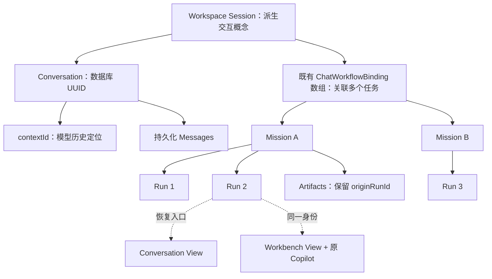
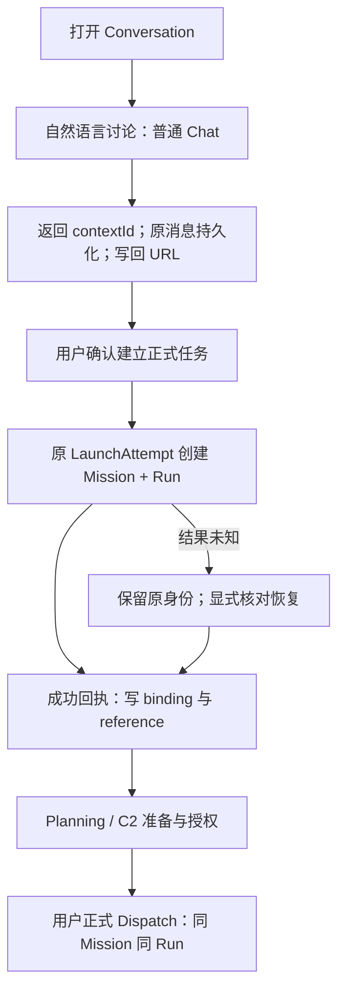
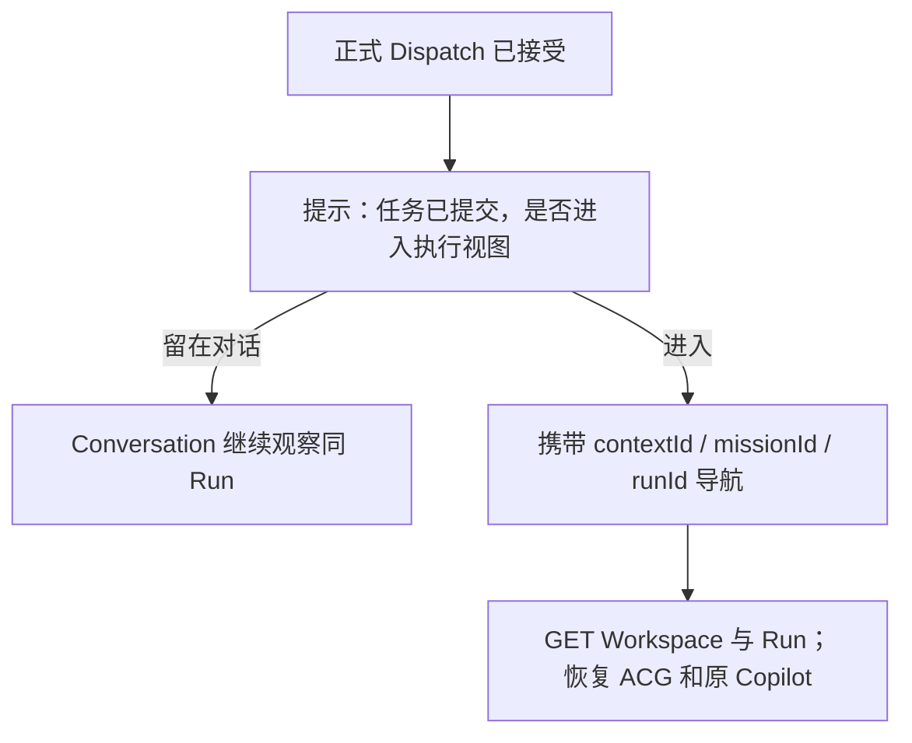
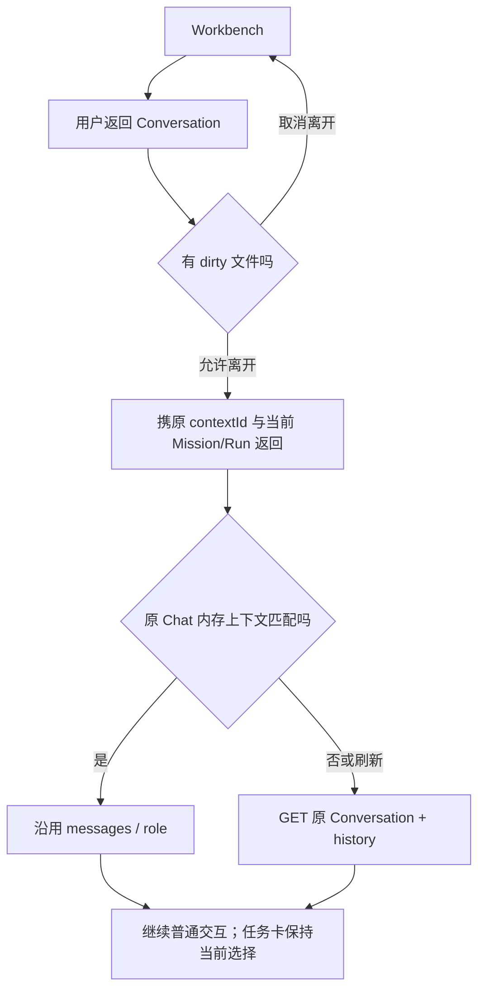
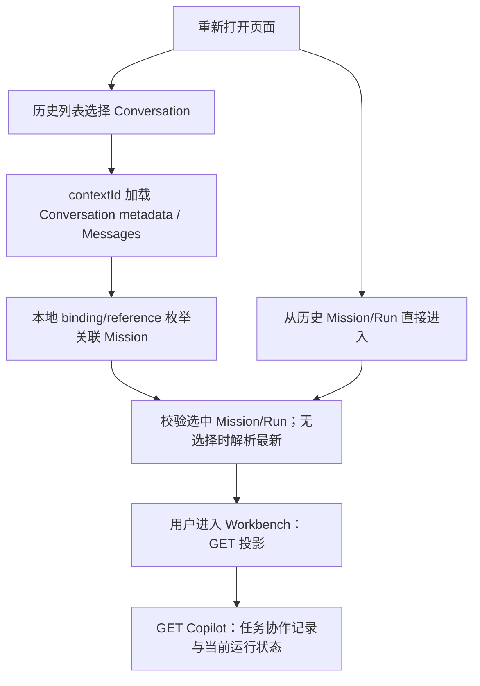
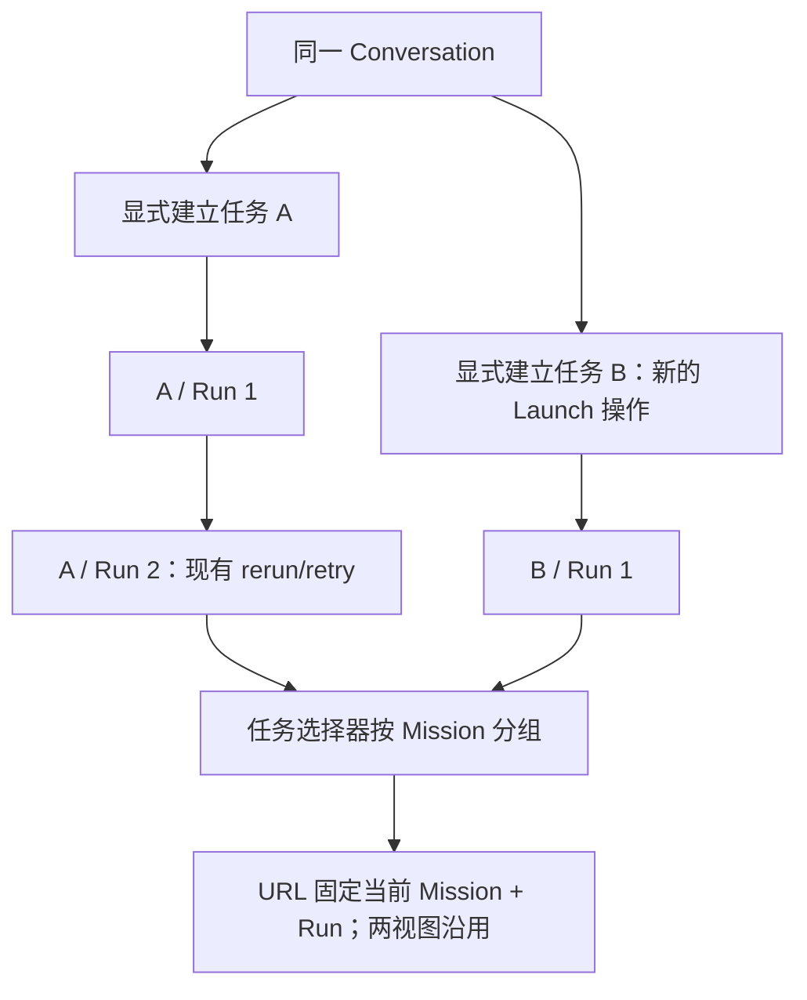

# PR-UI-02-Audit｜Unified Workspace Session 交互架构审计

审计日期：2026-10-31（Asia/Shanghai）。对象：当前本地工作区，包括尚未提交的 PR-UI-01-R1；不是仅审计 HEAD。

## 1. 结论与现场

**设计建议：Workspace Session 作为用户交互概念和现有数据的派生关系即可，不新增数据库实体、接口或第二套 Store。** 保留 ChatView 与 MissionWorkspaceView 两个页面，统一恢复入口和当前任务选择；不合并消息协议，不重写 Workbench/Copilot。

**已实现：** ChatWorkflowBinding 是按会话键组织的数组，可关联多个 Mission/Run；Mission 本来拥有多个 Run。**部分实现：** Conversation→Mission 的关联存在本地绑定及创建 input 中，但没有稳定、统一的恢复入口。**尚未实现：** 两视图无损往返、Dispatch 后用户自主选择进入 Workbench的完整闭环。

两个关键限制：

1. `ChatWorkflowBinding.conversationId` 实际常为 chatContextId 或 `draft:*`，不是数据库 Conversation UUID。不能直接把字段重命名后的值当数据库 ID。
2. 创建 Mission/Run 和正式 C2 Dispatch 是不同命令。用户场景中的“正式提交→创建 Mission/Run”可作为产品叙述，但不能把 POST missions 移到 C2 Dispatch 之后，或把创建成功视为已经执行。

现场首先执行了要求的四条命令：`git status --short`、`git branch --show-current`、`git rev-parse HEAD`、`git diff --stat`。

- 分支：`master`。
- HEAD：`58fb2c7f451c98b4c9a99f355bbd17e2d239aa29`。
- 起始：29 个 tracked 文件修改；diff stat 为 1208 insertions / 467 deletions；另有 11 个 untracked 文件（含两份既有记录）。
- 没有 Reset、Checkout、Stash、Commit、Push；未修改业务源码、测试、配置、API、Schema 或已有报告。
- ModelRuntimeControls.vue 原修改、R1 全部修改、PR-UI-00/R1 记录均保留。工作区内检索未发现 AGENTS.md。
- 本轮是静态审计；不把 R1 文档记载的 SELF-TESTED 当成本轮实际测试结果。未运行应用、浏览器或测试，也未连接数据库。

以下证据均为本地文件行号；“已实现”只表示代码有实现，不等于本轮运行验证通过。

## 2. 当前真实路由架构

| 路由/入口 | 实际页面与上下文 | 状态 |
|---|---|---|
| `/chat` | ChatView；`workspace=chat/agent` 控制历史模式，`contextId` 加载聊天历史，`runId` 选择运行 | 已实现 |
| `/federated-agent-workbench`、`/agentos/legal/contract-review`、`/contract-clause-planner` | 重定向 `/chat?workspace=agent`；不是独立 Agent 页面，固定 query 不保留全部旧 query | 已实现兼容入口 |
| `/agentos/acg` | AcgEntryView；无 runId 展示 ProjectListView；有 runId 先 GET Run，解析 missionId 后 replace 到 MissionWorkspace | 已实现 |
| `/agentos/missions/:missionId/workspace?runId=…` | MissionWorkspaceView；missionId 为路径参数，runId 为选中执行实例 | 已实现专业工作视图 |
| `/agentos/missions/new` | CreateMissionView 独立创建表单 | 已实现，不能当视图切换 |
| `/history` | HistoryView：聊天历史及 ACG 历史；`tab=acg`、`source`、`runId` 等由页面消费 | 已实现 |
| `/agentos-console` | 重定向 history，保留 query 并置 tab=acg | 已实现兼容入口 |

证据：`apps/frontend/src/router/index.ts:93`（Chat）、`:156`（旧入口）、`:171`（ACG）、`:211`（新建）、`:221`（Workspace）；`views/AcgEntryView.vue:38`、`:48`、`:62`；`views/HistoryView.vue:114`；`views/ProjectListView.vue:285`。本文后续简写 `views/…` 等均相对 `apps/frontend/src/`。

### 2.1 守卫、挂载与刷新

- **已实现：** router 使用 Web history / desktop hash history；全局守卫检查登录和恢复 redirect，临时网络失败不清身份；lazy chunk 失败一次刷新。守卫不恢复 Conversation/Mission，也不校验 query 的关联一致性。证据 `router/index.ts:252`、`:268`、`:313`。
- **已实现：** 单一 Pinia 实例在 `main.ts:21` 创建，Chat 是 `defineStore('chat')`（`stores/chat.ts:126`）；未发现每次导航重复创建 Pinia 的业务实现。
- **已实现：** Shell 渲染组件以 `route.path` 为 key，无 KeepAlive（`components/app/AuthenticatedAppShell.vue:342`）。不同 Mission 路径会重挂载；同一路径只改 query 不会重挂载。
- **部分实现：** Chat 的 contextId watcher 可恢复历史（`views/ChatView.vue:2068`）；run watcher可恢复任务（`:2081`、`:2118`）。无 contextId 的 `/chat` 刷新后不能凭空找回上次消息，Pinia messages/contextId 不是持久化字段。
- **风险：** MissionWorkspace 只在 setup 调用 loadWorkspace，selectedRunId 初始读取 query，未见 runId query watcher；同 Mission 的浏览器前进/后退或外部 replace query 可能只改 URL，不改投影。内部 selectRun 会主动加载，所以按钮路径可工作。证据 `views/MissionWorkspaceView.vue:246`、`:729`、`:1031`；route update guard `:944` 仅检查未保存文件。
- **已实现：** Workbench 离开有 dirty file 确认；卸载停止 Observation/SSE、请求和投影刷新（同文件 `:941`、`:1040`）。Chat 卸载重置进度与结果请求，没有 clearMessages（`views/ChatView.vue:2241`）。但 Shell 的模式/项目入口另外会清消息，见第 5 节。

### 2.2 能否表达同 Mission 两视图

**部分实现：** 两条现有 URL 可以承载同一 runId；Workbench 明确包含 missionId，Chat 依赖 Run/binding 知道 Mission。但没有共同会话定位字段、反向返回合同和一致性校验。不要新增 `/agent` 页面或把 `workspace=agent` 直接解释为 Workbench。

**设计建议：** 保留两条主路由，规范为：

```text
Conversation: /chat?workspace=chat&contextId=<模型历史定位键>&missionId=<选中任务>&runId=<选中运行>
Workbench:   /agentos/missions/<missionId>/workspace?runId=<选中运行>&contextId=<来源模型历史定位键>
```

其中 Chat 的 missionId 语义、Workbench 的 contextId 往返语义是新增前端约定，当前尚未完整消费；不改变后端合同。Conversation UUID 可由现有 conversationApi.getConversation(contextId) 解析，不必先增加 URL 参数。无 Mission 时省略 missionId/runId；无可验证 Conversation 来源的历史 Mission 保持“未关联”，不伪造 Conversation、不静默创建任务。草稿恢复使用第 7 节的本地键，不能把 draft 传给历史 API。

## 3. Store 与 Context 真实结构

| 层 | 真正保存什么 | 生命周期/重复情况 |
|---|---|---|
| Chat Store | 当前 messages、contextId、currentRoleId、模型用量；workflowBindings 数组 | messages 等为内存；binding 本地持久化；不拥有 Runtime 事实 |
| workflowRuns Store | 按 runId 的轻量 reference：missionId/conversationId/status/phase 等 | `workflow.run.references.v1`；导入旧 binding、同步运行索引；与 binding 有重复字段 |
| ChatView | activeWorkflowRunId/binding/run/acgView、结果缓存、面板与输入状态 | 页面局部；重复查询 Run/ACG，不是第二个任务系统 |
| MissionWorkspaceView | MissionWorkspaceProjection、selectedRunId/currentRunId、打开文档、选择、Observation | 路由级；重新进入 GET 恢复，卸载清观察；不读取 Chat Store 来创建 Mission |
| WorkbenchContext | missionId/runId/selectedSemanticTaskKey/node/artifact/editor/historical/Observation | computed 派生上下文，非 Store、非数据库实体 |
| Copilot | 服务端任务协作记录；前端每 Run 的展示缓存 | 与普通 Chat 消息系统分离，不能合并数组 |
| 布局 composable | 栏宽、底部高度/折叠等偏好 | localStorage；不属于任务身份 |

证据：`stores/chat.ts:127`、`:151`、`:218`；`stores/workflowRuns.ts:11`、`:46`、`:98`、`:131`、`:258`；`views/ChatView.vue:823`、`:1261`；`views/MissionWorkspaceView.vue:236`、`:381`、`:647`；`workbench/context.ts:6`、`:23`；`workbench/types.ts:16`；`composables/useWorkbenchLayout.ts:19`、`:35`。

**设计建议：** 不新增 Workspace Store。现有 WorkbenchContext 原样保留其专业选择职责；仅用纯函数/composable 在两个页面和 Shell 之间解析“会话键、Mission、Run、视图”，读取现有 Store 和 URL，返回派生结果，不再次保存 Run/消息副本。binding 是关联索引，workflowRuns 是运行发现索引；都不能授权执行，status 以新鲜 Run 为准。

### 3.1 ID 必须分清

| 名称 | 当前真实语义与证据 | 统一时约束 |
|---|---|---|
| Conversation.id | 后端 UUID，`apps/backend/src/main/java/com/kinlin/ai/entity/Conversation.java:22` | 用于 detail/rename/delete；不等同 contextId |
| Conversation.contextId / Chat contextId | 模型上下文和历史定位字符串；Conversation 另存此值（同文件 `:32`） | 历史通过 `/chat/history/{contextId}`，保留原值 |
| chatContextId | 启动 request.input 中快照化的 Chat Store contextId | 不是 Mission ID、不是新实体；不能替换已冻结启动快照 |
| chatRoleId | request.input 的 currentRoleId | 模型角色引用，不是会话身份；刷新恢复需从 Conversation.roleId 读取 |
| binding.conversationId | ChatView 取 query.contextId → store.contextId → draft ID | 实际是“前端会话关联键”；保留旧键兼容 |
| Mission ID | 正式任务实体标识 | 一任务多 Run；不能为切视图重建 |
| Run ID | 某次执行实例；binding.acgTaskId 当前也是 runId | acgTaskId 为兼容别名，不是另一个 Mission/Task |
| clientRequestId/operationId | 一次提交的幂等身份 | 不是任何会话 ID；恢复必须用原快照/原身份 |

证据：`services/api/conversation.ts:3`、`:36`、`:42`；`services/api/chat.ts:100`；`views/ChatView.vue:742`、`:834`；`stores/chat.ts:106`、`:713`、`:726`；`features/mission/request.ts:25`、`:60`。

### 3.2 普通聊天、历史、Mission 关联

**已实现：** 普通 sendMessage / SSE 使用现有 contextId 和 roleId；首次返回新 contextId 后更新 Store。后端 stream prepare 根据 contextId、属主和 workspaceMode 找 Conversation，找不到则创建；消息的 conversationId 使用数据库 UUID。证据 `stores/chat.ts:276`、`:564`、`:586`、`:615`；`apps/backend/src/main/java/com/kinlin/ai/service/ChatStreamPersistenceService.java:31`、`:40`、`:47`、`:91`。

**已实现：** Mission 创建 adapter 送入 conversationId、chatContextId、chatRoleId 和最近八条非空 role/content；这是一份启动输入快照，不是持续同步的模型上下文。`features/mission/request.ts:60`；Python 创建把 mission_input 交给 create_mission/prepare_run（`apps/agent/app/api/agentos_v2.py:2508`、`:2531`）；RuntimeMissionRecord/WorkflowRun 均有 input（`services/api/agentos/types/workflow.ts:96`；`apps/agentOS/src/contracts/workflow.py:376`）。**部分实现：** 可从已有 Run input 辅助恢复关系，但当前页面没有系统使用它重建绑定，不存在独立强约束 Conversation 外键。

**已实现：** startConversationWorkflow 创建成功后 addWorkflowBinding，插入前端“已创建 ACG 运行任务”消息，注册 workflowRuns reference；并非调用普通 Chat 消息持久化 API（`stores/chat.ts:700`、`:722`、`:731`）。

**缺口：** 这些启动消息只在内存，loadHistory 仅映射后端聊天消息，不恢复 workflow 字段（`stores/chat.ts:779`）。因此刷新可能失去启动消息气泡，但本地 binding 仍在。不能宣称绑定中的 messageId 一定是后端 Message ID：其来源为 Date.now 的本地消息（`:204`、`:727`）。

**缺口：** 首次直接启动 Agent/Mission 可以只有 draft 键且 chatContextId=null；该路径不创建普通 Conversation。之后普通聊天拿到 contextId 时，只有 workspace 索引更新，没看到 draft bindings 向真实 contextId 的迁移（`views/ChatView.vue:2124`）。历史会话恢复也未恢复 currentRoleId；loadHistory 只恢复 contextId（`stores/chat.ts:775`、`:814`）。

**风险：** loadHistory 没有请求取消/代次校验；快速切 A/B 可能晚回的 A 覆盖 B。setContextId 先设 ID 再异步 loadHistory 且不 await（`stores/chat.ts:840`），与 watcher 组合可能跳过加载判定。后续只做局部修复，不重写 Store。

## 4. Mission / Run / Artifact 与 Workbench

**已实现：** 领域 WorkflowRun 明确持有 missionId；Artifact 有 missionId 和 originRunId。目标图必须保留 Artifact 的运行来源，不能只有 Mission→Artifacts 的扁平关系。证据 `apps/agentOS/src/domain/models.py:124`、`:139`、`:185`。同 Mission 新 Run API 是 `/missions/{missionId}/runs`，校验返回仍属同 Mission（`services/api/agentos/api/workflow.ts:104`）。失败节点重试可能使用 current_run 或 successor_run，不能统一解释为“所有恢复都新建 Run”（`views/MissionWorkspaceView.vue:814`、`:827`）。

**已实现：** Workbench 按 URL missionId 和初始 query.runId GET `/missions/{missionId}/workspace?runId=…`，得到 activeGraph、graphNodes、entries、runs、diagnostics。ACG 是已有 blueprint/plan/semantic task 的投影，不由 Chat Store重新生成（`services/api/agentos/api/workspace.ts:5`；`apps/agentOS/src/runtime/v2/workspace.py:240`、`:266`、`:280`、`:322`）。

**已实现：** 指定 Run 必须属于 Mission；否则投影查询失败。未指定时服务端按 created_at/run_id 排序，优先最后一个 pending/running，然后最后一个 succeeded，最后兜底最后 Run（同文件 `:240`、`:338`）。**这不等于最新 Run**。ProjectList 用 latestRunId；Copilot 也有 latestRunId；Chat 用“最后有效非终态 binding，否则最后有效 binding”，三者语义不同。

**风险：** Workspace 的 currentRunId 仅首次 `||=` 设置为 defaultRunId，切换/刷新后未必跟随新 successor；历史判定是 activeRun != currentRunId（`views/MissionWorkspaceView.vue:357`、`:483`、`:675`）。不能把投影 activeRun（选中）当最新 Run。后续应统一历史判断，但仍尊重用户主动选择旧 Run。

**已实现：** 进入/刷新 Workbench 走只读加载，不自动创建 Mission/Run；只有显式 rerun/retry/创建表单才写执行 API。工作台页面的 404 暂缓投影和周期刷新已有降级，须保留（同文件 `:579`、`:594`、`:647`）。

## 5. Chat / Agent / Workbench 差异与复用

| 范围 | 当前差异/重复 | 最小处理（设计建议） |
|---|---|---|
| Chat 模式 | sendMessageStream 普通聊天；可显式 upgradeToWorkflow | 保留讨论/消息/工具权限；新默认统一 Conversation |
| Agent 模式 | 同 ChatView；sendMessage 分支直接走 sendAgentWorkspaceMessage→upgrade；source='agent' | 不再作为新任务启动模式；旧 query/source/history 继续可读，不改既有请求冻结身份 |
| 新建 Mission | CreateMissionView 提供材料/插件/参数，创建后进入专业任务 | 保留高级入口；不得当“切视图”调用 |
| Workbench | 完整投影、文件/图/任务/Run/Trace/Artifact、任务 Copilot | 整体保留，不迁入 ChatView |
| 旧 AcgVisualizationView | 有独立 draft、创建、Run/ACG 查询、进度/资源等逻辑 | 当前 router 没挂载它，保留历史兼容与测试；不以它为新统一入口，不贸然删除 |
| 重复实现 | Chat/旧 ACG 都加载 Run/ACG、缓存、轮询；Shell/Chat 都读 workspaceMode | 只抽取恢复/跳转/选择策略；不要因此合并专业渲染组件 |

证据：`views/ChatView.vue:1645`、`:1659`、`:1732`；`stores/chat.ts:748`；`views/CreateMissionView.vue:222`；`views/AcgVisualizationView.vue:1214`、`:1520`、`:1600`；`features/mission/launch.ts:17`；`workbench/composition.ts:7`。

**高优先级阻碍：** Shell selectWorkspaceMode 调用 chatStore.clearMessages 并丢弃 contextId/runId query；openAgentProject 也清消息。这是今天的“模式”行为，不能复用为两视图切换。clearMessages 同时将 contextId 置 null，下一次发送会创建新模型历史（`components/app/AuthenticatedAppShell.vue:666`、`:909`；`stores/chat.ts:870`）。lastChatRoute/lastMissionWorkspacePath 只是 Shell 内存提示（同 Shell `:459`），不是持久会话映射。

共享：Conversation 身份/原消息、关联任务列表、选中 Mission/Run、待确认 Launch 身份、服务端任务状态的读取入口。独立：Conversation 输入/滚动/信息栏；Workbench 编辑器/dirty 文件/Node/Artifact 选择；Copilot 输入、模型、权限及协作消息；各视图布局。可复用现有 geometry，但不把所有面板折叠状态强行同步。

## 6. ACG Copilot 上下文传递

**已实现链路：** WorkspaceProjection→workbenchContext→registry auxiliary view→AcgCopilotPanel props。

- `views/MissionWorkspaceView.vue:381` 形成 WorkbenchContext；`:402` 给 props：missionId、runId、graphNode、graphNodes、graph、entry、runtimeObservation、historical 等。
- `workbench/contributions/copilot/index.ts:4` 注册原面板；`components/workbench/AcgCopilotPanel.vue:128` 接 props；`:308` 把当前 node/entry 的 acgNodeId 设为 operationStep。
- 普通 Copilot 对话按 runId 调用 API；stream body 是 content/operationId/model/permission/effort，并没有自动发送整个选中 node 或 Chat contextId。节点重跑预览才显式传 stepId（同面板 `:233`、`:258`；`services/api/agentos/api/copilot.ts:36`、`:48`）。不要宣称“点击节点后所有对话自动携带该节点”。
- 服务端按 Run 查 Mission，组织状态/步骤/规划问题/任务语义与任务级近期协作记录。`apps/agent/app/api/agentos_v2.py:3304`；`apps/agentOS/src/runtime/planning_interaction.py:55`、`:87`、`:93`、`:168`。exchanges 是 **Mission 范围跨 Run** 记录，保留 sourceRunId；权限也是任务级，Run 只是 API 入口。
- SQLite 任务级 exchanges 通过 run_copilot_exchanges JOIN runs 恢复（`apps/agentOS/src/support/stores/sqlite_workflow_store.py:1275`）；不是 Chat 的 Conversation Messages。
- 离开面板会 saveSession、abort、停止轮询；内存 Map 以 Run 为键、最多 8 项、按 token 隔离（`components/workbench/AcgCopilotPanel.vue:311`、`:329`；`copilotSessionCache.ts:5`、`:16`）。同一应用寿命返回可恢复草稿，整页刷新 Map 丢失；已持久协作记录仍可从 GET Copilot 恢复。未发送草稿不保证跨刷新保留。

**结论：** 离开 Workbench 不会让服务端 Mission/Run/Copilot 记录失效；前端选择和草稿并非全量持久化。任务对话和普通聊天应保持不同记录体系；共享身份/选择，不复制全部消息。保留 revision、permission、historical、方案预览确认和原 operationId，不能把普通聊天文本当执行命令。

## 7. 目标 Workspace Session 模型（设计建议）



| 问题 | 决策 |
|---|---|
| 要新 Workspace Session 实体吗 | 不要。现有 Conversation、binding、Mission/Run 已足够支撑本机交互；无新表/后端接口 |
| 能复用 Conversation ID + Mission ID 吗 | 能，但必须同时区分 UUID 与 contextId；当前 binding 是前端会话键，兼容读取，不全量重编号 |
| 一个 Conversation 多 Mission | 数据结构已支持；UI 目前只显示一个 activeWorkflowRunId，且非终态阻止新启动；多任务选择/显式新任务入口需补 |
| 一个 Mission 多 Run | 已支持；按 Mission 分组显示 Run 历史，不因 rerun 生成新 Mission |
| 恢复入口用哪个 ID | 消息用 contextId，专业任务用 missionId+runId；组合是身份，不选一个 ID 代替全部 |
| 需要独立 WorkspaceContext 吗 | 不需要新状态容器；轻量派生 resolver 即可，现有 WorkbenchContext 继续负责专业视图选择 |
| 能复用 ChatWorkflowBinding 吗 | 能，数组保持一条 Run 关联；可在现有结构增量增加可选 Conversation UUID/明确会话键兼容信息，禁止另建平行 binding Store |

### 7.1 最小恢复与选择合同

1. 优先解析显式 URL；读取现有 binding，查询新鲜 Run 并验证其 missionId。Run 与 URL Mission 不符时提示错误，不猜测、不创建、不静默写错绑定。contextId 是消息入口，不是执行授权。
2. 有显式 Run：尊重用户选定，即使是历史 Run；无 Run 有 Mission：用已有 listMissions.latestRunId / 运行列表明确解析最新，而不是把 Workspace 默认 activeRun 称作最新。只有 Mission 没有 Run 时展示任务概览。
3. 无显式任务：沿用“当前会话最近有效非终态，否则最近有效”兼容策略；一旦用户选定，把 missionId/runId 写回 URL，之后不因轮询/新 Run 自动跳走。按 Mission 分组任务选择器提供全部 bindings。
4. Run successor 出现时，在同 Mission 分组补 reference/binding（不复制新启动 user message），显示“有新运行”供切换；恢复 current_run 时保持原 Run。不要仅按绑定 createdAt 推断 Mission 最新执行。
5. 返回 Conversation 必须携带原 contextId；有内存原消息时不重载覆盖；刷新后 loadHistory 同一 contextId，再恢复 roleId 和 bindings。首次普通聊天拿到 contextId 后同步写 URL，这是当前缺口的局部修复。
6. draft 没有真实 Conversation：仍用现有 draft 身份恢复本地任务关联；不得直接 loadHistory(draft)。新默认流程先普通聊天再正式创建通常已有 contextId；支持直接正式创建时必须展示“本地任务会话”，不能承诺已有持久普通聊天。取得真实 contextId 后将旧 draft 绑定合并/去重到新会话键，保留兼容别名；**已冻结 LaunchAttempt 的 slot/command/input 不重写**，待原操作结束后再迁移关系。
7. 关联丢失时：先现有 binding/reference 反查，再经受权限保护的 GET Run.input 中 chatContextId/conversationId 辅助核验；仅当确实是同一历史来源时补本地关联。服务器没有承诺任意 Mission 都有 Conversation，查不到时保留“未关联”。不为了补关联执行普通 send/create 或 C2。
8. 本地选择/绑定如需扩展持久化，仍扩展现有索引并按当前用户隔离；不要存另一份消息/Run。当前 binding/reference 全局 localStorage key 缺少 owner 隔离，跨账户误关联需验证，不能复用 Copilot 已有隔离结论。

## 8. 六个场景完整生命周期

以下图中产品交互为**设计建议**；真实服务状态见场景 D。DispatchAccepted、视图名等是 UI 事件/阶段，不是新增 Runtime status。

### A. 新任务



| 步骤 | 当前实现 | 最小补齐 |
|---|---|---|
| 默认讨论 | Chat 模式已实现；Agent 模式直接启动 | 统一默认讨论，不依 workspaceMode 分派新任务 |
| 建立关联 | 创建成功后 binding，input 有启动上下文快照 | 保持既有成功提交点；失败/未知不写伪成功绑定 |
| Planning/C2 | 已有正式控制流程 | Conversation 也需可访问同一现有正式控制组件/流程，否则用户只能提前进 Workbench 才能 Dispatch |
| 提示时机 | 创建后只成功 toast/激活 Run | 不能在 creation toast 时称已 Dispatch；按正式 Dispatch 回执及后续查询证据提示 |

正式控制组件目前只发 refresh 事件，ChatView 未挂 FormalExecutionControls；不能只设计一个 Dispatch 按钮而没有既有授权步骤。证据 `components/workspace/FormalExecutionControls.vue:98`、`features/acg/formalControl.ts:13`。设计建议后续复用该组件，在 Conversation 当前任务卡中提供必要流程，具体控制语义不变。

### B. 进入 Workbench



**当前：** Chat 手动按钮经 `/agentos/acg?runId=…` 桥接；只带 Run，丢失来源 contextId（`views/ChatView.vue:1376`；`views/AcgEntryView.vue:62`）。**建议：** 新入口直接用已验证 Mission 路由，旧桥继续可用并只透传白名单上下文参数；切换零 POST missions/runs/dispatch。用户也可在 Dispatch 前主动进入已创建任务的 Workbench 查看规划，不自动执行。

提示按已确认的 dispatchId/operationId 做本机已展示标记，避免刷新/轮询重复弹出；202 仅代表接受，不代表 Running/Completed。网络未知不弹“已执行”。无需新增服务协调系统。

### C. 返回 Conversation



**当前部分实现：** Chat Store 可在页面切换后保留，但 Shell 某些入口主动清空；Workbench 返回按钮只去项目列表（`views/MissionWorkspaceView.vue:1006`）。**建议：** 独立两视图切换动作不调用 clearMessages/setContextId(null)/startNewChat；无原 Conversation 的任务返回本地任务会话或显示未关联，不创建假聊天历史。Copilot 不迁为普通 Chat Messages。

### D. Run 生命周期与视图行为

真实 Execution WorkflowStatus：pending/planning/running/waiting_review/retrying/failed/completed/cancelled/superseded；Identity RunStatus：pending/running/succeeded/failed/cancelled/superseded；phase 另有 understanding/planning/graph_building/executing/recovery/review 等。证据 `apps/agentOS/src/contracts/workflow.py:75`；`apps/agentOS/src/domain/models.py:61`；`apps/agentOS/src/contracts/execution.py:10`；`services/api/agentos/types/workflow.ts:3`；转换 `apps/agent/app/api/agentos_v2.py:1671`。不可混用 status/phase/formalControl.status。

| 用户阶段 | 实际证据 | Conversation 应展示/可做（建议） | Workbench 应展示/可做（保留并对齐） |
|---|---|---|---|
| Planning | pending/planning；phase planning/graph_building；可能已有 PLANNING_ACCEPTED | 讨论、当前任务摘要、规划进度；按现有正式控制提供后续动作 | 规划/mission 文档、可用图、Trace；未有图不造图；只有授权动作可点 |
| Dispatch | C2 materialize→activate→handoff→permit→dispatch；不是 Run status | 已接受执行命令提示；可留在对话或进入 Workbench | 保留同 Run、版本与 Permit 检查；不可连点自动串发下一命令 |
| Running | running；phase executing；投影可为 running | 任务进度、必要确认入口、继续讨论；取消按实时能力 | ACG/节点/Trace/Artifact；取消仅当前可取消 Run |
| Review | waiting_review；phase review；question/review payload | 显示待回答/待审阅，链接或复用既有审核流程，不用聊天文本直接批准 | Copilot Planner 问答与 WorkflowReviewPanel；revision/权限/历史检查 |
| Failed | failed + failureCode/error/steps | 错误摘要、看证据、显式恢复/新任务入口；普通讨论可继续 | 失败节点与 Trace；沿用现有 retry mode / Copilot preview+confirm，不猜运行模式 |
| Paused | formalControl.status=ACTIVATED_PAUSED 等；Run 仍可 pending/planning | “已准备，等待授权/执行”；普通对话可用 | handoff/permit 等实际可用动作；**没有通用 paused Run 状态或通用暂停 API** |
| Recovering | retrying / phase recovery 或恢复命令返回；不是 recovering status | 显示恢复中；有 successor 时供切换，保留旧消息 | 查询实际返回 Run；current_run 不换身份，successor_run 显式新 Run |
| Completed | Execution completed / Identity succeeded | 交付物入口与任务完成摘要、继续讨论/显式新任务 | canonical Artifact/来源与运行证据；原样 rerun 是同 Mission 新 Run |
| Cancelled / Superseded | cancelled / superseded 终态 | 明确已停止/被替代，仍可查看历史 | 历史只读控制；若有新 Run 提供导航，不将终态当活跃 |

已实现控制事实：`features/acg/formalControl.ts:13`；`components/workspace/FormalExecutionControls.vue:56`、`:66`、`:98`；`views/MissionWorkspaceView.vue:360`；Copilot权限/历史控制 `components/workbench/AcgCopilotPanel.vue:46`、`:76`、`:282`。不是所有建议已呈现在当前 Chat。

注意终态集合不一致：chat/workflowRuns 只有 completed/failed/cancelled，Workbench 还识别 succeeded/superseded；可能把已被替代的 Run 当活跃。应在现有 presentation/helper 中统一映射，不新增后端状态。

### E. 历史恢复



| 恢复项 | 当前事实 | 建议与降级 |
|---|---|---|
| 找 Conversation | conversationApi 列表；History 点击用 contextId | 合并可发现历史，保留旧 workspaceMode=agent 记录入口，不把 agent 历史删除 |
| 定位 Mission | 本地 binding；Run.input 中有启动快照 | 校验后补关系；本地数据被清除不保证所有历史可回溯，不承诺多设备同步 |
| 最新 Run | ProjectList latestRunId；Workspace 默认偏好活跃/成功 | 明确最新与选中，显式历史 URL 优先；避免 defaultRunId 冒充 latest |
| 重进 Workbench | GET 投影，Run→Mission 旧桥已实现 | 不走 LaunchAttempt，不创建新 Mission/Run |
| Copilot | 服务端任务级记录；Map 恢复仅限应用寿命 | GET 新鲜 state；草稿跨刷新不在当前保证范围 |
| 角色 | Conversation.roleId 有字段，loadHistory 未恢复 | 元数据恢复 setRole；必须先验 contextId 匹配，防竞态 |

证据 `services/api/conversation.ts:24`；`views/HistoryView.vue:114`；`views/ProjectListView.vue:285`；`views/ChatView.vue:1457` 仍固定查 chat 分类，旧 agent 元数据不可假定能取到。新默认请求 workspace_mode=chat 不得直接用于旧 agent Conversation：后端按 mode 不匹配会创建新 Conversation（ChatStreamPersistenceService.java:44）。设计建议保留旧记录的传输 workspaceMode，仅新会话默认 chat；产品上不再显示独立 Agent 启动模式。

### F. 同一 Conversation 多任务



**数据已支持、UI 部分实现：** binding 每次成功按 runId 去重追加，不按 Mission 覆盖；同一 Conversation 能顺序创建多个 Mission。当前 upgrade 在选中非终态 Run 时直接 return（`views/ChatView.vue:1720`），不是后端一会话一任务约束。

**设计建议：** 保持现有普通输入用于讨论；独立“建立新任务”动作产生新 operationId，沿用同会话绑定数组，不能先清消息，也不能重用 A 的未确认 Launch 身份启动 B。若已有未确认创建，先核对原操作；允许另一任务前必须明确退出/完成当前提交流程，不绕过 BUSY。任务运行中是否新建另一 Mission由显式入口决定，不把旧 activeWorkflowRunId 当会话永久锁；本轮不新增任务队列。

任务切换只改变选择、URL和读取请求；保留整个 Conversation 的消息，不把 A/B 各自生成不同聊天 context。显式选 B 后 A 的轮询/终态不改选中对象。历史 Run 不自动跟随 successor，提供“前往当前运行”。任务被删除/归档时不级联删除 Conversation；失效 binding 保留可诊断标记，不凭空创建替代任务。

## 9. 最小改造文件与约束

以下全部是下一轮建议，本轮未实施。

| 文件 | 最小职责 | 不应做的事 |
|---|---|---|
| `components/app/AuthenticatedAppShell.vue` | 默认 Conversation；替换新用户模式入口为视图切换；保留旧入口/历史；切视图不清消息 | 不重写 Shell、不重做视觉 |
| `views/ChatView.vue` | contextId 写回 URL；统一派生选择；任务选择器；复用现有正式控制；Dispatch 后提示 | 不把 source=agent 当新默认启动；不承载全部专业图组件 |
| `stores/chat.ts` | 现有 binding 兼容归并/查询；局部 loadHistory 竞态保护；必要的 role 恢复协作 | 不重写 Store、不持久化第二套 Messages、不修改冻结 Launch |
| `stores/workflowRuns.ts` | 统一终态/选中关联更新、successor reference、账户隔离检查 | 不成为第二个会话真相源；不以缓存授权执行 |
| `views/MissionWorkspaceView.vue` | 原会话返回；监听同路径 Run query；区分选中/最新；桥接 successor 关联 | 不重写 Workspace、不新建任务以进入页面 |
| `views/AcgEntryView.vue` | 保留 Run 桥，只透传白名单会话来源 | 不替换全部旧 URL，不盲传 redirect |
| `router/index.ts` | 必要时规范旧 query 重定向；保留既有 route/name/auth/history | 两主路由可直接复用，不强制新增 route |
| `features/workspace/session.ts`（建议新增纯函数文件） | URL解析、选择优先级、binding兼容查找、往返URL构建；单测 | 不 defineStore，不保存实体，不调用创建 API |
| `components/workspace/FormalExecutionControls.vue` | 若父级无法识别 Dispatch 接受，增量发 typed accepted 事件供上层提示 | 保留原操作身份、版本、权限和202语义；不改 C2 API |
| `utils/conversationWorkspace.ts`、`views/HistoryView.vue` | 旧模式历史发现与显示兼容，避免新默认隐藏旧 Conversation | 不全量改写历史 mode，不删除索引 |
| 相邻 `*.spec.ts` | 身份/恢复/路由副作用回归 | 不用只比较实现文本的测试冒充生命周期验证 |

保留且原则上无需修改：`AcgCopilotPanel.vue`、`copilotSessionCache.ts`、`workbench/context.ts`、registry/contributions、Runtime Observation/Events、Graph/Trace/Artifact投影、`features/mission/{command,admission,launch,launchAttempt,policy,conflict,request}.ts`、ModelRuntimeControls.vue。仅在明确证据需要时单独评审适配；本方案不要求改后端或 API。

R1 的身份/原快照/冲突分型/只读对账/策略准入必须保持；工作视图切换不 begin/resume/complete 任意 LaunchAttempt。已有未确认提交跨视图恢复必须仍指向原 slot/operationId（`features/mission/launchAttempt.ts:12`；`stores/chat.ts:699`、`:758`）。

## 10. 风险与验证方法

本节为后续验证计划，**尚未执行**。

| 优先级 | 风险与代码证据 | 必须验证的结果 |
|---|---|---|
| P1 | 模式/项目入口 clearMessages，Shell:666/:914 | A→Workbench→A 消息/contextId/role 不变；切视图无创建/聊天 POST |
| P1 | binding.conversationId 混合键、draft 未迁移，ChatView:834/2124 | 首次讨论、直接创建、draft→真实 context、未知提交恢复四条路径不丢任务/不重放创建 |
| P1 | legacy workspaceMode 与后端匹配，ChatStreamPersistenceService.java:44 | 旧 agent 历史继续发送仍使用原 contextId，不新增 Conversation；新会话默认 chat |
| P1 | MissionWorkspace 没有 query watcher，:246/:1031 | 同 Mission Run A→B→浏览器后退/前进；URL、图、Trace、Copilot、historical 全部一致 |
| P1 | latest/current/selected 混用，Workspace:357/675；workspace.py:338 | 最新失败但旧 Run 成功、多个活跃、旧 Run 深链、successor 到达，均不误判/自动跳选 |
| P1 | loadHistory 无代次，chat.ts:779 | A 慢响应、B 快响应，不得 A 覆盖 B；任务恢复响应也不得串会话 |
| P1 | 普通聊天不含正式任务持续上下文，request.ts:60 只是启动快照 | 不能声称 Chat 已可理解最新 Runtime；初版提供真实任务卡和原 Copilot 入口，未来若做任务对话须复用既有任务能力，不暗改普通 Chat API |
| P1 | Completed/succeeded/superseded 判定不齐 | 三层状态对照，终态不得默认成活动任务；Review/Paused/恢复不增加伪状态 |
| P1 | URL Run 与 Mission/Conversation 不匹配 | 只读查询校验后报错；零创建；不写入错误 binding；404 与网络错误区别对待 |
| P1 | C2 Dispatch提示提前/重复；FormalExecutionControls:98 | 只有接受证据后提示；选择留在对话不跳转；轮询/刷新不重复弹窗；202不宣称运行完成 |
| P1 | 历史失败恢复支持 current_run，Workspace:827 | 保留明确模式选择与后端校验；不因统一历史 UI 默认修改历史事实；不扩展自动恢复 |
| P2 | binding/reference 无 owner key、Copilot Map 有隔离 | 用户退出再进入另一账户不显示旧关联；缓存不授权；不建设多端同步 |
| P2 | 输入/未保存文件/临时启动消息 | dirty guard 保留；启动卡由 binding 可恢复且不伪装持久 Message；Copilot 刷新恢复服务端记录，未发送草稿限制有据 |

验证组合：在现有 Vitest 的 router、ChatView、chat.workflow、workflowRuns、AcgEntryView、MissionWorkspaceView、FormalExecutionControls、AcgCopilotPanel 测试上补行为用例；浏览器手工走 A–F，拦截网络统计 POST missions/runs/C2 次数，导航只应 GET；含刷新、丢回执、快速切任务、断网恢复、旧 Agent URL、dirty 文件和多个任务。下一轮再运行 typecheck/相关专项和 R1 回归；本轮没有执行或更改这些测试。

## 11. 推荐后续 PR 拆分

1. **PR-UI-02A｜会话身份与恢复合同。** 纯 resolver、现有 binding 兼容查询/草稿归并、contextId URL/role 恢复、loadHistory 竞态；统一状态终态判断。验收刷新与历史恢复；不改 C2/视觉。
2. **PR-UI-02B｜双视图无损导航。** Shell 不清会话，Workbench 返回/同路径 query 监听，旧 ACG 桥兼容；显式选 Mission/Run 贯穿两视图。验收零创建副作用、dirty guard、旧 Agent 历史可达。
3. **PR-UI-02C｜默认 Conversation 与 Dispatch 用户选择。** 新交互不再 Agent/Chat 双启动模式，复用现有正式控制流程，接受 Dispatch 后提示留在对话/进入工作台。验收既有 C2 全流程/权限/原 operationId 保留。
4. **PR-UI-02D｜多任务与 successor 闭环。** 同 Conversation 任务分组、显式新任务、Run 历史/当前选择、任务删除/失效降级。复用现有索引与 API，无新任务队列。

每个 PR 均先承接当前 R1 的 SELF-TESTED 工作区和后续提交基线，不将其变更混同为本审计实施内容；提交/推送不属于本轮。

## 12. 实际检查范围、边界与最终现场

### 12.1 实际检查

- 完整读取 router/index.ts；检索 router 全目录，读取 index.spec.ts 的路由/守卫相关测试。
- 读取 Chat Store 的消息发送/流上下文、binding、启动/恢复、历史/清理段；ChatView 的模式、身份、Run/ACG加载、提交、watcher、挂载与卸载；Shell 的 route key、历史/模式/项目导航段。
- 读取 AcgEntryView 全部逻辑；MissionWorkspaceView 的上下文、加载、选择、C2/Copilot props、Run重试、路由守卫与卸载段；AcgVisualizationView 的创建/历史/Run加载链检索与相关代码段；CreateMissionView 创建配置/入口相关段；ProjectListView/HistoryView/AcgHistoryPanel 导航与选择检索。
- workbench/ 和 features/acg/ 完整文件清单检索；重点读取 context.ts、types.ts、composition.ts、copilot contribution、runtime/runtimeEvents.ts 共享与释放段、formalControl.ts、workbench.ts 构建入口引用。没有逐行审完所有 contribution/editor/渲染文件。
- 读取 AcgCopilotPanel 的 context/请求/确认/缓存/卸载路径、copilotSessionCache、FormalExecutionControls；useWorkbenchLayout 布局持久化、conversationWorkspace 全文。
- 读取 conversation/chat API，agentos mission/workspace/copilot API，workflow API rerun/retry/查询段、workflow/identity 类型；mission request/launch/conversationLaunchIdentity；LaunchAttempt 的身份合同及调用路径。
- 后端核对 Conversation entity/controller/service、ChatService 和 ChatStreamPersistenceService 的 Conversation 创建/模式匹配、消息持久化；Python agentos_v2 的 Mission 创建、状态映射、Copilot 入口；agentOS domain/models、contracts/workflow/execution、runtime/v2/workspace、planning_interaction 与 Memory/SQLite 的任务协作记录索引相关段。
- 对照已有 PR-UI-00 与 R1 报告相关段，不将旧报告结论替代当前代码；检索现有测试作为后续验证落点，未运行测试。

### 12.2 尚未检查/验证

没有做全仓逐文件审计；未逐行审查所有 workbench editor/contribution、组件视觉/CSS、全部 Chat 工具执行协议、后台任务调度/C2 执行引擎及 planning_operations 的完整恢复语义；未检查真实数据库数据与迁移执行状态、生产历史数据、桌面深链/浏览器实际行为、网络请求次数及多账户运行隔离。报告涉及这些内容仅按引用合同界定边界，不声称已经端到端验证。

### 12.3 Git 现场与完整性

报告新增后重新检查 HEAD、Git Status，并对写报告前采样的 39 个修改/未跟踪文件执行 SHA-256 比较（快照存于系统临时目录，不进入仓库）。唯一授权新增为本报告。最终核对结果见本节末尾的记录；R1 等原修改内容哈希保持不变；最终另有外部 config.py 修改，不属于本轮。


**现场变化说明：** 最终 HEAD 为 `081aa3fd22903d3b73c98d1a25dc750b3f036557`，不同于起始 HEAD。本审计没有执行 commit/merge/push；只读 git log 显示结束现场有 `4fce6935 feat(mission-launch): 收敛创建身份与安全恢复闭环` 和 `081aa3fd Merge remote-tracking branch origin/master`。因此不能将起始“R1 未提交”描述为结束状态。中途采样的 39 个文件内容 SHA-256 比较全部一致（0 个内容变化）。该采样晚于首次 Git 检查，包含当时已出现的 config.py，不包含当时已不在 dirty 列表的 ModelRuntimeControls.vue 和 PR-UI-00，不能把它冒充首次全量现场哈希；本轮未写入或覆盖这些文件。新增外部 `apps/agent/app/config.py` 修改未审计、未触碰。

HEAD 范围差异除原 R1/ModelRuntimeControls/记录纳入提交外，涉及 README、desktop app-assets 及其测试、品牌图片；这些外部变化未重新做完整审计，不影响本文按未变内容引用的主路由、Chat、Workspace 证据。后续实施应基于结束 HEAD 重新确认现场。

起始 Git Status（按首次命令输出复录；不是中途哈希采样时的状态）：

```text
 M apps/agent/app/api/agentos_v2.py
?? apps/agent/tests/test_mission_launch_reconciliation.py
 M apps/agentOS/src/support/stores/memory_workflow_store.py
 M apps/agentOS/src/support/stores/sqlite_workflow_store.py
 M apps/agentOS/src/support/stores/workflow_store.py
 M apps/agentOS/tests/support/test_workflow_store_contract.py
 M apps/backend/src/main/java/com/kinlin/ai/controller/AgentOsMissionController.java
 M apps/backend/src/main/java/com/kinlin/ai/gateway/AgentOsGatewayService.java
 M apps/backend/src/main/java/com/kinlin/ai/gateway/AgentOsPaths.java
 M apps/backend/src/test/java/com/kinlin/ai/controller/AgentOsMissionControllerTest.java
 M apps/backend/src/test/java/com/kinlin/ai/gateway/AgentOsGatewayServiceTest.java
 M apps/frontend/src/components/ModelRuntimeControls.vue
 M apps/frontend/src/features/acg/workbench.ts
?? apps/frontend/src/features/mission/admission.ts
?? apps/frontend/src/features/mission/architecture.spec.ts
?? apps/frontend/src/features/mission/command.ts
?? apps/frontend/src/features/mission/conflict.spec.ts
?? apps/frontend/src/features/mission/conflict.ts
 M apps/frontend/src/features/mission/conversationLaunchIdentity.spec.ts
 M apps/frontend/src/features/mission/conversationLaunchIdentity.ts
 M apps/frontend/src/features/mission/launch.spec.ts
 M apps/frontend/src/features/mission/launch.ts
 M apps/frontend/src/features/mission/launchAttempt.spec.ts
 M apps/frontend/src/features/mission/launchAttempt.ts
?? apps/frontend/src/features/mission/launchSafety.spec.ts
?? apps/frontend/src/features/mission/policy.spec.ts
?? apps/frontend/src/features/mission/policy.ts
 M apps/frontend/src/features/mission/request.ts
 M apps/frontend/src/services/api/agentos/api/mission.ts
 M apps/frontend/src/services/api/workflow.ts
 M apps/frontend/src/stores/chat.ts
 M apps/frontend/src/stores/chat.workflow.spec.ts
 M apps/frontend/src/views/AcgVisualizationView.spec.ts
 M apps/frontend/src/views/AcgVisualizationView.vue
 M apps/frontend/src/views/ChatView.spec.ts
 M apps/frontend/src/views/ChatView.vue
 M apps/frontend/src/views/CreateMissionView.spec.ts
 M apps/frontend/src/views/CreateMissionView.vue
?? docs/开发记录/PR-UI-00-前端生命周期工作台架构审计-2026-10-31.md
?? docs/开发记录/PR-UI-01-R1-Mission-Launch-Safety-Policy-Convergence.md
```

结束 Git Status（只读命令原样）：

```text
 M apps/agent/app/config.py
?? docs/开发记录/PR-UI-02-Workspace-Session-交互架构审计-2026-10-31.md
```

本轮自身源码修改：**无**。本轮仅新增本 Markdown 审计报告；未实施任何业务改造。39 个现场文件内容校验通过不等于全仓内容均未变化；上述外部 Git/配置变化已单独列明。未检查范围及静态审计限制见 12.2。
