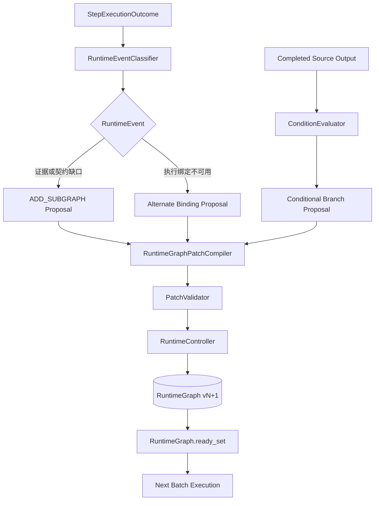
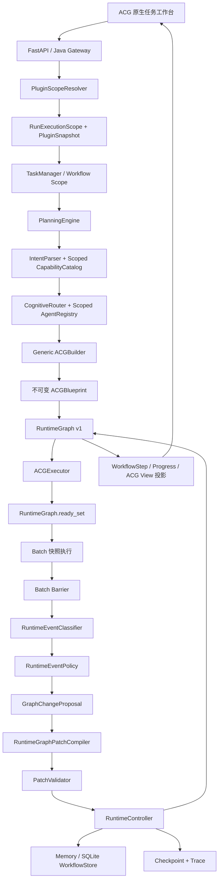

# 动态 ACG 与 Runtime Graph MVP：实施总结与下一步决策（2026-07）

> **文档性质**：归档合并稿——实施总结 1 篇 + 决策报告 1 篇
>
> **覆盖时间**：2026-07-27 ~ 2026-07-29
>
> **当前定位**：早期动态 ACG 的实现与决策记录；Patch 内核已归档为 legacy
>
> **合并日期**：2026-10-30
>
> **归档理由**：动态变图内核已迁至 `apps/agentOS/drafts/legacy_execution/`，活动运行时由 S02–S03 承接

## 0. 合并说明与导读

本册把 **2026-07-27 ~ 2026-07-29** 的 2 篇记录合并为一篇：`Runtime Graph 与受控动态 ACG MVP 实施总结`（2026-07-27，基线 `158c49c` → `5232e19`）与 `知弈OS 动态 ACG 与插件化 MVP 现状及下一步决策报告`（2026-07-29，基线 `c67c51b`）。正文逐字保留原文，仅做两类机械处理：标题层级下移一级、指向已归档文档的相对链接改写。来源清单见文末附录。

### 0.1 当时想解决什么

这一组是同一个代码线的「怎么做」与「做完怎么选」：

- **Runtime Graph 实施总结**：把静态 DAG 升级为受控演化 ACG。权威分离为三层——Blueprint 是不可变设计快照，RuntimeGraph 是状态 / 输出 / Binding / Attempt 的唯一权威，WorkflowStep 只是单向投影；三类动态能力（`ADD_SUBGRAPH` 仅允许 `INSERT_BEFORE_TARGET`、`RETRY_ALTERNATE_BINDING`、`ACTIVATE_CONDITIONAL_BRANCH`）全部走 `Proposal → Patch → Validator → RuntimeController` 单写入链，成功才 `graphVersion + 1`，用 `patchId` / `idempotencyKey` / `baseGraphVersion` 防冲突。
- **MVP 现状与决策报告**：底层能力成立后判断下一步投哪里——四层 MVP（原生通用规划、RuntimeGraph 执行、受控动态图、Run 级插件隔离）、Catalog 驱动构图（拒绝 `if domain=="industrial"` 式硬编码）、插件三态、Run 冻结快照；结论是瓶颈从「动态图不够」转为「用户不会建任务」。

### 0.2 今天还剩什么

| 主张 | 当前状态 |
|---|---|
| Blueprint / RuntimeGraph / WorkflowStep 三层权威分离 | 原则仍沿用；具体实现已由 S02–S03 的 `src/runtime/`（planning_commit、graph_materialization、graph_revision 等）承接 |
| Catalog 驱动构图、拒绝按行业硬编码 | 仍成立 |
| Run 级能力隔离、插件三态与 Run 冻结快照 | 仍成立，演进的形态是 Mission 模型下的 Run 冻结 |
| `graphVersion` 与普通状态分离、Patch 幂等 | 原则保留；具体 Patch 内核已归档 |
| 动态 Patch 内核（`ADD_SUBGRAPH` / `RuntimeController` / `PatchValidator`） | **已归档**：迁至 `apps/agentOS/drafts/legacy_execution/`，活动运行时不再是这条路径 |
| 「每 Run 单选一个 Pack」的表单式入口 | **已过时**：工作台已转入 Mission 工程模型 |
| 单进程 + per-run lock + SQLite 单行事务的一致性前提 | 已被 S02–S03 的持久化 / CAS / 跨库边界分析取代 |

### 0.3 为什么归档

- 动态变图内核已整体退出活动代码路径（归档到 `drafts/legacy_execution/`），文中命令、模块路径与一致性前提都不能直接对应当前实现。
- 决策报告的入口判断（任务创建引导、专业 Pack）已被后续 Mission 工作台与 EX 系列改写，继续放在「当前记录」里会误导读者。
- 保留价值：它完整记录了「为什么放弃自由组图、只做受控扩图」「为什么把执行真相收敛到单一 RuntimeGraph」，这些判断仍是现行设计的来源。

### 0.4 阅读建议

先看实施总结第 3 节「最终权威模型」与第 9 节「三类动态机制的统一关系」，再看决策报告第 8–10 节的问题与路线选择。当前实现请看 S02 / S03 系列记录与 `docs/架构设计/kinlin-agentos-current-architecture.md`。

## 篇目与阅读顺序

1. **Runtime Graph 与受控动态 ACG MVP 实施总结** — 实施总结，2026-07-27 — 原文件 `Runtime Graph 与受控动态 ACG MVP 实施总结.md`
2. **知弈OS 动态 ACG 与插件化 MVP 现状及下一步决策报告** — 决策报告，2026-07-29 — 原文件 `知弈OS 动态 ACG 与插件化 MVP 现状及下一步决策报告.md`

---

## 1. 原文｜Runtime Graph 与受控动态 ACG MVP 实施总结

<!-- 原始记录：Runtime Graph 与受控动态 ACG MVP 实施总结.md -->

> 原文件 `Runtime Graph 与受控动态 ACG MVP 实施总结.md` ｜ 2026-07-27 ｜ 实施总结 ｜ 原文 24398 字节

> 日期：2026-07-27
> 范围：RuntimeGraph 基础、执行权威迁移、事件驱动补救子图、备选执行绑定、确定性条件分支
> 代码基线：`158c49c` 之前的静态 ACG 运行能力
> 最终版本：`5232e19a657bed1007e34dc2fdccd2cfbd2c21b0`

### 1. 摘要

本轮工作完成了知弈 AgentOS 从“执行静态 ACG 蓝图”到“运行期间受控演化 ACG”的最小闭环。

系统现在具备三类真实的运行时动态能力：

1. 执行内容不足时，通过 `ADD_SUBGRAPH` 插入受约束的补救子图；
2. 当前执行者不可用时，通过 `RETRY_ALTERNATE_BINDING` 保持节点不变并切换备选 Agent 或模型绑定；
3. 上游输出满足不同条件时，通过 `ACTIVATE_CONDITIONAL_BRANCH` 激活一条预声明路径，并明确终结其他路径。

这三类能力没有把图修改权限交给 Agent、Planner 或 API，而是统一收敛到以下控制链：

```text
运行事实或确定性控制求值
→ GraphChangeProposal
→ RuntimeGraphPatch
→ PatchValidator
→ RuntimeController
→ graphVersion + 1
→ 下一轮 RuntimeGraph.ready_set()
```

MVP 的核心成果不是增加了几种 Patch JSON，而是建立了可执行、可持久化、可恢复、可审计、可去重的动态图运行内核。动态新增节点会真正进入 Ready Set 并执行；绑定切换后的下一 Attempt 会真正调用备选 Agent；条件分支中的未选 Agent 不会被调用，Join 也不会错误等待已经终结的路径。

### 2. 改造前的问题

早期 ACG 运行路径由多个对象共同维护执行事实：

```text
ACGBlueprint
+ WorkflowRun.steps
+ completedStepIds / activeStepIds
+ WorkflowStep.status
+ Checkpoint
```

这种模型可以执行静态 DAG，但不适合运行时改图：

- Blueprint 同时承担设计结构和运行参考，缺少明确的不可变边界；
- Ready Set 依赖 Blueprint 与多个状态集合，新增节点无法自然进入执行循环；
- 并行 Step 可以直接修改共享 `WorkflowRun`，存在结果相互覆盖风险；
- Checkpoint 可能用旧快照覆盖更新后的图；
- 普通重试、换 Agent、插入补救步骤没有统一的结构变更语义；
- 图变化缺少 base version、幂等键和单写入者；
- WorkflowStep 既是 API DTO 又是运行状态，无法安全承载动态图权威。

因此，本轮首先重构“执行真相”，再逐步开放受控动态能力。

### 3. 最终权威模型

MVP 完成后的职责边界如下：

```text
ACGBlueprint
= 不可变的设计时计划与审计快照

RuntimeGraph
= 运行拓扑、节点状态、输出、Binding、Attempt、事件、Patch 和分支决策的权威

WorkflowStep
= 从 RuntimeGraph 单向生成的 API 兼容投影

WorkflowRun.runtimeGraph
= RuntimeGraph 的持久化载体
```

#### 3.1 graphVersion

`graphVersion` 只表示运行时语义图版本，只在以下操作成功后递增：

- `ADD_SUBGRAPH`；
- `RETRY_ALTERNATE_BINDING`；
- `ACTIVATE_CONDITIONAL_BRANCH`。

以下普通执行行为不会增加 graphVersion：

- `PENDING → RUNNING → COMPLETED`；
- Attempt 创建和完成；
- 输出写入和 outputVersion 递增；
- Progress、Trace、Checkpoint 更新；
- 普通原 Binding 重试。

RuntimeGraph 初始化时：

```text
sourceBlueprintVersion = ACGBlueprint.version
graphVersion = 1
```

两者语义严格分离。

#### 3.2 WorkflowStep 单向投影

`refresh_run_execution_projection()` 从 RuntimeGraph 统一生成：

- `run.steps`；
- `run.completedStepIds`；
- `run.activeStepIds`；
- `run.currentStepId`。

执行、审核、取消和恢复路径不再从 WorkflowStep 反向更新 RuntimeGraph。修改投影对象不会改变权威 RuntimeNode。

### 4. RuntimeGraph 执行内核

#### 4.1 RuntimeNode

RuntimeNode 承载单个运行节点的权威事实：

```text
nodeId
nodeType
spec
status
activation
currentBinding
bindingCandidates
bindingHistory
bindingSwitchCount
attempts
output
outputVersion
error
sourcePatchId
createdGraphVersion
updatedAt
```

Blueprint 节点被深复制为 RuntimeNode，运行时 enrichment、Binding 和输出不会写回原始 Blueprint。

#### 4.2 Attempt 追加历史

每次真实 Agent 执行都会追加一个 RuntimeAttempt：

```text
attemptId
attemptNumber
graphVersion
bindingId
agentName
modelName
status
startedAt / endedAt
resolvedInput
output
error
traceContext
```

失败 Attempt 不会被后续重试或 Binding 切换覆盖。历史 Attempt 保存当时真实使用的 bindingId、Agent 和模型，不能根据当前 Binding 反推。

#### 4.3 Ready Set

Executor 每轮重新从 Store 加载最新 WorkflowRun 和 RuntimeGraph，然后调用：

```text
RuntimeGraph.ready_set()
```

Ready Set 不再读取 `completedStepIds`。节点进入 Ready Set 必须满足：

- 是可执行 Step Node；
- activation 为 ACTIVE；
- 状态为 PENDING 或 RETRYING；
- 所有当前有效前驱已经完成；
- 不存在尚未决策的 INACTIVE 条件入口边。

`RUNNING`、`COMPLETED`、`FAILED`、`CANCELLED` 和 `SKIPPED_BY_CONDITION` 均不会再次进入 Ready Set。

#### 4.4 Batch 快照与 Barrier

并行执行采用以下边界：

```text
锁内重新加载 RuntimeGraph
→ 计算 Ready Set
→ 创建 Attempt
→ Batch 节点统一转为 RUNNING
→ save_run()
→ 释放锁
→ 并发执行不可变 StepExecutionPackage
→ 收集 StepExecutionOutcome
→ 再次获取锁并重读最新 Run
→ 校验 graphVersion、nodeId、attemptId 和节点状态
→ Barrier 合并结果
→ 投影 WorkflowStep
→ Checkpoint
→ save_run()
```

Agent、LLM 和远端工具调用均在锁外执行。并行协程只返回 Outcome，不直接修改共享 WorkflowRun。

迟到 Outcome 如果遇到 Run 已取消、graphVersion 变化或 attemptId 不匹配，会被安全忽略并记录 Trace，不能覆盖较新的运行事实。

### 5. Patch 与一致性内核

#### 5.1 唯一写入者

RuntimeController 是 RuntimeGraph 语义变更的唯一入口。Agent、Executor、ProposalFactory、PatchCompiler、Recovery 和 API 均不能直接改写图结构或 Binding。

公开应用流程为：

```text
获取 GLOBAL_RUN_LOCK_MANAGER 的 run lock
→ 从 Store 读取最新 WorkflowRun
→ 检查幂等与取消状态
→ 校验 baseGraphVersion
→ deep copy 当前 Run
→ PatchValidator 在副本上纯验证
→ 在候选 RuntimeGraph 上应用语义变化
→ graphVersion + 1
→ 写 AppliedPatchRecord 和 Trace
→ 创建包含最新 RuntimeGraph 的 Checkpoint
→ 一次 save_run()
→ 保存成功后返回
```

Barrier 已持锁时使用内部 `apply_patch_to_candidate()`，避免非重入锁死锁，同时复用相同验证和应用逻辑。

#### 5.2 幂等和冲突

AppliedPatchRecord 保存：

```text
patchId
idempotencyKey
contentHash
semanticHash
operationType
baseGraphVersion
resultGraphVersion
sourceEventId
checkpointId
appliedAt
```

规则如下：

- 相同 patchId、相同内容：返回幂等重放，版本不变；
- 相同 patchId、不同内容：`PATCH_ID_CONTENT_CONFLICT`；
- 相同 idempotencyKey、相同语义：返回第一次结果；
- 相同 idempotencyKey、不同语义：拒绝；
- baseGraphVersion 过期：`GRAPH_VERSION_CONFLICT`；
- 已取消 Run：拒绝新 Patch；
- 保存失败：不污染调用方对象或 Store 中旧对象。

当前一致性前提为：

```text
单进程、单 Uvicorn Worker
+ 全局 per-run lock
+ 锁内重读最新 Run
+ graphVersion 乐观检查
+ SQLite 单行事务保存
```

MVP 没有虚构数据库 CAS，也没有宣称支持多进程一致性。

### 6. 动态能力一：ADD_SUBGRAPH

#### 6.1 触发链

StepExecutionOutcome 可以携带结构化 `runtimeSignals`。RuntimeEventClassifier 将输出、异常和契约错误归类为稳定 RuntimeEvent。

当前可记录的事件包括：

- `EVIDENCE_MISSING`；
- `INPUT_CONTRACT_VIOLATION`；
- `OUTPUT_CONTRACT_VIOLATION`；
- `LOW_CONFIDENCE`；
- `STEP_EXECUTION_FAILED`；
- `BINDING_UNAVAILABLE`。

只有有确定性 Recipe 的事件才能生成子图 Proposal。没有 Recipe 的事件会被安全忽略、拒绝或转人工，不允许 LLM 自由组图。

实际链路：

```text
StepExecutionOutcome
→ RuntimeEventClassifier.classify()
→ RuntimeEventPolicy.decide()
→ RecoveryRecipeRegistry
→ DeterministicProposalFactory.propose()
→ RuntimeGraphPatchCompiler.compile()
→ PatchValidator.validate()
→ RuntimeController.apply_patch_to_candidate()
→ graphVersion + 1
→ RuntimeGraph.ready_set()
```

#### 6.2 受限插入语义

MVP 只允许：

```text
ADD_SUBGRAPH + INSERT_BEFORE_TARGET
```

例如原图：

```text
A ─┐
   ├→ Target
B ─┘
```

插入补救链后：

```text
A ─┐
   ├→ Retrieve → Validate → Target
B ─┘
```

原入边不会物理删除，而是在历史图中标记 superseded。新增节点为 PENDING，记录 `sourcePatchId` 和新的 `createdGraphVersion`。

PatchValidator 检查目标状态、替换入边、ID 唯一性、端点、DAG、能力、契约、数据路径以及图预算。已完成节点和输出不能被修改或失效。

#### 6.3 Recipe 与防无限扩图

当前确定性 Recipe 包括：

- `evidence_retrieval_and_validation.v1`；
- `contract_repair.v1`。

Recipe 只描述 capability、契约和数据映射，不在 Core 中硬编码合同主题或业务字段。

除全局 Patch/节点/深度预算外，同一 `recipeId + targetNodeId` 每个 Run 最多应用一次。重复缺口不会形成无限的 retrieve/validate 链，而是产生 `RECIPE_REAPPLICATION_BLOCKED` 审计事件。

### 7. 动态能力二：RETRY_ALTERNATE_BINDING

#### 7.1 ExecutionBinding

ExecutionBinding 是不包含凭据的安全执行绑定：

```text
bindingId
agentName
agentId
domain
capability
modelName
allowedSkills
bindingType
source
priority
metadata
```

bindingId 由以下稳定字段的规范化哈希生成：

```text
agentName + agentId + modelName + capability
```

相同注册事实会产生相同 bindingId，不使用随机 UUID。

#### 7.2 CandidateResolver

CandidateResolver 从 AgentRegistry 枚举候选并过滤：

- domain；
- capability；
- requiredSkills；
- excludedBindingIds；
- enabled/availability。

候选按以下顺序稳定排序：

```text
priority 降序
→ registrationOrder
→ bindingId
```

当前使用轻量 Registry availability provider，不建设完整资源租约系统。

#### 7.3 故障与切换边界

以下故障可以立即触发 `BINDING_UNAVAILABLE`：

- Agent 未注册或消失；
- Agent 被禁用；
- Binding 不再注册；
- 模型端点被移除。

Timeout、连接、传输、限流和远端暂时不可用等瞬时故障，会先在当前 Binding 重试一次；超过固定阈值后才请求切换。

契约错误、证据缺失和业务低置信度不会被错误归类为“换人”。

#### 7.4 Patch 语义

`RETRY_ALTERNATE_BINDING` Patch：

- 不改变 nodeId；
- 不增删节点或边；
- 不创建 Attempt；
- 校验 expectedAttemptId 和 expectedCurrentBindingId；
- 校验新 Binding 的 domain、capability、skills 和注册状态；
- 更新 currentBinding；
- 追加 bindingHistory；
- bindingSwitchCount 增加；
- 节点进入 RETRYING；
- graphVersion 增加一次。

下一轮调度才创建新 Attempt，因此失败 Attempt 完整保留，新 Attempt 明确记录新 bindingId。

候选耗尽时事件被拒绝，节点不会循环回到已经失败的 Binding。

### 8. 动态能力三：ACTIVATE_CONDITIONAL_BRANCH

#### 8.1 受限 IF 结构

MVP 支持以下显式结构：

```text
DecisionSource
      ↓
    IF Control
    ↙       ↘
Branch A   Branch B
    ↘       ↙
      Join
       ↓
   Downstream
```

每个 IF Control 必须声明：

```text
conditionSpec
branchEdgeIds
joinNodeId
```

Blueprint 验证器要求：

- 决策源唯一且为 Step；
- 2 至 4 条分支；
- Join 唯一且是无条件 Control；
- 每条分支最终汇聚到 Join；
- Join 前分支节点互不共享；
- 不存在未声明分支边；
- 每条分支均可由 case 或 default 选择；
- 不允许嵌套 IF；
- LOOP 继续被拒绝。

#### 8.2 ConditionSpec 与安全求值

ConditionSpec 包含：

```text
sourceNodeId
jsonPointer
operator
cases
defaultEdgeId
valueType
```

支持的 operator 仅限：

- `EQUALS`；
- `IN`；
- `EXISTS`；
- `BOOLEAN`。

ConditionEvaluator 是纯函数，只能读取声明的 RuntimeNode.output，并使用受限 JSON Pointer 查找值。它不访问 Store、AgentRegistry、网络、环境变量或文件，不执行 Python/JavaScript 表达式。

求值结果包含 sourceOutputVersion 和 inputHash，因此 Patch 可以证明自己基于哪个确定性输入产生。

没有匹配 case 时：

- 存在 defaultEdgeId：稳定选择默认分支；
- 不存在 defaultEdgeId：返回 `CONDITION_NO_MATCH`，Run 进入结构化失败；
- 不会随机选择路径。

#### 8.3 Edge activation

边新增运行时 activation：

```text
INACTIVE
ACTIVE
TERMINATED
```

普通边默认 ACTIVE。IF 声明的分支入口边在 RuntimeGraph 初始化时变为 INACTIVE，因此决策前任何分支都不能进入 Ready Set。

Patch 成功后：

- 选中入口边变为 ACTIVE；
- 未选入口边变为 TERMINATED；
- IF Control 变为 COMPLETED；
- 未选分支独占节点变为 SKIPPED_BY_CONDITION；
- Join 及 Join 后节点不被跳过；
- 节点和边数量保持不变；
- graphVersion 增加一次。

#### 8.4 SKIPPED_BY_CONDITION

`SKIPPED_BY_CONDITION` 是独立终态：

- 不执行 Agent；
- 不生成业务输出；
- 不算失败；
- 不能 Retry；
- 不能转换为 RUNNING 或 COMPLETED；
- 可以持久化和恢复；
- 在 WorkflowStep 与 Progress 中单独展示。

只有 PENDING 节点可以通过条件 Patch 进入该状态。如果未选分支已经 RUNNING、COMPLETED 或 WAITING_REVIEW，Patch 会以 `BRANCH_ALREADY_STARTED` 拒绝。

#### 8.5 Join 语义

RuntimeGraph 只把 ACTIVE 的 Dependency/Control Flow Edge 作为有效前驱。

Join 会忽略来源已为 SKIPPED_BY_CONDITION 的终结路径，但仍等待：

- 选中分支的 ACTIVE 前驱；
- 其他普通必选依赖。

因此，未选分支没有输出不会导致 Join 死锁，也不会被误认为业务失败。

#### 8.6 BranchDecision

每次成功决策写入冻结的 BranchDecision：

```text
decisionId
controlNodeId
sourceNodeId
sourceOutputVersion
inputHash
selectedCaseKey
selectedEdgeIds
terminatedEdgeIds
skippedNodeIds
joinNodeId
sourceEventId
sourcePatchId
decidedAtGraphVersion
decidedAt
```

同一 controlNodeId 只能存在一个决策。Checkpoint 恢复后会保留边 activation、skipped 状态、inputHash 和 BranchDecision，不会重新求值或重复增加 graphVersion。

### 9. 三类动态机制的统一关系



三类 Patch 的变化范围互斥：

| Patch                       | 节点数量 |             边数量 | Binding      | 节点状态                        | Edge activation   |
| --------------------------- | -------: | -----------------: | ------------ | ------------------------------- | ----------------- |
| ADD_SUBGRAPH                |     增加 | 增加并保留旧边历史 | 新节点初始化 | Target RETRYING、新节点 PENDING | 不负责条件激活    |
| RETRY_ALTERNATE_BINDING     |     不变 |               不变 | 切换         | 原节点 RETRYING                 | 不变              |
| ACTIVATE_CONDITIONAL_BRANCH |     不变 |               不变 | 不变         | IF 完成、未选节点 skipped       | ACTIVE/TERMINATED |

### 10. Progress、API 与前端兼容

#### 10.1 Progress

Progress 在原字段基础上增加：

```text
graphVersion
dynamicStepCount
bindingSwitchCount
skippedByConditionCount
conditionalDecisionCount
```

ADD_SUBGRAPH 会增加 totalSteps，因此百分比允许回落。Binding 切换和条件决策不改变 totalSteps。

条件分支后的有效完成量为：

```text
effectiveFinished = completedSteps + skippedByConditionCount
percent = effectiveFinished / totalSteps
```

`completedSteps` 仍只统计真实完成节点，不把 skipped 混装成 completed。

#### 10.2 Run Detail 与 ACG View

接口现在可以暴露：

- 最新 RuntimeGraph 投影；
- graphVersion；
- appliedPatches；
- runtimeEvents；
- currentBinding 与 bindingHistory；
- bindingSwitchCount；
- edge.activation；
- branchDecisions；
- selectedEdgeIds / terminatedEdgeIds；
- skippedByConditionCount；
- conditionalDecisionCount。

未开放客户端 Patch 写入 API。

#### 10.3 Java 与 TypeScript

Java 强类型 Progress DTO 和 TypeScript 类型已同步新增字段。TypeScript StepStatus 增加 `skipped_by_condition`，ACG Edge 增加 activation，BranchDecision 有明确类型。

前端暂不自动刷新动态图，也没有分支编辑器；现有步骤列表和拓扑详情为 skipped 状态提供安全样式，对未知未来状态使用文本 fallback，不会抛异常。

### 11. Checkpoint、恢复与 Store

Checkpoint 保存完整 RuntimeGraph，因此包含：

- 节点状态、Attempt、输出和 Binding；
- graphVersion；
- RuntimeEvent 与 pending 队列；
- appliedPatches；
- edge.activation；
- BranchDecision；
- SKIPPED_BY_CONDITION；
- conditionalDecisionCount。

恢复前先比较当前 RuntimeGraph.graphVersion 与 Checkpoint graphVersion：

- 相同版本：允许恢复；
- Checkpoint 更旧：拒绝覆盖新图；
- Checkpoint 更高：视为数据异常；
- 旧数据缺少 RuntimeGraph：只能走显式兼容初始化。

恢复以 RuntimeGraph 为权威，再投影 WorkflowStep。RUNNING 节点恢复为 RETRYING；已应用 Patch、最新 Binding 和已完成分支决策不会被回滚或重复应用。

MemoryWorkflowStore 与 SQLiteWorkflowStore 都通过了 RuntimeGraph、Event/Patch 映射、Binding、Attempt、Edge activation、BranchDecision 和 Checkpoint 的重载验证。

### 12. 审计与可观测性

Trace 继续作为审计投影，不承担执行状态权威。动态链路会记录：

- RuntimeEvent 分类、忽略和拒绝；
- Recipe 选择与重复应用阻断；
- GraphChangeProposal；
- Patch 成功、拒绝和版本冲突；
- graphVersion、runtimeNodeId、attemptId、bindingId；
- selectedEdgeIds、terminatedEdgeIds；
- Checkpoint 创建。

ContextPack 每个 Attempt 重新装配，并从 RuntimeGraph 读取当前拓扑、上游输出、graphVersion、attemptId 和 bindingId。Binding 切换后不会复用旧 resolvedInput 对象。

### 13. 验收场景

#### 13.1 证据缺失动态扩图

```text
Target 第一次 Attempt
→ EVIDENCE_MISSING
→ evidence_retrieval_and_validation.v1
→ 插入 Retrieve → Validate
→ graphVersion 1 → 2
→ 新节点实际执行
→ Target 第二次 Attempt
→ 后续节点完成
```

#### 13.2 执行者失效切换 Binding

```text
Primary Attempt 失败
→ BINDING_UNAVAILABLE
→ 排除失败 bindingId
→ 选择 Alternate Binding
→ graphVersion 1 → 2
→ 下一轮创建新 Attempt
→ Alternate Agent 实际执行
→ Run 完成
```

合同与代码两个测试域都使用同一 CandidateResolver、ProposalFactory、PatchCompiler、Validator 和 RuntimeController。

#### 13.3 高风险合同

```text
riskLevel = high
→ high branch ACTIVE
→ direct branch TERMINATED
→ deep/review 实际执行
→ direct SKIPPED_BY_CONDITION
→ Join 和 final 完成
→ graphVersion 1 → 2
```

#### 13.4 低风险合同

```text
riskLevel = low
→ direct branch ACTIVE
→ deep/review branch TERMINATED
→ direct 实际执行
→ deep/review 不调用 Agent
→ Join 和 final 完成
```

#### 13.5 Critical 代码审查

```text
severity = critical
→ 深度审查路径 ACTIVE
→ 普通路径 TERMINATED 并 skipped
→ 使用与合同场景相同的 Core 条件链
→ Run 完成
```

### 14. 测试结果

最终版本完整测试结果：

| 测试域                |                  结果 |
| --------------------- | --------------------: |
| 阶段 4 Core 精确测试  |             24 passed |
| 阶段 4 Agent 精确测试 |             50 passed |
| AgentOS Core 全量     |            134 passed |
| Agent 应用全量        | 216 passed, 1 skipped |
| Java Backend          |            145 passed |
| Frontend              |             82 passed |
| ruff                  |                passed |
| git diff --check      |                passed |

阶段提交：

```text
5232e19 feat(agentos): execute conditional runtime branches
d6c112b feat(agentos): switch failed steps to alternate bindings
158c49c feat(agentos): execute event-driven runtime subgraph patches
5571266 refactor(agentos): make runtime graph execution authority
579e215 feat(agentos): establish versioned runtime graph foundation
527a53b fix(agentos): align workflow progress lifecycle message contract
```

### 15. 当前明确边界

本轮没有实现：

- LLM Planner 或 LLM 自由组图；
- LLM 自由选择 Agent；
- 动态创建 Agent；
- LOOP；
- 任意表达式执行；
- 任意节点或边删除；
- 已完成输出失效和下游自动重算；
- 子图回滚；
- 完整 Resource Manager 和租约；
- PostgreSQL WorkflowStore；
- 多 Worker 或多进程一致性；
- SSE Patch 事件；
- 公共 Patch 写 API；
- 前端实时图刷新和复杂分支编辑器。

因此，当前能力应准确描述为：

> **单进程前提下，基于版本化 RuntimeGraph、确定性策略和受限 Patch 的动态 ACG MVP。**

它已经解决“运行时能否安全改变执行结构”的核心问题，但还没有扩展为任意规划语言、分布式调度系统或完整认知操作系统。

### 16. 后续演进建议

#### 16.1 优先补齐 stateRevision

graphVersion 只表达语义图变化。进入多 Worker 或更强并发前，应增加独立 stateRevision，用于普通状态更新的数据库乐观锁，禁止复用 graphVersion。

#### 16.2 PostgreSQL CAS 与事务

正式多实例运行需要：

- `(run_id, state_revision)` 条件更新；
- patchId、eventId、idempotencyKey 唯一约束；
- Patch、Trace、Checkpoint 的事务边界；
- 冲突重读和有限重试策略。

#### 16.3 输出失效与子图重算

当前禁止修改已完成节点和使已完成输出失效。后续若支持更复杂重规划，需要显式引入：

- output lineage；
- inputRevision/outputVersion 传播；
- 下游失效集合；
- 可重算边界；
- 审计可见的重新执行原因。

#### 16.4 动态图读取体验

可以在不开放写 Patch API 的前提下，逐步增加：

- Run Detail 的 graphVersion 条件刷新；
- Patch 审计时间线；
- Edge activation 和 BranchDecision 可视化；
- Progress 中动态节点、Binding 切换和条件决策提示。

#### 16.5 Planner 接入原则

未来接入 LLM Planner 时，仍应保持当前控制权边界：

```text
LLM 只能提出结构化 Proposal
→ 确定性 Compiler
→ PatchValidator
→ RuntimeController
```

不得允许 Planner、Agent 或客户端直接写 RuntimeGraph。

### 17. 结论

本轮 MVP 建立了知弈 AgentOS 动态 ACG 的最小可信内核：

- Blueprint 与 RuntimeGraph 权威分离；
- RuntimeGraph 接管执行状态、输出、Binding 和 Attempt；
- Executor 每轮基于最新 RuntimeGraph 重新计算 Ready Set；
- 并行执行采用快照与 Barrier；
- 三类动态图变化统一经过 Proposal、Patch、Validator 和单写入 Controller；
- graphVersion、幂等、Checkpoint 和 Trace 形成一致性与审计闭环；
- 合同和代码场景复用相同 Core 机制，没有把业务关键词写入动态控制内核。

这使系统从“只能执行一张预先确定的 DAG”演进为“能够在严格边界内，根据运行事实调整拓扑、执行者和路径的版本化 AgentOS Runtime”。

---

## 2. 原文｜知弈OS 动态 ACG 与插件化 MVP 现状及下一步决策报告

<!-- 原始记录：知弈OS 动态 ACG 与插件化 MVP 现状及下一步决策报告.md -->

> 原文件 `知弈OS 动态 ACG 与插件化 MVP 现状及下一步决策报告.md` ｜ 2026-07-29 ｜ 决策报告 ｜ 原文 22395 字节

> 报告日期：2026-07-29  
> 代码分支：`master`  
> 代码基线：`c67c51bab9f02fd79309310203ca80ccca17134f`  
> 报告目的：说明当前 MVP 已经真实实现的能力、产品边界、主要缺口，并为下一阶段任务选择提供依据。

### 1. 执行摘要

当前知弈OS已经不再是“固定律师流程加一个通用页面”，而是形成了四层可以独立解释的 MVP：

1. **原生通用规划层**：`general/general` 不加载 Legal Pack 也能经过正式 PlanningEngine 生成 ACG 并完成执行；
2. **RuntimeGraph 动态执行层**：运行拓扑、状态、输出、Attempt 和 Binding 已由 RuntimeGraph 统一管理；
3. **受控动态图层**：支持补救子图、备用绑定和确定性条件分支三种运行时变化；
4. **Run 级专业能力隔离层**：已安装 Pack 可以全局注册，但每个 Run 只看见自己启用的 Capability、Agent 和 Workflow，并冻结插件快照。

当前最重要的判断是：

> **MVP 的底层运行机制已经成立，但面向普通用户的任务创建体验和非法律专业 Pack 的完整度尚未达到同一成熟度。**

用户在工作台“不知道填什么”，不是 RuntimeGraph 或 Planner 缺失，而是产品入口仍把内部任务字段直接交给了用户。与此同时，Legal Pack 已具备较完整的能力、Agent、Workflow 和 UI 扩展，Education、Programmer、Writer 则主要停留在静态 Workflow/Agent 脚手架阶段。

因此，下一阶段不建议继续增加第四种动态图操作。更合理的选择是优先完成以下三项之一：

- **路线 A（推荐）**：任务创建引导与示例任务；
- **路线 B**：选择一个非法律 Pack，完成从能力描述到 UI、规划、执行和交付的全链路产品化；
- **路线 C**：让真实业务 Agent 稳定产生 RuntimeEvent，减少动态能力对测试信号和故障注入的依赖。

### 2. 当前基线与验证状态

#### 2.1 Git 基线

```text
branch: master
HEAD: c67c51bab9f02fd79309310203ca80ccca17134f
latest: fix(acg-workbench): 将专业能力包改为单选叠加
```

`git status` 当前将 5 个前端文件显示为修改，但这些文件的工作区对象哈希与 Index 对象哈希完全一致，`git diff` 为空；本报告未修改这些文件，也未把它们视为功能差异。

#### 2.2 本轮实际测试

| 测试域 | 命令 | 结果 |
| --- | --- | --- |
| AgentOS Core | `cd agentOS && python -m pytest tests -q` | `177 passed` |
| Agent 应用 | `$env:PYTHONPATH='agentOS\src;agent'; python -m pytest agent/tests -q` | `235 passed, 1 skipped` |
| Java Backend | `cd backend && mvn test -q` | `149 passed` |
| Frontend | `cd frontend && npm test -- --run` | `105 passed` |

同一 HEAD 下前端 `vue-tsc` 与生产构建已通过。当前测试基线没有发现回归。

### 3. 当前产品与架构定位

#### 3.1 当前系统是什么

当前系统可以定义为：

> 一个以 ACG 为统一执行模型、以 RuntimeGraph 为运行事实、支持确定性规划和三类受控运行时变化，并允许专业能力 Pack 按 Run 隔离叠加的通用 AgentOS MVP。

#### 3.2 当前系统不是什么

当前系统还不是：

- 能由 LLM 任意创建和修改运行图的自由自治系统；
- 具备插件市场、在线安装、运行中卸载或沙箱的插件平台；
- 支持多个 Worker、分布式锁和 PostgreSQL CAS 的生产级调度系统；
- 已完成所有 Education、Programmer、Writer 专业体验的成品工作台；
- 用户只说一句模糊需求就一定能生成高质量专业成果的成熟产品。

### 4. 当前真实架构



核心控制边界保持为：

```text
Agent 只产生结果或诊断信号
Planner 只产生设计时 Blueprint
PatchValidator 只验证
RuntimeController 是运行图语义变化的唯一写入者
```

### 5. 已实现能力清单

#### 5.1 原生通用 ACG 启动链

Core 注册了 `native_acg_runtime_v1`，它是允许空静态 Step 的受控 Planner Bootstrap，不是另一个 General Profile，也不是 Legal Workflow 的变体。

通用任务实际链路为：

```text
general/general 请求
→ native_acg_runtime_v1
→ PlanningEngine
→ IntentParser 从 CapabilityCatalog 选择能力
→ CognitiveRouter 绑定 Agent
→ Generic ACGBuilder 构图
→ RuntimeGraph 初始化
→ ACGExecutor 执行
→ 最终交付
```

Core Native Catalog 当前包含任务理解、信息提取、资料检索、需求分析、流程拆解、资源规划、架构设计、通用分析、证据分析、比较分析、成本分析、风险分析、方案设计、验证和成果生成等能力。

`NativeGeneralAgent` 为这些能力提供离线可测的确定性执行实现。这保证了没有外部模型配置时测试仍可完成，但也意味着当前 Native 输出更接近“稳定演示与基础交付”，还不是依赖大模型深度推理形成的高质量专业成果。

#### 5.2 Catalog 驱动的通用规划

能力信息的唯一主要来源是 `CapabilityCatalog` 中的 `PlanningCapabilityDescriptor`。Descriptor 声明：

- 稳定 capabilityId；
- alias 和描述；
- dependsOn / optionalDependencies；
- planningStage；
- input/output contract；
- parallelizable；
- requiresEvidence；
- writesMemory；
- requiresReview。

`IntentParser` 从 Catalog 读取 alias 和可选能力，`CognitiveRouter` 处理规范化 capabilityId，`ACGBuilder` 只根据 Descriptor 和已解析 Binding 构图。

图差异因此来自能力组合和依赖声明，而不是：

```python
if domain == "industrial":
    return INDUSTRIAL_GRAPH
```

并行关系也由相同 planningStage、相同依赖和 `parallelizable=true` 推导，不由任务标题关键词直接决定。

#### 5.3 RuntimeGraph 执行权威

当前职责已经迁移为：

```text
ACGBlueprint = 不可变设计快照
RuntimeGraph = 运行拓扑、状态、输出、Binding、Attempt 和动态历史权威
WorkflowStep = RuntimeGraph 的单向 API 兼容投影
```

Executor 每轮重新加载最新 RuntimeGraph，并通过 `RuntimeGraph.ready_set()` 决定可执行节点，不再以 Blueprint、`completedStepIds` 和 `WorkflowStep.status` 的组合为权威。

并发 Batch 使用：

```text
锁内调度并保存 RUNNING Attempt
→ 锁外执行 Agent
→ 锁内 Barrier 合并 Outcome
→ 投影 WorkflowStep
→ Checkpoint
→ save_run
```

每次真实执行追加 Attempt，旧失败 Attempt 不会被覆盖；Cancel 后迟到 Outcome 不能把节点恢复为 Completed。

#### 5.4 受控动态图能力

当前支持三种 Patch：

| 动态能力 | 作用 | 图结构是否变化 | graphVersion |
| --- | --- | --- | --- |
| `ADD_SUBGRAPH` | 在目标节点前插入补救子图 | 是 | `+1` |
| `RETRY_ALTERNATE_BINDING` | 保持节点不变，切换备选 Agent/模型绑定 | 否，但执行语义变化 | `+1` |
| `ACTIVATE_CONDITIONAL_BRANCH` | 激活一个预声明条件分支并终结其他分支 | 有效拓扑变化 | `+1` |

普通状态迁移、输出写入、Trace 和 Checkpoint 不增加 graphVersion。

##### ADD_SUBGRAPH

支持 `INSERT_BEFORE_TARGET`：原前驱被重新连接到补救子图，子图末端再连接目标节点；旧边保留审计记录但退出有效边集合。新增节点会真实进入下一轮 Ready Set 并执行。

##### Alternate Binding

Binding 候选、Binding 历史和 Attempt 历史保存在 RuntimeNode。主 Binding 不可用时，只能从当前 Run Scope 内选择备选 Binding，不能越过插件边界。

##### 条件分支

条件使用受限 `ConditionSpec` 和确定性求值，不执行任意表达式。选中路径激活，未选路径进入 `SKIPPED_BY_CONDITION`，Join 不等待已终结路径。

#### 5.5 一致性、幂等与恢复

当前一致性内核为：

```text
单进程、单 Worker
+ GLOBAL_RUN_LOCK_MANAGER 的 per-run lock
+ 锁内重读最新 WorkflowRun
+ baseGraphVersion 乐观检查
+ Memory/SQLite 单次 save_run
```

Patch 保存 `patchId`、`idempotencyKey`、内容哈希和结果版本，支持重放去重和内容冲突识别。Patch、最新 RuntimeGraph、Trace 和 Checkpoint 在同一个 Run 副本中一次保存。

Checkpoint 恢复先比较当前图版本与快照图版本，旧 v1 Checkpoint 不能覆盖当前 v2 RuntimeGraph。恢复使用保存的 RuntimeGraph 和插件 Scope，不从 WorkflowStep 或当前全局插件集合重新推导事实。

#### 5.6 Run 级插件隔离

Pack 在进程启动时统一发现并注册，但 Run 创建时由 `PluginScopeResolver` 生成不可变的 `RunExecutionScope`：

```text
enabledPluginIds
capabilityIds
agentIds
workflowIds
pluginSnapshots
capabilityCatalogRevision
```

三态语义为：

| 请求值 | 语义 |
| --- | --- |
| `null` / 缺省 | 兼容策略，根据显式或推荐 Workflow 解析最小插件范围 |
| `[]` | Native-only |
| `["kinlin.legal"]` | Native + Legal |

Native 不是插件，始终存在。恢复时会校验 Manifest Hash、Contribution Revision 和 Catalog Revision；原插件缺失或贡献发生变化时明确拒绝，不能静默扩大范围。

Core 数据模型仍使用数组，因此内核具备多 Pack 范围表达能力；当前 ACG 工作台采用更保守的产品策略：**每个新 Run 最多选择一个专业能力包，Native Core 始终叠加**。

#### 5.7 前端工作台与运行审计

当前 ACG 页面已经从默认合同表单改为原生通用工作台，具备：

- Native Core 与专业能力包选择；
- 文本材料与文件上传；
- 任务目标、约束和预期交付物；
- 动态规划、思考强度和审核模式；
- Progress、WorkflowStep 和运行详情；
- RuntimeGraph 图形展示；
- graphVersion、动态节点数、Patch 数和 Binding 切换摘要；
- RuntimeEvent、Patch 和 BranchDecision 的可读时间线；
- Legal Pack 的编译期 UI 扩展、法律输入和法律结果展示；
- 历史 Run 的插件快照锁定与缺失插件提示。

前端不提供公共 Patch 写入口；图变化仍来自运行内核。

### 6. 各能力包当前成熟度

| 能力范围 | Capability Catalog | Agent | Workflow | 专用 UI | 动态规划闭环 | 当前判断 |
| --- | --- | --- | --- | --- | --- | --- |
| Native Core | 完整声明 | `NativeGeneralAgent` | `native_acg_runtime_v1` | 原生工作台 | 是 | 可运行 MVP |
| Legal Pack | 7 项法律能力 | 14 个法律 Agent | 合同审查、案件分析 | 已有 | 是 | 当前最完整专业包 |
| Programmer Pack | 未形成 Pack Catalog 贡献 | 4 个 Agent | 1 个静态 Workflow | 无 | 不完整 | 脚手架 |
| Education Pack | 未形成 Pack Catalog 贡献 | 1 个 Agent | 1 个静态 Workflow | 无 | 不完整 | 脚手架 |
| Writer Pack | 未形成 Pack Catalog 贡献 | 1 个 Agent | 1 个静态 Workflow | 无 | 不完整 | 脚手架 |

这里的“不完整”并不表示 Agent 或静态 Workflow 不存在，而是表示它们尚未完成以下统一闭环：

```text
Manifest Contribution
→ CapabilityDescriptor
→ Run Scoped Catalog
→ IntentParser
→ Generic ACGBuilder
→ 专业 UI 输入
→ 专业 Artifact 输出
```

因此，当前用户选择 Programmer、Education 或 Writer 后，界面仍主要展示通用输入，系统也不会像 Legal Pack 一样自然切换到完整专业体验。这是当前产品最明显的能力落差。

### 7. 当前端到端可用场景

#### 7.1 Native-only 通用任务

```text
enabledPluginIds=[]
domain=general
intent=general
```

可以经过正式 Planner 选择能力、构建非空 Blueprint、初始化 RuntimeGraph、执行节点并形成最终交付。适合方案设计、任务分析、需求拆解和通用报告等 MVP 演示。

#### 7.2 法律任务

```text
enabledPluginIds=["kinlin.legal"]
```

Native 基础能力仍然存在，Legal Capability、Agent、Workflow 和 UI 扩展叠加到同一工作台。合同审查、证据、风险、建议、人工审核和报告链路保留。

#### 7.3 动态运行演示

系统已有自动化场景证明：

- 证据缺失后插入检索与验证子图；
- 原 Binding 不可用后切换备用 Binding；
- 高低风险条件只执行一个分支；
- 新节点、第二 Attempt、跳过节点和 graphVersion 均可持久化、恢复和展示。

需要注意：这些机制在 Core 中是真实执行闭环，但业务 Agent 是否稳定产生高质量 `runtimeSignals` 仍取决于具体 Pack 的输出适配。不能把“内核支持 RuntimeEvent”直接等同于“所有线上业务任务都会自然触发合理扩图”。

### 8. 当前最主要问题

#### 8.1 用户不知道如何创建任务

当前页面要求用户理解“任务名称、目标、材料、约束、预期交付物、规划方式、思考强度和审核方式”。从系统内部看这些字段合理，但从首次使用者角度看，输入成本过高。

普通用户实际上只应该被要求回答：

> 你想完成什么？

其余字段应自动推断、提供示例或收进高级设置。当前只有 Legal UI Extension 提供较清晰的专业默认值，Native 和其他专业包缺少任务示例与一键填充。

#### 8.2 “已安装”与“可产品化使用”没有区分

当前插件列表会展示 Education、Programmer、Writer，因为它们确实被发现并注册；但 UI 没有表达“完整能力包”和“脚手架包”的成熟度差异。

建议后续在安全投影中增加或推导：

```text
status: scaffold | preview | ready
supportedIntents
exampleTasks
hasUiExtension
```

在完成这些字段前，也可以先只在主任务入口展示 `ready` Pack，把脚手架放到开发或实验区域。

#### 8.3 Native Agent 输出质量仍是确定性 MVP

NativeGeneralAgent 的执行分支保证稳定和离线测试，但内容深度有限。它适合验证 Planner、图、调度、恢复和交付链路，不应被误认为已经完成高质量通用智能体能力。

#### 8.4 动态能力与真实业务诊断之间仍有距离

RuntimeEventClassifier、EventPolicy、Recipe、PatchCompiler 和 RuntimeController 已经完整；下一步需要专业 Agent 按稳定契约输出缺口信号，并对误触发、重复触发和无 Recipe 情况做真实数据验收。

#### 8.5 生产一致性边界明确但尚未突破

当前只承诺单进程、单 Uvicorn Worker、Memory/SQLite。尚未实现：

- PostgreSQL WorkflowStore；
- 数据库层 CAS；
- 多 Worker 分布式 Run Lock；
- Patch 与外部副作用的 Outbox；
- `stateRevision` 与普通状态并发控制。

### 9. 下一步可选路线

#### 路线 A：任务创建引导与示例任务（推荐优先）

目标：让不了解 AgentOS、ACG 和专业字段的用户也能在 1～2 分钟内启动正确任务。

最小范围：

1. 主输入改为“告诉知弈OS你想完成什么”；
2. 任务名称自动生成，不再作为首要必填项；
3. Native 和每个 Ready Pack 提供 3～5 个示例任务；
4. 点击示例自动填充目标、约束和交付物；
5. 材料上传保留为可选；
6. 约束、交付物、规划和审核放入高级设置；
7. Pack 的示例和字段由 `PluginUiExtension` 贡献，主工作台不写 Legal/Programmer 专用分支；
8. 脚手架 Pack 显示成熟度或暂不进入主选择区。

收益：最快改善当前截图暴露的真实可用性问题，不改动动态内核。

风险：需要先确定“示例任务是纯前端配置还是 Pack Manifest/UI Extension 贡献”。推荐由 Native Workbench 与各 Pack UI Extension 分别贡献。

#### 路线 B：完成一个新的专业 Pack

目标：证明 Legal Pack 的成功不是特例，并形成第二个真正可用的专业垂直闭环。

建议优先选择 Programmer Pack，因为现有 Agent 和四步静态 Workflow 相对完整。

最小范围：

1. 在 Pack 内注册 CapabilityDescriptor；
2. 补齐 Manifest contributions；
3. 定义输入输出契约和依赖；
4. 让 Scoped Catalog 和 Generic ACGBuilder 完成动态规划；
5. 增加 Programmer UI Extension 和任务示例；
6. 增加代码/需求类 Artifact Renderer；
7. 建立 Native-only、Programmer-enabled 和 Legal-enabled 隔离测试；
8. 不在 Core 中增加程序员关键词分支。

收益：验证插件化架构的可复制性，并让“专业能力包”不再只有 Legal 一个成品。

风险：如果同时推进 Education、Programmer、Writer，会把范围扩展为三个产品项目。建议一次只完成一个。

#### 路线 C：真实业务 RuntimeEvent 闭环

目标：让动态能力从“内核能力和测试场景”走向稳定业务行为。

最小范围：

1. 选择一个 Legal 或 Programmer 真实场景；
2. 定义可验证的 `runtimeSignals` 输出契约；
3. 建立真实缺失证据、契约失败和 Binding 不可用样本；
4. 统计触发率、误触发率、重复事件和人工接管率；
5. 只增加确定性 Recipe，不开放 LLM 任意组图；
6. 在 UI 中解释“为什么改图、增加了什么、是否需要用户介入”。

收益：直接验证三类动态能力的业务价值。

风险：质量依赖 Agent 输出契约和测试数据，工作量可能高于界面引导。

#### 路线 D：生产级持久化与并发

目标：把单 Worker MVP 推进到可水平扩展的运行基础。

最小范围：

1. 增加独立 `stateRevision`；
2. PostgreSQL WorkflowStore；
3. graphVersion/stateRevision 条件更新；
4. 多 Worker 分布式锁或数据库串行化；
5. Patch、Checkpoint、Trace 的事务/Outbox 边界；
6. SQLite 与 PostgreSQL 一致性测试。

收益：提高生产可靠性和部署弹性。

风险：不会直接改善用户“不知道填什么”的问题，不适合作为当前产品验证的第一优先级。

### 10. 推荐决策顺序

综合当前实现，推荐顺序为：

```text
第一步：路线 A——任务创建引导
第二步：路线 B——完成 Programmer Pack
第三步：路线 C——真实业务动态触发
第四步：路线 D——生产并发与数据库一致性
```

理由如下：

1. 当前内核已有足够能力，首要瓶颈是用户无法正确表达任务；
2. 引导完成后，才能得到更真实的任务输入和验收反馈；
3. 第二个完整专业 Pack 可以验证架构可复制性；
4. 有稳定专业任务后，再评估动态扩图和 Binding 切换的真实收益；
5. 当使用量和并发需求明确后，再投入 PostgreSQL 与多 Worker 一致性。

如果下一阶段只允许选择一个任务，建议定义为：

> **“知弈OS任务创建引导 MVP：单目标输入、Pack 示例任务、一键填充、自动任务命名和高级字段折叠。”**

验收标准应是：一个不了解 ACG 的用户无需阅读说明，仅选择 Native 或一个专业能力包、点击一个示例或输入一句目标，就能启动有效 Run，并理解最终会得到什么。

### 11. 关键代码位置

| 模块 | 当前职责 |
| --- | --- |
| `agentOS/src/agentos/core/runtime_graph.py` | RuntimeGraph、RuntimeNode、Attempt、RuntimeEvent、Ready Set |
| `agentOS/src/agentos/core/execution/acg_executor.py` | Batch 快照执行、Barrier、Outcome 和动态事件接入 |
| `agentOS/src/agentos/core/recovery/` | Event、Policy、Recipe、Proposal、Patch、Validator、Controller |
| `agentOS/src/agentos/core/planning/capabilities.py` | CapabilityCatalog 与 Scoped Catalog |
| `agentOS/src/agentos/core/planning/native_capabilities.py` | Native CapabilityDescriptor 声明 |
| `agentOS/src/agentos/core/planning/acg_builder.py` | Descriptor 驱动的通用构图 |
| `agentOS/src/agentos/core/native.py` | Native Bootstrap 与 NativeGeneralAgent |
| `agentOS/src/agentos/core/plugin_scope.py` | RunExecutionScope、插件快照和可见性过滤 |
| `agentOS/src/agentos/packs/registry.py` | Pack Manifest 发现、规范化、哈希与注册核验 |
| `agent/packs/legal/` | 法律 Capability、Agent、Workflow 和专业业务实现 |
| `frontend/src/features/acg/` | 原生工作台模型与插件 UI Host |
| `frontend/src/plugins/` | 编译期 UI Extension Registry 与 Legal 扩展 |
| `frontend/src/views/AcgVisualizationView.vue` | 任务创建、Run 进度、动态图和审计视图 |

### 12. 最终结论

当前 MVP 已经证明三件关键事情：

1. 知弈OS可以脱离 Legal Pack，以 Native Core 独立规划和执行；
2. ACG 在运行期间可以通过受控、版本化、可恢复的机制发生真实变化；
3. 专业 Pack 可以全局安装，但每个 Run 的 Capability、Agent 和 Workflow 可见性独立冻结。

当前尚未证明的是：

1. 普通用户无需理解内部字段就能顺利创建任务；
2. 除 Legal 外的专业 Pack 已经形成同等完整的产品闭环；
3. 动态事件能在大量真实业务输入中稳定、准确地产生；
4. 系统能够在多 Worker 和 PostgreSQL 环境下维持相同一致性。

因此，当前阶段最合理的产品判断不是“动态图能力还不够多”，而是：

> **底层 MVP 已经成立，下一步应把能力转换成用户能理解、能触发、能验收的任务体验。**

---

## 附录：来源清单与合并说明

| # | 原文件 | 日期 | 性质 | 原文大小 |
|---:|---|---|---|---:|
| 1 | `Runtime Graph 与受控动态 ACG MVP 实施总结.md` | 2026-07-27 | 实施总结 | 24398 字节 |
| 2 | `知弈OS 动态 ACG 与插件化 MVP 现状及下一步决策报告.md` | 2026-07-29 | 决策报告 | 22395 字节 |

> **合并规则**：正文逐字保留，仅做两类机械处理：(1) 标题层级下移一级，原文 H1 由本节标题替代；(2) 指向已合并 / 已归档文档的相对链接改写为新文件名。结论、数字、命令与代码块未改动。
>
> **完整性校验**：合并时对每篇原文做归一化比对（忽略标题层级与链接目标），本篇 2 篇全部一致。
>
> **恢复原件**：原文件已从当前目录移除，完整内容保留在 Git 历史中。整理提交前用 `git checkout HEAD -- "docs/开发记录/<原文件名>"`；提交后用 `git checkout HEAD~1 -- "docs/开发记录/<原文件名>"`。
