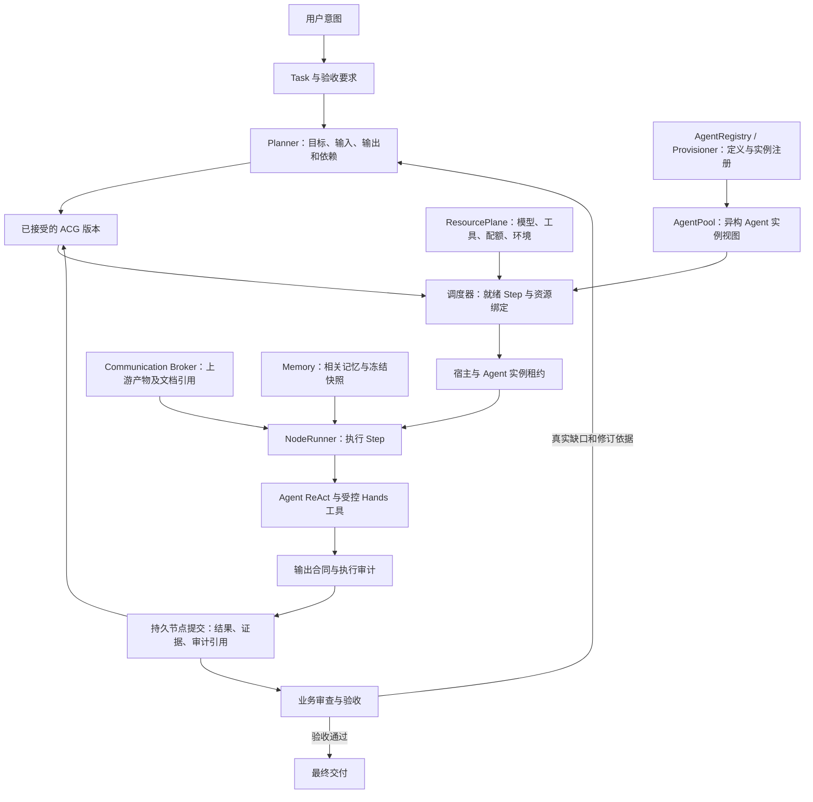

# ACG 的任务、执行与反馈合同

本文对应 2026-11-18 的协作修复，沿用现有执行内核。

## 各器件的唯一职责

| 器件 | 拥有的事实与决策 | 现有实现入口 |
| --- | --- | --- |
| Task / Step 合同 | 意图、目标、输入输出、验收要求；不提前选定某台机器或某个实例 | `contracts/planning.py`、`contracts/workflow.py` |
| Planner / 图编译器 | 工作分解、依赖、输入数据通道、局部修订；能力提示是候选，不是必须追加的业务工作 | `components/planner/task_decomposer.py`、`topology/compiler.py` |
| ResourcePlane | 资源、健康、配置和容量事实 | `components/resource/application/resource_plane.py` |
| AgentRegistry / AgentProvisioner | 定义版本、实例注册、受信模板组装、替换与回收 | `service/agents/registry.py`、`provisioning.py` |
| AgentPool | 联合注册、能力、宿主、健康和容量，向调度器提供当前实例视图 | `service/agents/pool.py` |
| ResourceBinder / LeaseCoordinator | 合法候选、适配评分、Agent 与宿主的容量预留、等待与释放 | `components/resource/scheduler/` |
| NodeRunner / Agent | 按 Step 合同执行；Agent 可在授权范围内 ReAct，不能自行声明全局任务成功 | `components/executor/node_runner.py`、`adapters/agent_tools.py` |
| Communication / Memory | 前者按图依赖交付产物和来源；后者提供受控召回。同次执行冻结已投递记忆，避免恢复时上下文变化 | `components/communicator/`、`components/memory/`、`executor/memory_input.py` |
| Audit / Workspace Review | 执行与输出审计、当前产物的业务验收；把问题和证据反馈规划 | `components/auditor/`、`runtime/workspace_review_execution.py` |
| ValueStore / Recovery | 不可变执行值、节点提交、重放证明和断点恢复 | `components/executor/value_store.py`、`runtime/permit_recovery.py` |

## 调度与交付

图根据已提交依赖确定 READY Step；Binder 根据 Step 的执行需求匹配实例与环境，原子预留宿主和 Agent 容量。两个 Step 竞争同一个实例时由租约保证容量，空闲且满足需求的副本可被选中。工具操作使用独立 Hands 容量租约，Agent 实例容量不能代替工具容量。

Step 分配和工具分配共同调用 `wait_ready()`。临时无容量进入等待；释放时主动唤醒，同时退避检查跨进程释放和租约到期。等待期间支持取消并重查执行许可，恢复容量后重新校验授权与工具审批。模型无需为资源暂忙重新推理。配置缺口、失去授权、外部结果未知仍分别进入各自的处理路径。

交付采用现有持久节点提交链：输出经过合同和执行审计后，以产物、来源、审计记录和提交标识持久化；图仅接收摘要及引用。它承担可重放的交付记录，避免另外维护一个容易失配的内存“完成队列”。业务审查节点消费已提交产物，验收后才形成最终交付。资源释放与产物提交是不同事实，不能相互代替。

## 两层 ReAct 与图版本

Agent 内部 ReAct 负责一个 Step 的具体执行，例如按需分页读取、检查和提交已有证据；ACG 层反馈负责跨 Step 的缺口，例如补读、重新分析和复验。后者通过正式图修订与接管推进版本，保留已完成前缀，仅执行需要新增或替换的工作。

验收针对当前候选产物。已有“草稿 → 审查 → 修订”的声明链若漏掉修订后复验，需要补上独立验证及其当前产物输入；显式控制循环复用原有审查机制。疑点允许被证实、被排除或保持证据不足，不预设一定存在缺陷。没有固定审查次数，继续与否依赖实际缺口和验收结论。

后续审查通过需要覆盖原来声明的验收义务，并实际获得当前产物字段。普通依赖路径、仅引用旧审查或读取其摘要，不能证明问题已解决；多个复验可分别履行各自的审查义务。模型新增复验时应继承原验收标准，运行时将未覆盖项反馈给 Planner 继续局部处理。缺少合同的历史记录保留受限兼容路径。

## 上下文与恢复

上游正文通过受控引用、字段合同和分页工具交付，不靠把全 Run 的历史正文重复塞入模型。记忆只提供相关背景和索引，不能证明当前工作区文件已读取。Planner 保留已提交探查依据、当前因果前沿和最新审查缺口。

冻结记忆和工具 WAL 目前共享历史 `tool:*` 值命名空间，因此恢复时必须按精确内部 key、节点归属、身份和策略验证记忆输入，再将其纳入恢复指纹。不能按前缀判断外部动作，也不能因记录带有某个 JSON 字段便忽略它。未知外部结果仍需核对；已经提交的结果直接复用，不重复产生副作用。

动态实例创建沿用受信模板和当前已接入的本地/远程协议。任意新环境的驱动、任意生成的执行代码和自动扩容策略不因声明一个能力名称就自动存在；需要对应适配器和注册事实。
