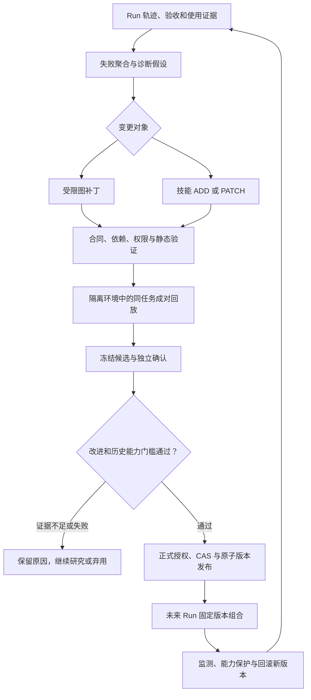

# 图与 Skills 演化：联合实现与验收计划

日期：2026-11-18。本文是基于文献与现有代码的后续实施建议，**本轮没有实现下述生产功能**。研究依据见 [图演化综述](graph_evolution/SUMMARY.md)和 [Skills 演化综述](skills_evolution/SUMMARY.md)，完整论文来源分别在两目录的 README 中。

## 1. 当前起点与目标

仓库已有真实 Run→Trajectory 投影、policy 的原子发布机制，以及受限 registered_validator_insertion 候选生成和图演化依赖注入编排。尚缺生产图快照验证、真实任务回放和正式图版本发布的接线；技能服务的评估、抽象、生命周期提案和检索仍为未实现方法。核查文件见 [图服务](../apps/agentOS/src/components/evolution/application/graph.py)、[候选生成器](../apps/agentOS/src/components/evolution/infrastructure/graph_candidates.py)及 [技能服务](../apps/agentOS/src/components/evolution/skill_service.py)。

首个目标应是一个可验收的最小闭环：从多个独立 Run 的重复失败提出一个局部补丁，使用未参与生成的任务进行基线/候选成对回放，通过明确质量和成本门槛后，以正式版本供未来 Run 使用。图和技能先分别改变，避免同时修改后无法归因。



## 2. 五类资产与版本绑定

| 资产 | 建议字段 | 必须满足的含义 |
|---|---|---|
| 轨迹证据 | runId、taskFamily、graphVersion、skillUsage、model/tool/policyVersion、sourceRefs、时间、内容摘要哈希 | 同 Run 快照不可重复计数；敏感原文留在授权存储 |
| 诊断卡 | failureType、stepId、supporting/counterEvidence、hypothesis、confidence、适用范围 | 解释是假设；区分 confirmed/refuted/inconclusive |
| 候选补丁 | target、baseVersion/baseChecksum、操作、preconditions、dependencyVersions、candidateChecksum、evidenceIds | 对象唯一、变更受限、父版本不可静默替换 |
| 评测报告 | candidateChecksum、baseline/reference、dataset角色/版本、taskIds、环境、评价器版本、成对结果和不确定性 | 只适用于被评测内容，修改候选后报告失效 |
| 发布回执 | proposalId/checksum、审批身份和策略、from/toVersion、reportChecksum、时间、幂等键 | 权限由正式主机验证，事务内提交，不接受调用方伪造分数 |

这些字段是建议扩展，不能误读为合同已有全部字段。尤其应先补 skillUsage 事件：区分 retrieved、injected、invoked、result_verified，保存实际 skillId/version 和步骤引用。仅在提示中出现过不能视为成功贡献。

未来 Run 冻结 graph、skill、model、tool、policy、retriever 的版本组合。技能包中的程序和资源也进入 checksum；依赖漂移时重新评测。历史 Run 保留原引用，不随最新版自动变化。

## 3. 阶段 A：建立真正可比较的回放

优先建立任务验收，不再把 completed 直接当作全部业务质量。每类任务规定可观察结果，例如文件确实存在且内容满足约束、检索答案有正确证据、表格运算符合确定性计算。模型 judge 可以补充语义维度，但应校准并保存原始评分依据；与确定性验收冲突时不能隐藏冲突。

回放固定任务、图、模型、工具、检索语料和环境快照。读取工具可用记录响应或确定性数据；外部写入用受控替身，记录期望副作用并验证其合法性。对于非确定性模型，预先规定重复次数、采样配置与失败处理，不在看到结果后选择对候选有利的重复。

建议按任务族、内容血缘及时间划分 development、selection、confirmatory。当前 ID 隔离是基础防线，同题换 ID、同文档派生问题仍可能泄漏。生成器不能访问最终确认题；确认结果进入下一轮开发后，该批数据不再承担新鲜确认角色。

验收产物为一个版本化任务集、运行环境说明和成对报告。至少能复现固定 baseline 的波动范围，并解释无法回放的任务类别。真实依赖未配置时明确不可用，不能用示例评分替代。

## 4. 阶段 B：接通一种图更新

第一种算子沿用现有 registered_validator_insertion。生产 validator 从正式图版本读取快照，检查 capability、目标步骤、插入位置、数据与控制依赖、输出合同、权限和资源上限。验证器结果应成为后续执行的真实条件；失败时必须有明确终止或恢复路径。

真实 evaluator 对 baseline 与 candidate 使用相同任务和环境，记录质量、总成本、重试、时延和失败类别。默认 max_cost_ratio=1.0 不应被隐式绕过；若某种验证增加成本但减少严重错误，应先通过明确的业务策略调整门槛并版本化该策略。

正式 publisher 负责身份鉴权、图编译、基版本 CAS、事务写入和回执。服务中的 approved_by 字符串只标识调用字段，不提供认证。发布前再次验证报告与候选、依赖及基版本一致；已有重新调用 trusted evaluator 的设计可保留，同时应规定报告冻结与非确定性重评的语义，避免将两个随机运行要求为无说明的完全相同。

验收至少覆盖：不同 Run 证据才能达到门槛；候选指向过期图时拒绝；修改候选后旧报告失效；持有伪报告不能发布；并发发布只有一个成功；重试返回同一回执；回滚生成新版本。这里列出的是后续实现时必要的行为验收，本轮不新增业务测试。

## 5. 阶段 C：技能只读基线与候选补丁

先有人工核验的小型种子库，用固定检索器测无技能、关键词、embedding 和混合召回。统一上下文和工具预算，记录未命中、错误适用、依赖不满足和成功复用。不要用技能数量作为唯一目标。

候选技能建议具备以下合同：

```yaml
skillId: example-validator-procedure
version: 1
kind: natural_language_with_optional_program
appliesWhen: ["有明确可检验的输出合同"]
notApplicableWhen: ["无法访问所需证据"]
inputs: {artifactRef: reference, acceptanceSpec: reference}
outputs: {verdict: enum, evidenceRefs: reference_list}
steps: ["读取合同", "执行已注册检查", "记录可核查结果"]
failureModes: ["证据缺失", "工具版本不兼容"]
dependencies: []
requiredCapabilities: ["registered_validation"]
evidenceRefs: []
```

该 YAML 是说明结构的例子，没有对应已实现 API，也不提供任何额外执行权限。实际候选必须填写真实证据、版本依赖及程序 hash。

抽象器从同族成败轨迹归纳槽位和边界，不复制原始敏感内容，保留来源引用；仅支持 ADD/PATCH。局部补丁绑定 base checksum，避免并发覆盖。先验检查包括 schema、依赖、循环、失效工具、资源大小和脚本静态检查；有程序则在隔离环境中验证行为。

## 6. 阶段 D：贡献评估、独立确认和生命周期

技能评测先固定图与检索，在同任务上比较原版、新版及无该技能。观察关联可用来排序候选；随机化消融能提供更强贡献证据，但仍需考虑多技能交互。不能把共同注入后成功的 reward 平均分配就称为因果归因。

发布判断采用预先约定的主要目标与受保护能力：主要质量相对 incumbent 的最低改进，历史能力相对 reference 的非劣容忍度，成本、权限和错误率的硬边界。报告样本量、拒绝数、分层结果和不确定性。样本量由最低有意义收益及方差估计决定，不设置一个声称适用于所有任务的固定数字。

建议状态转换为 candidate → verified → deprecated → retired，并保留 rejected/inconclusive 的决策记录。verified 需要同时满足合同和评测；deprecated 表示停止默认推荐或有替代版本；retired 保留历史和可追溯性。graveyard/dormant 是存储或召回层策略，不能等同于已经无用或可永久删除。MERGE/SPLIT 需要额外兼容评测，RETIRE 需要依赖影响分析和稀有能力保护。

候选 archive 用于多样探索，生产 registry 用于受批准版本。参考 DGM 时尤其不能把“进入探索档案”当成“已胜过父版本并获准上线”。两类资产通过状态及访问边界区分。

## 7. 联合更新时的归因和收益

图、技能单独形成稳定收益后，再研究联合更新。对于 G0/G1 图与 S0/S1 技能，至少比较 G0S0、G1S0、G0S1、G1S1；交互增益可用 Q11 − Q10 − Q01 + Q00 描述，并报告波动。它是实验条件下的交互量，不自动解释每一条边或步骤的因果贡献。

当新技能改变输入输出合同时，先产生兼容图候选，原子发布一个版本化组合或通过兼容依赖逐步升级；避免图已引用尚未发布的技能。运行时图修复仍由 Runtime 权威处理，离线演化只对未来版本提出建议。

总经济收益可用以下粗略模型判断：预期复用次数 × 每次净收益 − 构造/搜索/评测/维护成本。质量无法与货币直接换算时保留多目标结果，不能随意设权重。把所有搜索失败、检索开销和确认成本计入，防止只报告中选候选的推理节省。

## 8. 实验矩阵与实施顺序

| 实验 | 固定项 | 改变量 | 主要问题 |
|---|---|---|---|
| 图局部更新 | 模型、技能、任务与工具 | 原图 / 人工补丁 / 受限生成器 | 自动补丁是否修复重复失败 |
| 同预算结构 | 可用工具和总预算 | 单 Agent / 固定协作 / 自适应图 | 结构收益是否超出额外计算 |
| 技能检索 | 图、种子技能和模型 | 无技能 / 关键词 / embedding / 混合 | 找到技能是否带来净收益 |
| 技能演化 | 图和检索器 | 原版 / 局部补丁 / 整体重写 | 局部变化是否更稳定、便于回滚 |
| 生命周期 | 相同初始库和任务序列 | 只增加 / 频率裁剪 / 效用与保护集 | 库规模、遗忘与稀有能力如何平衡 |
| 联合更新 | 相同任务划分 | G0S0 / G1S0 / G0S1 / G1S1 | 是否存在可靠交互收益 |

实现优先级：真实验收与使用事件 → 可回放环境 → 一种图算子接通正式发布 → 只读技能基线 → 技能 ADD/PATCH → 生命周期与贡献估计 → 更多图算子 → 联合搜索或训练。每阶段以离线报告和可审阅产物为门槛，不以自动循环次数作为完成标准。

与差分隐私的衔接是证据最小化和发布边界：轨迹、诊断卡和技能都可能保留敏感信息，后续必须遵循同一数据治理与发布政策。未经邻接定义、机制和隐私会计论证，去标识或抽象成技能不能称为差分隐私。详见 [差分隐私综述](differential_privacy/SUMMARY.md)。
