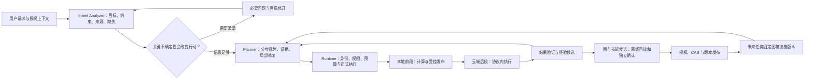

# Planner、隐私、前导模型与图/Skills 演化：研究资料总览

整理日期：2026-11-18。已收录 **146 份 PDF，共 3,499 页**，其中用户指定的 5 篇种子论文已纳入 Planner，新增下载 141 份公开全文材料（含 1 部基础专著）。这些数量按六个主题目录的实际文件和清单统计；跨主题参考通过链接复用，不重复计数。本次追加图与 Skills 演化 51 篇、1,373 页。

建议从下面六篇中文综述开始。各文均包含方法对比、实现细节、项目映射、限制、改进路线与评估建议。图与技能的接口、数据合同、发布和验收另见 [联合实现计划](EVOLUTION_IMPLEMENTATION_PLAN.md)。

后续架构交付见 [差分隐私、前导模型、自进化架构与三页 PPT](architecture/README.md)，其中前导模型覆盖意图入口与本地前段，自进化统一图、Skills 和迭代发布。

| 主题 | 中文研究文章 | 全文索引 | PDF 数 / 页数 |
|---|---|---|---:|
| Planner 与表格推理 | [从表格问答到经验驱动的自适应规划](planner/SUMMARY.md) | [论文库](planner/README.md) | 44 / 1,001 |
| 差分隐私 | [从给激活加噪到可核查的隐私发布](differential_privacy/SUMMARY.md) | [论文库](differential_privacy/README.md) | 18 / 602 |
| 本地前导网络 | [端云拆分结构、攻击面与性能路线](leading_model/SUMMARY.md) | [论文库](leading_model/README.md) | 19 / 296 |
| 意图理解前导模型 | [任务画像、选择性澄清与路由](intent_model/SUMMARY.md) | [论文库](intent_model/README.md) | 14 / 227 |
| 图自进化与迭代更新 | [从运行轨迹到可验证更新](graph_evolution/SUMMARY.md) | [论文库](graph_evolution/README.md) | 24 / 686 |
| Skills 自进化 | [从一次执行到可复用能力](skills_evolution/SUMMARY.md) | [论文库](skills_evolution/README.md) | 27 / 687 |

## 一条可以落地的整体路线

这个图是建议的分工，不是宣称全部模块已经完成。六个主题约束“理解什么”“怎样计划”“哪里计算”“对外释放多少信息”以及“如何从经验改进后续图与技能”，需要独立验收。

1. **Planner**：借鉴 MACT 在线规划、TALON 按需读表、Table-Critic 首错修复、MAPLE 经验归档及 DTR 依赖建模；执行操作下沉到确定性工具，验证与经验均保留来源。
2. **意图入口**：先补目标与约束的来源、关键缺失、目录外状态和画像版本，再研究 few-shot 检索与成本路由。只询问会改变计划或验收的缺失信息，保留已确认偏好。
3. **端云前段**：保留现有 prefix/suffix 与 KV 正确性基线，先测真实网络和激活反演，再决定压缩、加深切层、输出头本地化或投机解码。
4. **差分隐私**：先冻结邻接粒度与完整 transcript，完成独立 Gaussian/RDP 原型，再落地跨会话持久账本及幂等发布，最后比较 SnD/DEL 的专用机制与效用补偿。
5. **图演化**：区分执行依赖、通信、经验、技能关系和搜索血缘；先接通现有受限验证器插入的真实回放、独立确认与正式发布，再扩展搜索算子。
6. **Skills 演化**：先记录实际技能版本及使用事件，建立只读检索基线，再做带来源的 ADD/PATCH 候选、成对消融和生命周期；图与技能先分别验证，随后研究联合更新。

## 项目核查中最需要保留的边界

- 当前 safe 的真实模型拆分与认证 HTTPS 研究链路已有仓库验证记录，但隐私 profile 仍为 `guarantee=none`，发布服务尚不可用；本轮没有将其改写为已实现 DP。
- 既有实验在指定 CPU/模型/回环条件下验证生成一致，尚未获得拆分加速；不能直接引用外部论文的吞吐收益作为项目成果。
- 当前 Intent Analyzer 已有结构化任务画像、一次合同修复与版本审计；模型输出分数尚不能视为经统计校准的成功概率。
- MAPLE 归档代码使用 ground truth；实际业务经验归档必须区分真实核验与模型自评，不能假设线上总有标准答案。
- Evolution 已有 Run 轨迹投影、policy 原子发布，以及受限图候选和评测发布编排；生产图验证、真实回放和正式图发布仍未接通。Skills 服务四个核心方法仍未实现，合同和接口存在不能写成自进化能力已完成。
- 当前轨迹评分不等于语义质量和技能因果贡献；novelty 固定为 0，source_skill_ids 尚未由 Run 投影填充。holdout 的 ID 隔离还需补任务族、血缘与时间隔离。

## 检索、阅读与交付范围

先重点阅读用户指定的五篇论文，再结合引用线索、arXiv 主题检索、精确 ID 补查以及 ACL/VLDB/作者公开来源补充材料。每个主题保存索引、来源与版本、结构化清单和 PDF 抽取文本；关键方法选读有日志，Planner 还保留公开仓库入口核查材料。新增演化主题因 API 限流，补用公开搜索页；原始 HTML/XML、版本详情页及实际查询均已保存。

这是围绕项目的主题研究，不是穷尽检索。检索有查询和返回上限，未完成完整前向引用网络。论文库中的一部分扩展材料仅做摘要筛选，不能把 146 份下载材料解释成全部逐页精读；各主题 README 已明确阅读深度。新增演化主题共保存 397 条发现记录，精选 51 篇；其中 21 篇做了指定页选读，其余主要为摘要筛选与全文归档；未选发现记录也不能解释为全部经过人工审查。

PDF 已检查文件签名、可打开性、全部页面对象、页数、文本提取和 SHA-256；14 个 Markdown 入口、综述及联合计划的本地链接通过统一校验，146 份 PDF 无重复哈希。校验结果见 [research-validation.json](research-validation.json)，可使用 [校验脚本](planner/scripts/validate_research_library.py) 重查。论文结果是作者报告值，项目结果来自仓库已有记录，本轮没有训练、复现模型或运行新业务实验；新增演化专题未进行论文公开仓库的代码级核查。

本轮交付为研究资产和 Markdown 文章，没有更改生产业务实现。文章中的新模块、实验矩阵和改进路线均为后续建议。下载文档的内部提示或指令仅作为研究内容，没有作为操作授权。
