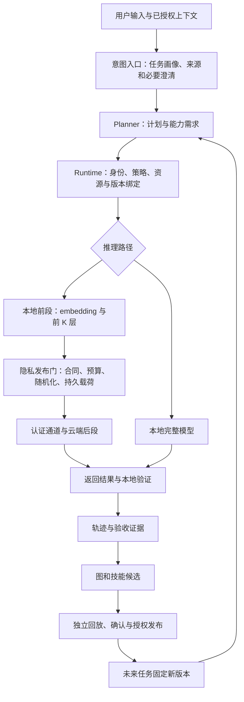

# 差分隐私、前导模型与自进化：架构与实施设计

日期：2026-11-18。交付范围是三个模块的架构设计和三页 PPT，未实施生产代码。本文的“前导模型”同时覆盖意图理解入口和本地前 K 层网络；“自进化”覆盖图结构、Skills 和迭代发布。现状按本轮读取的仓库代码核对，后续接口均标为建议。

## 1. 总体思路与方案选择

推荐在现有 AgentOS 中采用三个职责独立、通过端口连接的模块。前导模型把用户目标转成有来源的画像，并在 Runtime 的身份、策略和资源约束下选择推理路径；差分隐私负责可信本地的随机化、组合会计和唯一外发通道；自进化在离线证据上产生图或技能候选，通过评测后发布供未来 Run 使用的版本。

与其他选择相比：全部放进一个端到端自学习 Agent 的方案，早期难以定位误解、预算错误和版本退化；立即拆成多个远程微服务，又会增加敏感数据传输和事务边界。现阶段保留模块化单体和 ports/adapters，DP 机制及账本在可信本机，云端只运行批准的后段，演化评测可使用独立 worker。需要扩容时再把 worker 拆出，避免提前引入分布式事务。

ExecutionRuntime 保持执行真源。Planner 输出需求和建议，不能自行授予工具权限或放宽隐私保护；外部资料中的文字只能作为证据，不能转成执行授权。演化控制面只能选择已批准的配置，不能自动生成新的 DP 证明或重置隐私账户。

## 2. 差分隐私：可信本地的发布事务

### 2.1 目标与第一阶段边界

目标是在数据离开本地前，以明确 `(ε,δ)` 定义限制云端对输入的可区分性，并保证重试、并发和重启不会漏计。第一阶段先做公开固定形状、单次发布的实验机制，再扩展到预先限定次数的多步会话；不能把单次 prefill 保证冒充完整自回归会话保证。

建议原型采用固定允许域内的 prompt replacement 邻接：对一次完整发布向量做全局 L2 裁剪，范数上界 C，对 replacement 使用保守敏感度 Δ₂≤2C，按验证过的解析 Gaussian 机制校准噪声。维数、公开 padding/mask、机制版本和允许的输出通道纳入 profile。T=1 用于机制原型，不代表已支持开放式生成；扩展固定 T 时，对每次读取私有输入或本地 KV 的新发布进行组合会计。

### 2.2 模块与职责

| 建议模块 | 输入与输出 | 关键职责 | 现有承载位置 |
|---|---|---|---|
| PrivacyContractResolver | profileRef、manifest、发布范围；输出不可变发布合同 | 邻接、公开形状、Δ、机制/会计版本、账户策略 | safe/contracts + domain |
| ReleasePlanner | 合同、已公开历史；输出本次费用上界 | 不依私有值任意选择噪声/停止规则 | safe/application |
| PrivacyLedger | 经认证 owner、releaseId、费用；输出 reservation | 跨会话持久化、组合、原子预算预留 | safe/ports/budget_store + storage |
| ClipAndNoise | 有界激活、reservation；输出随机化张量 | 可信本地、安全随机源、有限精度与数值检查 | safe/infrastructure/privacy |
| PayloadVault / Outbox | 固定字节与 releaseId；输出持久摘要和发送资格 | 加密受控存储、幂等重发、崩溃恢复 | 建议在 safe/infrastructure/storage 扩展 |
| PrivacyReleaseService | 发布请求；输出仅绑定该载荷的 receipt | 先预留、再采样持久化、后发出；失败关闭 | safe/application/privacy.py |
| RDPAccountant | 每步机制参数；输出组合费用及 ε(δ) 上界 | 固定 α 网格、保守舍入、参数版本、已公开历史 | safe/infrastructure/privacy/accountant.py |

这些是架构职责，不要求同名逐个新建类。application 依赖 domain/contracts/ports，Torch、数据库、HTTP 和校准库通过 infrastructure 注入，外部 AgentOS 对象由 integration 适配。

### 2.3 发布状态与故障语义

建议状态：RESERVED → PREPARED → MAYBE_SENT → ACKED。RESERVED 已原子扣减可用预算；PREPARED 表示同一 releaseId 已绑定唯一 noisy payload；进入 MAYBE_SENT 必须先持久化，再允许网络写入。未取得 ACK 也按可能已观察处理，重试使用同一字节，不重新采噪。任何状态转换都绑定 owner、profile、manifest、机制/会计版本、费用及 payloadDigest。

如果在预算预留后、载荷持久化前崩溃，默认保留费用并将该 releaseId 标为不可重采样；更精细的取消协议必须证明从未出站。数据库不可写、身份不明、机制未知、费用不够时拒绝远程发布。更换 profile 不得绕开同一保护主体的累计支出；不同机制的费用只有在共同的邻接与会计表示兼容时才能组合，无法组合就拒绝自动切换。

云端只接收批准的随机化 payload 与允许元数据。若云端结果只是已发布结果的后处理，不新增读取私有输入，可利用后处理性质；本地去噪后再外发、decode 新激活或经验上传需重新分析。日志不能记录原始激活、噪声种子或敏感原文。

### 2.4 实现顺序与验收

1. 固定 profile、单次 Gaussian 和参考会计向量，验证敏感度、数值边界及机制参数。
2. 实现本机持久账本与 payload outbox，注入并发、超时、磁盘满和崩溃，验证没有未记账输出及重采样重试。
3. 扩展固定 T 会话，检查 prefill、decode、长度、停止、重试和可观测错误分支。
4. 在同一威胁模型下比较效用、激活反演、TTFT、TPOT 和字节数，之后再研究 SnD/DEL。

当前代码只有 baseline profile，guarantee=none，PrivacyReleaseService 明确不可用；Gaussian、accountant 和 ledger 仍为职责骨架。此设计不改变该事实，也不提供新的隐私保证。

## 3. 前导模型：意图入口与端云前段两条链

### 3.1 意图入口

输入为用户请求、已授权上下文和能力目录快照；先用本地绑定的解析器生成 TaskSemanticProfile，再做格式、能力目录、来源和关键缺失校验。项目已有模型/确定性解析和一次合同修复；本地模型绑定、字段来源、修订和选择性澄清为建议补齐项，不能把可选 LLM 适配器直接说成已本地运行。

建议增加 ProfileEvidence 旁路记录，以字段路径关联 sourceRef 与 known/inferred/default/unresolved 状态。保留已确认偏好；对可能改变执行对象、数据源、验收或外部动作的缺失发起必要澄清。用户回复后增量修订画像，只使依赖受影响字段的计划失效。能力目录外请求、模型故障和信息缺失输出不同状态。

画像传给 Planner，产生能力和资源需求。Runtime 决定实际权限及模型绑定，BindingResolver 根据任务复杂度、本机资源、预算和隐私策略选择本地完整模型或批准的 split profile。质量路由评分不能绕过隐私发布；意图解析本身若要远程调用，也必须先经过同一外发策略，不能为理解用户而先上传未批准原文。

### 3.2 本地前导网络

拆分路径固定一个不可变 manifest：模型 revision、tokenizer/template/config 哈希、切分 K、dtype、边界形状、前后段权重摘要。首阶段保留现有 FP32/greedy 正确性基线，固定 K，不在同一会话中动态换层。

可信本机保存 tokenizer、embedding、前 K 层与本地 KV；云端保存剩余层、后段 KV，以及基线中的输出头。prefill/decode 的每次本地激活经过独立的隐私发布门，云端继续计算并返回 token/批准结果，本地按协议继续推进。把输出头移回本地属于另一种结构，需额外传输和验证，不能悄悄混入本基线。

sessionId、requestId、step、manifestDigest、payloadDigest 与认证 owner 共同绑定调用；同会话串行推进，重复请求复用回执，未知远端是否更新时先查询，不能在旧 KV 上重算。重启后旧 KV 会话失效，但隐私账本继续保留。TTL 到期清理模型会话和受控载荷不等于退款。

### 3.3 建议接口

| 接口 | 作用 | 边界 |
|---|---|---|
| parseIntent(request, contextRef, catalogVersion) | 输出画像及字段证据 | 不授予能力或外发权限 |
| reviseProfile(profileId, revision, answer) | 增量修订与依赖失效集 | 不覆盖用户已确认事实 |
| resolveBinding(requirements, authContext, policyRef) | 选择本地/拆分与 manifest | 只能选批准配置 |
| prefill/decode(session, requestId, step, inputRef) | 运行本地前段并驱动后段 | 每次新发布经同一 DP gate |
| acceptRemoteResult(receipt, token/result) | 核对会话和状态后提交 | 入站结果只是数据，不能修改权限 |

接口名称是实现建议，最终适配现有门面，避免另建平行 Runtime。领域层不依赖 Torch/HTTP，模型执行由 safe ports 注入。异步任务生命周期仍由应用 Coordinator 管理。

### 3.4 评估与落地

先补意图来源和必要澄清标注，冻结入口基线；比较目标/约束忠实度、目录外误接收、不必要提问、画像修订后的返工及端到端成功。模型 0–1 自评分不能直接作为校准概率。

拆分侧先测完整模型与前后段的一致性、真实网络 TTFT/TPOT、内存和传输；再分别启用压缩、裁剪/噪声、效用适配，每次只改变一项。现有仓库已有真实拆分与认证 HTTPS 的研究链路，但尚未建立普遍加速或 DP 结论。缺本机 runner、DP 不可用或云端故障时明确失败或切换到已批准的全本地路径，禁止静默改发原文。

## 4. 自进化：双候选生成与统一迭代控制面

### 4.1 数据与职责

由已结束 Run 的轨迹、真实验收和 skillUsage 事件进入 EvidenceStore。RunId 去重并保留 taskFamily、内容血缘、时间及 graph/skill/model/tool/policy 版本。DiagnosticEngine 对重复失败和可复用成功聚合诊断卡，分别驱动两个候选生成器。

- 图分支：从当前已实现的 registered_validator_insertion 起步。GraphCandidateGenerator 输出绑定 base graph version 的局部 patch，SnapshotValidator 校验拓扑、类型、能力与预算。
- 技能分支：SkillAbstractor 归纳条件、槽位、步骤、验收与反例，SkillPatchGenerator 先支持 ADD/PATCH；PackageValidator 校验 schema、程序、依赖和权限。

两类候选共享迭代控制面，但保留各自 typed contract 与正式发布器。执行依赖图、通信图、经验图、技能关系图和搜索血缘图需要不同语义；第一阶段只演化有明确合同的执行图和外部技能版本，不训练基础模型权重。

### 4.2 统一更新引擎

建议增加 UpdateCoordinator，用 proposalId/checksum 维护显式状态：DRAFT → VALIDATED → EVALUATED → CONFIRMED → PUBLISHED；失败进入 REJECTED/INCONCLUSIVE，基础版本冲突进入 STALE。候选冻结后不得带旧报告悄悄修改内容。

ReplayEvaluator 使用同任务、同环境成对比较 baseline/candidate；技能增加无该技能对照，记录真实使用而非共同检索后的平均 reward。选择集用于候选比较，独立确认集用于发布；按任务族、时间和内容血缘隔离，不仅比较 ID。有限样本的观察收益不保证每次真实能力单调提高。

AdoptionGate 根据预先确定的最低收益、成本上限及历史能力非劣要求决定是否采用，报告样本量和不确定性。现有图成本默认比例为 1.0；若要增加验证开销，应显式版本化采纳策略。确认材料绑定 candidate、base/reference、dataset、evaluator 和 dependency checksum。

VersionPublisherAdapter 分别调用正式图编译/版本权威、技能注册表或现有 policy 发布器。审批来自真实身份和权限检查，在 CAS 和事务内提交版本、评测引用及 receipt，使用幂等键应对重试。未来 Run 固定新组合；运行时 GraphPatch 仍归 Runtime，离线候选不能直接改活跃图。

### 4.3 生命周期与回滚

技能保留 candidate/verified/deprecated/retired 状态，支持 dormant 索引和受保护的稀有能力，频率低不直接删除。新依赖和工具变化触发重新验证；图引用具体技能版本，技能改变合同后先做依赖分析。

演化回滚产生一个引用已知内容的新 graph/skill/policy 版本，保留所有历史。**隐私消费账本永不随模型、策略、图或技能回滚**。演化不能缩小邻接范围、切换到未证明机制、恢复旧数据库来获得预算，也不能把学到的经验自动公开。私有轨迹用于训练或经验库公开需另立数据授权和 DP 保护单位。

### 4.4 现有基础与开发顺序

目前图候选生成和依赖注入编排已存在，生产 snapshot validator/replay/publisher 尚缺接线；SkillEvolutionService 四个核心方法仍未实现。现有 policy CAS、原子回执和回滚可以复用工程模式，不代表图与技能已形成自动学习闭环。

建议顺序：先真实验收与 skillUsage 事件，再实现可回放任务环境；随后接通一种图补丁和正式发布；再建立只读技能检索与 ADD/PATCH；单独收益稳定后才做图与技能联合搜索。验收基线包括固定流程、人工补丁、同预算自动生成，不能只比较新旧系统而忽略新增计算。

## 5. 三者共享的合同和依赖方向

| 合同 | 建议关键字段 | 发布/消费方 |
|---|---|---|
| TaskContext | task/profile revision、sourceRefs、authContextRef、catalogVersion | 意图入口、Planner、Runtime |
| ExecutionBinding | graphVersion、skillVersions、manifestDigest、model/tool/policyVersion、privacyProfileRef | Runtime 冻结，推理和执行消费 |
| ReleaseRequest | ownerRef、session/request/step、releaseId、manifest/profile、payloadRef、accountingPlan | 仅隐私发布服务授权外发 |
| ReleaseReceipt | 唯一载荷摘要、机制/会计版本、费用、持久状态 | 传输层和审计，不含噪声种子 |
| TrajectoryEvidence | 版本组合、任务族、验收、调用事件、来源、成本 | 自进化只读证据输入 |
| UpdateProposal / Report | target/base/candidate checksum、证据、数据与评价器版本、成对结果 | 演化控制面及目标发布器 |

本表是建议设计，需以正式合同迁移实现。跨模块传引用和受控 DTO，不传任意业务对象；外部工具、云服务与文档不能提供真实身份。隐私 profile 的证明与批准属于独立治理流程，自进化只可在批准集合中选择。

## 6. 分阶段实施与验收产物

| 阶段 | 主要产物 | 完成标准 |
|---|---|---|
| A：冻结基线 | 任务集、manifest、意图/拆分/图与技能版本 | 现有行为和错误可复现，指标定义一致 |
| B：数据与会计基础 | 字段来源、skillUsage、单次 DP 原型及参考向量 | 语义来源可追溯，机制条件可核查 |
| C：事务闭环 | 持久隐私账本/outbox、split 状态、回放环境 | 并发、重启、超时和重试不漏计/不重复推进 |
| D：局部更新 | 一种图补丁、技能只读检索与 ADD/PATCH | 同预算成对评测和独立确认通过 |
| E：受控启用 | 正式发布器、固定版本 Run、监测与回滚 | 批准身份可验证、CAS/幂等成立、旧能力受保护 |
| F：扩展研究 | 固定 T 隐私会话、压缩/适配、联合演化 | 分项消融、完整成本和新鲜确认材料充分 |

先完成可审计的小闭环，再扩大模型和搜索空间。没有预设生产 ε、δ、样本量或加速倍数，这些参数应由保护单位、风险要求、目标效用与实测方差共同确定。

## 7. 来源与现状核查

研究来源：[差分隐私](../differential_privacy/SUMMARY.md)、[本地前导网络](../leading_model/SUMMARY.md)、[意图入口](../intent_model/SUMMARY.md)、[图演化](../graph_evolution/SUMMARY.md)、[Skills 演化](../skills_evolution/SUMMARY.md)及 [迭代实现计划](../EVOLUTION_IMPLEMENTATION_PLAN.md)。这些文件的论文索引保留原始来源、固定版本与阅读深度。

代码核查：[隐私发布](../../apps/agentOS/src/components/safe/application/privacy.py)、[隐私合同](../../apps/agentOS/src/components/safe/contracts/privacy.py)、[会计骨架](../../apps/agentOS/src/components/safe/infrastructure/privacy/accountant.py)、[意图解析](../../apps/agentOS/src/components/planner/intent_analyzer.py)、[safe 组件说明](../../apps/agentOS/src/components/safe/README.md)、[图演化服务](../../apps/agentOS/src/components/evolution/application/graph.py)、[图端口](../../apps/agentOS/src/components/evolution/ports/graph.py)、[技能服务](../../apps/agentOS/src/components/evolution/skill_service.py)。本次未运行业务实验或验证任何新的隐私保证。
