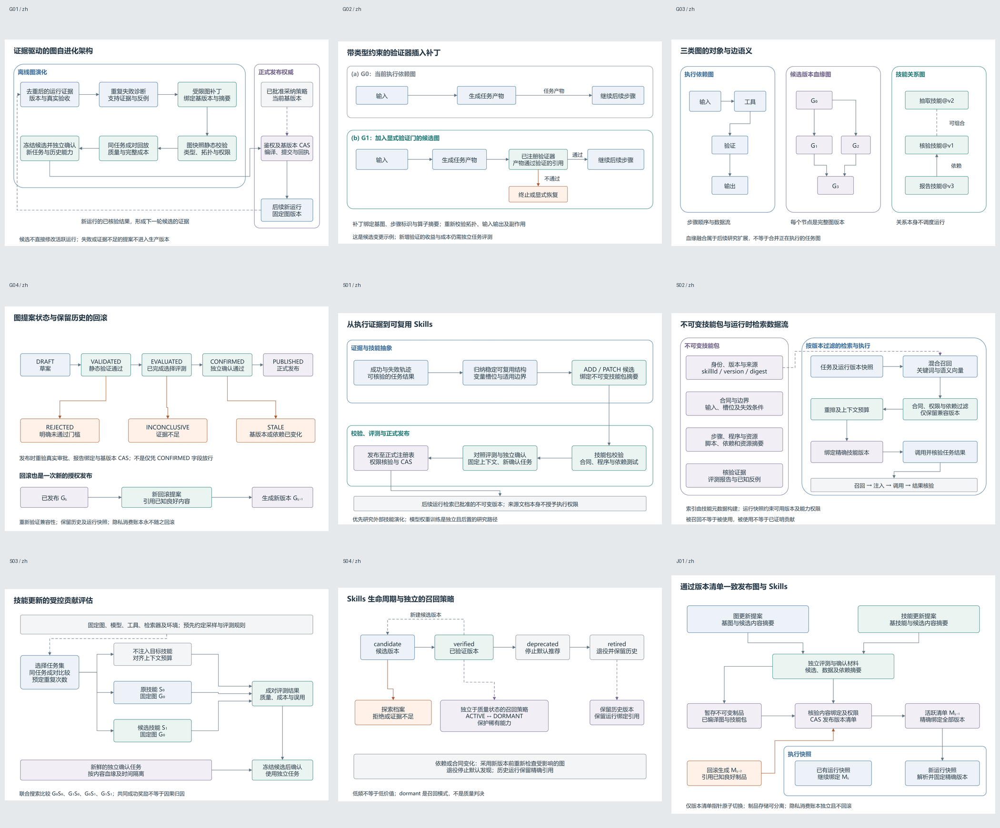

# 图与 Skills 自进化：论文架构图组

2026-11-19。九张原创设计图，中英文各一套，承接[三模块架构](../ARCHITECTURE_DESIGN.md)和[联合实现计划](../../EVOLUTION_IMPLEMENTATION_PLAN.md)。这是目标架构与评测协议设计，尚不代表生产闭环已实现，也不包含实验效果声明。

## 直接使用

- [完整交付包 ZIP](Evolution_Figures_Package.zip)：原生 draw.io、矢量 SVG/PDF、高清 PNG、图注、逻辑审查和生成工具。
- [中文九图 PDF](pdf/Evolution_All_Figures_zh.pdf) / [English PDF](pdf/Evolution_All_Figures_en.pdf)。
- [中文九页 draw.io](drawio/Evolution_All_Figures_zh.drawio) / [English draw.io](drawio/Evolution_All_Figures_en.drawio)。
- 图演化四页：[中文 draw.io](drawio/Graph_Evolution_zh.drawio) / [English](drawio/Graph_Evolution_en.drawio)。
- Skills 演化四页：[中文 draw.io](drawio/Skills_Evolution_zh.drawio) / [English](drawio/Skills_Evolution_en.drawio)。
- 联合发布：[中文 draw.io](drawio/Joint_Release_zh.drawio) / [English](drawio/Joint_Release_en.drawio)。

## 图索引

| 编号 | 内容与阅读目的 | 中文预览 | 英文矢量图 |
|---|---|---|---|
| G1 | 图演化闭环：证据、诊断、受限补丁、回放、独立确认、正式发布 | [PNG](png/g01_zh.png) | [PDF](pdf/g01_en.pdf) |
| G2 | 验证器插入：执行 DAG 的前后变化与通过/失败分支 | [PNG](png/g02_zh.png) | [PDF](pdf/g02_en.pdf) |
| G3 | 执行依赖图、候选版本血缘图、技能关系图的语义区分 | [PNG](png/g03_zh.png) | [PDF](pdf/g03_en.pdf) |
| G4 | 提案状态、证据不足、过期以及保留历史的回滚 | [PNG](png/g04_zh.png) | [PDF](pdf/g04_en.pdf) |
| S1 | 成败轨迹到可复用技能：抽象、ADD/PATCH、校验、确认、注册 | [PNG](png/s01_zh.png) | [PDF](pdf/s01_en.pdf) |
| S2 | 不可变技能包与运行时混合检索、版本过滤、绑定和使用事件 | [PNG](png/s02_zh.png) | [PDF](pdf/s02_en.pdf) |
| S3 | 无目标技能、原技能和候选技能的受控比较及独立确认 | [PNG](png/s03_zh.png) | [PDF](pdf/s03_en.pdf) |
| S4 | 技能生命周期与 active/dormant 召回策略的独立性 | [PNG](png/s04_zh.png) | [PDF](pdf/s04_en.pdf) |
| J1 | 图与技能的不可变制品、CAS 清单切换、运行快照和回滚 | [PNG](png/j01_zh.png) | [PDF](pdf/j01_en.pdf) |

单图各有 `_zh`、`_en`，在 `drawio/`、`svg/`、`pdf/`、`png/` 使用相同文件名。主文建议优先使用 G1、G2、S1、S2、J1；G3、G4、S3、S4 可按论文篇幅放入方法或补充材料。九张不是要求同时塞进一篇主文。

## 编辑、投稿与样式

在 draw.io / diagrams.net 中选择“文件 → 打开来源 → 设备”打开 `.drawio`。每个框、标签、连接线和转折点均为原生对象，不是位图背景；多页文件通过底部页签切换。英文版适合论文，中文版适合方案讨论。

蓝色表示执行/证据，青色表示候选/评测，紫色表示版本/发布，灰色表示背景约束，橙色表示失败/回滚。实线是主要流向，虚线表示约束、元数据、血缘派生或反馈；具体含义由上下文及图注确定。G3 的无向虚线专门表示可组合关系。

PDF 按 180 mm 通栏宽导出，保留可选择文字并嵌入字体；SVG 保留矢量文字与形状；PNG 宽 2880 px，按 180 mm 排版约 406 dpi。图中文字经检查不低于 8 pt。原生设计宽为 1440 单位，不能把设计字号直接当成印刷字号。单栏缩小会降低可读性，应拆分面板而非直接压缩。最终仍需按具体会议版心、字体和图注规范调整。

## 说明与复现

- [中英文图注](CAPTIONS.md)：各图适用范围、变量、对照与语义。
- [逻辑审查](LOGIC_REVIEW.md)：候选与发布边界、数据隔离、内容绑定、并发、回滚及现状。
- [图组规划](FIGURE_PLAN.md)：每图的单一任务与主文/补充定位。
- [机器检查记录](validation.json)：XML、几何、文字、矢量、字体、页面及文件 SHA-256。

生成入口为 `tools/build_drawio.py`；渲染入口为 `tools/render_drawio.cjs`，依赖 Playwright 和本机 Edge。设置 `KINLIN_NODE_MODULES` 为含 Playwright 的模块目录，并将官方 `https://www.draw.io/js/viewer.min.js` 保存为 `.build/viewer.min.js`；其本次渲染哈希见 validation.json。渲染仅允许本地回环请求。缓存脚本不包含在 ZIP 中。最终检查/合并入口为 `tools/finalize_figures.py`，依赖 PyMuPDF、Pillow；它读取生成及渲染阶段的 `.build` 报告。视觉检查完成后才能更新其人工审查记录，机器通过不能代替人工检查。

研究依据延续[图演化综述](../../graph_evolution/SUMMARY.md)与[Skills 综述](../../skills_evolution/SUMMARY.md)，论文库阅读深度以各目录 reading-log 为准。本次图组整理没有新增论文检索或复现实验。外部文献提供研究思路，清单发布和工程约束是本项目的设计综合。

