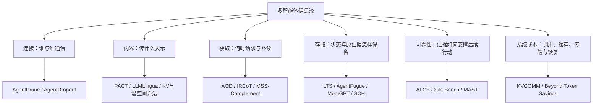

# 多智能体通信与按需证据获取：文献综述

检索截止：2026-11-25。用途：为 Kinlin/AgentOS 通信器选择第一篇扎实的方法或系统论文问题。

## 摘要

大语言模型多智能体通信的研究，已从设计谁与谁交流，扩展到选择交流什么、何时请求帮助、如何复用原始观察，以及何时已有足够证据继续行动。单纯提出“用引用代替正文”“提供摘要后按需读回原文”或“按当前缺口检索”，已经不足以建立创新性：LTS、AgentFugue、Ask on Demand、MSS-Complement 与 Semantic Context Handoff 分别覆盖了这些设计的重要部分。近期工作也表明，消息更短、读取更多和最终答对，分别不能替代总成本、正确整合与证据支持的评估。

本轮主语料38篇，其中18篇定向选读正文，20篇停留在标题和摘要层；反向检索另核对3篇边界文献的摘要，另有1篇流程工具来源。结论是：项目仍有值得研究的方向，但应把宽泛的“按需通信”收窄到**受预算约束时，跨来源、分页和版本变化如何影响证据完备性与下游决策可靠性**。这只是候选问题，需要先用强基线和诊断实验证明其重要性，再决定方法贡献。

## 1. 调研范围与证据边界

主题覆盖2018—2026年的相关工作，重点为2024—2026年的方法与系统。主要检索和核验来源为 arXiv、ACL Anthology，补充 OpenReview 交叉核查，以及作者正文中的参考文献和公开实现入口。先前仓库中的协议综述作为种子；新增内容集中于通信选择、共享记忆、主动检索、上下文压缩和证据评估。

这是一份**有检索和阅读记录的专题综述**，不是完成双人筛选、穷尽数据库与前向引用追踪的系统综述。没有进行荟萃分析，没有复现论文；下述效果均为作者在特定模型和任务上的报告。全文HTML的取回不代表逐页精读，具体选读范围见[阅读记录](READING_LOG.md)。

38篇文献中，34篇为方法、系统、实证或数据资源，4篇为主题综述。仅凭arXiv源页不自行推断同行评审或录用状态；正式ACL来源与arXiv来源在[文献目录](REFERENCES.md)中分别保留。不同论文的百分比、token和时延不做横向排名。

## 2. 将“通信器”分解为六个研究层次

图为本轮综合框架，展示问题分工，不表示各论文互相排斥，也不表示图中方法效果可直接比较。

### 2.1 拓扑与Agent数量：减少不必要的交流关系

AgentPrune将通信表示为时空图，通过优化和一次性剪枝减少冗余连接；AgentDropout进一步针对不同轮次的冗余Agent及交流调整图结构。这一层回答“谁值得参与、哪些连接值得保留”。[P01](REFERENCES.md#p01)、[P02](REFERENCES.md#p02)

对项目而言，Planner的依赖图与通信器的字段、页面选择属于不同干预。只更换图后报告token下降，不能证明读取策略更好；只固定图做字段选择，也不能宣称已经解决动态群体组织。可以先固定图隔离通信机制，后续再研究组合。

### 2.2 消息内容：保留行动需要的信息

LLMLingua及LongLLMLingua研究提示压缩与问题感知的关键信息保留。PACT更直接面向Agent交接，将公共消息组织为Action、State和Result，控制进入共享历史的内容。其意义在于：有效通信需要传递能继续工作的状态与依据，通用“尽量简短”并非充分规则。[P17](REFERENCES.md#p17)、[P18](REFERENCES.md#p18)、[P06](REFERENCES.md#p06)

因此，“采用结构化JSON”“去掉冗余推理”“保存来源字段”都应当先当作工程设计和基线，而非直接命名为原创算法。比较必须控制消息产生方式、支持材料和接收方可用工具。

### 2.3 接收方主动获取：最接近上一轮选题

ReAct、IRCoT、FLARE、Self-RAG和Adaptive-RAG已经建立了边推理边行动、依据当前状态调整检索的不同路径。它们的场景、训练与决策粒度不同，但共同削弱了“运行中再获取信息”这一宽泛表述的新颖性。[P12](REFERENCES.md#p12)—[P16](REFERENCES.md#p16)

Ask on Demand（AOD）把需求直接带入多Agent通信：请求者说明缺什么、已知什么及将影响的决策；门控批准后，从其他Agent已完成的记录中检索，再由选中的peer生成带依据的回复。其门控用同状态下批准／拒绝请求的成对后续执行训练，成本覆盖任务与辅助模型调用。[P03](REFERENCES.md#p03)，§3

MSS-Complement把相关性检索推进为“当前状态缺少的联合充分证据集合”构建。其SERBench按决策要求的分组证据评估完整集合，而不仅是命中若干相关段落。它与上一轮建议的“缺口驱动补读”高度相邻。[P07](REFERENCES.md#p07)，§3—5

我们的候选问题必须在这些工作之上进一步限定。把普通RAG应用到多Agent，或者给通用工具调用加“缺失证据”提示，并不自动形成方法增量。

### 2.4 共享记忆与原文恢复：已有比“只传摘要”更强的设计

LTS的共享记忆将摘要作为键、原始Agent输出作为值；接收方看到轻量摘要后，可按需选择原输出。其学习重点是是否准入共享记忆，并非正文一经摘要就被销毁。[P04](REFERENCES.md#p04)，§3.1、§4.4

AgentFugue将已完成轨迹写成episode笔记，保留原episode供更深读取，并支持按意图获取同伴进展。MemGPT和RLM分别从分层内存、程序环境与递归处理提供上下文外部化的先例。[P05](REFERENCES.md#p05)，§2.2；[P10](REFERENCES.md#p10)、[P11](REFERENCES.md#p11)

Semantic Context Handoff（SCH）进一步区分当前语义状态与归档的行动—观察证据，用ack改变证据的可见性而不删除证据，并在事实撤回或工作重开时恢复历史支持材料。它使“状态与证据分离”“修订后再读原文”也成为必须正面比较的已有机制。[P08](REFERENCES.md#p08)，§3

### 2.5 KV与潜空间：解决的是不同资源瓶颈

需要区分两篇同名近似工作：P19的KVCOMM研究同构Agent不同前缀下的缓存复用，主要节省prefill；P20的KVComm选择并传递部分层的KV，要求相同或同基座兼容模型。不能按缩写将它们合并，也不能把其推理加速视为黑盒API通信器可直接获得的收益。[P19](REFERENCES.md#p19)、[P20](REFERENCES.md#p20)

LatCom将多发送者潜表示压入固定槽位，Coca-Cola则以保持下一步动作分布为目标压缩工具观察。二者提示通信优化已经超越文本相似度，但都涉及模型内部表示和压缩器训练。[P21](REFERENCES.md#p21)、[P38](REFERENCES.md#p38)

首篇若优先兼容项目中的不同模型或托管API，可以研究文本与原证据接口，并将潜空间工作作为边界。必须分别核算文本token、潜表示位置、字节和模型计算量。

### 2.6 可靠性：信息传到了，还要看能否支持决策

Silo-Bench通过信息分片任务区分协同与计算，揭示收集数据、形成共识和正确整合并非一回事。MAST将失败分为系统设计、Agent间错位与任务验证；二者支持对失败原因作分层诊断，而非把所有失败归给通信量不足。[P22](REFERENCES.md#p22)、[P23](REFERENCES.md#p23)

ALCE区分答案质量与引用支持；来源传播实验则表明结构化保存来源可以研究语义漂移，但保持原主张不等于原主张真实。执行来源、阅读来源和语义支持也不应混作一种关系。[P26](REFERENCES.md#p26)、[P30](REFERENCES.md#p30)、[P31](REFERENCES.md#p31)

## 3. 七篇最近邻如何改变选题

| 论文 | 已覆盖的核心机制 | 与项目仍需比较的边界 |
|---|---|---|
| AOD，2026-10-30 | 接收方需求、peer历史检索、通信价值门控 | 同任务并行探索；项目是编译依赖与许可内的产物交付，不能仅凭场景不同主张创新 |
| LTS，2026-02起 | 摘要目录与原输出分离、按需注入 | 学习重点为写入准入；其原文读取已比固定摘要强 |
| AgentFugue，2026-05 | 共享episode、意图读取、保留原记录 | 需比较episode粒度与字段／路径粒度的实际必要性 |
| PACT，2026-06 | 行动状态与证据交接 | 强的结构化消息基线；不能仅与自由聊天比较 |
| MSS-Complement，2026-09起 | 状态条件、缺口扩展、集合充分性、完整源单元 | 是否能用更低选择开销，在动态跨来源读取中保持充分性？ |
| SCH，2026-11-18 | 语义状态与证据分离、ack、修订感知恢复 | 单Agent长时程机制也可移植；需测试跨Agent与部分读取带来的独立困难 |
| BELIEFRAG，2026-09 | 证据状态、冲突、可答性、检索与停止 | 不能把增加gap/conflict/cost评分直接视为新停止方法 |

表中的边界是本轮选读后的比较维度，不是“对方没有某功能”的全局断言。尤其AOD和SCH较新，可能继续修订；写作前需要刷新版本。

## 4. 最值得影响实验设计的四条证据

### 4.1 小的最终提示，不一定意味着低的总推理成本

MSS-Complement在其Test500设置下报告，五个源单元时的完整证据集合恢复率为73.0%，嵌入加重排为61.4%；同时，三次选择调用平均消耗约41.50K token，而最终交付的源代码上下文远小于这一数字。作者将其视为额外计算换取更好工作上下文的权衡。[P07](REFERENCES.md#p07)，§6.2—6.3

对项目的直接要求是分别测量：选择器开销、实际交付量、下游重复读取量及完整任务成本。不能只用Broker的`savingRatio`宣布节省。

### 4.2 token下降也可能伴随执行变慢

Beyond Token Savings在特定编码／终端任务和三种开放权重模型上研究压缩策略。其Qwen/Terminal-Bench结果中，约三分之一token的部分策略仍需要高出20%—80%的时延；分析同时讨论缓存前缀破坏、更多调用和工具开销。[P25](REFERENCES.md#p25)，§3—4

这不是所有压缩策略的共同结论，但足以否定“token下降比例就是加速比例”。计费假设和缓存价格也要单独披露。

### 4.3 保留原文、恢复原文，都不等于证据已经充分

SCH明确其provenance保证可寻址性，并不自动验证语义蕴含；Silo-Bench则包含数据已到齐仍算错的失败。二者说明“能找回”“已读全”“足以支撑决定”“最终整合正确”至少是四个层次。[P08](REFERENCES.md#p08)，§6；[P22](REFERENCES.md#p22)，§5.2

项目分页终止、字段完整性和任务证据充分性应各自评估。尤其是全局性结论，如“没有任何例外条款”，比找到一条局部事实需要更明确的覆盖条件。

### 4.4 结构化交接值得作为强基线，但不能预设质量不下降

PACT的SWE-agent设置中，输入token从314.6M降到156.0M，但解决率从25.6%到24.2%。作者描述其接近持平；本轮将其视为存在质量—成本权衡的结果，不把没有非劣检验的差异解释为严格“无损”。[P06](REFERENCES.md#p06)，表4

这要求我们的论文预先定义可接受质量界限，报告任务配对区间，避免用“差异不显著”替代“不劣”。

## 5. 对上一轮研究判断的修正

| 上一轮直观方向 | 本轮结论 | 研究后果 |
|---|---|---|
| 从接收方需求出发按需读取 | AOD已有直接近邻 | 不能作为唯一贡献 |
| 摘要在前、原文在后 | LTS、AgentFugue已有强先例 | 需要使用这些强机制对照 |
| 当前缺口驱动补证据 | MSS-Complement与BELIEFRAG相邻 | 必须说明方法目标、成本或场景的额外困难 |
| 状态与证据分离、修订后恢复 | SCH已经覆盖重要部分 | 不能只是换成多Agent版本就宣称新颖 |
| 保留来源可提升可靠性 | 来源与引用研究已有依据 | 必须区分来源存在、来源正确、结论被支持 |
| 少传token意味着更快更便宜 | 实证不支持一般化推断 | 以完整执行的质量—资源曲线为主结果 |

建议工作题目调整为：**受预算限制的多智能体通信中的证据完备性与任务可靠性**。它允许先做诊断，再决定走方法还是系统贡献，避免提前承诺某种新算法优于已有工作。

更具体的问题与最小验证方案见[问题调研](PROBLEM_STUDY.md)。现阶段最有价值的投入，是判断分页、跨来源和版本变化会造成多少额外失败，以及已有方法移植后能否消除这些失败。

## 6. 推荐阅读顺序

1. **AOD → MSS-Complement → SCH**：先理解最强重叠，重新确定自己的增量。
2. **PACT → LTS → AgentFugue**：形成可执行的强基线，而非只比较全量和摘要。
3. **Silo-Bench → MAST → ALCE**：区分缺信息、信息没用好和引用不支持。
4. **Beyond Token Savings**：决定如何核算真正的系统收益。
5. 按实验需要补读IRCoT、RLM、BELIEFRAG与KV／潜空间路线。

## 7. 交付与限制

- [文献矩阵](LITERATURE_MATRIX.md)：38篇的方法层级、粒度、训练、恢复机制和项目含义。
- [完整目录](REFERENCES.md)：由原始来源核对的作者、日期、标题、链接和版本。
- [阅读记录](READING_LOG.md)：18篇定向选读和20篇摘要筛选的具体边界。
- [检索方法](SEARCH_LOG.md)：查询、纳排标准、可复查范围及未覆盖内容。
- [语料内引用关系](citations/CITATION_GRAPH.md)：66条有原文锚点的关系；非完整被引网络。

来源HTML、提取正文与JSON记录仅保存在本地，沿用仓库研究资源不进入Git的规则。Markdown、脚本和原始可编辑说明可随仓库保留。本轮没有进行模型训练或业务实验，不把外部论文报告写成项目成果。

流程参考使用了`Answering Research Questions`的检索—筛选—追踪—综合框架，以及`literature-review`的主题综合与引用核验要求。流程工具来源另列为[M01](REFERENCES.md#m01)，不计入通信文献数量，也不作为通信机制效果的依据。
